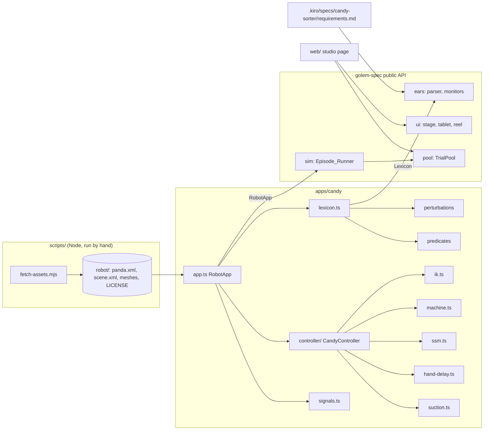
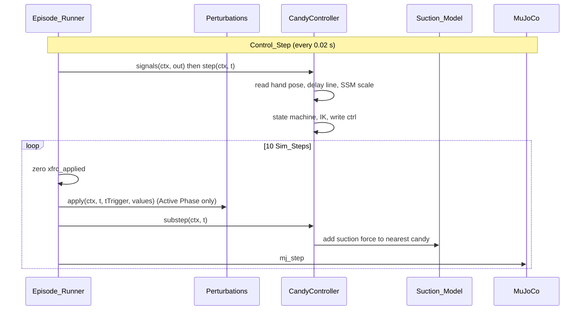
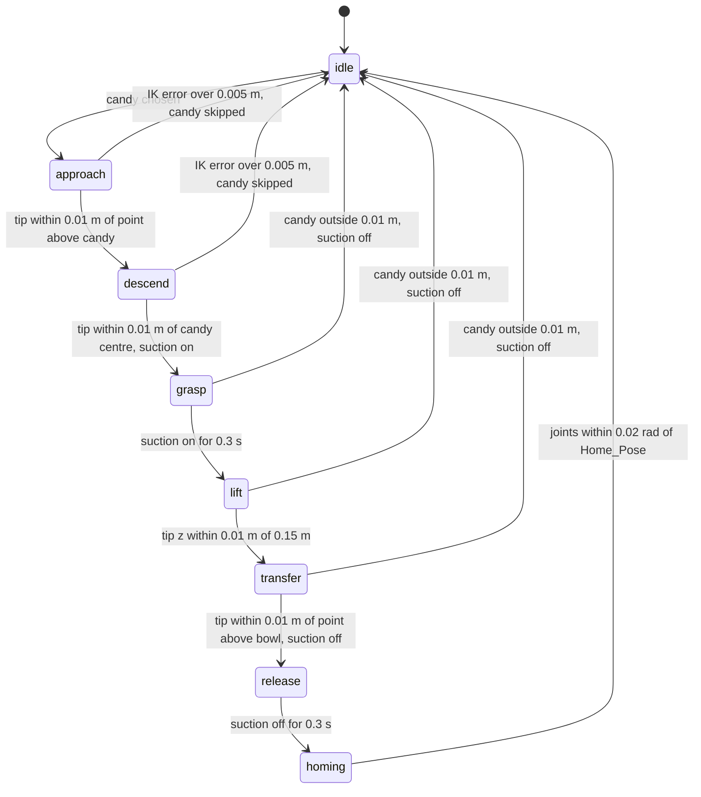

# Design Document

## Overview

candy-app is `apps/candy`: a Franka Emika Panda with a suction cup that sorts six pieces of Halloween candy into three bowls by colour while a hand reaches into the workspace. It is the second consumer of the skeleton. It proves that the EARS-to-physics pipeline handles a manipulator with a human-safety requirement, and it carries one deliberately incomplete safety function (SSM_v1) so that GOLEM has something real to break.

The design is a thin app layer on the fixed contracts in `.kiro/steering/interfaces.md`. It adds no field to those contracts except the optional items listed under "Cross-spec dependencies".

### Key design decisions

| Decision | Rationale |
|---|---|
| Suction is a capped spring-damper on `xfrc_applied`, with the candy body centre as reference point and the `tip` site placed 8 mm beyond the cup face, toward the candy (corrected during implementation: the first draft put it 8 mm inside the cup, which leaves a resting candy 10 to 20 mm from the site and out of the engage radius) | The candy cannot physically reach within 10 mm of its centre if the site sits on the cup face (a candy is up to 24 mm tall). With the site 8 mm inside the face, a candy touching the cup is 0 to 4 mm from the site, so the 0.01 m engage radius is reachable and leaves 6 mm of slack. |
| `k = 400 N/m`, `c = 2 N·s/m` | The hold margin is 2x or more (Requirement 3.9 calculation below). `c·Δt/m` stays at 0.8 for the lightest candy, inside the explicit-force stability region at `Δt = 0.002 s`. |
| Per-trial mutable parameters (vacuum ratio, tracker lag, candy colours, suction state) live in `data.userdata`, not in module state | `MjData` is created per trial and deleted with it. State cannot leak between trials, and trials stay bit-identical. |
| Setup perturbations (candy mass, candy positions, vacuum, lag) first act at the Trigger Time, and the controller starts picking at `t = warmup + 0.3 s` | The Episode_Runner makes no `apply` call during warm-up (golem-sim 5.7, 6.4). The 0.3 s gate lets candies settle after they are placed. |
| IK works on a scratch `MjData` owned by the controller | `data.qpos` stays untouched (Requirement 4.9) and the iterations need no write to the live state. |
| SSM_v1 is a pure function of the Tip position and the delayed hand pose | It makes "Tip only" (Requirement 6.2) a property of the function signature. |
| The hand-reach path teleports the mocap Hand from its parked pose to the table edge at the entry time | The Hand is a mocap body with no collision. A path from the parked pose to the table edge would add a free parameter that no requirement names. |

### Expected outcome (do not weaken)

SSM_v1 measures from the Tip only. A hand that passes near the elbow or wrist links while the Tip is more than 0.15 m away produces no Speed_Scale reduction. The requirement line `keep every link at least 0.10 m from the hand` is therefore **expected to be reported broken**. The falsifier should find a counterexample, and the design keeps that outcome visible:

- SSM_v1 gets no second distance check (Requirement 6.2).
- The requirement line, the monitor, and the tests are not weakened (Requirements 11.10, 11.12, 15.14).
- A broken line leads to a controller change in a later spec or an entry in `proposals.md`.

### Cross-spec dependencies

Two additive changes to the `Controller` contract are needed in `golem-sim`. Both are optional fields, so existing apps are unaffected. The fields are named here so the golem-sim spec can adopt them.

| Field | Why | Where it is called |
|---|---|---|
| `substep?(ctx: SimContext, t: number): void` | Suction must act every Sim_Step (0.002 s). `step` runs at 0.02 s, and a force held for 10 steps is unstable at `k = 400 N/m` for a 5 g candy. | Once per Sim_Step, after the Episode_Runner clears `xfrc_applied` and before `mj_step`, including during warm-up. It writes a force only while the Suction_Switch is on, so warm-up keeps `xfrc_applied` at 0 (golem-sim 5.7). |
| `dispose?(): void` | Requirement 14.4 needs the scratch `MjData` and the Jacobian buffers deleted exactly once. | Once at Trial end, also on error paths. |

Three further assumptions about other specs:

- The ears compiler passes the requirement Horizon to `PerturbationTemplate.dims` as the hidden slot `horizon` (a `Quantity`). When the slot is absent (unit tests) `dims` uses 3.0 s.
- `direction` slots arrive as an angle interval in radians, defined by golem-ears. The azimuth frame for this app is stated in "Hand-reach path".
- The Episode_Runner passes the same `ctx` object to `makeController` and `signals` for one Trial. The app uses that to share resolved ids (see Components, `ids.ts`).

## Architecture



### Per-step data flow inside one Trial



### Pick-and-place state machine



## Components and Interfaces

### Constants (`apps/candy/constants.ts`)

All numbers the requirements leave to the design. Frame: x forward from the Panda base, y to the left, z up. The origin is on the Table surface, directly under the Panda base axis. Angles are azimuth about +z, 0 along +x, counter-clockwise from above. The floor is at `z = -0.40 m`.

**Layout and geometry**

| Name | Value | Notes |
|---|---|---|
| Panda base | (0, 0, 0) | `link0` origin on the Table surface, near the Table's -x end |
| Table | x ∈ [-0.20, 1.00], y ∈ [-0.60, 0.60], top at z = 0, 0.04 m thick | static box geom `table` |
| Tray | x ∈ [0.34, 0.62], y ∈ [-0.16, 0.16] | candies spawn here; a flat marking geom without collision |
| Candy spawn dimensions | `candy.<i>.x` ∈ [0.35, 0.39], `candy.<i>.y` ∈ [-0.13, 0.13] | 0.04 m inside the Tray in x/y, leaves room for the overlap shift |
| Bowl `bowl_orange` (index 0) | centre (0.611, -0.382) | on an arc of radius 0.72 m about the base, at -32° |
| Bowl `bowl_purple` (index 1) | centre (0.720, 0.000) | at 0° |
| Bowl `bowl_green` (index 2) | centre (0.611, +0.382) | at +32° |
| Bowl shape | inner half-width 0.07 m (square), wall 0.01 m thick and 0.05 m high (four box geoms), floor a cylinder geom of radius 0.10 m and half-height 0.005 m (top at z = 0.010 m) | box and cylinder geoms only (Requirement 2.2) |
| Workspace | x ∈ [0.15, 0.90], y ∈ [-0.55, 0.55], z ∈ [0.00, 0.50] | contains the Tray, the Bowls, and the Tip's working volume. Every Table edge point lies outside it. |
| Workspace centre `C` | (0.55, 0.00) | origin of hand-entry rays |
| Home_Pose `q_home` | [0, -0.7854, 0, -2.3562, 0, 1.5708, 0.7854] rad | the Franka "ready" pose. All within joint limits. |
| Tip at Home_Pose | ≈ (0.307, 0, 0.482) | flange at ≈ 0.590 m, cup face at 0.490 m, site 0.008 m beyond the face. A test measures it: (0.3069, 0, 0.4823). |
| Hand start pose `S` | palm (0.55, 1.10, 0.30), yaw π/2 rad | the forearm points away from the Table along +y. |
| Distance of `S` from the Tip at Home_Pose | ≈ 1.145 m to the palm centre, ≈ 1.095 m to the palm surface | meets the 1.0 m minimum (Requirement 2.5). A test measures it against the surface. |
| Hand | palm sphere radius 0.05 m at the body origin; forearm capsule radius 0.04 m from the origin to 0.30 m along the body +x axis | yaw about z; the forearm extends from the palm toward the person |

**Candy**

| Name | Value |
|---|---|
| Count | 6 (`candy_0` … `candy_5`) |
| Shapes | `candy_i` for i = 0, 3: box, half-extents 0.010 m. i = 1, 4: sphere, radius 0.012 m. i = 2, 5: capsule lying along x, radius 0.008 m, half-length 0.008 m |
| Default mass | 0.020 kg for all, set with the geom `mass` attribute |
| Default colours in `rgba` | i mod 3 = 0 orange, 1 purple, 2 green. Each colour equals the `rgba` of exactly one Bowl (Requirement 2.14). |
| Run-time colour | `data.userdata[8 + i]` ∈ {0, 1, 2}, drawn by `initState`. The sort logic and the studio tint read it. The `rgba` only gives the default. |
| Vertical half-extent `h_i` | box 0.010 m, sphere 0.012 m, capsule 0.008 m |
| Overlap distance `D_OV` | 0.036 m (largest horizontal diameter 0.032 m plus 4 mm) |
| Resting speed | 0.05 m/s |

**Collision filter** (`contype` / `conaffinity` bit masks)

| Geom class | contype | conaffinity | Collides with |
|---|---|---|---|
| Table, Bowls (world) | 1 | 14 | arm links, candies, cup |
| Arm link collision geoms | 2 | 1 | world only |
| Suction cup | 8 | 5 | world, candies |
| Candy | 4 | 9 | world, cup |
| Hand geoms | 0 | 0 | nothing |

Panda collision geoms come with their own `contype`. The script rewrites the `collision` default class so that the links use 2 and 1. Candies do not collide with each other, which keeps spawn overlaps harmless. Requirement 2.9 lists no candy-candy pair.

**Scene settings**: `opt.timestep = 0.002`, `size nuserdata = 24`.

**`data.userdata` layout**

| Index | Content | Written by |
|---|---|---|
| 0 | Vacuum_Ratio (default 1) | `initState`, perturbation `the vacuum weakens to` |
| 1 | Tracker_Lag in s (default 0) | `initState`, perturbation `the hand tracker lags by` |
| 2 | active candy count (default 6; tests may set 1 to 6) | `initState` |
| 3 | Suction_Switch, 0 or 1 | controller |
| 4 | suction target candy index, -1 when none | Suction_Model |
| 5 | count of Vacuum_Ratio clamp warnings | Suction_Model |
| 6 | last Vacuum_Ratio value that was clamped | Suction_Model |
| 8 to 13 | candy colour index per candy | `initState` |
| 7, 14 to 23 | reserved | |

Inactive candies (index ≥ `userdata[2]`) are parked on the floor at (-0.60 - 0.05·i, 0.90, -0.38) and are left out of selection and of every count.

**Controller and suction parameters**

| Name | Value |
|---|---|
| Suction_Engage_Radius | 0.01 m, from the Tip site to the candy body centre `xpos` |
| Suction stiffness `k` | 400 N/m |
| Suction damping `c` | 2 N·s/m |
| Holding_Force | 3 N; effective cap `F_cap = 3 N × Vacuum_Ratio` |
| Tip site offset | 0.008 m beyond the cup face (on the candy side), `z` axis pointing out of the cup (down at Home_Pose) |
| Cup | cylinder radius 0.02 m, 0.100 m long, mounted on the flange with the same frame as the Menagerie hand mount (pos 0 0 0.107, quat 0.9238795 0 0 -0.3826834) |
| Nominal Tip speed `v_nom` | 0.50 m/s |
| Acceleration-up limit `a_up` | 2.5 m/s² (increases of commanded speed only; decreases are immediate) |
| Control gate `T_READY` | `warmup + 0.3 s = 1.3 s` |
| Slowdown_Distance / Stop_Distance | 0.40 m / 0.15 m |
| Hand delay line | length `N = ceil(0.3 / 0.02) + 1 = 16` samples of (x, y, z, yaw) |
| `distmax` | 0.6 m, for `mj_geomDistance` and for `min_link_hand_distance` when nothing is closer |
| Approach height above candy centre | 0.10 m |
| Lift height above Table | 0.15 m |
| Release height above Bowl centre | 0.10 m above the Table surface (0.05 m above the rim) |
| Dwell after suction on / off | 0.3 s |
| Guard radius at waypoints | 0.01 m |
| Home guard | all joints within 0.02 rad of `q_home` |

**IK parameters**

| Name | Value |
|---|---|
| Solver | damped least squares, `Δq = Jᵀ (J Jᵀ + λ² I)⁻¹ e` |
| Task rows (5) | 3 Tip position rows, then 2 tilt rows (rotation about world x and y) weighted by `w_t = 0.15 m/rad`. Rotation about the cup axis is free. |
| `λ0` | 0.05 |
| Adaptive rule | manipulability `μ = sqrt(det(J Jᵀ))`. If `μ ≥ μ0 = 0.02` then `λ = λ0`, otherwise `λ = λ0 + (λmax − λ0)(1 − μ/μ0)²` with `λmax = 0.20` |
| Per-iteration joint step limit | 0.10 rad on the largest joint step (the whole `Δq` is scaled down to meet it) |
| Iteration cap | 200 |
| Position tolerance | 1 mm |
| Tilt tolerance (convergence) | 1° (the stricter internal tolerance for the 5° requirement) |
| Skip threshold | Tip error above 0.005 m |
| Start configuration | the previous joint target (`q_home` at the first step), not `data.qpos` |
| Reachable box for tests | x ∈ [0.30, 0.78], \|y\| ≤ 0.40, `r = sqrt(x² + y²) ≤ 0.74`, z ∈ [0.00, 0.30] |

The Tip error that decides skipping is `|p_target − p_tip|` of the best configuration found.

### `scripts/fetch-assets.mjs`

Plain Node 20 ESM, no Python. One entry point with three modes.

| Mode | Behaviour |
|---|---|
| default | Downloads files from `https://raw.githubusercontent.com/google-deepmind/mujoco_menagerie/<MENAGERIE_COMMIT>/franka_emika_panda/…`, checks each against `ASSET_HASHES`, then writes `robot/`. |
| `--resolve` | Maintainer-only. Queries the GitHub API for the current head of Menagerie, downloads the file list, and **prints** the commit hash and the sha256 of each source file as a snippet to paste into the script. It writes nothing under `robot/`. |
| `--check` | Reports whether every output file exists with the expected hash. |

`MENAGERIE_COMMIT` (a full 40-character hash) and `ASSET_HASHES` (a map of file path to sha256) are constants in the script. **The values are resolved once by running `node scripts/fetch-assets.mjs --resolve` and pasting the output. This design does not invent them.** Until they are pasted, both constants are `null`, and the default mode exits non-zero with the message "Run --resolve once and paste the printed commit and hashes into scripts/fetch-assets.mjs."

Pipeline for one default run:

1. If every output exists with the expected content hash, print "Assets are current." and exit 0 (Requirement 1.7).
2. Download each source file (`panda_nohand.xml`, `LICENSE`, visual and collision meshes referenced by it) into memory. A network error or non-2xx status exits non-zero with the URL, the status, and the file path. A hash mismatch exits non-zero with the path and both hashes. Nothing is written until every file has been downloaded and verified, so earlier valid files stay unchanged (Requirements 1.8, 1.9).
3. Visual meshes: parse OBJ, simplify with `meshoptimizer`'s `MeshoptSimplifier` to at most 3000 faces (target index count 9000), write OBJ with fixed number formatting (`toFixed(6)`).
4. Collision meshes: simplify to at most 200 faces, then compute the convex hull with the small dependency-free quickhull in `scripts/lib/hull.mjs`, and write the hull as OBJ.
5. Patch `panda_nohand.xml` into `robot/panda.xml` with anchored string edits, each of which fails the script if its anchor is missing: add the cup body and `tip` site inside `link7`, replace the `collision` default class collision bits, set `nuserdata` in the scene. Remove the gripper if the source has one.
6. Write `robot/scene.xml` from `scripts/lib/scene.mjs`: table, tray marking, bowls, six candies, hand, lights, floor. All numbers are formatted with a fixed number of digits, and files and elements are written in sorted order with no timestamps (Requirement 1.6).
7. Copy the Menagerie `LICENSE` to `robot/LICENSE` (Requirement 1.2).
8. Write only below `apps/candy/robot/`. The process makes network calls only in an explicit run (Requirements 1.10, 1.12).

### `controller/` modules

All numeric work is in plain functions over preallocated `Float64Array`s. Only `index.ts` touches MuJoCo.

**`ids.ts`** resolves, once in `makeController`, the model ids the controller and the signals need, and stores them in a `WeakMap<SimContext, CandyIds>` keyed by `ctx`. The map holds derived, immutable data, so it does not change trial behaviour.

| Key (`ctx.ids`, `<type>:<name>`) | Use |
|---|---|
| `body:link0` … `body:link7`, `body:cup`, `body:hand`, `body:candy_0` … `body:candy_5` | velocities, positions |
| `geom:table`, `geom:hand_palm`, `geom:hand_forearm` | contact filter, distance |
| `joint:joint1` … `joint:joint7`, `joint:candy_0_free` … `joint:candy_5_free` | joint limits, qpos and qvel addresses |
| `actuator:actuator1` … `actuator:actuator7` | `data.ctrl` indices |
| `site:tip` | Tip position, velocity, Jacobian |

Arm_Collision_Geoms are collected by scanning `model.geom_contype` and `geom_bodyid` once: every geom of `link0` to `link7` with `contype = 2`, and the cup geom with `contype = 8`. The result is stored in an `Int32Array`.

**`ik.ts`**

```ts
interface IkResult { q: Float64Array; error: number; iterations: number; converged: boolean }
class IkSolver {
  constructor(mj: any, model: any, siteId: number)           // allocates scratch MjData, 2 DoubleBuffers, work arrays
  solve(target: Float64Array /*3*/, qStart: Float64Array /*7*/, out: IkResult): IkResult
  dispose(): void                                            // deletes scratch MjData and buffers once
}
```

`solve` copies `qStart` into the scratch `MjData`, then loops at most 200 times: `mj_kinematics`, `mj_comPos`, `mj_jacSite` into the two buffers, build the 5×7 `J` and the error `e = [p_target − p_tip; w_t·tilt_xy]`, compute `λ`, solve the 5×5 system `(J Jᵀ + λ² I) y = e` with an in-place Cholesky (the product of the diagonal gives `μ²`), set `Δq = Jᵀ y`, scale `Δq` so its largest element is at most 0.10 rad, add it to `q`, clamp to `jnt_range`. It keeps the best `q` by position error. The tilt error is `a × (0, 0, −1)` where `a` is the `z` axis of the `tip` site (`site_xmat`). The returned `error` is the best Tip position error in metres. If any Jacobian entry is not finite, `solve` returns `qStart` with `error = Infinity` (Requirement 4.11).

**`suction.ts`**

```ts
// per Sim_Step; adds into data.xfrc_applied, never clears it
function suctionStep(mj: any, ctx: SimContext, ids: CandyIds, ws: SuctionWorkspace): void
// pure core, tested without MuJoCo
function suctionForce(out: Float64Array /*3*/, tip: ArrayLike<number>, vTip: ArrayLike<number>,
                      candy: ArrayLike<number>, vCandy: ArrayLike<number>, cap: number): void
function sanitizeRatio(v: number): number    // clamp to [0,1], NaN/Infinity -> 0
```

`suctionStep` reads `userdata[3]` (switch) and `userdata[0]` (ratio). While the switch is off it returns without writing. Otherwise it picks the active candy nearest to the Tip by `|p_tip − xpos_candy|` (lower index on ties), and if that distance is at most 0.01 m it computes

```
F  = k (p_tip − p_candy) + c (v_tip − v_candy)
F' = F · min(1, F_cap / |F|)           (F' = 0 when |F| = 0)
```

and adds `F'` to rows `xfrc_applied[6·body + 0..2]` of that candy. The reaction on the cup is not applied (the suction is a model of an external air force). `data.userdata[4]` records the chosen index. A ratio outside [0, 1] or not finite is sanitised and counted in `userdata[5]`/`userdata[6]`; the controller exposes `warnings(): string[]` which builds the message ("Vacuum_Ratio 1.7 is outside [0, 1]; using 1") only when the count changed, so the common path allocates nothing.

**Hold and release calculation** (Requirements 3.9, 3.10):

- A candy resting on the cup face sits `d_c = h_i − 0.008 m` from the site: 0.002 m (box), 0.004 m (sphere), 0.000 m (capsule). So `d_c ≤ 0.004 m`.
- Worst-case force the suction must supply to a candy of mass `m` that follows a tip accelerating upward at `a`: `F_req = m (g + a)`. For `m = 0.020 kg`, `a = 5 m/s²`, `g = 9.81 m/s²`: `F_req = 0.020 × 14.81 = 0.296 N`. That is about one tenth of the 3 N cap, so the cap is not active.
- Spring deflection for that force: `e = F_req / k = 0.296 / 400 = 0.74 mm`.
- Distance bound: `|p_tip − p_candy| ≤ d_c + e ≤ 0.004 + 0.00074 = 0.00474 m`, which is less than 0.01 m by a factor of 2.1.
- At constant 0.5 m/s the damping term is `c·(v_tip − v_candy) = 0` once the candy follows the tip. The candy is at rest relative to the tip when suction turns on (the Tip dwells 0.3 s before the lift), so the damper adds no start-up error.
- Damping check: for 20 g, `2·sqrt(k m) = 5.66 N·s/m`, `ζ = 2 / 5.66 = 0.35`. The overshoot of the step response to a 5 m/s² onset is below 30 % of `e`, about 1 mm, inside the 5 mm of slack.
- Carry mass: the cap holds while `m (g + a) ≤ F_cap`, so `m_c = 3 N × VR / (g + a)`. For `a = 5 m/s²`: 0.2026 kg at VR = 1 and 0.1013 kg at VR = 0.5. For `a = 0`: 0.3058 kg at VR = 1. Every in-scene candy (at most 0.060 kg) is therefore held at any `a ≤ 5 m/s²`.
- The in-scene release limits: a 0.060 kg candy leaves at `a > 3/0.060 − 9.81 = 40.2 m/s²` (VR = 1) or `a > 1.5/0.060 − 9.81 = 15.2 m/s²` (VR = 0.5). An SSM stop that brings the Tip from 0.5 m/s to rest in a few control steps can reach those figures, which is why the weak-vacuum and heavy-candy requirements are worth falsifying.
- When `F_req > F_cap` the net force on the candy relative to the Tip is constant, so the displacement grows with constant acceleration `(F_req − F_cap)/m`. Example: `m = 1.2 · m_c = 0.243 kg` at `a = 5 m/s²` has `F_req = 3.6 N` and an excess acceleration of 2.47 m/s². The candy moves from the 7.5 mm cap-onset deflection to the 10 mm radius in `sqrt(2 × 0.0025 / 2.47) = 0.045 s`. Property 10 runs 0.5 s.
- Stability: for the lightest candy (5 g) `k Δt²/m = 0.32` and `c Δt/m = 0.8`. Both are inside the stable range for the semi-implicit Euler update with an explicit force. An example test runs candies from 5 g to 60 g with the cup at rest and checks the Trace stays finite.

**`ssm.ts`**

```ts
/**
 * SSM_v1 measures the separation from the suction-cup Tip only.
 * Every other link is unmonitored. This is the known limit of v1 and is
 * kept on purpose so that GOLEM can falsify it. Do not add a link check here.
 */
function separation(tip: ArrayLike<number>, hand: ArrayLike<number> /* x,y,z,yaw */): number
function speedScale(d: number): number
```

- `separation = max(0, min(|tip − palm| − 0.05, distToSegment(tip, palm, palm + 0.30·(cos yaw, sin yaw, 0)) − 0.04))`.
- `speedScale(d) = 0` if `d ≤ 0.15` or `d` is not finite; `1` if `d ≥ 0.40`; otherwise `(d − 0.15) / 0.25`. Non-finite hand coordinates make `d` non-finite, so the scale is 0 (Requirement 6.11).
- The function reads no model, no link position, and no velocity.

**`hand-delay.ts`**: a ring buffer in one `Float64Array(16 × 4)`. `push(x, y, z, yaw)` writes at `head`, then `read(lagSteps)` returns the sample `lagSteps` older. `lagSteps = clamp(round(lag / 0.02), 0, 15)`. On the first push all 16 slots are filled with that sample, so early reads never see garbage. The delay line is built once at construction and never grows (Requirement 14.5). `read(0)` is the sample just pushed (Requirement 6.10). The true Hand is never altered.

**`machine.ts`**: the transition table (below) as a frozen array `TRANSITIONS: readonly Transition[]` with `{ from, guard: GuardId, to, action: ActionId }` entries, plus `STATES` and a pure `next(state, guards): Transition | undefined`. The table is a plain data structure that a test can enumerate (Requirement 5.13). The machine has no wall-clock read and no `Math.random()`.

**`index.ts`: `CandyController`**

| Step (each Control_Step) | Action |
|---|---|
| 1 | Read the true hand pose from `mocap_pos` and `mocap_quat` (yaw = `2·atan2(qz, qw)`), push to the delay line, read the delayed pose with the lag from `userdata[1]`. |
| 2 | `scale = speedScale(separation(tip, delayedHand))`. |
| 3 | If `t < T_READY` or the state is `idle` with no candidate, hold the Home_Pose targets. |
| 4 | Evaluate guards from `site_xpos`, candy `xpos`, `userdata`, and the dwell timer (the dwell timer counts control steps: `n_dwell = round(0.3 / 0.02) = 15`). Take at most one transition. |
| 5 | The commanded speed is `v = min(v_nom · scale, v_prev + a_up·0.02)`. When `scale = 0` the controller keeps the previous joint targets and leaves the switch unchanged (Requirement 6.7). |
| 6 | Move the waypoint toward the goal by `min(v · 0.02, remaining distance)`, solve IK from the previous targets, write `data.ctrl[0..6]`. |
| 7 | Set `userdata[3]` from the machine state (on from `grasp` to `transfer`, off otherwise). |

`substep(ctx, t)` calls `suctionStep`. `dispose()` deletes the `IkSolver` handles once (idempotent after the first call).

**Candy selection rule** (Requirement 5.2). Over the active candies that are not in the skip mask and are on the Tray (centre inside the Tray rectangle and `z ≤ 0.04 m`), pick the one with the smallest `q = floor(1000 · sqrt(x² + y²))` (distance from the base axis in whole millimetres). Equal `q` is broken by the lower candy index. The rule reads only candy positions and ids. The skip mask is a `Uint8Array(6)` in the controller instance.

**State machine table**

`dwell` is the 15-control-step counter. `Tip≈P` means the Tip site is within 0.01 m of waypoint `P`. `lost` means a held candy is farther than 0.01 m from the Tip. `ikFail` means the IK error for the current waypoint exceeds 0.005 m.

| From | Guard | To | Action |
|---|---|---|---|
| `idle` | `t ≥ T_READY` and a candidate exists | `approach` | choose candy by the selection rule; goal = candy xy at 0.10 m above candy centre |
| `approach` | `ikFail` | `idle` | set the skip bit of the candy |
| `approach` | `Tip≈P_above` | `descend` | goal = candy centre + (0, 0, 0.005) |
| `descend` | `ikFail` | `idle` | set the skip bit |
| `descend` | distance Tip to candy centre ≤ 0.01 m | `grasp` | switch on, reset `dwell` |
| `grasp` | `lost` | `idle` | switch off |
| `grasp` | `dwell ≥ 15` | `lift` | goal = candy xy at z = 0.15 m |
| `lift` | `lost` | `idle` | switch off |
| `lift` | `|tip_z − 0.15| ≤ 0.01` | `transfer` | goal = point 0.10 m above the Bowl of the candy's colour |
| `transfer` | `lost` | `idle` | switch off |
| `transfer` | `Tip≈P_bowl` | `release` | switch off, reset `dwell` |
| `release` | `dwell ≥ 15` | `homing` | goal = `q_home` (joint-space ramp, 0.5 rad/s) |
| `homing` | all joints within 0.02 rad of `q_home` | `idle` | none |
| any | none of the above | same | hold |

`ikFail` is evaluated only in `approach` and `descend`: those are the states that move to a new target after a choice. In the other states the target is reached by following a straight line that was reachable at the previous waypoint. The `lost` transition does not set a skip bit, so the candy becomes a new candidate (Requirement 5.11).

### `signals.ts`

`signals(ctx, out)` runs once per Control_Step, before the Sim_Steps of that step.

| Signal | Computation |
|---|---|
| `min_link_hand_distance` | One buffer from the Buffer_Helper holds the `fromto` array for all pairs. For every Arm_Collision_Geom and each of `hand_palm`, `hand_forearm`: `mj_geomDistance(m, d, g1, g2, 0.6, fromto)`. Result = minimum, which is `0.6` when no pair is closer. It uses the true Hand pose in `data`, not the delayed one. `mj_geomDistance` does not apply contype filtering, and a test checks that for a filtered pair. |
| `fastest_link_speed` | For `link0` to `link7` and `cup`: `mj_objectVelocity(m, d, mjOBJ_BODY, id, res6, 0)` into a buffer, then the norm of `res6[3..5]` (world frame, at the body centre of mass). Maximum. |
| `tip_speed` | The same call for `mjOBJ_SITE` and the `tip` site. |
| `candies_sorted`, `candies_misplaced`, `candies_dropped_outside`, `candies_active` | `classifyCandies(...)`, below. |
| `table_force` | The Contact_Iterator visits `data.contact` once. For each contact whose two geoms are one Arm_Collision_Geom and the `table` geom, `mj_contactForce(m, d, i, res6)` into a buffer, and `res6[0]` (normal force, N) is summed. |
| `hand_in_workspace` | 1 when the palm centre (`xpos` of `hand`) is inside the Workspace box, else 0. |

`candies_active` is an addition to the eight signals of Requirement 7.1. The `drop every candy` predicate needs the number of candies in the Trial and cannot derive it from the other signals.

**Candy classification** (pure function over positions, linear speeds, colours, active flags):

- A candy is **resting** when its linear speed is at most 0.05 m/s (Requirement 7.13).
- A candy is **in Bowl `b`** when `|x − bx| ≤ 0.07`, `|y − by| ≤ 0.07`, and `0 ≤ z ≤ 0.06 m` (centre height above the Table).
- `candies_sorted` counts resting candies in the Bowl whose index equals the candy colour. `candies_misplaced` counts resting candies in any other Bowl.
- `candies_dropped_outside` counts active candies with `z ≤ 0.04 m` that are in no Bowl and inside no Tray rectangle. That includes candies on the Table outside the Tray and candies on the floor (`z < 0`). A candy carried at 0.15 m is not counted, and a dropped candy counts once it is low.
- `candies_active` is the number of active candies.

### `lexicon.ts`

`robotNames = ['arm', 'Panda', 'robot']`.

**Predicates** (each `margin` returns `-Infinity` when any input is not finite):

| `phrase` | `signals` | Margin | Unit |
|---|---|---|---|
| `drop every candy into the bowl of its colour within {duration}` | `candies_sorted`, `candies_misplaced`, `candies_dropped_outside`, `candies_active` | `n = candies_active − candies_sorted`. Margin = `+1` if `n = 0`, else `−n`. The monitor takes the maximum over the window ("eventually within"), so the line holds if all candies are sorted at some instant of the window. | `candies` |
| `keep every link at least {length} from the hand` | `min_link_hand_distance` | `min_link_hand_distance − length` | `m` |
| `keep its fastest link below {speed}` | `fastest_link_speed` | `speed − fastest_link_speed` | `m/s` |
| `not drop a candy outside the bowls` | `candies_dropped_outside` | `0.5 − candies_dropped_outside` | `candies` |
| `never press on the table with more than {force}` | `table_force` | `force − table_force` | `N` |

The slot `{duration}` of the first phrase is the window length that the monitor uses; the margin function itself is instantaneous. A `length` above 0.6 m gives a negative margin whatever the arm does, because the signal saturates at `distmax`. The compiler reports a warning for such a line.

**Perturbations**

| `phrase` | Dimensions | `apply` |
|---|---|---|
| `a hand reaches in from {direction} at {range:speed}` | `hand.angle` (`angle`, `wrap` true when `any direction`, otherwise the interval of the direction slot), `hand.speed` (`speed`, severity `up`, range from the slot), `hand.entry` (`duration`, [0, Horizon], severity `none`), `hand.height` (`length`, [0.05, 0.25] m above the Table, severity `none`) | Writes `mocap_pos` and `mocap_quat` of `hand` from the path model below. |
| `the candies weigh {range:mass}` | `candy.mass` (`mass`, severity `up`) | Sets `body_mass` of every candy to the value and scales `body_inertia` by `m_new / m_current`. Idempotent. The Episode_Runner restores the model (golem-sim 3.8). |
| `the vacuum weakens to {ratio}` | `vacuum.ratio` (`ratio`, severity `down`). The slot takes a single ratio (fixed) or a range, the same way `{range:kind}` does. | Writes `userdata[0]`. |
| `the hand tracker lags by {range:duration}` | `tracker.lag` (`duration`, severity `up`) | Writes `userdata[1]`. |
| `candies land anywhere on the tray` | `candy.<i>.x`, `candy.<i>.y` for i = 0 … 5 (`length`, severity `none`, x ∈ [0.35, 0.39], y ∈ [-0.13, 0.13]) | At the first Sim_Step of the Active Phase (`|t − tTrigger| < simDt/2`) places each candy: resolve overlaps, write `qpos` (free joint position and identity quaternion, `z = h_i`) and zero `qvel`. |

`apply` clamps every value to its Dimension range before use (Requirement 9.16). It allocates nothing; all intermediate values are scalars.

**Defaults** (Requirement 9.18): `initState` writes `userdata[0] = 1`, `userdata[1] = 0`, `userdata[2] = 6`. A requirement that names none of the three perturbations leaves them.

**Hand-reach path.** Let `θ = hand.angle`, `h = hand.height`, `v = hand.speed`, `τ = t − tTrigger − hand.entry`.

1. Entry point `E`: from `C = (0.55, 0)` along `(cos θ, sin θ)` to the Table boundary. With `d = (cos θ, sin θ)`: `t_x = (1.00 − 0.55)/d.x` if `d.x > 0`, `(−0.20 − 0.55)/d.x` if `d.x < 0`, `∞` if `d.x = 0`; `t_y = ±0.60/d.y` likewise. `E = C + min(t_x, t_y)·d` at height `h`. `E` is outside the Workspace by construction, since the Table edge is outside the Workspace box on every side.
2. Target `T`: the Bowl centre with the smallest horizontal distance to `E` (lower index on ties), at height `h`.
3. Before the entry (`τ < 0`) the Hand stays at `S` with yaw π/2.
4. From the entry the Hand appears at `E` (no ramp, because the Hand collides with nothing and the entry models a person's hand appearing at the Table edge), then moves toward `T` along the straight line: `p(τ) = E + (T − E)/|T − E| · min(v·τ, |T − E|)`. After arrival it holds at `T`.
5. Yaw is `θ`, so the forearm extends from the palm back toward the Table edge it came from.

The path depends only on `t`, `tTrigger`, and the values.

**Candy placement and overlap rule.** For candy `i` in order 0 … 5, start at `(x_i, y_i)`. While some earlier candy `j < i` has a horizontal centre distance below `D_OV = 0.036 m`, add 0.01 m to `x_i`. The rule uses the already-shifted positions of earlier candies and nothing else. With all six at the same point, the shifts are 0.04 m each, so the last candy ends at `x ≤ 0.39 + 5 × 0.04 = 0.59 m`, 0.03 m inside the Tray's `x = 0.62 m` edge.

### `app.ts`: the RobotApp

| Field | Value |
|---|---|
| `id` | `'candy'` |
| `name` | `'Candy sorter (Franka Panda)'` |
| `files()` | Reads `robot/` (Node: `node:fs`; browser: `fetch` of the Vite-served static files). Returns each file keyed by its path under `/robot`. |
| `sceneFile` | `'scene.xml'` |
| `simDt`, `controlDt`, `warmup` | 0.002, 0.02, 1.0 |
| `lexicon` | `candyLexicon` |
| `makeController(ctx, rng)` | Builds `CandyController` (resolves ids, creates `IkSolver`, delay line, skip mask). |
| `signals(ctx, out)` | See `signals.ts`. |
| `initState(ctx, rng)` | Sets the Panda `qpos` and `ctrl` to `q_home`; writes defaults to `userdata`; then for i = 0 … 5 draws `u_x`, `u_y`, `u_c` in this fixed order (18 draws): `x_i = 0.35 + 0.04·u_x`, `y_i = −0.13 + 0.26·u_y`, colour `floor(3·u_c)`; applies the overlap rule; places candies; parks inactive candies. |

Imports come only from `golem-spec`, `golem-spec/ui`, and `golem-spec/node`. The file runs unchanged in Node and in the browser; only `files()` branches on the runtime.

### Handle hygiene plan (Requirements 3.14, 4.10, 7.12, 10.13, 14.2 to 14.4)

| Handle | Created | Deleted |
|---|---|---|
| Scratch `MjData` of the IK solver | `makeController`, once | `dispose()`, once |
| Jacobian `DoubleBuffer`s (`jacp`, `jacr`, 3×7 each) | `makeController`, once | `dispose()`, once |
| `fromto` buffer for `mj_geomDistance` | Buffer_Helper, once per `signals` call, shared by all pairs | by the helper |
| Velocity result buffer (6) | Buffer_Helper, once per `signals` call | by the helper |
| `data.contact` vector | Contact_Iterator, once per `signals` call | by the iterator |
| `mj_contactForce` result buffer (6) | Buffer_Helper, wrapped around the contact iteration | by the helper |

`step` and `substep` allocate no object, array, closure, or string; they work on typed arrays created in the constructor. `signals` runs at control rate and may use the helpers. The Handle_Counter test covers every row.

### `web/` studio page

```
web/
  index.html        Vite entry; mobile viewport; no external fonts or scripts
  main.ts           boot: load app, build stage, tablet, reel, pool; wire events
  studio.ts         live simulation worker client, ghost swarm, reel, replay
  live.worker.ts    one MuJoCo instance, runs the app, receives hand targets, posts poses and signals
  hand-drag.ts      pointer/touch drag, height slider, keyboard stepping, speed limit, clamp
  hud.ts            live min_link_hand_distance, tip_speed, candies_sorted
  tablet.ts         binds requirement lines to editable quantity controls
  style.css         design tokens from design-language.md
  vite.config.ts    optimizeDeps.exclude: ['@mujoco/mujoco']
```

- The page imports only `golem-spec` and `golem-spec/ui`. It uses the "Vltava clay at midnight" tokens, B612 and B612 Mono (self-hosted files), and sentence-case messages.
- **Layout**: the stage is full bleed. On at least 1024 px the tablet is a 380 px column at the left and the reel sits under the stage. On a phone the stage is 56vh, the primary actions ("Summon 64 ghosts", "Reach in", "Reset hand") sit directly under it, then the tablet and the reel.
- **Hand drag** (`hand-drag.ts`): `pointerdown/move/up` handlers cover mouse and touch. A pick ray from the camera is intersected with the plane `z = h`, where `h` ∈ [0.05, 0.25] m comes from a slider. The target is clamped to a disc of radius 1.5 m about the Table centre (0.40, 0). Each frame the Hand moves toward the target by at most `3 m/s × Δt`. On release the Hand stays where it is until the next drag or the reset button. Keyboard: arrow keys move the target by 0.05 m, Page Up and Page Down change the height by 0.05 m.
- **Tablet**: each EARS line shows its quantities as controls; an edit marks the line "running" in under 100 ms, sends the changed requirement to the TrialPool, and updates the line when the result arrives.
- **Failing trial**: its ghost is drawn in `--break` and added to the reel. "Replay the fall" replays its poses. A failing requirement line shows the fracture mark.
- **Rendering**: render on demand (simulating, dragging, or replaying), pixel ratio capped at 1.5, paused off-screen. With `prefers-reduced-motion` ghosts appear without the rise and replays step frame by frame.
- **Candy colours**: the stage tints each candy from `userdata[8 + i]` of the live worker, not from the `rgba` default.
- No network access except static assets and no analytics (Requirement 12.15). Errors name what broke and how to fix it, for example "Assets are missing from robot/: run node scripts/fetch-assets.mjs."

### File layout

```
apps/candy/
  package.json            deps: golem-spec; scripts: assets, test, dev
  tsconfig.json           strict, extends tsconfig.base.json
  constants.ts            every number in the constants tables
  app.ts                  RobotApp
  lexicon.ts              predicates and perturbations
  geometry.ts             pure helpers: hand path, overlap rule, candy classification, SSM separation
  controller/
    index.ts              CandyController
    ids.ts                id resolution, Arm_Collision_Geoms
    ik.ts                 IkSolver
    machine.ts            STATES, TRANSITIONS, next()
    ssm.ts                separation, speedScale
    hand-delay.ts         ring buffer
    suction.ts            suctionStep, suctionForce, sanitizeRatio
  scripts/
    fetch-assets.mjs
    lib/{obj.mjs, hull.mjs, patch.mjs, scene.mjs, hash.mjs}
  robot/                  generated: panda.xml, scene.xml, assets/*.obj, LICENSE
  web/                    studio page (see above)
  test/                   Vitest and fast-check files (see Testing Strategy)
  .kiro/
    specs/candy-sorter/requirements.md
    hooks/gate.json       agentStop hook running `golem gate`
```

`controller/` holds only what the structure rule names; `geometry.ts` and `constants.ts` sit at the app root so `lexicon.ts` and the controller can share them without a cycle.

### The app's own requirements (`apps/candy/.kiro/specs/candy-sorter/requirements.md`)

Standard Kiro format with an Introduction, a Glossary, and numbered Requirements. Each line starts with its id, holds one behaviour, and carries units. Content outline (the file is written in the implementation task, not here):

| Theme | EARS shape (indicative) |
|---|---|
| Separation from the hand | `WHEN a hand reaches in from any direction at up to 1.5 m/s THE arm SHALL keep every link at least 0.10 m from the hand` (expected to break against SSM_v1) |
| Fastest link near a hand | `WHILE the hand is in the workspace THE arm SHALL keep its fastest link below …` using the same hand perturbation |
| Table contact force | `THE arm SHALL never press on the table with more than …` |
| Candies dropped outside | `THE arm SHALL not drop a candy outside the bowls` |
| Sorting success | `WHEN candies land anywhere on the tray THE arm SHALL drop every candy into the bowl of its colour within …` |
| Heavier candies | `WHEN the candies weigh 0.005 kg to 0.060 kg THE arm SHALL …` the sorting response |
| Weaker vacuum | `WHEN the vacuum weakens to 0.5 to 1 THE arm SHALL …` |
| Lagging tracker | `WHEN the hand tracker lags by up to 0.3 s and a hand reaches in … THE arm SHALL …` |

The exact numbers are fixed when the file is written. They stay at the harshest believable values (hand speed up to 1.5 m/s, candy mass 0.005 to 0.060 kg, vacuum ratio 0.5 to 1, tracker lag up to 0.3 s). The file is never edited to make a run pass.

## Data Models

```ts
// constants.ts (excerpt; all SI)
export const TABLE = { xMin: -0.20, xMax: 1.00, yMin: -0.60, yMax: 0.60 } as const;
export const TRAY = { xMin: 0.34, xMax: 0.62, yMin: -0.16, yMax: 0.16 } as const;
export const WORKSPACE = { xMin: 0.15, xMax: 0.90, yMin: -0.55, yMax: 0.55, zMin: 0, zMax: 0.50 } as const;
export const BOWLS: readonly { name: string; x: number; y: number }[];       // index = colour index
export const Q_HOME: readonly number[];                                       // 7 joint angles
export const HAND_START: { x: number; y: number; z: number; yaw: number };
export const SUCTION = { k: 400, c: 2, holdingForce: 3, engageRadius: 0.01 } as const;
export const SSM = { slowdown: 0.40, stop: 0.15 } as const;
export const UD = { vacuum: 0, lag: 1, count: 2, switch: 3, target: 4, warnCount: 5, warnValue: 6, colour: 8 } as const;

// controller state (one instance per Trial)
interface CandyController extends Controller {
  step(ctx: SimContext, t: number): void;
  substep(ctx: SimContext, t: number): void;     // additive, see Cross-spec dependencies
  dispose(): void;                               // additive
  warnings(): string[];
}
interface MachineState {
  state: StateId; candy: number; skip: Uint8Array /*6*/; dwell: number;
  goal: Float64Array /*3*/; wp: Float64Array /*3*/; vPrev: number;
  qTarget: Float64Array /*7*/;
}
interface Transition { from: StateId | 'any'; guard: GuardId; to: StateId; action: ActionId }

// geometry.ts
interface CandyState { x: number; y: number; z: number; speed: number; colour: number; active: boolean }
interface CandyCounts { sorted: number; misplaced: number; droppedOutside: number; active: number }
function classifyCandies(c: readonly CandyState[], out: CandyCounts): CandyCounts;
function handPose(out: Float64Array /*4: x,y,z,yaw*/, t: number, tTrigger: number,
                  v: { angle: number; speed: number; entry: number; height: number }): void;
function resolveOverlaps(xy: Float64Array /*12*/): void;      // in place, deterministic
function chooseCandy(pos: Float64Array /*6x3*/, active: Uint8Array, skip: Uint8Array): number; // -1 if none
```

Scenario values, Trace, and TrialSpec are the contract types in `interfaces.md`. The only new persisted data is under `apps/candy/robot/` (generated) and `.golem/` (written by the CLI).

## Correctness Properties

*A property is a characteristic or behavior that should hold true across all valid executions of a system-essentially, a formal statement about what the system should do. Properties serve as the bridge between human-readable specifications and machine-verifiable correctness guarantees.*

Reflection: acceptance criteria that only describe packaging, UI look, or meta-requirements on the test suite (Requirements 1.1 to 1.3, 1.6 to 1.12, 10.1 to 10.5, 10.11, 11.1, 11.9 to 11.12, 12.x, 13.1, 13.2, 13.5 to 13.10, 14.6, 14.8, 15.x) are covered by examples and smoke tests in the Testing Strategy, not by properties. Criterion 3.11 is merged into Property 4. Criteria 4.2 and 4.3 are merged into Property 11. Requirements 6.3 to 6.5 and 6.8 are one property. The statements about Trial determinism, bit-identical force, and `initState` are kept apart because they fail for different reasons.

### Property 1: Mesh pipeline respects face bounds

For any generated triangle mesh, the visual pipeline returns a mesh with at most 3000 faces, and the collision pipeline returns a convex mesh with at most 200 faces whose vertices all lie on or inside the hull of the simplified vertices.

**Validates: Requirements 1.4, 1.5**

### Property 2: Scene structure invariants

For any required object name in `{link0..link7, cup, table, bowl_orange, bowl_purple, bowl_green, candy_0..candy_5, hand, hand_palm, hand_forearm}` and the site `tip`, the compiled model resolves exactly one object of the right type. For any candy geom, its shape is a box, sphere, or capsule, its mass is in [0.005, 0.060] kg, and its `rgba` equals the `rgba` of exactly one Bowl. The model has seven position actuators and none for the cup, `opt.timestep` is 0.002 s, and the Hand at its start pose is at least 1.0 m from the Tip at the Home_Pose.

**Validates: Requirements 2.1, 2.2, 2.3, 2.4, 2.5, 2.6, 2.7, 2.8, 2.10, 2.11, 2.14, 15.12**

### Property 3: Collision filter table

For any pair of geoms in the compiled model, the pair can collide if and only if the class pair is one of world-arm link, world-cup, world-candy, or cup-candy. No pair that includes a Hand geom can collide.

**Validates: Requirements 2.9**

### Property 4: Suction force is capped, directed, and follows the spring-damper law

For any Tip and candy positions and velocities, any ratio in [0, 1], and Holding_Force 3 N, `suctionForce` returns a vector whose magnitude is at most `3 · ratio`, whose direction equals that of `k(p_tip − p_candy) + c(v_tip − v_candy)` whenever that vector is nonzero, and whose value equals that vector exactly when the vector's magnitude is at most the cap. The maximum magnitude at ratio 0.5 is 1.5 N.

**Validates: Requirements 3.2, 3.3, 3.4, 3.5, 3.11**

### Property 5: Vacuum ratio sanitising

For any double `r` (including negative values, values above 1, `NaN`, and `±Infinity`), `sanitizeRatio(r)` is in [0, 1], equals `r` when `r ∈ [0, 1]`, equals 0 when `r` is not finite, and a warning that names the original value is recorded exactly when `r` was changed.

**Validates: Requirements 3.12**

### Property 6: Switch gating and single target

For any set of candy positions with the switch off, the force on every candy is exactly 0 N. With the switch on, force is applied to at most one candy: the active candy nearest to the Tip when its distance is at most 0.01 m, with the lower index winning equal distances, and to none when no candy is within 0.01 m. The Suction_Model writes force only on the first Sim_Step after the switch turns on or later, and exactly 0 from the first Sim_Step after it turns off.

**Validates: Requirements 3.2, 3.6, 3.7, 3.8**

### Property 7: Suction adds without disturbing other forces

For any initial content of `xfrc_applied`, after `suctionStep` every row not belonging to the target candy is unchanged, and the target candy's translational force changed by exactly the suction force.

**Validates: Requirements 3.13**

### Property 8: Suction is a pure function

For any Trial state, switch, ratio, and time, two evaluations of `suctionForce` give bit-identical outputs.

**Validates: Requirements 3.15**

### Property 9: A 20 g candy stays within the engage radius

For any candy shape of the six scene shapes, any constant Tip speed in [0, 0.5] m/s, and any Tip acceleration direction with magnitude up to 5 m/s², a 20 g candy attached with Vacuum_Ratio 1 stays within 0.01 m of the Tip for the whole move in the fixture world.

**Validates: Requirements 3.9, 15.3**

### Property 10: Candies above the carry mass slip

For any mass `m > 1.05 · 3·VR/(g + a)` with `a` in (0, 5] m/s² and `VR` in [0.5, 1], a candy attached by suction while the fixture Tip accelerates upward at `a` leaves the 0.01 m radius within 0.5 s, and the applied force magnitude equals `3·VR` during the slip.

**Validates: Requirements 3.10, 15.4**

### Property 11: IK step equals the damped-least-squares reference

For any generated 5×7 Jacobian with full row rank or near-singular rank, error vector `e`, and `λ` from the adaptive rule, the solver's `Δq` equals the dense reference `Jᵀ(J Jᵀ + λ²I)⁻¹ e` within 1e-9 relative error before the step limit is applied.

**Validates: Requirements 4.2, 4.3**

### Property 12: IK converges on reachable points

For any target in the reachable box of the constants table, the solver returns a Tip error of at most 1 mm in at most 200 iterations, and the cup axis points down within 5°.

**Validates: Requirements 4.5, 4.8, 15.2**

### Property 13: IK failure contract

For any target outside the reachable envelope (distance from the base above 0.9 m, or below the table by more than 0.05 m), the solver stops after at most 200 iterations and the reported error equals the actual Tip error of the returned joints. When a Jacobian entry is not finite, the solver returns the start configuration and `Infinity`.

**Validates: Requirements 4.6, 4.11**

### Property 14: IK joint limits and step limit

For any target and start configuration, including starts within 0.05 rad of a singular configuration, every returned joint target lies inside the joint limits and no single iteration changes any joint by more than 0.10 rad.

**Validates: Requirements 4.4, 4.12**

### Property 15: IK is deterministic and leaves state untouched

For any target and start configuration, two calls return bit-identical joint targets, and `data.qpos` is bit-identical before and after each call.

**Validates: Requirements 4.7, 4.9**

### Property 16: Candy selection depends only on positions and ids

For any candy positions, active flags, and skip mask, `chooseCandy` returns the on-Tray, active, non-skipped candy with the smallest `floor(1000·distance from the base axis)`, with the lower id winning equal values. It returns the same result for any permutation of the evaluation order and when unrelated state changes, and returns -1 when no candidate exists.

**Validates: Requirements 5.2, 5.10**

### Property 17: Transition table is enumerable and total

For any state and any combination of guard values, `next` returns at most one transition whose `from` matches, every `to` is a state in `STATES`, every state is reachable from `idle`, and `lost` or `ikFail` always lead to `idle`. The nominal chain `idle → approach → descend → grasp → lift → transfer → release → homing → idle` exists, and the table is the only source of transitions.

**Validates: Requirements 5.3, 5.4, 5.5, 5.6, 5.7, 5.8, 5.9, 5.11, 5.12, 5.13**

### Property 18: Speed scale range, boundaries, and monotonicity

For any `d ≥ 0`, `speedScale(d)` is in [0, 1], equals 1 for `d ≥ 0.40`, equals 0 for `d ≤ 0.15`, equals `(d − 0.15)/0.25` between, and for any `d1 ≤ d2` satisfies `speedScale(d1) ≤ speedScale(d2)`.

**Validates: Requirements 6.3, 6.4, 6.5, 6.8, 15.5**

### Property 19: SSM measures from the Tip only

For any two states with the same Tip position and the same hand pose but different joint configurations and link positions, the Speed_Scale is equal, and equals `speedScale(separation(tip, hand))` computed from those two inputs.

**Validates: Requirements 6.1, 6.2**

### Property 20: Commanded speed follows the scale, and a non-finite hand stops the arm

For any nominal speed, previous speed, and Speed_Scale, the commanded Tip speed is at most `v_nom · scale`; when the scale is 0 the joint targets and the Suction_Switch are unchanged from the previous step; when any hand coordinate is not finite the scale is 0.

**Validates: Requirements 6.6, 6.7, 6.11**

### Property 21: Delay line reads the sample `lag` steps earlier

For any sequence of at least 16 hand samples and any lag in [0, 0.3] s, `read` returns the sample `clamp(round(lag/0.02), 0, 15)` steps older than the newest, and the newest sample when the lag is 0. Pushing never grows the buffer.

**Validates: Requirements 6.9, 6.10, 14.5**

### Property 22: Tracker lag changes only the controller's reading

For any scenario and any two `tracker.lag` values, the true Hand pose in the Trace is identical, and the controller's delayed read differs only through the delay line.

**Validates: Requirements 9.11, 9.12**

### Property 23: Link-hand distance signal

For any Hand pose and arm configuration in the fixture, `min_link_hand_distance` equals the minimum of the per-pair signed distances over all Arm_Collision_Geoms and both Hand geoms, is at most 0.6 m, and equals 0.6 m exactly when no pair is closer than 0.6 m.

**Validates: Requirements 7.2, 7.14**

### Property 24: Candy classification and workspace test

For any candy states, `candies_sorted + candies_misplaced + candies_dropped_outside ≤ candies_active`; a candy with speed above 0.05 m/s is in neither `sorted` nor `misplaced`; a resting candy in the Bowl of its colour counts as sorted and in any other Bowl as misplaced; a low candy outside every Bowl and the Tray counts as dropped; a candy above 0.04 m outside every Bowl is not counted as dropped. `hand_in_workspace` is 1 exactly when the palm centre lies in the Workspace box.

**Validates: Requirements 7.5, 7.6, 7.7, 7.9, 7.13**

### Property 25: Predicate margins are sound

For any signal values and slot values in range, each predicate's margin is positive if and only if the predicate holds; equals the formula in the Components table (`min_link_hand_distance − length`, `speed − fastest_link_speed`, `0.5 − candies_dropped_outside`, `force − table_force`); for `drop every candy` equals `+1` when `candies_active − candies_sorted = 0` and `−(candies_active − candies_sorted)` otherwise; the sign flips when the threshold crosses the signal; and two evaluations give equal results.

**Validates: Requirements 8.2, 8.3, 8.4, 8.5, 8.6, 8.7, 8.8, 8.9, 8.10, 8.11, 8.12, 15.6**

### Property 26: Margins are monotone in the threshold

For any signal value and thresholds `a ≤ b`, the margin of `keep every link at least {length}` at `b` is at most its margin at `a`, the margin of `keep its fastest link below {speed}` at `b` is at least its margin at `a`, and likewise for `never press` (non-decreasing in `force`).

**Validates: Requirements 8.14, 8.15**

### Property 27: Non-finite input gives negative infinity

For any predicate and any input vector with at least one `NaN` or `±Infinity` signal value, the margin is `-Infinity`.

**Validates: Requirements 8.13**

### Property 28: Hand path

For any `(θ, v, entry, h)` in the Dimension ranges and any `t`: before `tTrigger + entry` the Hand pose is the start pose; the pose depends only on `t`, `tTrigger`, and the values; after the entry it starts at the Table-edge point `E(θ)` outside the Workspace; its distance to the target Bowl never increases and reaches 0; it holds at the Bowl centre afterwards; and its speed is at most `v`.

**Validates: Requirements 9.2, 9.3, 9.4, 9.5, 9.6, 15.15**

### Property 29: Candy mass is set and restored

For any mass in [0.005, 0.060] kg, after the perturbation applies every candy has that mass and its inertia is scaled by the same factor, applying twice equals applying once, and after the Trial the model's `body_mass` and `body_inertia` are bit-identical to their values before it.

**Validates: Requirements 9.8, 9.9**

### Property 30: Candy placement and the overlap rule are deterministic

For any six `(x, y)` pairs in the spawn ranges, `resolveOverlaps` returns the same positions on equal inputs; after it, every pair is at least 0.036 m apart horizontally; only `x` coordinates change and only upward in steps of 0.01 m; each later candy's shift depends only on earlier candies; and every candy lies inside the Tray.

**Validates: Requirements 9.13, 9.14, 9.15**

### Property 31: Out-of-range scenario values are clamped

For any Scenario value (including `NaN`-free values far outside the range), every perturbation `apply` clamps it into its Dimension range and does not throw.

**Validates: Requirements 9.16**

### Property 32: Parser round trip over candy phrases

For any valid EARS line built from the Candy_Lexicon phrases and generated quantities, `parse(format(parse(line)))` equals `parse(line)`.

**Validates: Requirements 15.7**

### Property 33: Every requirement line compiles

For every acceptance criterion line of the Candy_Requirements_File, compilation against the Candy_Lexicon returns no error, and the file contains at least one line for each of the eight themes of Requirement 11.4, including the two pairings of Requirements 11.2 and 11.3.

**Validates: Requirements 11.2, 11.3, 11.4, 11.8, 15.9**

### Property 34: `initState` is deterministic

For any seed, two `initState` calls on fresh data give bit-identical `qpos` and `userdata`, draw exactly 18 values in the fixed order, place the Panda at `q_home`, and give colours in {0, 1, 2}.

**Validates: Requirements 10.7, 10.8, 10.9**

### Property 35: Trials are deterministic

For any scenario in the Dimension ranges and any seed, running the same `TrialSpec` twice in the same runtime returns bit-identical `t`, `signals`, `events`, `robustness`, and `worstAt`.

**Validates: Requirements 10.6, 10.12, 14.1, 15.8**

### Property 36: Handles are returned

For any Trial (including a Trial that stops early or throws in `apply`), the Handle_Counter after the Trial equals its value before it, and `dispose` called twice deletes each handle once.

**Validates: Requirements 3.14, 4.1, 7.12, 10.13, 14.3, 14.4, 14.7, 15.10**

### Property 37: Source hygiene

For any source file of `apps/candy` (excluding generated files), no import path contains `skeleton/src`, every import of the skeleton uses `golem-spec`, `golem-spec/ui`, or `golem-spec/node`, and the file contains no `Math.random` call and no `Date.now` or `performance.now` call in `controller/`, `lexicon.ts`, or `app.ts`.

**Validates: Requirements 5.14, 5.15, 10.9, 10.10, 13.3, 13.4, 15.13**

## Error Handling

| Condition | Behaviour | Requirement |
|---|---|---|
| `MENAGERIE_COMMIT` or `ASSET_HASHES` is `null` | Script exits non-zero and tells the maintainer to run `--resolve` once. | 1.1 |
| Download fails or status is not 2xx | Exit non-zero, print URL, status, and file path. Nothing is written. | 1.8 |
| Hash mismatch | Exit non-zero, print path, expected hash, and actual hash. | 1.9 |
| Patch anchor not found in `panda_nohand.xml` | Exit non-zero, print the anchor and the file, write nothing. The upstream file changed; re-run `--resolve` and update the anchors. | 1.3 |
| `robot/` missing at run time | `files()` rejects with "Assets are missing from robot/: run node scripts/fetch-assets.mjs." | 10.2 |
| Vacuum_Ratio outside [0, 1] or not finite | Clamp (non-finite becomes 0), record the warning, continue. | 3.12 |
| IK Jacobian not finite | Return the start joints and `Infinity`; the machine treats it as `ikFail`. | 4.11, 5.12 |
| IK cannot reach a target | Return the best joints and their error; if above 0.005 m the candy is skipped for the Trial. | 4.6, 5.12 |
| Hand pose read by the controller not finite | `speedScale` returns 0, the arm holds. | 6.11 |
| A signal input not finite | The margin is `-Infinity`; the Trace stores the signal unchanged (golem-sim 7.10). | 8.13 |
| Scenario value outside a Dimension | Clamped inside `apply`; never throws for a validated Scenario. | 9.16 |
| Candy lost while suction is on | Switch off, state `idle`, candy stays a candidate. | 5.11 |
| Model diverges (non-finite `qpos`) | Handled by the Episode_Runner (`diverged` event, robustness `-Infinity`). | golem-sim 7.11 |
| `apply`, `step`, `substep`, or `signals` throws | The Episode_Runner deletes `MjData` and calls `dispose`; the Handle_Counter returns to its prior value. | 10.13, 14.4 |
| Line of the requirements file matches no template | The compiler reports a compile error with the closest template (owned by golem-ears). | 11.11 |
| `length` above 0.6 m in `keep every link at least` | Compile warning: the signal saturates at `distmax = 0.6 m`. | 7.14 |
| Studio: WASM or asset load fails | Message in sentence case that names the file and the fix; the stage stays empty. | 12.16 |

The 0.10 m separation line failing is not an error: it is a verdict (`broken`) with a counterexample and a reproduction command.

## Testing Strategy

**Frameworks.** Vitest for examples, fast-check for properties (testing steering). Each property is one fast-check test with `numRuns ≥ 100` and a tag comment `Feature: candy-app, Property N: <text>`. Physics tests use short horizons: at most 2 s of simulation after warm-up in CI, at most 3 s for a full Trial (Requirement 15.1). Long campaigns belong in `evidence/`. No assertion or requirement is weakened to make a test pass; if a test is wrong, the commit message says why.

**Why PBT applies.** The app's core is pure numeric logic (IK step, suction law, SSM, candy classification, margins, hand path, overlap rule, transition table) and a parser round trip, all with large input spaces. The scene, the asset script, and the studio page are not property-tested: they use example, smoke, and static checks.

**Test files** (`apps/candy/test/`):

| File | Properties | Examples |
|---|---|---|
| `mesh.test.ts` | 1 | one real OBJ through the pipeline |
| `scene.test.ts` | 2, 3 | compile with `from_xml_path`; Home_Pose Tip position; load under 4 s |
| `suction.test.ts` | 4, 5, 6, 7, 8 | default 3 N; allocation probe over 10k calls; stability sweep 5 g to 60 g |
| `suction-physics.test.ts` | 9, 10 | fixture MJCF with a mocap-driven cup and a free candy, 0.5 s per run |
| `ik.test.ts` | 11, 12, 13, 14, 15 | Home_Pose round trip; tray and bowl grid reach example (a failure moves the layout constants, not the test) |
| `machine.test.ts` | 16, 17 | one nominal cycle driven by synthetic guards; no wall clock in source |
| `ssm.test.ts` | 18, 19, 20, 21 | source header contains the Tip-only statement |
| `signals.test.ts` | 23, 24 | `mj_geomDistance` ignores contype; `table_force` with a pressed cup; buffer deletion |
| `lexicon.test.ts` | 25, 26, 27, 32, 33 | robot names; phrases exact |
| `perturbations.test.ts` | 22, 28, 29, 30, 31 | defaults; no allocation |
| `app.test.ts` | 34, 35, 36 | 3 s smoke Trial with finite robustness and unchanged Handle_Counter; wall time under 2 s as a CI budget |
| `hygiene.test.ts` | 37 | folder and file layout, `package.json` dependency |
| `assets.test.ts` | | stubbed network: failure names the URL; hash mismatch; idempotent second run; `--resolve` prints and writes nothing under `robot/` |
| `web.test.ts` | | pure helpers of `hand-drag.ts` (clamp to 1.5 m, 3 m/s limit, 0.05 m keyboard step) as properties with fast-check; the page itself with snapshot and manual checks |

**Generators.** Reachable targets use the box in the IK table. Candy states draw positions from the Table, speeds from 0 to 0.2 m/s, colours 0 to 2. Hand-path values use the Dimension ranges. EARS lines are built by interleaving lexicon phrases with generated quantities that carry units. Scenario generators are `Scenario` objects over the Dimensions of the requirement under test.

**Handle and allocation checks.** The Handle_Counter from golem-sim wraps every Trial in Property 36. Allocation probes call `step`, `substep`, and `apply` in a loop and assert that heap growth stays under a small threshold with GC forced between runs.

**Not covered by automated tests.** The visual quality of the studio (design tokens, ghost look), pointer feel on touch devices, and whether SSM_v1 actually breaks the 0.10 m line. The last one is a falsification result and belongs in `evidence/`, reported by `golem falsify`.
