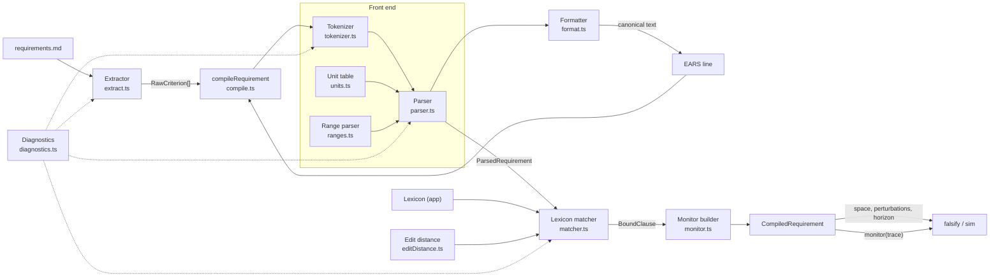

# Design Document

## Overview

The `ears` module (`skeleton/src/ears/`, package `golem-spec`) compiles one acceptance criterion written in the GOLEM dialect of EARS into a `CompiledRequirement` (see `.kiro/steering/interfaces.md`). It also extracts the criteria from a Kiro `requirements.md`. The compiled result carries a scenario space for the falsifier, perturbation calls for the simulator, a horizon, and a monitor with robustness semantics.

The module is a small compiler front end plus a monitor generator:

1. **Tokenizer** splits a line into tokens with offsets, lines and columns.
2. **Unit table and quantity parser** turn `200 N` into a `Quantity` with an SI value.
3. **Parser** builds an AST for the five EARS patterns, with an optional comma before THE.
4. **Range parser** reads `up to`, `A to B`, `from any direction`, `from behind` and `at any point in its stride`.
5. **Lexicon matcher** matches clauses to `PerturbationTemplate` and `PredicateTemplate` phrases token for token. On failure it suggests the closest template by token edit distance.
6. **Monitor builder** produces `monitor(trace)` with always, eventually and state semantics anchored at the `trigger` event.
7. **Compiler** assembles the `CompiledRequirement`. The **Formatter** prints an AST back to canonical text. The **Extractor** reads criteria from `requirements.md`.

### Design decisions

| Decision | Rationale |
|---|---|
| Hand-written tokenizer and recursive-descent parser, no parser library | `tech.md` forbids heavy dependencies. The grammar is five fixed shapes, so a parser generator adds nothing. Hand-written code gives exact control of diagnostic positions. |
| Result types instead of exceptions: `{ value, diagnostics }` | Requirement 8 needs all problems reported together, ordered by offset. Only the Formatter throws (Requirement 10.11), because it is given a bad AST, which is a programmer error. |
| Template phrases are compiled once to a token pattern (`CompiledTemplate`) | The matcher and the edit distance both work on token sequences. Compiling once avoids re-tokenizing per clause and keeps the matcher deterministic. |
| Matching is exact, token for token, case-insensitive. Suggestions come only from edit distance | Requirement 5.6 forbids approximate matching. A near miss is an error with a suggestion, never a guess. |
| Monitor is a closure over precomputed constants. Its window loop uses indices and scalar locals only | Requirement 7.16 forbids per-sample allocation. The `margin` function receives a single reused `Record<string, number>` scratch object. |
| `NaN` robustness with unit `trace` or `signal` for unmeasurable cases | A missing measurement must never read as satisfied (Requirements 6.7, 6.11, 7.5, 7.9, 7.10). |
| `Diagnostic` and `ParsedRequirement` are new types in `ears/`, not changes to `interfaces.md` | Specs may add but not rename or remove shapes. All new fields are additive. |

### Assumptions (approved)

- A `NaN` robustness is returned with unit `trace` (no trigger, empty window) or `signal` (missing signal).
- `WHERE` uses `CompileOptions.enabledFeatures`. A disabled feature gives `+Infinity` robustness.
- The `Trace` starts after warm-up. The monitor does not skip samples.
- `NON_EARS_LINE` is a diagnostic kind with severity `warning`. Diagnostics carry a `severity` field.
- A bare number is accepted only for `{count}` and for `{ratio}` in [0, 1]. A bare ratio outside [0, 1] is `BAD_RANGE`.
- The suggestion is dropped when the edit distance exceeds half the length of the longer sequence.
- Numbered lines starting with `FOR ALL` are skipped with a `NON_EARS_LINE` warning.

### Research summary

- EARS has five patterns (ubiquitous, event-driven, state-driven, unwanted behaviour, optional feature). Kiro writes `WHEN ... THEN the system SHALL ...`, and the GOLEM dialect accepts the `THE <robot> SHALL` form with an optional comma. Source: [EARS overview, Alistair Mavin et al.](https://alistairmavin.com/ears/).
- Robustness semantics for signal temporal logic: the robustness of `always φ` over a window is the minimum of the robustness of `φ` over the window. For `eventually φ` it is the maximum. Positive means satisfied and negative means violated, with the magnitude in the unit of the predicate. Source: [Donzé and Maler, "Robust satisfaction of temporal logic over real-valued signals"](https://link.springer.com/chapter/10.1007/978-3-642-15297-9_9). Content was rephrased for compliance with licensing restrictions.
- Levenshtein distance over token sequences is a metric (identity, symmetry, triangle inequality) when substitution cost is itself a metric. The cost here is 0 for equal tokens and 1 otherwise, so the metric laws hold. The wildcard rule in Requirement 9.3 keeps this true because wildcard equality is an equivalence on `Kind`.

## Architecture



Data flow for `compileRequirement(line, lexicon, options)`:

1. `tokenize(line)` returns tokens plus tokenizer diagnostics.
2. `parse(tokens, lexicon.robotNames)` returns a `ParsedRequirement` (AST) plus parser diagnostics. Quantities in clauses are parsed with `units.ts`. Ranges are parsed with `ranges.ts`.
3. `matchTrigger` and `matchResponse` bind slots against the lexicon and return `BoundClause` values or `UNKNOWN_PHRASE` diagnostics.
4. `buildMonitor` builds the monitor from the bound predicate and the temporal wrapper.
5. If any diagnostic has severity `error`, no `CompiledRequirement` is returned. Otherwise the compiler returns it together with warnings.

File-level flow: `compileRequirementsFile(text, lexicon, options)` calls `extractCriteria`, then compiles each criterion independently, and remaps diagnostic positions to file coordinates.

### Module boundaries

- `ears/` imports only types from `interfaces.md` shapes (declared in `skeleton/src/index.ts` types or a shared `types.ts`). It does not import `sim`, `falsify`, `pool` or MuJoCo.
- `ears/` never calls `Math.random()`, `Date.now()`, `performance.now()`, `fetch` or `fs`. A test scans the sources for these identifiers (Requirement 12.12).
- Public functions are re-exported from `skeleton/src/index.ts`, so apps import them from `golem-spec`. Apps never deep-import `skeleton/src/ears/...`.

### File layout

```
skeleton/src/ears/
  index.ts            public exports (compileRequirement, compileRequirementsFile, extractCriteria,
                      tokenize, parse, format, parseQuantity, toSI, fromSI, tokenEditDistance, types)
  diagnostics.ts      Diagnostic, DiagnosticKind, helpers: makeDiagnostic, sortDiagnostics, hasError
  tokenizer.ts        tokenize(input) -> { tokens, diagnostics }
  units.ts            UNIT_TABLE, parseQuantity, toSI, fromSI, ACCEPTED_UNITS
  ast.ts              ParsedRequirement, Clause, Pattern, Range types, stripOffsets (for equality in tests)
  ranges.ts           parseRangePhrase, rangeToDimension
  parser.ts           parse(tokens, robotNames) -> { ast, diagnostics }
  editDistance.ts     tokenEditDistance, toWildcardSequence, closestTemplate
  matcher.ts          compileTemplate, matchPerturbation, matchPredicate
  monitor.ts          buildMonitor, evaluateWindow (the allocation-free window loop)
  compile.ts          compileRequirement, compileRequirementsFile, horizon computation
  format.ts           format(ast) -> string
  extract.ts          extractCriteria(text) -> { criteria, diagnostics }
  __tests__/          *.test.ts (Vitest + fast-check), generators.ts, reference.ts (naive monitor and DP edit distance)
```

## Components and Interfaces

All signatures below are type-level only. Cross-module shapes (`Quantity`, `Dimension`, `ScenarioSpace`, `Trace`, `CompiledRequirement`, `PerturbationCall`, `Lexicon`, `PredicateTemplate`, `PerturbationTemplate`) are used unchanged from `interfaces.md`.

### diagnostics.ts

```ts
type DiagnosticKind =
  | 'PATTERN_MISMATCH' | 'MISSING_UNIT' | 'UNKNOWN_PHRASE'
  | 'BAD_RANGE' | 'UNKNOWN_ROBOT' | 'NON_EARS_LINE';

interface Diagnostic {
  kind: DiagnosticKind;
  severity: 'error' | 'warning';
  message: string;            // non-empty, plain language, includes value and unit where a number is involved
  line: number;               // 1-based
  column: number;             // 1-based, UTF-16 code units
  start: number;              // 0-based offset
  end: number;                // exclusive, end >= start
  suggestion?: string;
}

declare function sortDiagnostics(d: readonly Diagnostic[]): Diagnostic[]; // by start, stable
declare function hasError(d: readonly Diagnostic[]): boolean;
```

`UNKNOWN_ROBOT` carries the allowed names in `suggestion` (Requirement 8.6). Illegal characters from the tokenizer use `PATTERN_MISMATCH` with severity `error` and a message that names the character (the Diagnostic_Kind list has no dedicated kind, so this keeps the closed set intact).

### tokenizer.ts

```ts
type TokenType = 'number' | 'unit' | 'keyword' | 'word' | 'comma' | 'requirementId';
interface Token {
  type: TokenType;
  text: string;
  start: number; end: number;   // [start, end) in UTF-16 units
  line: number; column: number; // 1-based
}
declare function tokenize(input: string): { tokens: Token[]; diagnostics: Diagnostic[] };
```

Rules, in scan order at each position:

1. Skip whitespace (`' '`, `\t`, `\r`, `\n`). `\r\n` counts as one break. Line and column are tracked incrementally from the original input.
2. At the start of input, try a requirement ID: `R<n>.`, `<n>.<m>` or `<n>.` followed by whitespace or end. The ID token text includes the trailing period. The parser strips it.
3. Try a number: optional sign, digits, optional fraction, optional exponent.
4. After a number (with at most one space between), try a unit by longest match against `ACCEPTED_UNITS`, case-sensitive. `m/s` must beat `m`. The unit must end at a word boundary, so `5 mx` yields a word `mx`, not a unit `m`.
5. Try a word `[A-Za-z][A-Za-z0-9_'-]*` (plus other letters). If its upper-cased text is one of WHEN, WHILE, IF, THEN, WHERE, THE, SHALL, emit `keyword`, else `word`. Keywords inside a longer word never match because the whole word is scanned first.
6. A comma emits `comma`.
7. Any other character produces one error diagnostic and no token. Scanning continues.

Coverage invariant: every UTF-16 unit of the input belongs to exactly one of a token, skipped whitespace, or an error character.

### units.ts

```ts
interface UnitSpec { spelling: string; kind: Kind; factor: number }
declare const UNIT_TABLE: readonly UnitSpec[];
declare const ACCEPTED_UNITS: readonly string[];

declare function toSI(value: number, unit: string): number;     // multiplies by the unit factor
declare function fromSI(si: number, unit: string): number;      // divides by the unit factor; 0 -> exactly 0
declare function parseQuantity(text: string): { quantity?: Quantity; diagnostics: Diagnostic[] };
declare function quantityFromTokens(
  num: Token, unit: Token | undefined, slot: SlotKind
): { quantity?: Quantity; diagnostics: Diagnostic[] };
```

| Unit | Kind | Factor to SI |
|---|---|---|
| `N`, `kN` | force | 1, 1000 |
| `s`, `ms` | duration | 1, 0.001 |
| `m`, `cm`, `mm` | length | 1, 0.01, 0.001 |
| `m/s`, `cm/s` | speed | 1, 0.01 |
| `deg`, `°`, `rad` | angle | π/180, π/180, 1 |
| `kg`, `g` | mass | 1, 0.001 |
| `%` | ratio | 0.01 |

`SlotKind = Kind | 'direction' | 'range'`. For `count`, an unsigned integer with no unit is accepted. For `ratio`, `%` or a bare number in [0, 1] is accepted. A bare number outside [0, 1] gives `BAD_RANGE` stating the interval. Any other slot with a bare number gives `MISSING_UNIT`. `Quantity.text` is the exact source substring, including its spacing.

### ast.ts

```ts
type Pattern = 'ubiquitous' | 'event' | 'state' | 'unwanted' | 'optional';
interface Span { start: number; end: number; line: number; column: number }

interface Clause {
  text: string;               // exact source substring from first to last token
  tokens: Token[];
  span: Span;
}
interface ParsedRequirement {
  id?: string;                // without trailing period
  pattern: Pattern;
  condition?: Clause;         // trigger, state, fault or feature
  robot: { name: string; span: Span };
  response: Clause;
}
declare function stripOffsets(ast: ParsedRequirement): unknown; // for equality ignoring offsets, line and column
```

### ranges.ts

```ts
interface RangePhrase {
  kind: Kind;
  min: number; max: number;   // SI
  wrap: boolean;
  fixed: boolean;             // min === max
  span: Span;
  text: string;
}
declare function parseRangePhrase(tokens: readonly Token[], at: number): {
  range?: RangePhrase; next: number; diagnostics: Diagnostic[];
};
declare function rangeToDimension(
  name: string, range: RangePhrase, severity: Dimension['severity']
): Dimension;
```

Forms recognised: `up to <q>` (min 0, max q.si), `<q> to <q>` (same kind), `from any direction` (0 to 2π, wrap), `from behind` (3π/4 to 5π/4, wrap), `at any point in its stride` (phase 0 to 1, wrap), and a lone quantity (fixed). Validation emits `BAD_RANGE` for min greater than max (at the second quantity), mixed kinds (at the second quantity), and negative force, duration, length, speed or mass (at that quantity).

### parser.ts

```ts
interface CompileOptions { enabledFeatures?: readonly string[]; id?: string }
declare function parse(
  tokens: readonly Token[], robotNames: readonly string[]
): { ast?: ParsedRequirement; diagnostics: Diagnostic[] };
```

The parser is a single pass over tokens:

```
line     := [ID] ( ubiq | event | state | unwanted | optional )
ubiq     := THE robot SHALL response
event    := WHEN clause [,] THE robot SHALL response
state    := WHILE clause [,] THE robot SHALL response
unwanted := IF clause [,] THEN [,] THE robot SHALL response
optional := WHERE clause [,] THE robot SHALL response
```

Clause boundaries are found by scanning for the next `THE` keyword (or `THEN` for the unwanted pattern) that is followed by a robot name and `SHALL`. A second `SHALL` is a `PATTERN_MISMATCH` at the second `SHALL`. An empty clause is a `PATTERN_MISMATCH` at the position where the clause was expected. The parser does not interpret clause words. Interpretation belongs to the matcher, which keeps the grammar independent of any lexicon except `robotNames`.

### editDistance.ts

```ts
type WildToken = { wild: Kind | 'direction' | 'range' } | { word: string };   // word is case-folded
declare function tokenEditDistance(a: readonly (string | WildToken)[], b: readonly (string | WildToken)[]): number;
declare function toWildcardSequence(clause: readonly Token[]): WildToken[];     // quantities collapse to one wildcard
declare function closestTemplate(
  clause: readonly Token[], templates: readonly CompiledTemplate[]
): { template?: CompiledTemplate; distance: number; tooFar: boolean };
```

Cost model: equal case-folded words or equal-kind wildcards cost 0. Insert, delete and substitute cost 1. Two wildcards of different kinds cost 1. The DP uses two rolling `Int32Array` rows. `closestTemplate` scans the templates in Lexicon order and keeps the first minimum, so ties go to the earlier template. `tooFar` is true when `distance > max(lenA, lenB) / 2`.

### matcher.ts

```ts
interface CompiledTemplate {
  phrase: string;
  pattern: (string | { slot: SlotKind; name: string })[];   // lower-cased words and typed slots
  index: number;                                            // Lexicon order
}
interface BoundClause<T> {
  template: T;                                              // PredicateTemplate or PerturbationTemplate
  slots: Record<string, Quantity | [Quantity, Quantity] | string>;
  si: Record<string, number>;                               // bound SI numbers, by slot name
  ranges: Record<string, RangePhrase>;
}
declare function compileTemplate(phrase: string, index: number): CompiledTemplate;
declare function matchPerturbation(
  clause: Clause, lexicon: Lexicon
): { bound?: BoundClause<PerturbationTemplate>; diagnostics: Diagnostic[] };
declare function matchPredicate(
  clause: Clause, lexicon: Lexicon
): { bound?: BoundClause<PredicateTemplate>; wrapper?: TemporalWrapper; diagnostics: Diagnostic[] };
```

Matching steps for a clause:

1. For a response, strip a trailing `for <duration>` or `within <duration>` and record the `TemporalWrapper`.
2. For each template in Lexicon order, walk the template pattern against the clause tokens. A literal must equal the token case-folded. A slot consumes a quantity, a range phrase or a direction as its kind requires.
3. Zero full matches: emit `UNKNOWN_PHRASE` at the first unmatched token, with the closest template as `suggestion` unless `tooFar` or the class is empty.
4. Two or more full matches: emit one `UNKNOWN_PHRASE` that lists the matching phrases in Lexicon order and bind nothing.
5. One match: bind the slots. For `{range:<kind>}`, pass the resulting Dimension to the template's `dims` function. A second range bound to the same slot yields `BAD_RANGE` at the second range.

### monitor.ts

```ts
type TemporalWrapper =
  | { kind: 'always'; duration?: number }       // duration undefined: to end of trace
  | { kind: 'eventually'; duration: number };

interface MonitorSpec {
  pattern: Pattern;
  predicate: PredicateTemplate;
  slots: Record<string, number>;                // SI
  wrapper: TemporalWrapper;
  stateMargin?: { predicate: PredicateTemplate; slots: Record<string, number> };
  disabledFeature?: boolean;                    // WHERE with a feature that is not enabled
}
type MonitorFn = (trace: Trace) => { robustness: number; worstAt: number; unit: string };
declare function buildMonitor(spec: MonitorSpec): MonitorFn;
```

Monitor algorithm (per call):

1. If `disabledFeature`, return `{ robustness: +Infinity, worstAt: 0, unit: predicate.unit }`.
2. Check every name in `predicate.signals` is a key of `trace.signals`. If not, return `{ NaN, 0, 'signal' }`.
3. Anchor `t0`: for `event` and `unwanted`, the `t` of the first event named `trigger`. If none, return `{ NaN, 0, 'trace' }`. For other patterns, `t0 = t[0]`.
4. Window `[a, b]`: `a = t0`. `b = t0 + duration` when the wrapper has a duration, else `t[n-1]`. Find the first index `i0` with `t[i] >= a` by binary search, and iterate while `t[i] <= b` and `i < n`. This reads only the samples inside the window and never interpolates.
5. If no sample is inside the window, return `{ NaN, 0, 'trace' }`.
6. For each index, fill a preallocated scratch record `s` with `signals[name][i]` for each name in `predicate.signals`, call `predicate.margin(s, slots)`, and keep the running min (always) or max (eventually). Strict comparison keeps the earliest time on ties. If a margin is `NaN`, return `{ NaN, t[i], predicate.unit }` immediately for the first such sample.
7. For `state`, each sample contributes `max(-stateMargin, responseMargin)` and the monitor takes the minimum over `[t[0], t[n-1]]`. `stateMargin` is evaluated with the same scratch record, using the union of both templates' signal names.

The scratch record and the signal-array list are created once in `buildMonitor`, not per call and not per sample. The monitor never writes to `Trace`.

### compile.ts

```ts
interface CompileResult {
  requirement?: CompiledRequirement;
  diagnostics: Diagnostic[];
}
declare function compileRequirement(line: string, lexicon: Lexicon, options?: CompileOptions): CompileResult;

interface FileCompileResult {
  requirements: CompiledRequirement[];   // file order
  diagnostics: Diagnostic[];             // extractor + compiler, ascending file position
}
declare function compileRequirementsFile(text: string, lexicon: Lexicon, options?: CompileOptions): FileCompileResult;
```

Assembly:

- `id`: the AST ID, else `options.id`, else `''`.
- `source`: the input line unchanged.
- `space.dims`: for `event` and `unwanted`, the Dimensions from the trigger template's `dims` in source order. For `ubiquitous`, `state` and `optional`, the dims declared by the matched response or state template (`PredicateTemplate` has no `dims` today, so this is an empty list until a template adds an optional `dims`, which is an additive field). Duplicate names produce an error at the second occurrence.
- `perturbations`: one `PerturbationCall` per matched perturbation template. A searched value (`min < max`) is the Dimension name (string). A fixed value is the SI number.
- `horizon`: for `event` and `unwanted` with `for` or `within`, wrapper duration plus trigger duration, or the wrapper duration alone when the trigger has none. For `ubiquitous` and `state`, `options.episodeSeconds` if given, else the lexicon default below.

The lexicon has no field for episode length in `interfaces.md`. Requirement 6.9 says the Lexicon defines it. The design adds an optional `episodeSeconds?: number` to `Lexicon` (an additive field), with a documented default of 10 s when absent. `CompileOptions.episodeSeconds` overrides it.

### format.ts

```ts
declare function format(ast: ParsedRequirement): string;   // throws on an invalid pattern, naming the field
```

Output shapes:

```
[ID ]THE robot SHALL response
[ID ]WHEN condition, THE robot SHALL response
[ID ]WHILE condition, THE robot SHALL response
[ID ]IF condition, THEN THE robot SHALL response
[ID ]WHERE condition, THE robot SHALL response
```

Clause text is joined from the clause tokens with one space, except that a comma token attaches to the previous token. Quantity spellings come from the recorded `text`, so `0.20 s` stays `0.20 s`. The Formatter reads only its argument.

### extract.ts

```ts
interface RawCriterion {
  id: string;            // "<n>.<m>" or "R0.<m>"
  text: string;          // without the number prefix, continuation lines joined with one space
  line: number;          // 1-based line of the numbered line
  column: number;        // 1-based column of the first character of text
  offset: number;        // 0-based file offset of the first character of text
}
declare function extractCriteria(text: string): { criteria: RawCriterion[]; diagnostics: Diagnostic[] };
```

Algorithm: split lines on `\r?\n` while recording each line's start offset. Track the current requirement number from `### Requirement <n>` headings and whether we are inside `#### Acceptance Criteria`. A numbered line matches `^(\d+)[.)]\s+`. Lines that begin with `-` or `*` are ignored without a diagnostic. Indented non-blank, non-numbered lines extend the current criterion. A blank line, a numbered line or a heading ends it. Qualifying criteria start with WHEN, WHILE, IF, WHERE or THE as whole words. Other lines emit `NON_EARS_LINE`.

To map compiler diagnostics to the file, the file-level function compiles each criterion text, then adds `offset` to `start` and `end`, and converts line and column using the criterion's line and column (for the first line) or by recomputing from the file's line-start table (for joined continuation lines the compiler keeps a per-criterion offset map).

## Data Models

### Token and AST

`Token`, `Span`, `Clause`, `ParsedRequirement` are defined above. Equality ignoring positions uses `stripOffsets`, which removes `start`, `end`, `line`, `column` and `span` recursively and upper-cases keywords.

### Lexicon compilation cache

`WeakMap<Lexicon, { perturbations: CompiledTemplate[]; predicates: CompiledTemplate[] }>` caches template compilation. The cache is keyed by object identity and never mutates the Lexicon. It is a pure memo: results do not depend on whether the cache was warm.

### Reference models (tests only)

`reference.ts` holds simple implementations used as oracles:

- `refMonitor(trace, spec)`: evaluates the margin at every sample with plain loops and filters by `a <= t <= b`.
- `refEditDistance(a, b)`: full-matrix Levenshtein.
- `refTokenize(input)`: independent line and column calculator from the input prefix.

### Trace conventions

- `trace.t` is strictly increasing, control-rate, starting after warm-up.
- `trace.signals[name].length === trace.t.length` for every name.
- `trace.events` may be empty. The first `trigger` event is the anchor.

## Correctness Properties

*A property is a characteristic or behavior that should hold true across all valid executions of a system-essentially, a formal statement about what the system should do. Properties serve as the bridge between human-readable specifications and machine-verifiable correctness guarantees.*

Reflection on redundancy: criteria 1.11, 3.16, 7.15, 8.13, 9.12 and 12.11 all state determinism. They are folded into Properties 28 and 29. Criteria 6.1 to 6.5, 6.10, 6.12 and 7.2 to 7.4 all describe the same window evaluation, so they share one reference-model property (Property 21). Criteria 7.11 and 7.12 are kept as a separate sign property (Property 22) because the reference-model property compares values and the sign property compares only the boundary. Criteria 9.1 to 9.4 and 9.10, 9.11 stay separate: the first compares to a reference, the second states algebraic laws. Criteria 10.1 to 10.6 and 10.10 merge into one formatter layout and idempotence property. Criteria 3.6, 3.7 and 10.9 merge into one comma-insensitivity property.

### Property 1: Tokenizer coverage and offsets

For any input string (including Unicode, `\r\n`, tabs and illegal characters), the tokens are in ascending order, do not overlap, `input.slice(token.start, token.end) === token.text` for each token, and the input equals the in-order concatenation of token texts, skipped whitespace and the texts of error-diagnostic characters. Padding the input with leading and trailing whitespace leaves all token texts unchanged and shifts every offset by the length of the leading padding.

**Validates: Requirements 1.1, 1.2, 1.4, 1.5, 1.10**

### Property 2: Tokenizer line and column agree with an independent calculation

For any input string, each token's and each diagnostic's `line` and `column` equal the values computed independently from the input prefix, counting `\n` and `\r\n` as one break each and columns in UTF-16 code units from 1.

**Validates: Requirements 1.8, 8.9**

### Property 3: Keyword recognition ignores case and whole-word only

For any keyword in {WHEN, WHILE, IF, THEN, WHERE, THE, SHALL} and any letter-case mutation of it, the tokenizer emits one `keyword` token whose text is the original spelling. For any keyword followed by one or more letters, the tokenizer emits one `word` token for the whole word.

**Validates: Requirements 1.6, 1.7**

### Property 4: Quantities convert to SI with the table kind and preserve text

For any finite number written with any accepted unit and either zero or one space between them, `parseQuantity` returns a Quantity whose `si` equals the number times the unit's factor, whose `kind` is the unit's kind, and whose `text` is the exact substring written.

**Validates: Requirements 2.1, 2.2, 2.3, 2.12**

### Property 5: Unit conversion is the identity

For any finite value `x` and any accepted unit `u`, `fromSI(toSI(x, u), u)` equals `x` within a relative error of 1e-12, and `x = 0` returns exactly `0`.

**Validates: Requirements 2.11**

### Property 6: Quantity text round trip

For any Quantity produced by the parser, parsing its `text` returns a Quantity with equal `kind`, `si` and `text`.

**Validates: Requirements 2.12**

### Property 7: Bare numbers are accepted only for count and in-range ratio

For any number written without a unit, a `{count}` slot accepts it exactly when it is an unsigned integer, a `{ratio}` slot accepts it exactly when it lies in [0, 1] and otherwise reports `BAD_RANGE` at the number, and every other slot reports `MISSING_UNIT` at the number's line and column and returns no Quantity.

**Validates: Requirements 2.5, 2.6, 2.7, 2.8**

### Property 8: Quantity kind mismatch is rejected with both kinds named

For any template slot of kind K and any Quantity of kind J different from K, the matcher binds nothing and emits an `UNKNOWN_PHRASE` diagnostic whose message names both K and J.

**Validates: Requirements 2.10, 5.3, 5.7**

### Property 9: Generated valid lines parse to the expected pattern, ID and clauses

For any generated valid line of any of the five patterns, with an optional ID of the forms `R<n>.`, `<n>.` or `<n>.<m>` (1 to 6 digits) and any letter case for keywords, the parser returns an AST with the expected `pattern`, the ID stored without its trailing period (or no ID when absent), upper-case keywords, the robot name as written, and for each clause `input.slice(span.start, span.end)` equal to the clause text.

**Validates: Requirements 3.1, 3.2, 3.3, 3.4, 3.5, 3.8, 3.9, 3.12, 3.14**

### Property 10: Optional commas do not change the AST or the canonical text

For any generated valid line, writing it with or without the comma before THE (and, for the unwanted pattern, with or without a comma after THEN) yields equal ASTs ignoring offsets, and `format` returns identical text for both.

**Validates: Requirements 3.6, 3.7, 10.9**

### Property 11: Unknown robot names are rejected and listed

For any generated valid line whose robot name is not in `robotNames`, the parser emits an `UNKNOWN_ROBOT` diagnostic at that word, and its message lists every allowed name.

**Validates: Requirements 3.11, 8.6**

### Property 12: Range phrases produce the right interval and Dimension

For any quantity `q` and pair `q1`, `q2` of the same kind with `q1.si <= q2.si`, `up to q` yields `[0, q.si]`, `q1 to q2` yields `[q1.si, q2.si]` (equal values allowed), and a lone quantity yields a fixed value with `min === max`. Each range yields exactly one Dimension with `min` and `max` in SI, `severity` from the template and `wrap` only for angle and phase named ranges. Each searched range appears in `params` as the Dimension name, and each fixed value appears as its SI number.

**Validates: Requirements 4.1, 4.2, 4.6, 4.11, 4.12, 5.8**

### Property 13: Invalid ranges are rejected with BAD_RANGE

For any range with `min > max`, with quantities of different kinds, or with a negative force, duration, length, speed or mass, the parser emits a `BAD_RANGE` diagnostic at the line and column of the second quantity (or of the negative quantity) and returns no Dimension for it.

**Validates: Requirements 4.7, 4.8, 4.9**

### Property 14: Template matching binds the written values

For any generated Lexicon and any clause built from a template phrase with its slots filled by quantities of the matching kinds, the matcher selects that template and binds each slot to the SI value written in that position. Writing the literal words in any letter case gives equal bindings.

**Validates: Requirements 5.1, 5.2, 5.10, 5.11**

### Property 15: Matching is exact, never approximate

For any template clause mutated by swapping two adjacent literal words, deleting a literal word, inserting an extra word or misspelling a word, the matcher binds no slot and emits an `UNKNOWN_PHRASE` diagnostic.

**Validates: Requirements 5.6, 5.4**

### Property 16: Token edit distance obeys the metric laws

For any token sequences `a`, `b` and `c`, `d(a, a) = 0`, `d(a, b) = d(b, a)`, `d(a, b) >= 0`, `d(a, b) = 0` only when `a` equals `b` ignoring letter case, `d(a, c) <= d(a, b) + d(b, c)`, and `|len(a) - len(b)| <= d(a, b) <= max(len(a), len(b))`.

**Validates: Requirements 9.10, 9.11**

### Property 17: Edit distance matches a reference and handles wildcards

For any clause and template phrase, `tokenEditDistance` equals a full-matrix reference Levenshtein over the same wildcard sequences. A quantity counts as one token whatever number of tokens it spans, equal-kind wildcards cost 0, different-kind wildcards cost 1, and words compare ignoring letter case.

**Validates: Requirements 9.1, 9.2, 9.3, 9.4**

### Property 18: The suggestion is the first closest template of the right class, or absent when too far

For any generated Lexicon and any clause that matches no template, the `suggestion` equals the phrase of the first template (in Lexicon order) with the minimum distance, taken only from perturbation templates for trigger clauses and only from predicate templates for response and state clauses. The suggestion is omitted when the minimum distance exceeds half the length of the longer sequence, or when the class has no template. Repeating the call gives equal results.

**Validates: Requirements 5.4, 9.5, 9.6, 9.7, 9.8, 9.9, 9.12**

### Property 19: First trigger anchors the window

For any trace with one or more `trigger` events at times `t₀ <= t₁ <= ...`, the monitor of an `event` or `unwanted` requirement returns the same result as a trace with only the first trigger. Replacing signal samples with `t < t₀` by arbitrary values does not change `robustness` or `worstAt` for an always-wrapper.

**Validates: Requirements 6.6, 6.13**

### Property 20: A trace with no trigger, no window sample or a missing signal is never reported as satisfied

For any trace with no `trigger` event (event and unwanted patterns), the monitor returns `NaN` with unit `trace`. For any trace whose window contains no sample, it returns `NaN` with unit `trace` and `worstAt` 0. For any trace missing a signal named by the predicate, it returns `NaN` with unit `signal`. For any trace where `margin` returns `NaN` at some sample in the window, it returns `NaN` with the predicate unit and `worstAt` equal to the time of the first such sample.

**Validates: Requirements 6.7, 6.11, 7.5, 7.9, 7.10**

### Property 21: The monitor equals a naive reference over the closed window

For any trace, anchor and wrapper (always or eventually, with or without a duration, including windows that extend past the last sample or end exactly on a sample), the monitor's `robustness` equals the reference minimum (always) or maximum (eventually) of the margin over exactly the samples with `a <= t <= b`, `worstAt` equals the earliest time attaining it, and `unit` equals the predicate unit. For the `state` pattern the result equals the minimum over all samples of `max(-stateMargin, responseMargin)`.

**Validates: Requirements 6.1, 6.2, 6.3, 6.4, 6.5, 6.10, 6.12, 7.2, 7.3, 7.4, 7.6, 7.7**

### Property 22: Robustness soundness

For any trace with non-NaN margins and any compiled requirement, `robustness > 0` if and only if the margin is greater than 0 at every sample in the window (always) or at one or more samples (eventually). `robustness < 0` if and only if direct evaluation shows a violation, and `robustness === 0` only when the extreme margin equals 0.

**Validates: Requirements 7.11, 7.12**

### Property 23: Sign flips when the threshold crosses the signal

For any trace and any `above` predicate with threshold `θ`, a threshold below the minimum signal value in the window gives positive robustness, a threshold above it gives negative robustness, and moving the threshold back restores the original sign.

**Validates: Requirements 7.13**

### Property 24: Raising an above threshold never raises robustness

For any trace and any thresholds `θ1 <= θ2` of an `above` predicate, `robustness(θ2) <= robustness(θ1)`.

**Validates: Requirements 7.14**

### Property 25: A disabled optional feature is vacuously satisfied

For any trace, including one with no `trigger` event, the monitor of a `WHERE` requirement whose feature is not in `enabledFeatures` returns `+Infinity`, `worstAt` 0 and the response unit.

**Validates: Requirements 6.8**

### Property 26: Horizon follows the wrapper and trigger durations

For any generated wrapper duration `w` and fixed trigger duration `d`, the horizon of an `event` or `unwanted` requirement with `for` or `within` equals `w + d`, or `w` when the trigger has no duration.

**Validates: Requirements 6.9**

### Property 27: Monitors are pure and read-only

For any deep-frozen trace, the monitor does not throw, does not mutate `t`, `signals` or `events`, reads signals only through `Trace.signals` and anchors only through `Trace.events`, and two calls return bit-identical `robustness`, `worstAt` and `unit` (compared with `Object.is`).

**Validates: Requirements 7.1, 7.8, 7.15, 7.16**

### Property 28: Diagnostics are well formed, ordered, positioned and decide the outcome

For any generated line, including lines mutated to contain one or several independent problems, every diagnostic has a known kind, a severity, a non-empty message, `line >= 1`, `column >= 1`, `end >= start`, and its offsets select the offending token (or an empty span at the expected position for a missing token). Diagnostics are in ascending `start` order. If any diagnostic has severity `error`, no `CompiledRequirement` is returned. If all are warnings, the requirement is returned with them.

**Validates: Requirements 8.1, 8.7, 8.8, 8.11, 8.12**

### Property 29: Compiling is deterministic and does not mutate its inputs

For any line, Lexicon and Compile_Options (all deep-frozen), compiling twice gives deeply equal `id`, `source`, `pattern`, `space`, `perturbations`, `horizon` and diagnostics, and for any trace the two monitors return bit-identical results. Tokenizing, parsing and formatting the same input twice also give equal results.

**Validates: Requirements 1.11, 3.16, 8.13, 12.11, 12.13**

### Property 30: Compiled requirements carry the line's identity and ordered unique dimensions

For any valid line, `source` equals the input character for character, `id` equals the line's ID without its period (or the option ID, or `''`), `pattern` equals the AST pattern, and for `event` and `unwanted` patterns `space.dims` lists the trigger's Dimensions in source order with unique names. If two Dimensions would share a name, an error diagnostic is emitted at the second and no requirement is returned.

**Validates: Requirements 12.1, 12.2, 12.3, 12.4, 12.5, 12.7**

### Property 31: Parse and format round trip

For any generated valid line of any of the five patterns, `parse(format(parse(line)))` equals `parse(line)` ignoring source offsets, line and column.

**Validates: Requirements 10.8, 13.3**

### Property 32: Canonical text layout and idempotence

For any generated valid line, `format(ast)` contains no `\n` or `\r`, no leading or trailing whitespace, exactly one space between tokens (a comma attaches to the previous token), upper-case keywords, a comma before THE for event, state and optional patterns, `IF <fault>, THEN THE` for unwanted, the ID followed by one space when present, every Quantity spelling unchanged, and `format(parse(format(ast)))` equals `format(ast)`. The Formatter does not mutate a deep-frozen AST.

**Validates: Requirements 10.1, 10.2, 10.3, 10.4, 10.5, 10.6, 10.7, 10.10**

### Property 33: Extractor returns qualifying criteria with unique ordered IDs and exact positions

For any generated Kiro requirements file with distinct `(n, m)` pairs, the extractor returns exactly the numbered criteria under `#### Acceptance Criteria` that start with WHEN, WHILE, IF, WHERE or THE, in file order, with IDs `<n>.<m>` that are unique, and with `line` and `column` such that the file's text at that position starts with the returned `text`. A criterion before any requirement heading gets ID `R0.<m>` and a warning.

**Validates: Requirements 11.1, 11.2, 11.4, 11.7, 11.13**

### Property 34: Extractor skips non-EARS and FOR ALL lines with a warning and ignores bullets

For any generated file mixing EARS lines, non-EARS numbered lines, `FOR ALL` lines and unnumbered bullets, the extractor returns criteria only for the EARS lines, emits one `NON_EARS_LINE` warning at the text position of each other numbered line, and emits nothing for `-` and `*` bullets. An empty input, or a file with no `#### Acceptance Criteria` heading, gives an empty list and no error.

**Validates: Requirements 11.5, 11.8, 11.11, 11.12**

### Property 35: Extractor is insensitive to line endings, number format and continuation layout

For any generated file, converting every `\n` to `\r\n` returns the same IDs, texts, line numbers and columns. Writing criterion numbers as `<m>.` or `<m>)` returns the same IDs and texts. Splitting a criterion's text across indented continuation lines returns the text joined by single spaces.

**Validates: Requirements 11.8, 11.9, 11.10**

### Property 36: File compilation isolates failures and reports in file coordinates

For any generated file containing valid and invalid criteria, `compileRequirementsFile` returns a `CompiledRequirement` for every valid criterion in file order, regardless of the invalid ones. Each diagnostic's `line` and `column` locate the offending text in the file. A repeated Requirement_ID adds one warning at the second criterion and keeps both requirements.

**Validates: Requirements 12.8, 12.9, 12.10, 8.14**

## Error Handling

| Condition | Component | Result |
|---|---|---|
| Character that belongs to no token | Tokenizer | `PATTERN_MISMATCH` error naming the character. Scanning continues. |
| Line does not fit a pattern | Parser | `PATTERN_MISMATCH` at the first token that cannot continue, or at the end of the line. The message names the closest pattern and the expected keyword or clause. |
| Second `SHALL` | Parser | `PATTERN_MISMATCH` at the second `SHALL`. No AST. |
| Empty condition or response clause | Parser | `PATTERN_MISMATCH` at the expected position, naming the missing clause. |
| Robot name not in `robotNames` | Parser | `UNKNOWN_ROBOT` at the word, with allowed names in `suggestion`. |
| Number without unit where a quantity is required | Units | `MISSING_UNIT` at the number. |
| Word after a number not in the unit table | Units | `UNKNOWN_PHRASE` at the word, listing accepted units. |
| Bare ratio outside [0, 1] | Units | `BAD_RANGE` at the number, stating the interval. |
| Range with min > max, mixed kinds, negative physical value, or duplicate range for a slot | Ranges | `BAD_RANGE` at the second quantity or range. No Dimension. |
| Clause matches no template | Matcher | `UNKNOWN_PHRASE` at the first unmatched token, with the closest phrase as `suggestion` unless too far. |
| Clause matches several templates equally | Matcher | One `UNKNOWN_PHRASE` listing the phrases in Lexicon order. Nothing bound. |
| Lexicon has no template of the clause class | Matcher | `UNKNOWN_PHRASE` naming the missing class. Earlier diagnostics for the line are kept. |
| Quantity kind differs from slot kind | Matcher | `UNKNOWN_PHRASE` naming expected and found kinds. |
| Duplicate Dimension name | Compiler | Error at the second occurrence. No requirement. |
| Non-EARS or `FOR ALL` numbered line | Extractor | `NON_EARS_LINE` warning. Line skipped. |
| Criterion before any requirement heading | Extractor | ID `R0.<m>` plus one warning. |
| Repeated Requirement_ID in a file | File compiler | One warning at the second criterion. Both kept. |
| No trigger event, empty window, or window beyond the trace | Monitor | `NaN`, unit `trace`, `worstAt` 0. |
| Missing signal | Monitor | `NaN`, unit `signal`, `worstAt` 0. |
| `margin` returns `NaN` | Monitor | `NaN`, predicate unit, `worstAt` at the first such sample. |
| Invalid or missing `pattern` in an AST | Formatter | Throws an `Error` naming the field. No partial text. |

Diagnostic messages state the problem in plain language and include values with their units as written (for example `200 N`). They contain no themed wording (`product.md`).

All compile-time failures are returned as data. The module never throws on user text. The monitor never throws for a well-formed `Trace`.

## Testing Strategy

PBT applies: the module consists of pure functions with clear input and output behaviour (tokenizer, parser, unit conversion, formatter, edit distance, monitor, extractor). The testing rules in `testing.md` ask for exactly these properties.

### Dual approach

- **Property tests (fast-check)** cover Properties 1 to 36.
- **Example tests (Vitest)** cover specifics: one example per Diagnostic_Kind asserting `kind`, one-based `line` and `column` (Requirement 13.10); a Kiro-style `requirements.md` with a comma before THE and one without (Requirement 13.11); unit case sensitivity (`n`, `M` rejected); `THENCE` and `IFFY` as words; `from behind` and `at any point in its stride` constants; the ambiguous-template case; the empty-lexicon case; `up to 0 N` as a fixed range; `FOR ALL` skipping; section ending at the next heading.
- **Smoke tests** check that `golem-spec` re-exports the public functions (Requirement 12.14) and that no source file under `ears/` mentions `Math.random`, `Date.now`, `performance.now`, `fetch` or `node:fs` (Requirement 12.12).

### Property test configuration

- Every property runs with `numRuns >= 100` and a fixed seed, logged on failure, via `fc.assert(prop, { numRuns: 100, seed: SEED })`. `SEED` is a constant in `generators.ts` and can be overridden with the `GOLEM_SEED` environment variable.
- Each property test carries a tag comment in the form `Feature: golem-ears, Property N: <title>`.
- Each correctness property is implemented by a single property-based test.
- Property-based testing is not implemented from scratch. The library is fast-check, with Vitest as the runner.
- Synthetic traces have at most 1000 samples. MuJoCo is not imported or started. There is no `Math.random()`, network or clock in tests. Randomness comes only from fast-check.
- Test names state the behaviour, for example `it('rejects a force without a unit')`.
- No assertion or requirement is weakened to make a test pass. If a test is wrong, the commit message says why.

### Generators (`__tests__/generators.ts`)

- `arbUnit`, `arbQuantity(kind?)`: accepted units and finite magnitudes, with zero and one space.
- `arbLexicon`: a small Lexicon with 1 to 6 perturbation and predicate templates, with unique first words, mixed slot kinds, and a `margin` such as `above` threshold.
- `arbValidLine(lexicon)`: builds a valid line of a chosen pattern from the lexicon, with random ID form, random keyword case, and optional commas. It returns both the text and the expected AST fields, which serve as the oracle for Property 9.
- `arbMutation`: swap, delete, insert and misspell operators over a valid clause.
- `arbTrace`: strictly increasing `t` (grid with jitter), 1 to 1000 samples, signals of the same length, an optional list of `trigger` events, repeated values to exercise ties.
- `arbRequirementsFile`: headings, criteria with `.` or `)` numbering, continuation lines, bullets, non-EARS lines, `FOR ALL` lines, and an LF or CRLF choice. Each file carries its expected criteria list.
- `arbTokenSeq`: sequences over a small alphabet, so that equal tokens and ties occur often.

### Reference oracles (`__tests__/reference.ts`)

Naive window monitor, full-matrix Levenshtein, and an independent line and column calculator. Properties 2, 17 and 21 compare the production code against these.

### Out of scope here

Simulation, the falsifier and any MuJoCo use are tested in their own specs. Long search campaigns belong in `evidence/`, not in this suite. Allocation per sample (Requirement 7.16) is enforced by code review of `monitor.ts` and by the frozen-trace test; it has no runtime assertion.
