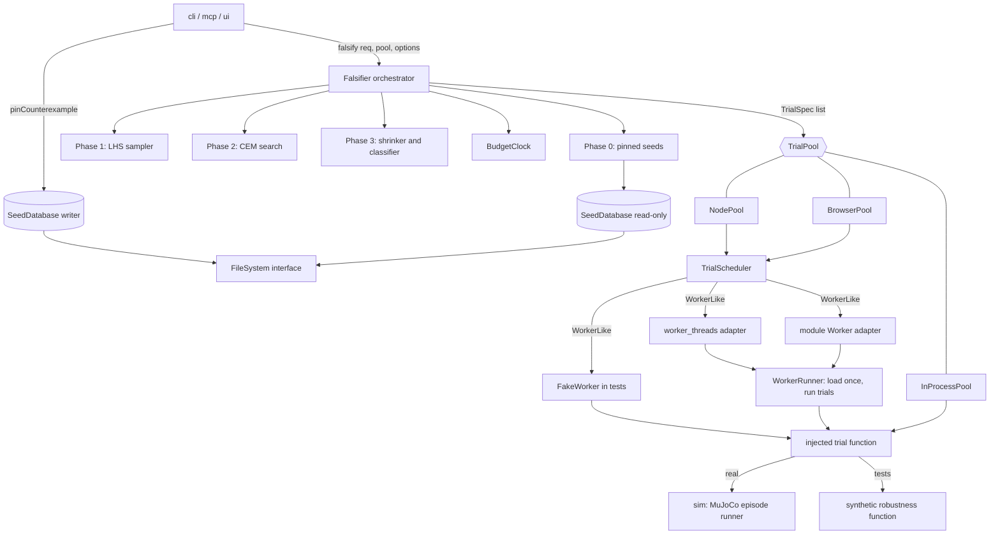
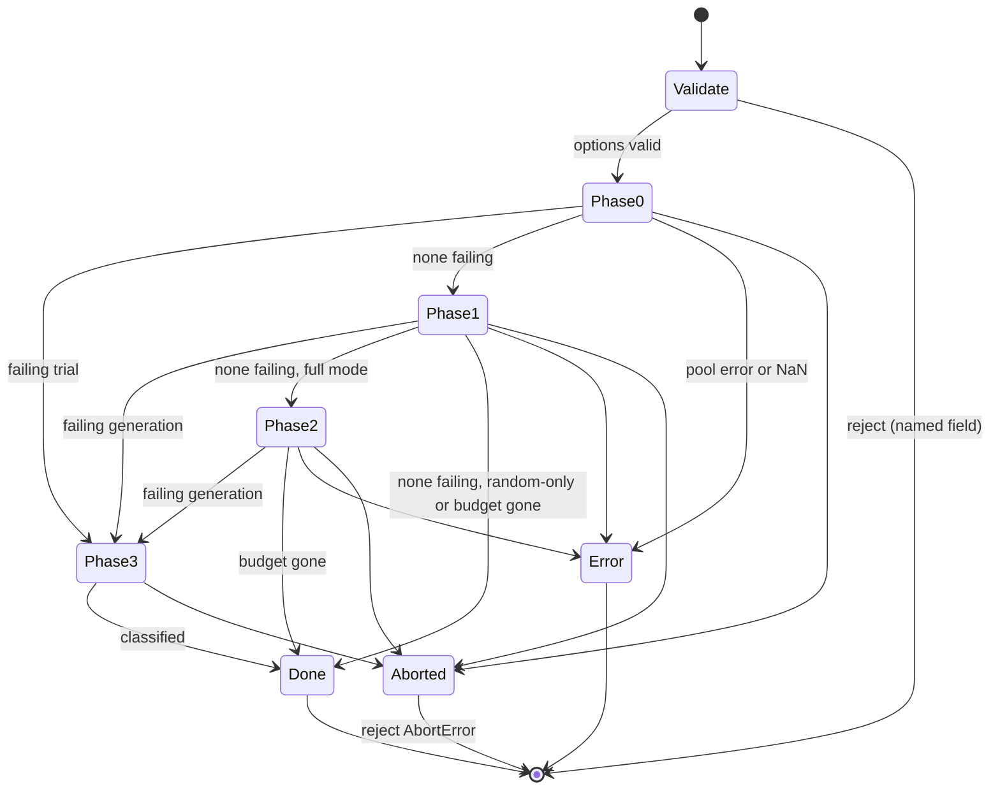
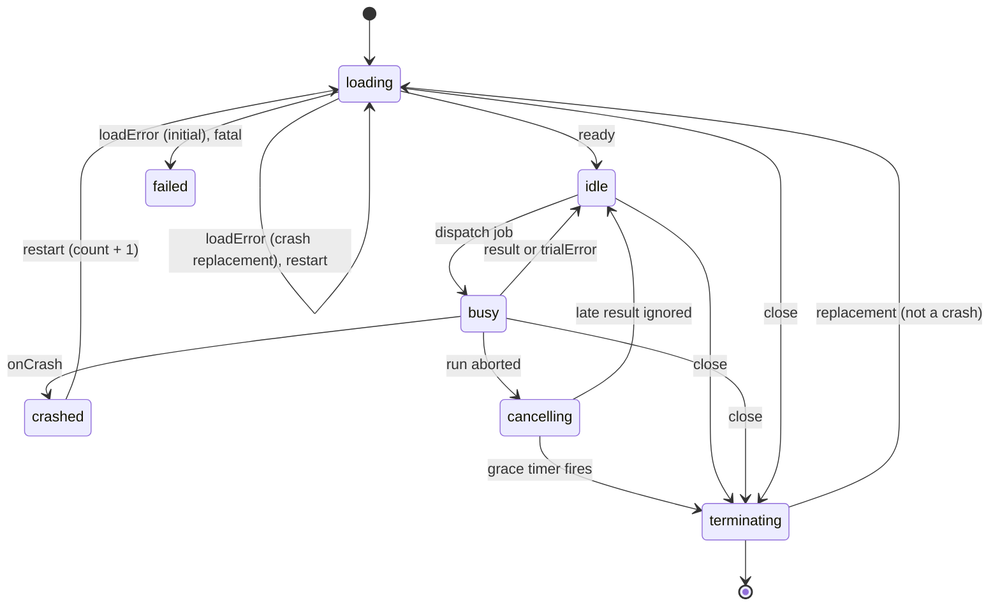

# Design Document: golem-falsify

> Revised by `golem-falsify-hardening` (Nov 2026): CEM elites and fallback (section 4), shrinker sweep and second pass (5), classification points (6), budget clock and time-aware grants (7), replay options and UI fields (8), Clopper-Pearson tolerance (9), Node pool size (13), defaults table and data models. The requirements text is unchanged; `.kiro/specs/golem-falsify-hardening/bugfix.md` lists the criteria it supersedes.

## Overview

`golem-falsify` turns one `CompiledRequirement` into one `Verdict`. It is two modules:

- `skeleton/src/falsify`: search (Latin hypercube, cross-entropy, shrinking, classification), budget accounting, verdicts, the seed database.
- `skeleton/src/pool`: the `TrialPool` implementations (in-process, Node `worker_threads`, browser module Workers) on top of one transport-independent scheduler.

Everything is a pure function of its inputs plus an injected trial function. The falsifier never calls MuJoCo itself. It submits `TrialSpec` lists to a `TrialPool` and reads `TrialResult` back. Tests replace the trial function with a synthetic robustness function, so no test in this spec loads MuJoCo except the few integration tests that check handle cleanup and cross-pool bit equality.

### Design decisions

| # | Decision | Rationale | Requirements |
|---|---|---|---|
| D1 | A **generation is atomic**. All trials of a submitted generation are run, counted and reported. "Skip the remaining unstarted trials of the current phase" is implemented as "submit no further generation". | A pool runs a generation in parallel. Cancelling "unstarted" trials of a submitted generation would make the trial count depend on completion order and break 19.3 and 1.14. The cost is at most `generationSize - 1` extra trials. `foundAfter` still counts to the first failing trial in input order. | 1.2, 1.3, 1.11, 19.3 |
| D2 | The falsifier **never writes** the seed database. It reads Phase 0 seeds through a read-only handle and returns a `PinnedSeedEntry` plus `RunMetadata`. The caller (CLI, MCP) pins it with `pinCounterexample(db, appId, entry)`. | A rejected (aborted) `falsify` returns nothing to pin, so 17.7 holds by construction. Phase 0 never writes (3.9). One writer makes the write policy testable. | 3.9, 11, 17.7 |
| D3 | CEM refit is **exact** by default (smoothing `alpha = 1`). A `smoothing` option in (0, 1] is available but not used by default. | 5.5 says "refit to the elites". Smoothing is an opt-in extension that does not change the default. | 5.5 |
| D4 | The shrinker **tests the milder end first**, then bisects. | One extra trial per dimension finds the common "any value fails" case at once, and it keeps the interval invariant simple (`lo` is always a tested passing point). | 6.1 to 6.3, 6.12 |
| D5 | One scheduler, two thin adapters. All dispatch, backpressure, crash, restart, abort and close logic is in `TrialScheduler`. Adapters only create `WorkerLike` objects. | 15.9 requires identical behaviour for Node and browser. | 12 to 18 |
| D6 | Seeds are derived by a bijective mixer, so distinct trial indices give distinct seeds within one (searchSeed, phase). | 4.8 requires distinct seeds for distinct indices. A hash with collisions could not guarantee that. | 4.8, 19.6 |

### Research notes

- Normal CDF through `erfc`: W. J. Cody's rational Chebyshev approximation for `erfc` has relative error near 1e-16 and keeps precision in the tails, which matters for truncated sampling far from the mean.
- Normal quantile: Wichura's AS241 (PPND16) is accurate to about 1e-16 over (0, 1).
- Incomplete beta: the continued-fraction evaluation (modified Lentz) from Numerical Recipes `betacf`, with the symmetry switch at `x > (a+1)/(a+b+2)`. Log-gamma from the Lanczos approximation (g = 7, 9 coefficients, about 1e-15 relative).
- Clopper-Pearson one-sided upper bound: the `1 - alpha` quantile of Beta(k+1, n-k). Content was rephrased for compliance with licensing restrictions from standard references on these methods.

## Architecture



### Module layout

```
skeleton/src/falsify/
  index.ts          public exports of this module
  types.ts          Budget, FalsifyOptions, ProgressEvent, RunMetadata, PinnedSeedEntry, errors
  prng.ts           mulberry32, fmix32, hashString, deriveSeed, phase and stream salts
  normal.ts         erfc, normalCdf, normalQuantile (AS241), truncated normal draw
  beta.ts           lnGamma, regularizedIncBeta, clopperPearsonUpper, failureRateUpper95
  lhs.ts            latinHypercube(space, n, searchSeed, generation)
  cem.ts            CemState, initCem, refitCem, sampleCem, circular statistics
  shrink.ts         shrink(failing, space, runTrial, limits)
  classify.ts       verificationSeeds, classify
  budget.ts         BudgetClock (trial counter, injectable clock, phase quotas)
  falsifier.ts      falsify(): phase state machine
  progress.ts       frozen ProgressEvent construction, safe callback invocation
  seed-db.ts        SeedDatabase, canonical JSON, equality, id validation
  fs.ts             FileSystem interface, memoryFileSystem (fault injection for tests)
skeleton/src/pool/
  index.ts          public exports of this module
  types.ts          RunOptions, PoolOptions, TrialFn, error classes
  protocol.ts       HostMessage, WorkerMessage, transfer list helper
  scheduler.ts      TrialScheduler, WorkerLike, WorkerFactory, slot state machine
  in-process.ts     InProcessPool
  worker-runner.ts  transport-independent worker loop (load once, run, delete handles)
  node.ts           NodePool, worker_threads adapter       (imported only by src/node.ts)
  node-entry.ts     the file a Node Worker executes
  browser.ts        BrowserPool, module Worker adapter
  browser-entry.ts  the file a module Worker executes
  testing.ts        FakeWorker, FakeWorkerFactory, synthetic trial helpers (test-only export)
```

Each source file has an adjacent `*.test.ts`.

### Public entry points

Apps import only through public entries (`structure.md`).

- `golem-spec` (browser-safe): `falsify`, `latinHypercube`, `shrink`, `SeedDatabase`, `pinCounterexample`, `memoryFileSystem`, `InProcessPool`, `createBrowserPool`, `TrialScheduler`, and all types of this spec.
- `golem-spec/node`: `createNodePool`, `nodeFileSystem()` (wraps `node:fs/promises`).
- `skeleton/src/falsify` imports no Node module (20.1). The only Node touch is the injected `FileSystem`.

### Phase state machine



An abort at any point rejects with `AbortError` and returns nothing, so there is nothing to pin.

## Components and Interfaces

All `interfaces.md` types are unchanged. This spec adds fields and new types only. The one change to `TrialPool` is an optional trailing argument:

```ts
interface RunOptions { signal?: AbortSignal }
// interfaces.md signature plus an optional trailing argument (Req 17.1):
// run(specs: TrialSpec[], onResult?: (r: TrialResult) => void | Promise<void>, opts?: RunOptions): Promise<TrialResult[]>
```

`onResult` may return a promise. The pool then counts that result as "waiting for delivery" until it settles (Requirement 16.3). A `void` return is delivered at once.

### 1. Seed derivation and PRNG (`prng.ts`)

```ts
function fmix32(z: number): number            // bijection on uint32 (murmur3 finalizer, splitmix32-style avalanche)
function mulberry32(seed: number): () => number   // uniform in [0, 1)
function hashString(s: string): number        // FNV-1a over UTF-16 code units, then fmix32
function deriveSeed(searchSeed: number, phase: number, index: number): number  // uint32
```

```
fmix32(z):  z ^= z >>> 16; z = imul(z, 0x85EBCA6B); z ^= z >>> 13; z = imul(z, 0xC2B2AE35); z ^= z >>> 16; return z >>> 0
base(s, p)      = fmix32( (s >>> 0) ^ imul(p + 1, 0x9E3779B1) )
deriveSeed(s,p,i) = fmix32( (base(s, p) + imul(i, 0x9E3779B9)) >>> 0 )
```

For fixed `(s, p)`, `i -> imul(i, 0x9E3779B9)` is injective on `0 <= i < 2^32` because the multiplier is odd, and `fmix32` is a bijection. Distinct indices therefore give distinct seeds (Requirement 4.8). The function is pure and returns a uint32 on every platform (19.6).

Salts (the `phase` argument):

| Salt | Use |
|---|---|
| 1 | Phase 1 trial seeds, index = Phase 1 trial index (0-based, global across generations) |
| 2 | Phase 2 trial seeds, index = Phase 2 trial index |
| 3 | Verification seeds, index = candidate counter |
| 4 | LHS stream for generation `g`: `mix(searchSeed, 4, g)` then combined with `hashString(dimName)` |
| 5 | CEM sampling stream for generation `g`: `deriveSeed(searchSeed, 5, g)` |

Verification seeds (Requirement 7.2): candidates `c_j = deriveSeed(searchSeed, 3, j)` for `j = 0, 1, 2, ...`. Skip any candidate equal to the original seed and take the first three. They are mutually distinct by injectivity.

### 2. Normal distribution helpers (`normal.ts`)

```ts
function erfc(x: number): number                       // Cody rational Chebyshev, relative error ~1e-16
function normalCdf(z: number): number                  // 0.5 * erfc(-z / sqrt(2))
function normalQuantile(p: number): number             // Wichura AS241 PPND16, p in (0, 1); +-Infinity at 0 and 1
function drawTruncatedNormal(mu: number, sigma: number, lo: number, hi: number, u: number): number
```

**Truncated normal (non-wrap dimensions), inverse CDF, one uniform per draw.** Let `za = (lo - mu)/sigma`, `zb = (hi - mu)/sigma`.

1. If `za > 0`, both bounds lie in the upper tail. Mirror: `(za, zb, flip) = (-zb, -za, true)`. After this step `zb < 0`, so both bounds are in the lower tail. This keeps `normalCdf` evaluated where it has full relative precision (the lower tail).
2. `a = normalCdf(za)`, `b = normalCdf(zb)`, `mass = b - a`.
3. If `mass >= 1e-12`: `p = a + u * mass`, `y = normalQuantile(p)`. Then `x = mu + sigma * y` when not mirrored, and `x = mu - sigma * y` when mirrored (`y` is a draw of the negated standardized variable, so the sign flips back).
4. If `mass < 1e-12` (negligible mass, the mean is more than about 7 sigma outside the interval): return `clamp(mu, lo, hi)`, the mode of the truncated density. One uniform is still consumed so the stream position is the same on both paths.
5. Always finish with `x = clamp(x, lo, hi)` to absorb rounding.

Because every fitted mean is an average of in-range values and `sigma >= 0.01 * width`, step 4 is a guard and does not occur in normal runs. It is reachable only when a caller passes a manual distribution or a large `smoothing`-blended mean. Rejection sampling is not used, so draw cost is constant and the stream does not depend on data.

**Wrapped normal (wrap dimensions).** Draw `z = normalQuantile(clampOpen(u))` with `clampOpen(u) = max(u, 2^-53)` so `z` is finite, then `x = mu + sigma * z` and wrap:

```
d = x - min;  r = d - width * floor(d / width)
if (!(r >= 0) || r >= width) r = 0          // floating-point guard: r === width or NaN maps to min
value = min + r                              // in [min, max)
```

The same guard applies to LHS wrap values (section 3).

### 3. Latin hypercube sampler (`lhs.ts`)

```ts
function latinHypercube(space: ScenarioSpace, n: number, searchSeed: number, generation: number): Scenario[]
```

Validation first (Requirements 4.11, 4.12): `n` must be a finite non-negative integer, else throw `RangeError('lhs: invalid n=<n>')`. Every non-fixed dimension needs finite bounds and `min <= max`, else throw naming the dimension. `n = 0` returns `[]`.

For each non-fixed dimension `d` (independent of every other dimension, 4.5):

1. `rng_d = mulberry32( fmix32( deriveSeed(searchSeed, 4, generation) ^ hashString(d.name) ) )`.
2. `perm = [0..n-1]`, shuffled by Fisher-Yates with `rng_d`: for `i = n-1` down to 1, `j = floor(rng_d() * (i + 1))`, swap `perm[i]`, `perm[j]`.
3. For sample `i`: `u = rng_d()` in [0, 1), `v = min + ((perm[i] + u) / n) * width`.
4. Guards:
   - Wrap dimension: if `v >= max`, set `v = prevDouble(max)`. Result is in `[min, max)`.
   - Non-wrap dimension: if `v > max`, set `v = max`.
   - Stratum repair: let `k = floor((v - min) / width * n)`. If `k !== perm[i]` (rounding at a stratum edge), set `v = min + ((perm[i] + 0.5) / n) * width`. `perm[i]` stays a valid stratum index, so the coverage invariant is exact.
5. Fixed dimension: `v = min`, no draws consumed (4.2). Keys of every scenario follow the order of `space.dims` (4.7).

**Coverage invariant**: for every non-fixed dimension, `{ floor((v_i - min) / width * n) : i < n }` is a permutation of `0..n-1`. Wrap dimensions partition the circle with the same strata, and `max` is treated as `min` (4.4). A degenerate `width = 0` is a fixed dimension.

**How generations combine.** Each generation `g` is its own Latin hypercube batch of nominal size `G` (`phase1GenerationSize`), seeded with `generation = g`. A generation shortened by the quota or by the time left is the **prefix** of the full size-`G` batch (golem-falsify-hardening 5.5), so a run with `n` Phase 1 trials has `ceil(n / G)` generations, the last one holding the first `n mod G` scenarios of `latinHypercube(space, G, searchSeed, g)`. Batches are not merged into one big hypercube, so stratification holds inside a full generation; a shortened last generation is a uniform sample but not stratified. Phase 1 trial `i` (global, 0-based) gets `deriveSeed(searchSeed, 1, i)`.

**Random-only prefix (Requirement 10.7).** Full mode uses `n1 = quota1` Phase 1 trials and random-only uses `n1' >= n1`. Because shortened generations are prefixes, the first `n1` trials of both modes are identical for every `n1` (Property 5).

### 4. Cross-entropy search (`cem.ts`)

Revised by golem-falsify-hardening defect 2 (tie-aware elites, uniform fallback, elitism, LHS mix).

```ts
type DimDist = { kind: 'normal'; mu: number; sigma: number }
             | { kind: 'wrapped'; mu: number; sigma: number }
             | { kind: 'uniform' }            // no information, interval dimension
             | { kind: 'uniformCircle' }      // no information or degenerate wrap fit
             | { kind: 'fixed' }
interface CemState { dists: DimDist[]; carried: Observed[] }   // carried: best observations so far
interface CemParams { genSize: number; eliteFraction: number; smoothing: number; lhsFraction: number }  // DEFAULT_CEM: 32, 0.25, 1, 0.2
interface Observed { scenario: Scenario; robustness: number; index: number }   // index = run order

function selectElites(obs: Observed[], rho: number): Observed[]            // first ceil(rho*m) in the total order
function eliteSet(obs: Observed[], slots: number): { elites: Observed[]; informative: boolean }
function initCem(space, phase1: Observed[], p: CemParams): CemState
function refitCem(space, prev: CemState, gen: Observed[], p: CemParams): CemState
function sampleCem(space, state, n, searchSeed, generation): Scenario[]
function sampleGeneration(space, state, G, n, lhsFraction, searchSeed, generation): Scenario[]
```

**Total order.** Robustness ascending, then `index` ascending. `index` is the run order: Phase 1 trial `i`, then `n1 + j` for Phase 2 trial `j`, so observations carried across generations stay totally ordered and completion order never matters (19.4). NaN and error trials are removed first (5.15).

**Tie-aware elites.** With `γ` the robustness of the `slots`-th observation in the total order, the elites are every observation with robustness `<= γ`. Ties at `γ` enter together, so the index never decides membership. `informative = false` when every observation has the same robustness: then there is nothing to fit.

**Initial distribution.** From all Phase 1 observations: `eliteSet(phase1, ceil(rho * n1))`. Uninformative, `n1 < 2` or fewer than 2 elites give the uniform distribution (`uniform` for interval dimensions, `uniformCircle` for wrap dimensions). Otherwise each dimension is fitted from the elites as below. `carried` starts as the top `ceil(rho * genSize)` Phase 1 observations.

**Refit per generation.** `pool = carried ∪ generation`; fewer than 2 usable observations keep the previous state. `slots = ceil(rho * genSize)`; `{ elites, informative } = eliteSet(pool, slots)`. Uninformative gives the uniform distribution; fewer than 2 elites keep the previous state; otherwise fit and smooth: `mu' = alpha * mu_fit + (1 - alpha) * mu_prev`, `sigma' = alpha * sigma_fit + (1 - alpha) * sigma_prev`, `alpha = smoothing` (default 1), for `normal`/`wrapped` pairs of the same kind, wrapped `mu` blended along the shortest arc. `carried` becomes the first `slots` of `pool`. If the budget gives a generation of size 0, no refit.
**Non-wrap fit** over elite values `x_1..x_e`:

```
mu_fit    = (1/e) * sum x_j
sigma_fit = sqrt( (1/e) * sum (x_j - mu_fit)^2 )          // population std
sigma     = max(sigma_fit, 0.01 * width)                  // Req 5.8
```

**Wrap fit.** With `theta_j = 2*pi*(x_j - min)/width`:

```
C = (1/e) sum cos theta_j ;  S = (1/e) sum sin theta_j
mu_theta = atan2(S, C)  mapped to [0, 2*pi)
R        = sqrt(C^2 + S^2)                                // mean resultant length, in [0, 1]
mu       = min + (mu_theta / (2*pi)) * width               // in [min, max)
```

- If `R < 1e-3` (elites spread over the circle, direction undefined): the dimension becomes `uniformCircle`: draw `min + u * width`. This is the uniform fallback.
- Else `R_c = min(R, 1 - 1e-12)`, `sigma_theta = sqrt(-2 * ln R_c)` (radians), `sigma = (sigma_theta / (2*pi)) * width`, then `sigma = max(sigma, 0.01 * width)`.

`atan2(sum sin, sum cos)` is used instead of an arithmetic mean so that elites on both sides of the seam (for example 358 deg and 2 deg) give a mean near 0 deg, not near 180 deg.

**Sampling a generation (5.2 to 5.4, 5.12).** A generation of nominal size `G` holds `m = round(lhsFraction * G)` Latin-hypercube draws and `G - m` CEM draws; when every dimension is `uniform`, `uniformCircle` or `fixed`, `m = G` (the whole generation is LHS, the distribution random-only search uses). Position `i` is an LHS draw iff `floor((i+1)*m/G) > floor(i*m/G)` (interleaved). The LHS draws are `latinHypercube(space, m, deriveSeed(searchSeed, 6, 0), g)`. The CEM draws come from one stream per generation `rng = mulberry32(deriveSeed(searchSeed, 5, g))`, dimension-major in `space.dims` order, `G - m` draws per dimension:

- `fixed`: `min`, no draw.
- `normal`: `drawTruncatedNormal(mu, sigma, min, max, rng())`.
- `wrapped`: normal draw wrapped into `[min, max)` as in section 2.
- `uniform`: `min + rng() * width`, clamped to `max`.
- `uniformCircle`: `min + rng() * width`, guarded `< max`.

A generation shortened by the quota or the time left is the prefix (first `n`) of the full size-`G` mix, as in Phase 1. The Phase 2 trial seed is `deriveSeed(searchSeed, 2, j)` with `j` the Phase 2 trial index, so scenarios and seeds depend only on `(searchSeed, state, j)`.
**Parameter validation (5.6, 5.7).** Generation size must be an integer `>= 2`, `eliteFraction` in `(0, 1)`, `smoothing` in `(0, 1]` and `lhsFraction` in `[0, 1)`. Otherwise Phase 2 runs zero trials and the falsifier returns `status: 'error'` unless a failing trial exists (the phase is entered, the options are checked at Phase 2 start, and the error is recorded in `meta.errors`).

### 5. Shrinker (`shrink.ts`)

```ts
interface ShrinkLimits { tolerance: number; maxTrials: number }   // defaults 0.01, 60
interface ShrinkOutcome { scenario: Scenario; robustness: number; trials: ShrinkTrialLog[]; errors: string[]; budgetStopped: boolean }
async function shrink(
  failing: { scenario: Scenario; seed: number; robustness: number },
  space: ScenarioSpace,
  runTrial: (s: Scenario) => Promise<{ robustness: number } | { error: string }> | null,  // null = budget gone
  limits: ShrinkLimits
): Promise<ShrinkOutcome>
```

Severity coordinate for a `Severity_Dimension` `d` with `width = max - min`:

| Case | milder end | `s(v)` | `v(s)` |
|---|---|---|---|
| `severity: 'up'` (non-wrap) | `min` | `v - min` | `min + s` |
| `severity: 'down'` (non-wrap) | `max` | `max - v` | `max - s` |
| wrap dimension | `min` | `v - min` (never across the wrap point) | `min + s` |

A wrap dimension with severity `'up'` or `'down'` is shrunk toward `min` in the `[min, max)` coordinate and the interval never crosses the seam. `'none'` and fixed dimensions are never touched.

Procedure for one Severity_Dimension, with the seed fixed to the original seed (sweep added by golem-falsify-hardening defect 7):

```
hi = s(current value)       hiValue = current value (kept exactly, no round trip)
lo = 0                      (milder end, untested)
if hi == 0: done
1. test the milder end: trial at s = 0.     failing -> hi = 0, hiValue = v(0), accept, done
                                             not failing -> lo = 0 (now a tested passing point)
2. coarse sweep, SWEEP = 8: for k = 1 .. 7, mildest first, while (hi - lo) > tolerance * width:
       s = k * top / 8   (top = hi at the start of the sweep);  trial at v(s)
       failing -> hi = s, accept the candidate scenario, end the sweep
       otherwise -> lo = s
3. while (hi - lo) > tolerance * width and trialsUsed < maxTrials:
       mid = (lo + hi) / 2 ;  trial at v(mid)
       failing (robustness < 0) -> hi = mid, hiValue = v(mid), accept the candidate scenario
       otherwise                -> lo = mid
```

Pass 1 runs this for every Severity_Dimension in `space.dims` order. Pass 2 runs it again for each dimension `d` such that another dimension changed after `d` was last shrunk (only such a change can make a milder value of `d` fail); a single severity dimension never gets a second pass. A half-space costs about `1 + k + log2((hi / 8) / (tolerance * width))` trials, 11 in the audit probe. The sweep finds a failing window below a passing stretch when the window is at least `hi / 8` wide.

A trial that errors or returns NaN counts as not failing (6.13) and is logged in `errors`. `runTrial` returns `null` when the Budget is exhausted, which stops shrinking and returns the scenario accepted so far (6.9). The shrink trial limit is global across dimensions, not per dimension (6.8). Every accepted candidate was confirmed by a trial with robustness below zero, and the input scenario was a failing trial under the same seed. The output scenario is always one of those, so it still fails under the original seed (6.4).

**Soundness without monotonicity.** The failing set of a real robot is not monotone in severity. The sweep and the bisection assume it is, only to choose where to look next. If the assumption is wrong, the result is a local answer: the mildest failing value found along that line, not the global mildest. Correctness does not depend on it, because (a) every accepted value is confirmed failing and (b) a candidate is only ever tried at `s < hi`, so severity never increases (6.5). The test generators include non-monotone synthetic functions for this reason.

`shrunk = true` iff the output differs from the input in at least one dimension (6.11). When every Severity_Dimension is already at its milder end the function returns the input and runs no trial (6.12).

### 6. Classifier (`classify.ts`)

```ts
function verificationSeeds(searchSeed: number, originalSeed: number): [number, number, number]
function classify(robustness: (number | null)[]): 'robust' | 'seed-sensitive' | undefined
```

Revised by golem-falsify-hardening defect 1. The **original failure** (the failing search trial Phase 3 started from) runs once under each of the three verification seeds; that gives `classification`. When the shrunk scenario differs from the original, the same three seeds also run at the shrunk scenario, in the same `pool.run` (6 specs), and give `boundarySensitive` (true when any of them is `>= 0`, unset on an error); otherwise `boundarySensitive = classification === 'seed-sensitive'` and no extra trial runs. The shrunk point sits on the failure boundary, where the margin is about 0, so a label computed there is close to a coin flip (the audit saw 23 of 30 robust failures labelled seed-sensitive).

`null` marks an error or NaN. Rule: any `null` gives `undefined` (7.5). Otherwise all three `< 0` gives `'robust'`, any `>= 0` gives `'seed-sensitive'`. These trials run even when the Budget is exhausted and are counted in Phase 3 (7.8). The counterexample's `scenario`, `seed` and `robustness` are not changed by classification (7.9). `meta.verification` and `meta.boundaryVerification` record the scenario, seeds, robustness and errors of each set.

### 7. Budget and clock (`budget.ts`)

```ts
class BudgetClock {
  constructor(budget: Budget, cfg: BudgetConfig, now?: () => number)   // now defaults to performance.now
  readonly maxTrials: number | null
  readonly maxWallMs: number | null
  readonly shrinkReserve: number | null              // null without maxTrials
  lastGrantTimeLimited: boolean                      // the last grant was cut by the time left
  timeStopped: boolean                               // the last grant was cut or refused by the wall limit
  start(): void;  elapsedMs(): number
  phaseUsed(p: SearchPhase): number
  remainingSearch(): number                          // Infinity without maxTrials
  remainingForProgress(): number | null
  trialsExhausted(): boolean;  timeExhausted(phase: SearchPhase | 3): boolean
  observe(n: number, ms: number, poolSize: number): void   // one measured batch
  waveMs(): number | null                            // estimated ms per wave; null before a batch or without maxWallMs
  grant(phase: SearchPhase, wanted: number, poolSize?: number): number   // trials for the next generation
  record(phase: SearchPhase, n: number): void
  grantShrink(): number;  recordShrink(n: number): void
}
```

**Validation (8.6, 8.7, 8.9).** Run before any trial: at least one of `maxTrials`, `maxWallMs`; `maxTrials` a positive integer; `maxWallMs` a positive finite number; `phase1Fraction` and `phase2Fraction` in [0, 1] with sum `<= 1`. Errors are `RangeError` objects that name the field and the value (or both fractions and their sum).

**Phase quotas (8.8; 8.10 and 8.11 revised by golem-falsify-hardening defect 5).** Let `T = maxTrials`, `f1 = phase1Fraction` (default 0.2, item E) and `f2 = phase2Fraction` (default `1 - f1`), `ε = 1e-9`.

```
phase 0:  cap = T, and at most maxPinned trials          // counts against T
phase 1:  quota1 = min(T - used0, floor(f1 * T + ε))      // random-only mode: quota1 = T - used0
phase 2:  quota2 = min(T - used0 - used1, floor((f1 + f2) * T + ε) - used1)   // cumulative cap: unused Phase 1 trials carry forward
phase 3:  shrink trials come from a separate reserve R = max(reserveMin, ceil(reserveFraction * T)), defaults 12 and 0.15, on top of T; verification seeds always run
```

The cumulative cap means no trial is lost to two separate floors (`T = 7` runs 7 search trials), and `ε` makes a fraction `p / T` give back exactly `p` (used by `meta.replayOptions`). With a wall limit, Phase 1 stops starting generations at `start + f1 * maxWallMs`, Phase 2 at `start + min(1, f1 + f2) * maxWallMs` and shrink trials at `start + (1 + reserveFraction) * maxWallMs`. Both limits can be active, and the earlier one wins (8.2).

**Time-aware grants (golem-falsify-hardening defect 4).** Under a wall limit the falsifier measures every batch and calls `observe(n, ms, pool.size)`; the estimate of the time per wave (`pool.size` trials at once) is an exponential average with weight 0.5 of `ms / ceil(n / pool.size)`. `grant(phase, wanted, poolSize)` returns `min(wanted, quota left, T - used, fit)` with `fit = floor((deadline(phase) - elapsed) / waveMs) * poolSize` (no time fit before the first measurement or without `maxWallMs`). When `fit` is the binding term, `lastGrantTimeLimited` is set and that generation is the last of its phase. Without an estimate, the first wave of a generation runs alone and the rest of the generation is granted after measuring it. `grantShrink()` returns 1 only when one more wave fits before the shrink deadline and the reserve is not used up. Without `maxWallMs` no decision reads the clock (19.5). A generation already submitted is allowed to finish (8.5).

**Shrink reserve (approved change).** The shrink trials no longer come from what the search left over, so a counterexample found in the last generation of an exhausted budget is still shrunk. `shrink.maxTrials` still caps a single shrink.

**Resulting invariant**: `n0 + n1 + n2 <= T`, `n3_shrink <= R`, and `trials <= T + R + 6` (3 verification trials at the original failure, 3 at the shrunk scenario when it differs).
### 8. Falsifier orchestrator (`falsifier.ts`)

```ts
function falsify(req: CompiledRequirement, pool: TrialPool, opts: FalsifyOptions): Promise<FalsifyResult>
interface FalsifyResult { verdict: Verdict; meta: RunMetadata; pinEntry?: PinnedSeedEntry }
```

Steps:

1. Validate `opts` (budget, fractions, generation sizes, tolerance, shrink limit). Throw before any trial.
2. Start the clock. Record `searchSeed`, `mode`, `budget` in `meta`.
3. **Phase 0.** Read `opts.seedDb?.read(appId, req.id)`. A read error (invalid JSON, invalid entry) becomes a `skippedSeedFiles` item and Phase 0 runs zero trials (3.6). Each entry is checked against `req.space`: every space dimension present, no extra dimension, each value inside `[min, max]`. Invalid entries go to `skippedPinned` with the reason. Valid entries are stably sorted by stored `robustness` ascending (ties keep file order, 3.2). Entries run one at a time while `grant(0, 1)` allows and fewer than `maxPinned` have run; the rest are counted in `pinnedNotRun` (3.8). A pinned entry with robustness `< 0` is a failing trial. One with `>= 0` is added to `resolvedPinned`. An errored pinned trial is logged in `meta.errors` and ignored (3.7). Emit the phase 0 progress event, even for zero entries (9.5).
4. **Phase 1** (skipped after a Phase 0 failure). Loop generations of `grant(1, G1, pool.size)` trials: the prefix of `latinHypercube(space, G1, searchSeed, g)`, with trial seeds `deriveSeed(searchSeed, 1, i)`. After each generation: update the log and emit the progress event. Stop when a generation had a failing trial, when the quota or time share is gone, when time cut the generation (section 7), or when an error occurred. A space whose dimensions are all fixed still runs here: the sampler returns the fixed scenario each time and only the seeds differ (1.8).
5. **Phase 2** (full mode, no failure, space has at least one non-fixed dimension, budget remains). `state = initCem(...)`. Loop: `size = grant(2, G2, pool.size)`; stop if 0; `sampleGeneration` (prefix of the size-`G2` CEM and LHS mix); run; emit progress; stop if a generation had a failing trial or was cut by time; else `refitCem` with run-order indices.
6. **Phase 3** (only when a failing trial exists). Choose the failing trial with lowest robustness, ties to the earliest run (global trial order). `foundAfter = trials before that generation + (first failing index in the generation) + 1`. Run `shrink` with each candidate trial submitted as a one-spec `pool.run`. Then run the verification trials of section 6 (3 at the original failure, plus 3 at the shrunk scenario when it differs) as one `pool.run`. Emit one phase 3 progress event with the shrink and verification trials.
7. Assemble `Verdict` and `RunMetadata` (including `replayOptions`). Build `pinEntry` when `status === 'broken'`.

**Failure and error handling inside a generation.** Results are collected through the `onResult` callback and through the resolved array. If `pool.run` resolves, the array (input order) is authoritative. If it rejects with an `AbortError`, `falsify` rejects with an `AbortError` and writes nothing. If it rejects for another reason, or a result has `NaN` robustness, the falsifier records an error, counts the results received plus one for the failing trial, and stops starting trials (1.12, 2.2). If a failing trial was seen before the error, `status` is `'broken'` (2.1), Phase 3 is skipped, `shrunk` is false, and classification is unset.

**Verdict fields.**

- `trials = n0 + n1 + n2 + n3` and `randomTrials = n1`, `guidedTrials = n2` (1.5).
- `closest`: lowest robustness among completed trials, earliest-run on equality (1.6). If no trial completed, `closest = { robustness: Infinity, scenario: {}, seed: 0 }` and `meta.errors` says so. Report serialisation writes `null` for infinite values.
- `status`: `'broken'` iff some trial had robustness `< 0`. Else `'error'` if a trial error occurred, or if no trial completed. Else `'held'` (2.1, 2.3, 2.4).
- `failureRateUpper95` from Phase 1 only (section 9), and beside it `failureRateUpper95Exact`, the exact Clopper-Pearson bound for the same counts (golem-falsify-hardening item C). Both undefined when Phase 1 ran zero completed trials (2.9).
- `ms` from the injected clock (1.7).

**Progress events (Req 9).** `emitProgress(event)` runs after all results of a generation arrived and before the next generation is submitted. It builds a deep-frozen copy (9.11), calls the callback inside `try`, ignores a throw, and attaches a `.catch(() => {})` to a returned promise without awaiting it (9.8, 9.9). No event is emitted after an abort has been observed (17.6). Each event carries the scenarios, seeds and robustness of the generation, `lowestRobustness` (Math.min semantics, so `-0` is below `0`), `elapsedMs`, `timeFraction` (null without `maxWallMs`) and, in Phase 2, the `cem` distribution the generation was drawn from (golem-falsify-hardening defect 10). Calls are issued in phase order and generation order, never concurrently (9.7), because the falsifier is a single sequential async function.

**onResult forwarding (9.12, 9.13).** The falsifier passes the pool a wrapper that records the result, then calls `opts.onResult(result, { phase, generation, index })` inside `try/catch` (Phase 3: generation 0 = shrink, 1 = verification). The user callback's errors never reach the pool.

**Determinism.** Random choices come only from `mulberry32` streams derived from `searchSeed`. `Math.random()` is never called (19.1). Without `maxWallMs`, no decision reads the clock (19.5). `meta.replayOptions` (golem-falsify-hardening defect 5) holds the options that rerun any run, timed or not, trial for trial without a clock: `maxTrials = p0 + p1 + p2`, `phase1Fraction = p1 / T`, `phase2Fraction = p2 / T`, `maxPinned = p0`, and a shrink limited to the `k` shrink trials that ran (`maxTrials = max(1, k)`, `reserveMin = k`, `reserveFraction = 0`). It works because every generation but the last of a phase is full size and the last is a prefix of the same draw (19.8).

**Abort.** `opts.signal` is passed to every `pool.run` and checked before each generation and trial. On abort the function rejects with an error whose `name` is `'AbortError'`.

### 9. Failure-rate bound (`beta.ts`)

```ts
function failureRateUpper95(n: number, k: number): number | undefined   // undefined when n === 0
function clopperPearsonUpper(n: number, k: number, confidence = 0.95): number
function regularizedIncBeta(x: number, a: number, b: number): number
function lnGamma(x: number): number
```

- `n = 0`: undefined.
- `k = 0`: `min(1, 3 / n)` (rule of three, as the requirement states). The exact value is `1 - 0.05^(1/n)`, which never exceeds `3/n` because `ln 20 = 2.9957 < 3`.
- `k = n`: `1`.
- `1 <= k < n`: `p_U` = the 0.95 quantile of Beta(`k+1`, `n-k`), i.e. the unique `x` in `(k/n, 1)` with `I_x(k+1, n-k) = 0.95`.

`I_x(a, b) = x^a (1-x)^b / (a * B(a,b)) * betacf(x; a, b)`, with `ln B = lnGamma(a) + lnGamma(b) - lnGamma(a+b)`. When `x > (a+1)/(a+b+2)` use `I_x(a,b) = 1 - I_{1-x}(b,a)`. `betacf` is the modified Lentz continued fraction with `tiny = 1e-300`, `eps = 1e-15`, at most 10,000 iterations (enough for `n <= 10,000`). The root is found by bisection on `[k/n, 1]` for at most 200 iterations or until the bracket is below `CP_TOLERANCE = 1e-13`. `I_x` is increasing in `x`, so bisection always converges. The accuracy target is 1e-6 absolute (2.7); the audit measured 6.7e-12 relative error against exact binomial inversion. For `k = 0` the function returns the exact `1 - (1 - confidence)^(1/n)`, which the Verdict reports as `failureRateUpper95Exact` beside the rule of three.

**Cross-checks.** For `k = n - 1`, Beta(`n`, 1) has CDF `x^n`, so `p_U = 0.95^(1/n)` exactly. For `k = n`, `p_U = 1`. For `k = 0`, the exact `1 - 0.05^(1/n)` is used to check `3/n >= exact`. A small table of `(n, k, p_U)` values computed offline with `qbeta(0.95, k+1, n-k)` is committed as test constants.

### 10. Seed database (`seed-db.ts`, `fs.ts`)

```ts
interface FileSystem {
  readFile(path: string): Promise<string>                 // throws an error with code 'ENOENT' when missing
  writeFile(path: string, data: string): Promise<void>
  rename(from: string, to: string): Promise<void>
  mkdir(path: string, opts: { recursive: true }): Promise<void>
  remove(path: string): Promise<void>                     // ignores a missing file
}
interface SeedReader { read(appId: string, reqId: string): Promise<PinnedSeedEntry[]> }
interface SeedDatabase extends SeedReader {
  add(appId: string, entry: PinnedSeedEntry): Promise<'added' | 'duplicate'>
  write(appId: string, reqId: string, entries: PinnedSeedEntry[]): Promise<void>
  pathFor(appId: string, reqId: string): string           // <root>/seeds/<app>/<reqId>.json
}
function createSeedDatabase(fs: FileSystem, root?: string): SeedDatabase   // root default '.golem'
function pinCounterexample(db: SeedDatabase, appId: string, entry: PinnedSeedEntry): Promise<'added' | 'duplicate'>
function counterexampleEquals(a: Counterexample, b: Counterexample): boolean
function canonicalJson(entries: PinnedSeedEntry[]): string
```

- **Id validation (11.11).** `appId` and `reqId` are rejected if empty, if they contain `/`, `\`, `..` or a NUL character. The error names the id. Validation runs before any `FileSystem` call. Ids such as `2.1` and `R3` are valid.
- **Read (11.2, 11.5, 11.7).** A missing file returns `[]` and creates nothing. Invalid JSON throws `SeedDbError` naming the path and the parse position. A non-array or an entry that does not match the `Counterexample` shape (plus the optional added fields with the right types) throws `SeedDbError` naming the path and the zero-based index of the first invalid entry. The file is not changed.
- **Equality (11.4).** Same `reqId`, same `seed`, same set of dimension names, and every value equal under `===`. `robustness`, `shrunk`, `foundAfter` and the added fields are ignored.
- **Add (11.3).** Read, return `'duplicate'` and leave the file untouched when an equal entry exists, otherwise append and write.
- **Canonical JSON (11.10).** All object keys are sorted by code unit order, recursively. The output uses `JSON.stringify(sorted, null, 2) + '\n'`. Non-finite numbers are rejected at write time (`SeedDbError`). Writing the same entries twice gives identical bytes.
- **Atomic write (11.8, 11.9).** `mkdir(dir, { recursive: true })`, `writeFile(tmp)`, `rename(tmp, target)` where `tmp = <target>.tmp-<counter>`. On any failure the temporary file is removed (errors from removal ignored) and a `SeedDbError` names the path. The old file is intact because `rename` is the only step that touches it.
- **Round trip (11.6).** `JSON.parse(canonicalJson(x))` deep-equals `x` for all valid entries, including the added fields (`classification`, `verificationSeeds`, `verificationRobustness`).
- **Write policy (D2).** `falsify` calls only `read`. `pinCounterexample` is the only code path that calls `add`.
- `memoryFileSystem()` in `fs.ts` is a `Map`-backed implementation with a fault hook (fail the Nth call of a method) and a call log. Tests use it to check atomicity and "no write calls".

### 11. Pool: worker protocol (`protocol.ts`)

```ts
type HostMessage =
  | { type: 'init'; slot: number; appId: string; config: WorkerConfig }
  | { type: 'run'; id: number; spec: TrialSpec }
  | { type: 'cancel'; id: number }
  | { type: 'probe'; id: number }                     // debug: ask for live handle count (20.8)
  | { type: 'shutdown' }

type WorkerMessage =
  | { type: 'ready'; slot: number }
  | { type: 'loadError'; slot: number; message: string; stack?: string }
  | { type: 'result'; id: number; result: TrialResult }                  // transfer: result.poses?.frames.buffer
  | { type: 'trialError'; id: number; message: string; stack?: string }
  | { type: 'probeReply'; id: number; liveHandles: number }
  | { type: 'log'; level: 'debug' | 'info' | 'warn'; message: string }   // optional, never affects results

interface WorkerConfig {
  trialModule?: string        // URL of a module exporting createTrialFn(appId, config); default loads MuJoCo + app
  assetBase?: string          // static asset base URL (fetch of robot files only)
  [key: string]: unknown      // opaque app or test settings; must be structured-cloneable
}
function transferList(m: WorkerMessage): ArrayBuffer[]       // [result.poses.frames.buffer] when present
```

`id` is a scheduler-wide increasing job id. A job is one attempt of one spec, so a retry gets a new id and a stale message from a terminated worker is recognised by its unknown id (18.8).

`WorkerRunner` (in `worker-runner.ts`) is the worker side. It is transport-independent: `handle(msg, post)`.

- `init`: load MuJoCo and the app once (`createTrialFn`), then post `ready`. On a throw, post `loadError`.
- `run`: call the trial function, post `result` with its transfer list, or `trialError` on a throw. In `finally`, `.delete()` every MuJoCo handle the trial created (20.4), through a `HandleTracker` that also reports `liveHandles` for `probe`.
- `cancel`: honoured only if the trial function is cooperative (it yields). The default simulation loop is synchronous, so `cancel` is best-effort and the scheduler's grace timer is the real mechanism.
- Allocation inside the physics step loop and typed array reuse are the concern of `sim`. The runner reuses one `Float32Array` pose buffer per worker, but a transferred buffer is detached, so after a `poses` transfer the runner allocates a new buffer outside the step loop.

### 12. Pool: scheduler (`scheduler.ts`)

```ts
interface WorkerLike {
  post(msg: HostMessage, transfer?: ArrayBuffer[]): void
  onMessage(cb: (m: WorkerMessage) => void): void
  onCrash(cb: (reason: string) => void): void       // error event or unexpected exit
  terminate(): Promise<void>
}
type WorkerFactory = (slot: number, generation: number) => WorkerLike    // generation counts restarts of the slot

interface SchedulerOptions {
  size: number
  factory: WorkerFactory
  appId: string
  config: WorkerConfig
  maxRestarts?: number                 // per slot, default 5 (18.4)
  abortGraceMs?: number                // default 2000, allowed 100..60000 (17.10)
  deliveryBound?: number               // default 2 * size, integer >= 1 (16.3)
  timers?: { setTimeout; clearTimeout }  // injectable for tests
}
class TrialScheduler implements TrialPool {
  readonly size: number
  readonly ready: Promise<void>        // resolves when all slots are ready, rejects with LoadError on first load failure
  run(specs, onResult?, opts?): Promise<TrialResult[]>
  close(): Promise<void>
  probe(slot: number): Promise<number> // debug
}
```

**Slot state machine.**



**Queues and ordering.** One FIFO job queue ordered by run creation order, then input index (16.7). A crash retry is pushed to the front (18.2). A run is a record `{ id, specs, results[], pending, onResult, signal, status }`. `run` returns a promise that resolves with `results` in input order and `results[i].spec` equal to `specs[i]` (12.2, 12.12). The result carries the spec the host sent, so equality holds even if the worker returns a clone.

**Dispatch rule.** A job is posted to a slot only if the slot is `idle` and delivery capacity exists (below). Each slot holds at most one in-flight job, so in-flight never exceeds `size` (16.1, 16.2). `dispatch()` runs after every event (ready, result, crash, enqueue, abort) in the same scheduling turn (16.5).

**Delivery bound (16.3 to 16.5).** A completed result is delivered to `onResult` in a `try/catch`. If `onResult` returns a promise, the result stays in `waiting` until it settles. Dispatch is blocked while `waiting.length >= deliveryBound` and any queued job has `record === 'poses'`. A synchronous return frees capacity at once. If `onResult` throws, the result counts as delivered, capacity frees, and the owning run rejects with an error whose `cause` is the thrown error (16.8).

**Completion order.** `onResult` is called once per result in completion order, before `run` resolves (12.3).

**Trial error (12.10).** On `trialError` the run rejects with `TrialError` whose message names `app`, `reqId` and `seed` and whose `cause` carries the message and stack. The run's undispatched jobs are dropped and its in-flight results are ignored. The slot returns to `idle`. Other runs and the pool are unaffected.

**Crash handling (Req 18).**

1. `onCrash` on a busy slot: terminate the worker (releases its MuJoCo runtime, 18.8), mark the slot `crashed`, increment `slot.restarts`, create a replacement through `factory(slot, ++slot.generation)`, and set the slot `loading`. `size` is never changed (18.7).
2. The job gets `attempts += 1`. If `attempts === 1`, push it to the queue front with the same spec. If `attempts === 2`, reject its run with `TrialCrashError` naming `app`, `reqId`, `seed` and saying the trial crashed two workers (18.3). Other runs are untouched.
3. If `slot.restarts > maxRestarts`: the scheduler enters `failed` with `RestartLimitError(slot, lastMessage)`. All pending runs and every later `run` reject with it. `close` still resolves (18.5).
4. A completed trial on a slot sets `slot.restarts = 0` (18.4).
5. A `loadError` from a crash replacement counts as one restart of the slot and retries (18.6).

**Load failure (14.4, 15.10, 15.11, 17.12).** A `loadError` during the initial load puts the scheduler into `failed` with `LoadError(slot, message)`. `ready` rejects with it and every `run`, pending or later, rejects with an error that includes the message. The Node adapter awaits `ready` in its factory function, terminates every worker, and rejects construction with the worker index and the original error as `cause`. The browser adapter returns the pool at once and lets `run` reject. A `loadError` from an abort replacement (below) is also fatal at once, because the same module is likely to fail again. A `loadError` from a crash replacement retries up to the restart limit (18.6).

**Abort (Req 17).**

- On `signal` abort: in the same turn set the run `aborted`, remove its undispatched jobs, reject the run with `AbortError`, and mark its in-flight slots `cancelling` (17.2, 17.3). Results that arrive later for those jobs are dropped, so `onResult` is not called after the abort (17.4). Already aborted at call time: reject at once, dispatch nothing (17.5).
- Each cancelling slot receives `{ type: 'cancel', id }` and a timer `abortGraceMs`. If the worker posts a result before the timer fires, the slot becomes `idle` again. If the timer fires, the worker is terminated and replaced. This replacement is not a crash and does not count toward `maxRestarts`. `size` stays constant once the replacement is `ready` (17.10, 17.11).
- Runs queued behind the aborted run keep their order and are not rejected (17.9). The pool stays usable (17.8).

**Close (12.6 to 12.9, 16.9).** The first `close` call creates one shared promise: mark the scheduler `closed`, reject pending runs with `CancelledError`, drop the queues and `waiting`, terminate every worker, and resolve when all have stopped. Later `close` calls return the same promise (12.7). `run` after close rejects with `PoolClosedError('pool is closed')` (12.8). No `onResult` fires after `close` resolves.

**Injected trial function (12.13, 20.6, 20.7).** `TrialFn = (spec: TrialSpec) => TrialResult | Promise<TrialResult>`.

- `InProcessPool(trialFn)` calls it directly.
- For worker pools, the worker cannot receive a function, so `WorkerConfig.trialModule` names a module exporting `createTrialFn`. A synthetic module returns a synthetic function, and the runner never loads MuJoCo or the app files.
- `FakeWorker` runs the same `WorkerRunner` in the same thread against an injected `TrialFn`, with a scripted behaviour per slot and per job (delay, crash, load failure, trial error). It implements `WorkerLike` and mimics buffer transfer by marking transferred buffers as detached.

### 13. Pool: concrete pools

**`InProcessPool` (Req 13).** `size = 1`. For each spec in order: check the signal, then `await` the trial function, then call `onResult`. Between trials it yields to the macrotask queue (`setTimeout(0)` or `MessageChannel`) every `yieldEvery` trials (default 1) so an abort fired from a timer is seen. An abort rejects with `AbortError` and calls `onResult` only for finished trials (13.4 to 13.6). A throw rejects with `TrialError` naming the spec (app, reqId, scenario, seed) with the original as `cause`, and stops that run (13.7, 13.8). It uses no Worker and no `Math.random()`.

**`createNodePool(options)`** (`skeleton/src/pool/node.ts`, exported from `golem-spec/node` only). `size` defaults to the physical core count (`physicalCoreCount()` in `pool/cores.ts`: `/proc/cpuinfo` on Linux, `sysctl hw.physicalcpu` on macOS, `Win32_Processor.NumberOfCores` on Windows, probed once), or `max(1, os.availableParallelism() - 1)` when it cannot be probed (golem-falsify-hardening defect 8); an explicit `size` must be an integer `>= 1` (14.2). The factory creates `new Worker(new URL('./node-entry.js', import.meta.url))` and wraps it as `WorkerLike` (`message`, `error` and `exit` events map to `onMessage` and `onCrash`). It posts structured-clone data and passes `transferList`, so `poses.frames` moves without a copy (14.6). It makes no network calls (14.8).

**`createBrowserPool(options)`** (`skeleton/src/pool/browser.ts`). `size` defaults to `clamp(navigator.hardwareConcurrency - 1, 1, 8)`, and to 1 when `hardwareConcurrency` is not a positive integer (15.1, 15.2). An explicit size must be an integer in 1..8 (15.4). The factory creates `new Worker(new URL('./browser-entry.js', import.meta.url), { type: 'module' })`. Static assets are fetched by URL from `assetBase`. Transfer works through `postMessage(msg, transfer)` (15.7).

Both adapters pass the same `SchedulerOptions`, so dispatch order, error types and restart behaviour match (15.9).

### Defaults (checked by `design-doc.test.ts`)

| Setting | Value | Where |
|---|---|---|
| `phase1Fraction` | `0.2` | `DEFAULT_PHASE1_FRACTION`, falsifier.ts (0.4 before golem-falsify-hardening item E) |
| `phase1GenerationSize` | `32` | `DEFAULT_PHASE1_GENERATION_SIZE`, falsifier.ts |
| `cem.generationSize` | `32` | `DEFAULT_CEM`, cem.ts (16 before defect 2) |
| `cem.eliteFraction` | `0.25` | `DEFAULT_CEM` |
| `cem.smoothing` | `1` | `DEFAULT_CEM` |
| `cem.lhsFraction` | `0.2` | `DEFAULT_CEM` |
| `shrink.tolerance` | `0.01` | `DEFAULT_SHRINK`, shrink.ts |
| `shrink.maxTrials` | `60` | `DEFAULT_SHRINK` |
| `shrink.reserveFraction` | `0.15` | `DEFAULT_SHRINK_RESERVE`, falsifier.ts |
| `shrink.reserveMin` | `12` | `DEFAULT_SHRINK_RESERVE` |
| `shrink sweep points` | `8` | `SWEEP`, shrink.ts |
| `Clopper-Pearson bisection tolerance` | `1e-13` | `CP_TOLERANCE`, beta.ts |
| `wave estimate weight` | `0.5` | `WAVE_EMA_WEIGHT`, budget.ts |
| `quota epsilon` | `1e-9` | `QUOTA_EPSILON`, budget.ts |
## Data Models

```ts
// ---------- budget and options ----------
interface Budget { maxTrials?: number; maxWallMs?: number }              // at least one is required

interface FalsifyOptions {
  appId: string                          // used for seed paths and TrialSpec.app
  budget: Budget
  searchSeed: number                     // uint32
  mode?: 'full' | 'random-only'          // default 'full'
  phase1Fraction?: number                // default 0.2 (random-only forces 1)
  phase2Fraction?: number                // default 1 - phase1Fraction
  phase1GenerationSize?: number          // default 32, positive integer
  maxPinned?: number                     // cap on Phase 0 trials, default none
  cem?: { generationSize?: number; eliteFraction?: number; smoothing?: number; lhsFraction?: number }   // 32, 0.25, 1, 0.2
  shrink?: { tolerance?: number; maxTrials?: number; reserveFraction?: number; reserveMin?: number } // 0.01, 60, 0.15, 12
  seedDb?: SeedReader                    // read-only; the falsifier never writes (D2)
  signal?: AbortSignal
  onProgress?: (e: ProgressEvent) => void | Promise<void>
  onResult?: (r: TrialResult, info: { phase: 0 | 1 | 2 | 3; generation: number; index: number }) => void
  clock?: () => number                   // injectable, default performance.now
}

// ---------- progress ----------
interface ProgressEvent {
  readonly phase: 0 | 1 | 2 | 3
  readonly generation: number            // zero-based inside the phase; phases 0 and 3 use 0
  readonly scenarios: readonly Readonly<Scenario>[]
  readonly seeds: readonly number[]      // same length and order as scenarios
  readonly robustness: readonly number[] // same length and order as scenarios
  readonly lowestRobustness: number      // lowest seen so far in the run (Infinity before any trial; -0 below 0)
  readonly trialsUsed: number
  readonly trialsRemaining: number | null   // null without maxTrials
  readonly elapsedMs: number
  readonly timeFraction: number | null   // elapsedMs / maxWallMs, null without maxWallMs
  readonly cem?: readonly { name: string; kind: string; mu: number | null; sigma: number | null }[]   // Phase 2 only
}

// ---------- pinned seeds ----------
interface PinnedSeedEntry extends Counterexample {
  classification?: 'robust' | 'seed-sensitive'   // at the original failure
  boundarySensitive?: boolean            // any verification seed passes at the shrunk scenario
  verificationSeeds?: number[]           // length 3
  verificationRobustness?: (number | null)[]   // null = trial error
}

// ---------- run metadata ----------
interface RunMetadata {
  app: string; reqId: string
  mode: 'full' | 'random-only'
  budget: Budget
  searchSeed: number
  config: ResolvedConfig                 // all defaults filled in
  phaseTrials: { p0: number; p1: number; p2: number; p3: number }
  p3Detail: { shrink: number; verification: number }
  stopReason: 'completed' | 'trial-budget' | 'time-budget' | 'failure-found' | 'error'
  budgetExhausted: boolean
  resolvedPinned: { scenario: Scenario; seed: number; robustness: number }[]
  skippedPinned: { index: number; reason: string }[]
  skippedSeedFiles: { path: string; reason: string }[]
  pinnedNotRun: number
  errors: { phase: 0 | 1 | 2 | 3; message: string; seed?: number }[]
  classification?: 'robust' | 'seed-sensitive'
  boundarySensitive?: boolean
  verification?: { scenario: Scenario; seeds: number[]; robustness: (number | null)[]; errors: string[] }
  boundaryVerification?: { scenario: Scenario; seeds: number[]; robustness: (number | null)[]; errors: string[] }
  replayOptions: ReplayOptions           // rerun this run trial for trial (section 8)
}

interface FalsifyResult { verdict: Verdict; meta: RunMetadata; pinEntry?: PinnedSeedEntry }

// ---------- pool ----------
interface PoolOptions {
  size?: number
  deliveryBound?: number                 // integer >= 1, default 2 * size
  maxRestarts?: number                   // default 5
  abortGraceMs?: number                  // default 2000, 100..60000
}
type TrialFn = (spec: TrialSpec) => TrialResult | Promise<TrialResult>

// errors (all carry `name`; `cause` where an original error exists)
// AbortError, PoolClosedError, CancelledError, TrialError, TrialCrashError,
// RestartLimitError, LoadError, SeedDbError
```

`Verdict`, `Counterexample`, `TrialSpec`, `TrialResult`, `TrialPool`, `Scenario`, `ScenarioSpace`, `Dimension` and `CompiledRequirement` are exactly as in `interfaces.md`.

**Seed file** (`.golem/seeds/<app>/<reqId>.json`), canonical form:

```json
[
  {
    "classification": "robust",
    "foundAfter": 41,
    "reqId": "R2",
    "robustness": -0.043,
    "scenario": { "push.angle": 2.356, "push.force": 168 },
    "seed": 2780164117,
    "shrunk": true,
    "verificationRobustness": [-0.04, -0.05, -0.02],
    "verificationSeeds": [11, 22, 33]
  }
]
```


## Correctness Properties

*A property is a characteristic or behavior that should hold true across all valid executions of a system-essentially, a formal statement about what the system should do. Properties serve as the bridge between human-readable specifications and machine-verifiable correctness guarantees.*

Generators: `ScenarioSpace` values with 1 to 6 dimensions mixing fixed, severity `up`, `down`, `none`, and wrap dimensions; Synthetic_Robustness_Function instances built from random half-spaces, boxes, unions of boxes (non-monotone) and noise terms that depend on the seed; random Search_Seeds; random Budgets. All functions are pure.

### Property 1: LHS stratum coverage

For any ScenarioSpace, any generation index, any Search_Seed and any `n` from 0 to 200, the sampler returns `n` scenarios, and for every non-fixed dimension the strata `floor((v - min) / width * n)` of the `n` values form a permutation of `0..n-1`. Every fixed dimension equals its `min`, and keys follow the dimension order.

**Validates: Requirements 4.1, 4.2, 4.7, 4.10, 21.5**

### Property 2: Sampling ranges, wrap-aware

For any ScenarioSpace, `latinHypercube` and `sampleCem` (for any valid `CemState`, including near-degenerate `sigma` and `mu` at the seam) return values in `[min, max]` for non-wrap dimensions and in `[min, max)` for wrap dimensions.

**Validates: Requirements 4.3, 4.4, 5.3, 5.4, 21.6**

### Property 3: LHS determinism and per-dimension independence

For any Search_Seed, generation index, `n` and ScenarioSpace, two calls return bit-identical scenarios. For any dimension present in two spaces, the column of values for that dimension is identical in both samples, whatever the other dimensions are.

**Validates: Requirements 4.5, 4.6, 4.7, 21.9**

### Property 4: Seed derivation is pure, uint32 and injective per phase

For any `(searchSeed, phase)` and any distinct trial indices `i != j` below 2^20, `deriveSeed` returns an integer in `[0, 2^32)`, returns the same value on repeated calls, and `deriveSeed(s, p, i) != deriveSeed(s, p, j)`. For any Search_Seed and original seed, `verificationSeeds` returns three mutually distinct seeds that all differ from the original seed.

**Validates: Requirements 4.8, 7.2, 19.6**

### Property 5: Random-only Phase 1 prefix equals full-mode Phase 1

For any Search_Seed, ScenarioSpace, generation size `G` and trial budget, the full-mode Phase 1 trials (scenarios and seeds) are a bit-identical prefix of the random-only Phase 1 trials, whatever the Phase 1 size (shortened generations are prefixes, golem-falsify-hardening 5.5).

**Validates: Requirements 10.7, 4.9**

### Property 6: Elite selection is a total order with lower-index tie-break

For any list of observed trials (including ties on robustness) and any `rho` in (0, 1), the selected elites are the first `ceil(rho * m)` entries under `(robustness ascending, index ascending)`, the set does not change when the list is permuted, and among equal-robustness trials the lower input index is chosen first.

**Validates: Requirements 5.1, 5.5, 19.4**

### Property 7: CEM fit clamps and keeps previous state

For any non-fixed non-wrap dimension and any elite set with at least 2 trials, the fitted `mu` equals the elite mean, lies in `[min, max]`, and the fitted `sigma` equals `max(populationStd, 0.01 * width)`. Fixed dimensions stay fixed. Elites are tie-aware (every observation at or below the slot threshold). When fewer than 2 usable observations exist, the refit returns the previous state unchanged. When every observation has the same robustness, or Phase 1 has fewer than 2 trials or gives fewer than 2 elites, the state is uniform on every non-fixed dimension (golem-falsify-hardening defect 2).

**Validates: Requirements 5.1, 5.2, 5.8, 5.13**

### Property 8: Circular fit respects the seam

For any wrap dimension and any set of at least 2 values drawn within a half-width arc of a center `c` (including arcs that straddle `min`/`max`), the fitted resultant length `R` is in `(0, 1]`, the fitted mean lies within that arc (circular distance to `c` at most the arc half-width) and not at mid-range, and rotating all values by an offset (mod width) rotates the fitted mean by the same offset (mod width) within 1e-9 relative error. When `R < 1e-3` the fit is `uniformCircle`. The fitted `sigma` is at least `0.01 * width`.

**Validates: Requirements 5.4, 5.8**

### Property 9: Normal CDF and quantile are consistent, truncated draws are monotone in `u`

For any `p` in `[1e-12, 1 - 1e-12]`, `normalCdf(normalQuantile(p))` equals `p` within 1e-12 relative error. For any `(mu, sigma, lo, hi)` with `sigma > 0` and `lo < hi`, `drawTruncatedNormal` is non-decreasing in `u` and returns a value in `[lo, hi]`, including when the mean lies several sigma outside the interval.

**Validates: Requirements 5.3**

### Property 10: Shrinker output still fails

For any Synthetic_Robustness_Function (monotone or not), any ScenarioSpace and any failing scenario with its seed, the scenario returned by the shrinker evaluates to robustness below zero under the original seed.

**Validates: Requirements 6.2, 6.3, 6.4, 21.3**

### Property 11: Shrinker never increases severity

For any synthetic function, space and failing scenario, for every Severity_Dimension (including wrap dimensions, measured as distance from `min` without crossing the wrap point) the severity coordinate of the output is at most that of the input.

**Validates: Requirements 6.1, 6.5, 6.10, 21.3**

### Property 12: Shrinker leaves none and fixed dimensions

For any synthetic function, space and failing scenario, every dimension with `severity: 'none'` and every Fixed_Dimension has the same value in the output as in the input.

**Validates: Requirements 6.6, 21.4**

### Property 13: Shrinker limits, flag and no-op

For any synthetic function, space, tolerance and trial limit, the shrinker runs at most `maxTrials` trials, `shrunk` is true iff the output differs from the input, and when the input is already at the milder end of every Severity_Dimension the output equals the input and zero trials ran.

**Validates: Requirements 6.7, 6.8, 6.11, 6.12**

### Property 14: Shrinker determinism

For any synthetic function, space, failing scenario and seed, two shrink runs return the same scenario and the same trial log.

**Validates: Requirements 6.15**

### Property 15: Classification rule

For any triple of verification outcomes, the classification is `robust` iff all three robustness values are below zero, `seed-sensitive` iff all three are present and at least one is zero or above, and unset iff any trial errored.

**Validates: Requirements 7.3, 7.4, 7.5**

### Property 16: Verdict soundness

For any synthetic function, space, Budget and Search_Seed, `Verdict.status` is `'broken'` iff some trial in the run had robustness below zero (and then `counterexample` is defined with `robustness < 0`), `'held'` iff no trial was below zero, no error occurred and at least one trial completed, and `'error'` otherwise. Broken takes precedence over error.

**Validates: Requirements 1.10, 1.11, 2.1, 2.3, 2.4, 2.5, 21.7**

### Property 17: Trial accounting

For any run, `Verdict.trials = n0 + n1 + n2 + n3`, `randomTrials = n1`, `guidedTrials = n2` (0 in random-only mode), `foundAfter` is at least 1 and at most `n0 + n1 + n2`, `n0 + n1 + n2 <= maxTrials` and `shrinkTrials <= shrinkReserve` when a trial limit is set, and the verification trials number 3, or 6 when the shrunk scenario differs from the original failure, so that `trials <= maxTrials + shrinkReserve + 6`.

**Validates: Requirements 1.5, 5.14, 6.14, 8.3, 8.10, 8.11, 10.2**

### Property 18: Closest is the earliest minimum

For any run, `Verdict.closest.robustness` equals the minimum robustness over all completed trials, and its scenario and seed are those of the earliest-run trial attaining it.

**Validates: Requirements 1.6**

### Property 19: Falsifier determinism and independence from pool and completion order

For any Search_Seed, space, Budget (trial count only) and synthetic function, running `falsify` twice returns equal Verdicts (all fields except `ms`, robustness bit-identical) and equal scenario sequences, and the result is the same on an InProcess pool and a fake-worker pool of any size from 1 to 64 whose completion order is shuffled, and the same with or without `onProgress` and `onResult` callbacks, and the same after an earlier cancelled run on the same pool.

**Validates: Requirements 1.14, 5.12, 9.10, 19.2, 19.3, 19.5, 19.9, 21.9**

### Property 20: Soundness and monotonicity of margins

For any signal value and thresholds, a margin of the form `signal - threshold` is positive iff the requirement held, flips sign when the threshold crosses the signal, and raising the threshold never raises the margin, and the falsifier reports `broken` exactly for scenarios whose margin is negative.

**Validates: Requirements 21.8, 2.1**

### Property 21: Failure-rate bound is valid

For any `n` from 1 to 10,000 and any `k` from 1 to `n`, `failureRateUpper95(n, k)` is at least `k / n` and at most 1. For `k = 0` it equals `min(1, 3 / n)`.

**Validates: Requirements 2.6, 2.7, 2.10, 21.12**

### Property 22: Failure-rate bound is monotone and matches closed forms

For any `n` and `k1 <= k2 <= n`, the bound for `k2` is at least the bound for `k1`. For any fixed `k >= 1` and `n1 < n2` with `n1 >= k`, the bound at `n2` is at most the bound at `n1`. For any `n >= 2`, `failureRateUpper95(n, n - 1)` equals `0.95^(1/n)` within 1e-6, `failureRateUpper95(n, n)` equals 1, and the exact `k = 0` value `1 - 0.05^(1/n)` is at most `3 / n`. Committed reference values from `qbeta(0.95, k+1, n-k)` match within 1e-6.

**Validates: Requirements 2.6, 2.7, 21.13**

### Property 23: Failure rate uses Phase 1 only

For any run, `failureRateUpper95` equals the function of `(n1, k1)` where `n1` is the number of completed Phase 1 trials and `k1` the number of those below zero, and is undefined when `n1 = 0`. Adding Phase 0, 2 or 3 trials to a run does not change it.

**Validates: Requirements 2.8, 2.9**

### Property 24: Phase 0 ordering and no writes

For any list of pinned entries (valid and invalid), the entries that run are the valid ones in ascending stored robustness with ties in file order, invalid entries are listed with reasons, and no `writeFile`, `rename`, `mkdir` or `remove` call reaches the file system during `falsify`.

**Validates: Requirements 3.1, 3.2, 3.6, 3.9**

### Property 25: Budget validation and fractions

For any Budget or fraction pair that violates the rules (no limits, non-positive or non-finite values, non-integer `maxTrials`, fractions outside [0, 1] or summing above 1), `falsify` rejects before running any trial with an error that names the offending field.

**Validates: Requirements 8.1, 8.6, 8.7, 8.9, 4.11, 4.12**

### Property 26: Progress events

For any run, exactly one progress event is emitted per Phase 0 execution, per Phase 1 and 2 generation, and per Phase 3, in phase order and ascending generation order. In each event `scenarios.length = seeds.length = robustness.length` equals the trials actually run, `trialsRemaining` is `maxTrials - trialsUsed` or `null` without a trial limit, and the event is not changed by later activity. A throwing or rejecting callback does not change the Verdict. A slow async callback adds no wall time.

**Validates: Requirements 9.1, 9.2, 9.3, 9.4, 9.5, 9.6, 9.7, 9.8, 9.9, 9.11**

### Property 27: Result forwarding

For any run, each `TrialResult` delivered by the pool reaches the caller's `onResult` exactly once and before that generation's progress event, and an `onResult` that throws never changes the run.

**Validates: Requirements 9.12, 9.13**

### Property 28: Seed database round trip

For any list of valid pinned entries (including classification, verification seeds and robustness values), writing then reading returns a deep-equal list, and a read followed by an unchanged write produces a file whose parsed content deep-equals the original.

**Validates: Requirements 11.1, 11.2, 11.6, 21.10**

### Property 29: Seed database dedupe and canonical form

For any list of counterexamples with duplicates under the equality rule (same `reqId`, `seed`, dimension set and exact values), adding them one by one stores no two equal entries and keeps first-seen order. Writing the same entries twice yields byte-identical files, and the file ends with a single newline and uses 2-space indentation.

**Validates: Requirements 11.3, 11.4, 11.10, 21.11**

### Property 30: Seed database id validation

For any app or requirement id that is empty or contains `/`, `\`, `..` or NUL, every `SeedDatabase` method rejects with an error naming the id and makes zero file-system calls.

**Validates: Requirements 11.11**

### Property 31: Atomic writes

For any entries and any single injected failure at `writeFile` or `rename`, the previous file content is unchanged, the temporary file does not remain, and the error names the path.

**Validates: Requirements 11.8, 11.9**

### Property 32: Pool results in input order, for every pool kind

For any list of specs, any pool size from 1 to 8, any completion order and any injected trial function, the InProcess pool, the Node scheduler pool with fake workers and the browser scheduler pool with fake workers each return results with `results[i].spec` equal to `specs[i]`, `robustness`, `worstAt` and `unit` equal to the InProcess results, call `onResult` exactly once per spec, and deliver `onResult` only to the call that submitted the spec when several runs overlap.

**Validates: Requirements 12.2, 12.3, 12.5, 12.11, 12.12, 12.13, 19.7, 21.14**

### Property 33: Backpressure

For any specs, pool size and completion schedule, the number of in-flight trials never exceeds `size` and each worker holds at most one trial. With `record: 'poses'` and a slow `onResult` returning promises, the number of results waiting for delivery never exceeds the delivery bound, and dispatch resumes in the same turn that capacity frees.

**Validates: Requirements 16.1, 16.2, 16.3, 16.4, 16.5**

### Property 34: Run ordering across concurrent calls

For any set of concurrent `run` calls, jobs are dispatched in call order and, within a call, input order, and no job of a later call is dispatched while an earlier call still has undispatched jobs, except crash retries which go to the front.

**Validates: Requirements 16.7, 18.2**

### Property 35: Abort leaves pool reusable and database unchanged

For any abort time (including before the first dispatch, mid generation and during Phase 3), the pool `run` rejects with `AbortError`, `onResult` is not called after the abort, undispatched specs are discarded, a run queued behind it still resolves, and a later `run` returns results equal to those of a fresh pool. `falsify` rejects with `AbortError`, emits no progress event after the abort, and every file in the seed database is byte-identical to before the call.

**Validates: Requirements 13.4, 13.5, 13.6, 17.2, 17.3, 17.4, 17.5, 17.6, 17.7, 17.8, 17.9**

### Property 36: Crash retry once, then error

For any crash schedule on fake workers, a trial that crashes a worker at most once is requeued once and eventually succeeds with the same spec and the same result as a crash-free run. A trial that crashes two workers rejects its own run with an error naming `app`, `reqId` and `seed`, while runs of other calls complete. `size` is constant throughout.

**Validates: Requirements 18.1, 18.2, 18.3, 18.7**

### Property 37: Restart limit and reset

For any crash schedule per slot, the scheduler fails with an error naming the slot and last message exactly when a slot has more than `maxRestarts` consecutive restarts without a completed trial. A completed trial resets that slot's count. After failure every pending and later `run` rejects and `close` still resolves.

**Validates: Requirements 18.4, 18.5, 18.6**

### Property 38: Close semantics

For any pool state, `close` resolves, can be called repeatedly without error, a pending `run` rejects with a cancellation error, no `onResult` call happens after `close` resolves, and a `run` after `close` rejects with a pool-closed error.

**Validates: Requirements 12.6, 12.7, 12.8, 12.9, 16.9**

## Error Handling

| Situation | Behaviour | Requirements |
|---|---|---|
| Invalid budget, fractions, `n`, dimension, pool size | Synchronous `RangeError` naming the field and value, before any trial or worker | 4.11, 4.12, 8.6, 8.7, 8.9, 14.2, 15.4, 16.6 |
| Pool rejects (not cancellation) or a trial returns NaN | Stop starting trials, `status: 'error'` with counts and `closest` so far, seed database not touched (it never is). Broken wins if a failing trial was seen, Phase 3 is then skipped | 1.12, 2.1, 2.2, 2.3, 5.15 |
| No trial completed | `status: 'error'`, `closest.robustness = Infinity`, reason in `meta.errors` | 2.4 |
| Pinned seed file invalid, entry out of range | Skip file or entry, record path and reason, leave the file unchanged | 3.6, 3.7, 11.7 |
| Trial error during shrink or verification | Shrink: candidate counts as not failing, error logged, status stays `broken`. Verification: classification unset, error recorded | 6.13, 7.5 |
| Budget runs out inside a generation | Last generation shrinks to the grant, or a submitted generation finishes. The verdict states the trials actually run | 1.13, 5.11, 8.5, 9.4 |
| Abort | `falsify` and `pool.run` reject with `AbortError`, no file touched, pool stays usable | 17 |
| Worker crash | Replace the worker, retry the trial once, then reject that run. Restart limit rejects everything with the slot and last message | 18 |
| Worker load failure | Initial: scheduler fails with `LoadError` (Node rejects construction, browser rejects runs). Crash replacement: counts toward the restart limit. Abort replacement: fatal at once | 14.4, 15.10, 15.11, 17.12, 18.6 |
| `onResult` throws | Pool: result counts as delivered, run rejects with the thrown error as `cause`. Falsifier wrapper: error ignored | 9.13, 16.8 |
| Progress callback throws or rejects | Ignored, no effect on the verdict or the budget | 9.8 |
| Seed file write fails | Remove the temporary file, report the path, keep the previous file | 11.9 |
| Invalid id for seed paths | Reject with the id named, no file-system call | 11.11 |

Error classes carry a stable `name` (`AbortError`, `PoolClosedError`, `CancelledError`, `TrialError`, `TrialCrashError`, `RestartLimitError`, `LoadError`, `SeedDbError`) and keep the original error in `cause`. Messages follow the product voice: plain, exact, with units and identifiers, for example `trial R2 seed 2780164117 crashed two workers`.

Two interpretations are worth stating. First, generation atomicity (D1) means a failing trial inside a generation does not cancel its siblings, so a run can use up to `generationSize - 1` more trials than a per-trial stop would. Second, when the failing trial is found in the last generation of an exhausted budget, Phase 3 still shrinks, using the separate shrink reserve (approved change; previously `shrunk` was false in this case).

## Testing Strategy

**Approach.** Property-based testing applies: the search, sampling, shrinking, numeric bounds, seed database and scheduler are pure or injectable functions with large input spaces. Properties use fast-check with Vitest, at least 100 runs each (21.1). Each property test is one `it` and carries the tag comment `Feature: golem-falsify, Property N: <title>`. Tests are named by behaviour, for example `it('shrunk scenario still fails under the original seed')`. No assertion is weakened to make a test pass. When a property fails, the test prints the fast-check seed and the shrunk counterexample (21.16).

**Not property-tested.** Real `worker_threads` and module Workers, MuJoCo handle cleanup, zero allocation in the step loop and cross-pool bit equality with physics are integration tests with one to three examples. They run short horizons (at most 2 s of simulation) and at most 50 trials (21.17). Long campaigns live in `evidence/`.

**Test doubles.**

- `syntheticRobustness(spec)`: a seeded family of pure functions `(scenario, seed) -> robustness`: half-spaces (`signal - threshold`), boxes, unions of boxes (non-monotone), and seed-dependent noise. It stands in for the injected trial function, so no test loads MuJoCo (20.6, 20.7).
- `FakeWorker` and `FakeWorkerFactory` implement `WorkerLike` over the real `WorkerRunner` with an injected `TrialFn`. A script controls per-slot and per-job behaviour: completion delay and order (random permutation from a seed), crash, load failure, trial error, never answering (to test the abort grace timer). Fake timers drive `abortGraceMs` with no real waiting. This exercises the same `TrialScheduler` that the Node and browser adapters use (21.14, 21.15).
- `memoryFileSystem()` provides a call log and fault injection for the seed database and the "no writes" checks.
- An injectable clock drives wall-time budgets. A test stubs `Math.random` to throw while running `falsify` (19.1).

**Property tests (one per property above).**

| Module | Properties |
|---|---|
| `prng`, `lhs` | 1, 2, 3, 4, 5 |
| `cem`, `normal` | 2, 6, 7, 8, 9 |
| `shrink`, `classify` | 4, 10, 11, 12, 13, 14, 15 |
| `falsifier`, `budget`, `progress` | 16, 17, 18, 19, 20, 23, 24, 25, 26, 27, 35 (falsifier part) |
| `beta` | 21, 22 |
| `seed-db` | 28, 29, 30, 31 |
| `scheduler`, `in-process` | 32, 33, 34, 35 (pool part), 36, 37, 38 |

**Example and edge-case tests.** All-fixed spaces, `n = 0`, invalid `n`, budget exhausted before each phase, budget exhausted mid generation, a pinned seed that now passes (resolved), an empty seed file, a file with invalid JSON, a failing trial in Phase 0 skipping Phases 1 and 2, `error` verdict on a rejecting pool, a failing trial found in the last generation, classification metadata written to the pinned entry, abort grace timer replacing a stuck worker with `size` unchanged, Node pool construction failing on a bad worker and terminating the rest, browser size defaults with a fake `navigator`.

**Smoke tests.** The `falsify` import graph contains no `node:` module. The package dependency list matches `tech.md`. A handle probe on a MuJoCo worker returns the same live handle count after the 1st and the 100th trial (20.8).

**Integration tests (short, CI).** One Node pool test with a real worker and the synthetic `trialModule` (checks transfer of `poses.frames` and clean shutdown). One MuJoCo test with at most 2 s horizon comparing InProcess and Node results bit for bit. The browser pool is covered by the shared scheduler tests plus a Vite smoke page in `evidence/`.

**Requirement 21 coverage.** Every item of Requirement 21 maps to a property or test above: 21.3 and 21.4 to Properties 10 to 12, 21.5 to 1, 21.6 to 2, 21.7 to 16, 21.8 to 20, 21.9 to 3 and 19, 21.10 to 28, 21.11 to 29, 21.12 and 21.13 to 21 and 22, 21.14 to 32, 21.15 to the pool example tests, 21.16 and 21.17 to the conventions above.
