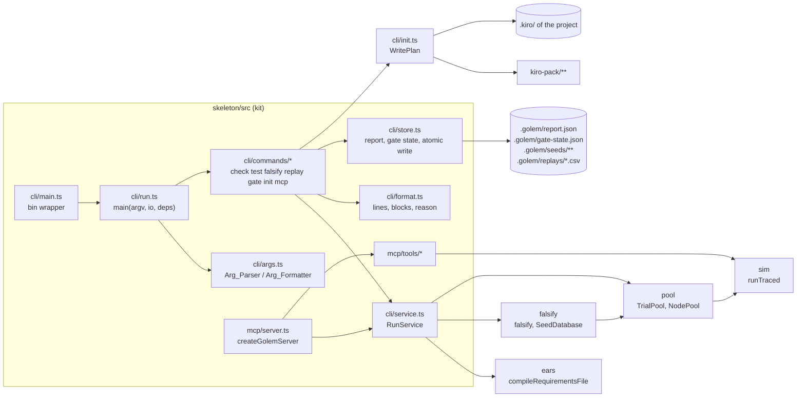
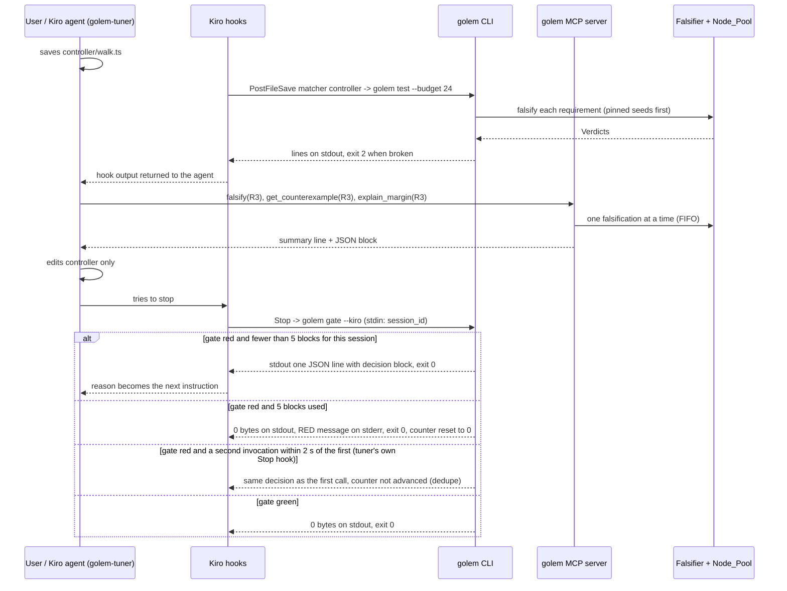
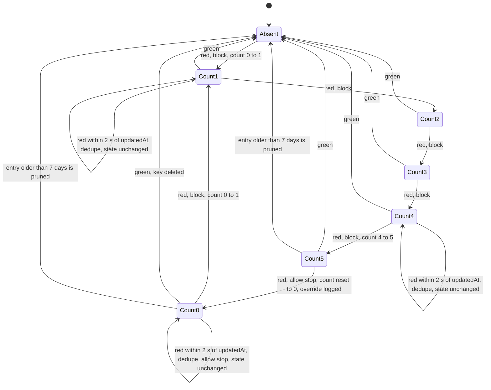
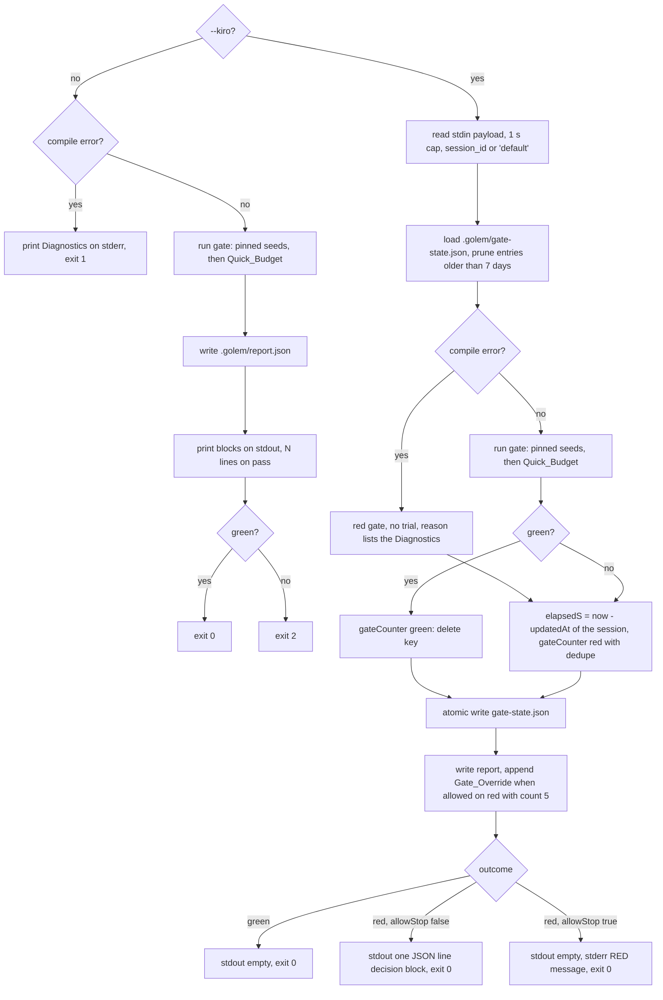
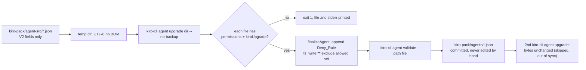

# Design Document: golem-kit

## Overview

`golem-kit` is the part of GOLEM that plugs into Kiro. It has five deliverables:

- `skeleton/src/cli`: the `golem` command (`check`, `test`, `falsify`, `replay`, `gate`, `init`, `mcp`).
- `skeleton/src/mcp`: a stdio MCP server with eight tools.
- `skeleton/kiro-pack`: the templates `golem init` copies into a project's `.kiro/` (hooks, steering, three agents, MCP settings, two skills, one workflow), plus the V2 agent sources that the build script upgrades.
- `skeleton/power`: a Kiro Power that is also an Agent Plugin.
- `skeleton/crew-app`: a small Kiro Crew app that runs the skeptic overnight.

The kit calls three sibling modules and nothing else: `golem-ears` (`compileRequirementsFile`, `compileRequirement`, `Diagnostic`), `golem-sim` (`runTrial`, `ModelCache`) and `golem-falsify` (`falsify`, `createSeedDatabase`, `pinCounterexample`, `TrialPool`, `createNodePool`, `nodeFileSystem`). It renames or removes no contract in `interfaces.md`. Everything it adds is optional (see "Approved optional additions").

The loop it supports: a controller file is saved, a hook runs `golem test`, a counterexample comes back through the CLI or MCP, the agent fixes the controller, and a Stop hook runs `golem gate --kiro`. While a requirement is red, the Stop hook prints `{"decision":"block","reason":...}` on stdout and exits 0, so the agent keeps working. After five blocked attempts in one session, the sixth stop is allowed once, the session counter resets to 0, and the next red gate blocks again. Outside Kiro, `golem gate` without `--kiro` exits 2 on a red gate, for CI and the repair workflow. A `held` verdict means "no counterexample found in N trials". It is never a proof, and no LLM decides any verdict.

### Design decisions

| # | Decision | Rationale | Requirements |
|---|---|---|---|
| D1 | `main(argv, io, deps) => Promise<number>` is the only entry point. `src/cli/main.ts` (already the `bin` target in `package.json`) is a 10-line wrapper that builds `io` and `deps` from Node. | Tests call `main` in-process and read exit codes without spawning. | 28.2 |
| D2 | All side effects go through `KitDeps` and `CliIo`. Modules `sim`, `pool` and MuJoCo are loaded by dynamic `import()` inside `createDefaultDeps`, only by commands that need them. | `golem check` must not load MuJoCo. A test spies on the loader. | 3.8, 27.3 |
| D3 | The loop guard is a pure function `gateCounter` plus a state file keyed by `session_id`. The Stop payload is read for `session_id` only. The counter is not latched: an allowed stop on a red gate resets that session's count to 0. | A bounded retry count cannot be gamed by payload contents. Without the reset, one allowed stop would disable the gate for the rest of the session. The function is testable as a state machine. Two gate invocations for one stop (the workspace Stop hook and the tuner's own Stop hook) are collapsed by a dedupe window of `DEDUPE_WINDOW_S = 2` s, decided from `elapsedS`, which the CLI computes. | 8.5 to 8.25 |
| D4 | The requirements guard is wired only inside `agents/golem-tuner.json`. `hooks/golem.json` has no PreToolUse hook and nothing reads an environment variable. | Kiro spec mode and every other agent keep write access to `requirements.md`. Only the agent that tunes controllers is blocked, and the block follows the agent, not the workspace. | 17.8, 18.4, 18.11, 19.9 |
| D5 | MCP uses the low-level `Server` of `@modelcontextprotocol/sdk` with hand-written JSON-schema `inputSchema`s and a 60-line validator. No `zod` import. | Requirement 27.4 allows no runtime dependency beyond the SDK and `tech.md`. Our validator also produces the "names the invalid field" messages that 11.9 needs. | 11.9, 27.4 |
| D6 | The CLI and the MCP server share one `RunService` (compile, pool, falsify, pin, report). The CLI wraps it with printing and exit codes. The MCP wraps it with queue, time cap and Tool_Result. | One code path means one set of determinism guarantees. | 4, 5, 12, 27.2 |
| D7 | Replay needs the trace, which `TrialResult` does not carry. The kit asks for it through `KitDeps.runTraced`, backed by the approved optional trace exposure of `golem-sim`. | Keeps `interfaces.md` untouched. | 6.3, 6.4, 13, 27.7 |
| D8 | `init` computes a `WritePlan` first and executes it second. Every write is temp file plus rename. | Idempotence and containment are properties of the pure plan. A failure stops before the next file. The starter robot is part of the same plan. | 9 |
| D9 | Agent files go through a pipeline: committed V2 source templates, `kiro-cli agent upgrade <dir>`, a deterministic `finalizeAgent` step that appends the Deny_Rule (with `exclude`) that V2 cannot express, then `kiro-cli agent validate`. The committed result is the finalized universal file. | The upgrade turns V2 `toolsSettings` into V3 `permissions.rules`, but V2 has no way to say "deny everything except these paths". Verified on `kiro-cli` 3.5.0 (see X5). | 19.2, 20.1, 20.6, 21 |
| D10 | `golem gate` has two output protocols chosen by `--kiro`. With it, every outcome exits 0 and the block is carried by stdout JSON. Without it, a red gate exits 2. One pure function `gateExitCode(verdicts, kiro, startError)` holds the mapping. Under `--kiro`, a compile error in a Requirements_File is a Red_Gate that the counter counts, with a block output that lists the Diagnostics. Only a usage or Config_File error exits 1. | Kiro's Stop contract needs exit 0 with JSON. CI and the repair workflow need a non-zero code. A broken spec must not let the agent stop. | 7.11, 8.1, 8.9, 8.22 |

### Approved optional additions

These replace the earlier assumptions A2, A3 and A4. Each is an optional field added to a sibling contract. Nothing is renamed or removed, so `interfaces.md` stays valid (27.7). The sibling specs `golem-ears`, `golem-sim` and the apps must add the fields below, as optional. The kit ships a fallback for each, so it works (with reduced output) before the siblings add them.

| Addition | Exact optional shape | Owner | Kit fallback when absent |
|---|---|---|---|
| Trace exposure for replay | `TrialResult.trace?: Trace`, filled by `runTrial` when a new optional run option `recordTrace?: boolean` is true. `KitDeps.runTraced` calls `runTrial` with `recordTrace: true` and returns `{ result, trace: result.trace }`. | `golem-sim` | `runTraced` throws `TraceUnavailableError`. `golem replay` exits 1 naming the id and the cause, writes no CSV (6.14). MCP `replay` and `explain_margin` return an error result with the same cause. |
| Signal units | `RobotApp.signalUnits?: Record<string, string>` (signal name to unit text, for example `{ "height": "m", "tilt": "rad" }`). | apps | The unit of a lexicon predicate that reads the signal, then the text `unit not declared`. |
| Predicate access | `CompiledRequirement.predicates?: PredicateBinding[]` with `interface PredicateBinding { predicate: PredicateTemplate; slots: Record<string, number>; window?: { t0: number; t1: number } }` (seconds, absent means whole trace). | `golem-ears` | `explain_margin` returns an error result "per-signal margins unavailable: the compiled requirement carries no predicate bindings", unless the monitor result carries `margins`. |
| Monitor margins | The result of `CompiledRequirement.monitor` may carry `margins?: Record<string, number>` (signal name to margin in the unit of the result). | `golem-ears` | The kit recomputes margins from `predicates` along the replayed Trace (13.8). |

### Assumptions (approved unless marked open)

- **A1 Falsify budget.** `falsify` counts pinned seeds inside `maxTrials` (Phase 0 is capped by `T`). The gate's Quick_Budget of 24 is therefore submitted as `maxTrials = 24 + pinnedValidCount`, so the 24 trials are in addition to the pinned ones (7.1). `golem test --budget n` and the MCP `run_requirement` pass `n` unchanged (pinned seeds count toward it, 4.3, 12.1). The MCP `falsify` tool passes `n + pinnedValidCount` (12.2: "within budget search trials"). Phase 3 verification trials may add up to 3 trials past `T`, as the falsify design states.
- **A5 Monitor unit in verdicts.** `Verdict` has no unit. The CLI and MCP capture `TrialResult.unit` through the `onResult` callback of `falsify` and store it as the additive field `unit` on each report entry.
- **A6 App module.** `golem.config.json` field `app` names a JavaScript module whose default export is a `RobotApp` (built output, or loaded under a TypeScript runner the user configures). The kit does not transpile TypeScript.
- **A7 Search seed.** The CLI adds the optional flag `--search-seed <n>` and the optional config field `searchSeed` (uint32, default 1). Requirement 27.1 allows "the Config_File, a flag or a fixed default".
- **A8 Per-app install.** Hooks run in the workspace root. `golem init` is run inside each app directory, so the app directory holds its own `.kiro/` and the Config_Locator finds `golem.config.json` from the hook's working directory. A monorepo root with several apps needs `--app` in its hook commands. Requirements 17.5 and 17.10 are met under this install model.
- **A9 `init --force` and `settings/mcp.json`. RESOLVED** by requirements 9.4 and 22.5: `--force` replaces only the `golem` entry of `mcpServers` and keeps every other entry and every other top-level field. Without `--force`, the entry is added only when absent.
- **A10 Unreadable state.** An existing `.kiro/settings/mcp.json` that is not valid JSON makes `golem init` exit 1 with the path named and no file written. The requirements do not cover this case.
- **A11 Compile errors in `gate`.** An error Diagnostic in any Requirements_File makes `golem gate` without `--kiro` exit 1 (not 2), as for `test` (4.17, 7.11). Under `--kiro` a compile error is instead a Red_Gate (8.9, resolved by OQ5): the gate runs no trial, the counter counts it, the block output lists the Diagnostics, and the exit code is 0. A usage or Config_File error still exits 1 with 0 bytes on stdout. "Nothing to check" is a Red_Gate (7.7, 8.8).
- **A12 Partial verdict.** When the MCP time cap ends `run_requirement` or `falsify`, `falsify` rejects with `AbortError` and returns nothing. The server therefore builds the partial verdict from the `onResult` stream it recorded (trial count, lowest robustness, scenario and seed). A partial verdict is flagged `partial: true`, is never pinned and never written to the Report_File.
- **A13 Gate result code in the report.** `meta.lastGateExitCode` holds `gateExitCode(verdicts, false)`, the code a CI run would return (0 green, 2 red), whatever `--kiro` was. It is written on every gate run that reaches the trial phase. The repair workflow runs `golem gate` without `--kiro`, so the process exit code and the field agree.

### Open questions raised by this revision

| # | Question | Decision, or what the design does meanwhile |
|---|---|---|
| OQ1 | **RESOLVED.** Requirement 21.5 says the build script does not hand-edit upgraded files, but a Deny_Rule with `exclude` cannot come from `kiro-cli agent upgrade`. | Decision: `finalizeAgent` is a deterministic script step and the only post-upgrade change (21.1, 21.2, 21.5). A second upgrade skips the finalized file as "out of sync" and leaves it byte-identical, so the pipeline is idempotent (verified on 3.5.0). |
| OQ2 | **RESOLVED.** `kiro-cli` 3.5.0 rejects a positional path for `agent validate`. | Decision: the command is `kiro-cli agent validate --path <file>`, as requirements 21.2, 21.3 and 21.9 now state. The builder and `kiro-cli.test.ts` use it. |
| OQ3 | **RESOLVED.** The upgrade writes a `kiroUpgrade` marker, rewrites `hooks` into the array form and keeps `toolsSettings` and `allowedTools`. | Decision: `V3_Fields` includes `permissions`, `kiroUpgrade` and `model`. The structural validator accepts those, both `hooks` forms and the V2 fields the upgrade keeps (21.1, 21.4, K1). |
| OQ4 | **RESOLVED by the dedupe window.** The workspace Stop hook (17.4) and the tuner's own Stop hook (19.4) both run `golem gate --kiro` for one stop under one `session_id`. | Decision: both hooks stay. The CLI passes `elapsedS` (seconds from the stored `updatedAt` of the session to the start of the invocation) as the fifth argument of `gateCounter`. With `DEDUPE_WINDOW_S = 2` s, a red call that arrives within the window of an earlier red call returns `nextState` equal to the input, so the second invocation does not advance the counter (8.24, 8.25, Property 14). Residual: two hooks whose invocations start more than 2 s apart (for example when the first gate run is slow) still count twice. This is acceptable, because the effect is only an earlier allowed stop after five counted blocks. |
| OQ5 | **RESOLVED.** A compile error under `--kiro` used to exit 1 with 0 bytes and let the agent stop with a broken spec. | Decision: under `--kiro` a compile error is a Red_Gate. The counter counts it, the block output has a `reason` that lists the Diagnostics, and the exit code is 0. Without `--kiro` it still exits 1 (7.11). A usage or Config_File error exits 1 with 0 bytes in both modes (8.9, 8.22, 8.25, 28.26). |
| OQ6 | Requirement 24.6 (pause on `golem gate` exit 1) depends on the agent step obeying its prompt, because the repeat stop condition only reads the report. The workflow step shape (W1) is unverified. | Pinned by a structural test. Documented as the least verified file. |
| OQ7 | Until `golem-sim` exposes the trace, `golem replay` fails with a named cause. | See "Approved optional additions". |

## Architecture

### Module and data flow



Dependencies point downwards. `check` touches `ears` only. `test`, `falsify`, `gate` and `mcp` reach `pool` and `sim` through `KitDeps.createPool` and `KitDeps.runTraced`, which are loaded lazily.

### The loop: Kiro hooks, golem, MCP



### Gate state machine (per Session_Id)



`count` is the number of consecutive blocks since the last allow. A missing key counts as 0. Red calls 1 to 5 block. Red call 6 sees `count = 5`, allows the stop, prints the stderr RED message, appends a Gate_Override and stores `count = 0` with a fresh `updatedAt`. Red calls 7 to 11 block again, and call 12 allows again. A green gate deletes the key. Count1 to Count4 are also pruned when old, and the dedupe self-loop exists for every count, both drawn once for brevity.

Dedupe (8.24, 8.25): the workspace Stop hook and the tuner's own Stop hook both run `golem gate --kiro` for one stop. When the entry of the session has `updatedAt` less than `DEDUPE_WINDOW_S = 2` s before the start of the current invocation and the current gate is red, the call is the same Stop event as the earlier one. The counter returns `nextState` equal to its input and `allowStop` true only when the stored count is 0 (the earlier call was an allow that reset the count), false otherwise. A deduped call writes the same state back, so `updatedAt` is not refreshed and the window cannot be extended by repeated calls. A green call is never deduped, because it deletes the key.

### `golem gate` data flow



Under `--kiro`, all messages other than the block JSON go to stderr (8.4). The state file is written before anything is printed on stdout (8.16). A write failure prints a warning and the counter's decision still applies (8.19). Only a usage or Config_File error exits 1 with 0 bytes on stdout, and it does so before the state is read (8.9, 8.22). A compile error is not a start error under `--kiro`: it is a Red_Gate that the counter counts, so the agent cannot stop with a broken spec. Without `--kiro`, a compile error exits 1 (7.11). A Gate_Override is appended only for an allow at count 5 (8.21). A deduped allow at count 0 appends none, because the earlier call already logged it.

### Why the guard is agent-scoped

Kiro's spec mode writes `requirements.md` itself. A workspace-level PreToolUse hook would block it, and an environment-variable switch would need something to set the variable. The kit instead puts the guard in `agents/golem-tuner.json` as an agent-scoped `preToolUse` hook. The hook exists only while `golem-tuner` is the active agent. Spec mode, the scribe, the skeptic (which cannot write) and the user's own chat are unaffected. The script itself reads only the payload on stdin, so its result cannot depend on who runs it.

### Verified Kiro formats

Checked against the Kiro documentation, the Agent Plugins specification, and (for the agent pipeline) by running `kiro-cli` 3.5.0 locally. "Not verified" and "Assumed" items are pinned by structural tests that fail loudly if a file drifts.

| Format | Status | Source |
|---|---|---|
| Hook file `.kiro/hooks/<id>.json`: `{ "version": "v1", "hooks": [ { name, description?, trigger, matcher?, action: { type: "command", command }, timeout?, enabled? } ] }`. `timeout` is in seconds, default 60. | Verified | [Kiro hooks](https://kiro.dev/docs/hooks/) |
| Trigger names are PascalCase: `PostFileSave`, `PostTaskExec`, `PreToolUse`, `Stop`, `SessionStart`. For file events the matcher is a regex on the file path. For tool events it is a tool selector or regex on the tool ID. | Verified | [Hook types](https://kiro.dev/docs/hooks/types/) |
| Command hooks get a JSON event on stdin with `hook_event_name`, `cwd`, `session_id`; tool events add `tool_name` and `tool_input`. Exit 0 adds stdout to context. Exit 2 denies on gating events (PreToolUse). | Verified | [Hook types](https://kiro.dev/docs/hooks/types/) |
| A Stop hook that exits 0 and prints `{"decision":"block","reason":"..."}` sends the reason back and the agent continues. This is the contract the kit implements (X6). | Partly. Documented by a third-party mirror. Approved by the requirement owner. | [hooks reference mirror](https://github.com/dev-rb-hub/rendu.ai/blob/main/docs/reference/kiro-cli/hooks.md) |
| Manual hook trigger `Manual` (CLI V3 and Web; the IDE cannot create one). | Partly. Named in the hook types page. | [Hook types](https://kiro.dev/docs/hooks/types/) |
| Agent file (IDE 1.0 and CLI V3): fields `name, description, prompt, mcpServers, tools, resources, hooks, permissions, model` and the legacy `allowedTools, toolsSettings`. V3 ignores `toolsSettings` and reads `permissions`. | Verified | [Agent configuration reference](https://kiro.dev/docs/custom-agents/configuration-reference/) |
| Permission rule: `{ "capability": "fs_write", "match": [globs], "exclude": [globs], "effect": "allow" or "deny" }` inside `permissions.rules`. Capabilities include `fs_read, fs_write, shell, mcp, skill`. Deny overrides ask overrides allow, with no precedence between scopes. `exclude` globs "must NOT match". Filesystem globs: `*` within one path component, `**` across separators, patterns without wildcards also match children. | Verified | [Permissions](https://kiro.dev/docs/permissions/) |
| The base of a relative filesystem glob (workspace root versus App_Dir) | Assumed workspace-relative. With the per-app install of A8 the two coincide. | |
| Writes under `.kiro/specs` ask in an untrusted workspace even when a rule allows them. Writes to `.kiro/settings` are always denied. | Verified. The scribe's proposals file therefore needs a trusted workspace. | [Permissions](https://kiro.dev/docs/permissions/) |
| `kiro-cli agent upgrade <directory>`: converts top-level `*.json` in the directory, flags `--dry-run` and `--no-backup`, backup `<file>.json.bak`, exit 0 when every file was upgraded, unchanged or skipped, 1 when a file failed, 2 when the path is bad. | Verified | [Upgrading agent configs](https://kiro.dev/docs/cli/v3/upgrade-agent/); run on 3.5.0 |
| Upgrade results on 3.5.0: `toolsSettings.write.allowedPaths` becomes an `fs_write` allow rule with `match`; `toolsSettings.write.deniedPaths: ["**"]` becomes an `fs_write` deny rule; `allowedTools` entries become `fs_read`, `mcp` (`match: ["golem/falsify"]`) and `skill` allow rules; `tools` is sorted; object-form `hooks` become an array with `name`, `trigger` (`preToolUse`, `stop`), `matcher`, `action`, `timeout`; a V2 hook `timeout_ms` becomes `timeout` in whole seconds; a hook matcher `fs_write` is widened to `write` with a warning; a `kiroUpgrade` marker `{ revision, fingerprint, source }` is added; `toolsSettings` and `allowedTools` stay in the file. | Verified by running the command | local run |
| A file with a hand-written `permissions` block next to V2 fields, or an upgraded file edited by hand, is reported `skipped ... out of sync (not rebuilt)`, exit 0, bytes unchanged. A pristine upgraded file is reported `unchanged ... already universal`. | Verified by running the command | local run |
| An agent file with a UTF-8 byte order mark is rejected by the upgrade with `Invalid JSON: expected value at line 1 column 1`. The build script writes UTF-8 without BOM. | Verified by running the command | local run |
| `kiro-cli agent validate --path <file>`; exit 0 on a valid finalized universal file. A positional path is rejected. | Verified by running the command (see OQ2) | local run; [CLI commands](https://kiro.dev/docs/reference/cli-commands/) |
| Workflow recipe file name `<name>.workflow.json` under `.kiro/workflows/`. Repeat node: `{ "type": "repeat", "id", "maxIterations", "onMaxIterations": "pause", "stopCondition": { "fileCheck": { "path", "jsonPath", "value" } } }`. An unknown field such as `until` is dropped silently. | Partly (third-party article) | [Kiro workflows](https://kiro.dev/docs/workflows/), [recipe article](https://www.jpmti2016.com/articles/kiro-workflows-recipes-automate-pipeline) |
| Workflow step node shape and a node that runs a shell command | Not verified. Assumption W1. | |
| Agent Plugins 1.0: `plugin.json` at the plugin root with a closed schema. Permitted top-level fields are `$schema, name, version, description, author, homepage, repository, license, keywords, extensions`. Skills live in `skills/<name>/SKILL.md`. MCP servers live in `mcp.json` with `$schema` and `mcpServers`; a stdio entry has `type: "stdio"`, `command`, `args`. | Verified | [Agent Plugins specification](https://agent-plugins.org/specification), [Kiro blog](https://kiro.dev/blog/powers-supports-plugins/) |
| Crew app `app.json`: required `name, version, displayName, description`; `author, license, tags`; `agents[], skills[], mcpServers`; `repo, iconPath, screenshots[], highlights[]`; `crons[] { name, every or cron_expr, message, agent?, enabled? }`; `permissions { api, events, mcpTools, storage, cron, memory, network, jobs }`. There is no `schedule` field and no time-zone field. Icon: PNG with transparency, at least 256 x 256. Screenshots: PNG or JPG, 1200 px wide, 16:9, at most 5. | Verified (read 2026-11) | [Manifest reference](https://kiro.dev/docs/crew/apps/manifest/), [Build your first app](https://kiro.dev/docs/crew/apps/build-first-app/), [Publishing](https://kiro.dev/docs/crew/apps/publishing/) |
| Whether a Crew gateway reads our agent JSON files and skill front matter, and which time zone it reads `cron_expr` in | Not verified. Assumption C1. | |
| MCP SDK 1.32.2 installed in the repo exports `InMemoryTransport.createLinkedPair()` from `@modelcontextprotocol/sdk/inMemory.js`, and `Server`, `StdioServerTransport`, `Client`. | Verified (read `node_modules/.../inMemory.d.ts`) | local |

Assumptions that remain after this table:

- **W1** the workflow uses steps `{ "type": "step", "id", "agent", "prompt" }` and the gate step is an agent step whose agent runs `golem gate` through its shell tool. The repeat stop condition reads `.golem/report.json`, path `meta.lastGateExitCode`, value `0` (A13). The `jsonPath` syntax is unverified.
- **C1** a Crew gateway accepts the Kiro agent files and the skills of the pack as they are, and reads `cron_expr` in its own host time zone. The manifest fields themselves are verified. No gateway was available to install the app.
- **K1** an upgraded Agent_File may carry `permissions`, `model` and `kiroUpgrade` (V3_Fields) next to V2_Fields, and its `hooks` may be in object or array form. The structural test accepts exactly that set (OQ3).

### Decisions on the research conflicts (X1 to X7)

All seven conflicts between the research and the requirements are resolved. The interim handling is gone.

| # | Topic | Status | Decision applied |
|---|---|---|---|
| X1 | Hook `action` shape | **RESOLVED** | `action` is the object `{ "type": "command", "command": "..." }` (17.1). The structural test checks `action.type === "command"` and a non-empty `action.command`. |
| X2 | Hook matchers | **RESOLVED** | Matchers are regular expressions, not globs: `(^\|[\\/])requirements\.md$` and `(^\|[\\/])controller[\\/]` (17.2, 17.3). Tests run each regex against sample paths (28.24, Property 41). |
| X3 | `plugin.json` fields | **RESOLVED** | `plugin.json` holds `$schema` and only fields Agent Plugins 1.0 defines. `skills/` and `mcp.json` are found by convention and are not named in the manifest (25.1). |
| X4 | URL scan | **RESOLVED** | `mcp.json` may hold `$schema`. The no-URL scan of the Power allows only the `$schema` value of `plugin.json` and of `mcp.json` (25.6, 28.25, Property 48). |
| X5 | Write restriction in agents | **RESOLVED** | Pipeline of D9: V2 source templates, `kiro-cli agent upgrade <dir>`, `finalizeAgent`, `kiro-cli agent validate --path`. The skeptic's deny-all comes from the upgrade (`deniedPaths: ["**"]`). The tuner's and scribe's deny-with-exclude is appended by `finalizeAgent`. The structural validator checks the effective permissions (21.8). See OQ1 to OQ3. |
| X6 | Stop hook block protocol | **RESOLVED** | With `--kiro`, a blocked red gate prints `{"decision":"block","reason":...}` on stdout and exits 0. Without `--kiro`, a red gate exits 2. With `--kiro` every outcome exits 0 except a usage or Config_File error (1). The workflow runs `golem gate` without `--kiro`. |
| X7 | Command names | **RESOLVED** | `kiro-cli agent upgrade <dir>` and `kiro-cli agent validate` (path through `--path`, OQ2). |

## Components and Interfaces

All signatures are types only. File paths are under `skeleton/`.

### File layout

```
skeleton/
  src/cli/
    main.ts              bin wrapper: builds CliIo and KitDeps, calls run(), sets process.exitCode
    run.ts               main(argv, io, deps): Promise<number>
    args.ts              COMMANDS table, parseArgs, formatArgs, ArgError
    config.ts            GolemConfig, locateApp, parseConfig, formatConfig, ConfigError
    deps.ts              KitDeps, CliIo, createDefaultDeps (lazy imports)
    service.ts           RunService (compile, run, falsify, pin, report)
    format.ts            requirement lines, counterexample lines, gate blocks, buildReason, formatQuantity
    exit.ts              testExitCode, gateExitCode, HookExit
    store.ts             atomicWriteFile, report IO, gate-state IO, mergeReport
    gate-counter.ts      gateCounter, pruneState, parseStopPayload
    replay-target.ts     selectReplay (pinned or closest, seed override)
    studio-url.ts        encodeStudioHash, decodeStudioHash, studioUrl
    csv.ts               traceToCsv, formatNumber
    init.ts              buildPlan, executePlan, mergeMcpSettings
    commands/            check.ts test.ts falsify.ts replay.ts gate.ts init.ts mcp.ts
  src/mcp/
    server.ts            createGolemServer, runStdioServer
    schema.ts            ToolDef, validateInput, SchemaError
    result.ts            makeToolResult, limitJson, summarise
    queue.ts             FifoQueue, WriteQueue
    cap.ts               withTimeCap
    margins.ts           signalMargins, explain
    proposals.ts         ProposalEntry, formatEntry, parseEntries, appendProposal
    tools/               list.ts check.ts run.ts falsify.ts counterexample.ts replay.ts explain.ts propose.ts
  kiro-pack/
    agent-src/           golem-tuner.json golem-skeptic.json golem-scribe.json   V2 source templates (not copied by init)
    hooks/golem.json
    hooks/golem-guard-requirements.mjs
    steering/golem-ears.md
    agents/              golem-tuner.json golem-skeptic.json golem-scribe.json   built: upgraded and finalized, committed
    settings/mcp.json
    skills/robot-ears/SKILL.md  skills/falsify-and-fix/SKILL.md
    workflows/falsify-and-fix.workflow.json
    manifest.json        generated: PackManifest (lists every file except agent-src/)
  power/                 plugin.json  mcp.json  POWER.md  LICENSE  skills/**  steering/golem-ears.md
  crew-app/              app.json  agents/*.json  skills/**  assets/icon.png
  scripts/
    build-pack.ts        PackBuilder: upgrade, finalize, validate, manifest
    pack-checks.ts       pure checkers shared by the build and the tests (see "Pack checkers")
    sync-power.ts        copy skills and steering into power/, parity check
  test/                  pack, guard (child_process), scans, tiny-app support
```

### Entry point and I/O (`run.ts`, `deps.ts`)

```ts
interface CliIo {
  stdout: { write(s: string): void };
  stderr: { write(s: string): void };
  stdin: { isTTY: boolean; read(timeoutMs: number): Promise<string | undefined> };  // undefined = nothing within the cap
  cwd: string;
}

declare function main(argv: readonly string[], io: CliIo, deps: KitDeps): Promise<number>;  // exit code, never throws

/** Narrow injected dependencies. Names marked [sibling] bind to the real sibling modules. */
interface KitDeps {
  fs: KitFs;                                   // node:fs/promises subset, see below
  now(): Date;                                 // wall time for stamps and pruning only
  clock(): number;                             // monotonic ms for durations
  packRoot: string;                            // absolute path of skeleton/kiro-pack
  loadApp(modulePath: string): Promise<RobotApp>;
  compileFile: typeof import('golem-spec').compileRequirementsFile;      // [ears]
  compileLine: typeof import('golem-spec').compileRequirement;           // [ears]
  falsify: typeof import('golem-spec').falsify;                          // [falsify]
  createSeedDatabase: (root: string) => SeedDatabase;                    // [falsify] over nodeFileSystem()
  pinCounterexample: typeof import('golem-spec').pinCounterexample;      // [falsify]
  createPool(o: { app: RobotApp; appDir: string; size?: number }): Promise<TrialPool>;  // [pool] createNodePool, lazy
  runTraced(app: RobotApp, req: CompiledRequirement, spec: TrialSpec): Promise<{ result: TrialResult; trace: Trace }>;  // [sim] runTrial with recordTrace, throws TraceUnavailableError
  gitCommit(appDir: string): Promise<string | undefined>;
}

interface KitFs {
  readFile(p: string): Promise<string>;              // ENOENT as error.code
  readBytes(p: string): Promise<Uint8Array>;
  writeFile(p: string, data: string | Uint8Array): Promise<void>;
  rename(a: string, b: string): Promise<void>;
  mkdir(p: string, o: { recursive: true }): Promise<void>;
  remove(p: string): Promise<void>;                  // ignores missing
  realpath(p: string): Promise<string>;
  readdir(p: string): Promise<string[]>;
  stat(p: string): Promise<{ isFile: boolean; isDirectory: boolean }>;
}
declare function createDefaultDeps(): KitDeps;       // every heavy import is `await import()` inside a function body
```

`main` catches every thrown error, prints `golem: <message>` on stderr and returns 1. Seeds are never drawn from `Math.random`.

### Arg_Parser and Arg_Formatter (`args.ts`)

```ts
type FlagKind = 'bool' | 'string' | 'posint' | 'posnum';   // posint: positive integer. posnum: positive finite decimal.
interface FlagSpec { name: string; kind: FlagKind }
interface CommandSpec {
  name: CommandName;
  usage: string;                                // one line, shown on missing positionals
  positionals: { name: string; required: boolean }[];   // at most these many
  flags: FlagSpec[];                            // command flags; global flags are added by the parser
}
type CommandName = 'check' | 'test' | 'falsify' | 'replay' | 'gate' | 'init' | 'mcp';
declare const GLOBAL_FLAGS: FlagSpec[];          // --app string, --json bool, --help bool
declare const COMMANDS: Record<CommandName, CommandSpec>;

interface ParsedCommand {
  command: CommandName;
  positionals: string[];
  flags: Record<string, string | number | true>;   // value type follows FlagKind; numbers already parsed
}
declare class ArgError extends Error { flag?: string; value?: string }
declare function parseArgs(argv: readonly string[]): ParsedCommand | { help: true };   // throws ArgError
declare function formatArgs(cmd: ParsedCommand): string[];
```

Per-command flags:

| Command | Positionals | Flags |
|---|---|---|
| `check` | `[file]` | none |
| `test` | none | `--req` string, `--budget` posint, `--time` posnum, `--workers` posint, `--search-seed` posint |
| `falsify` | `<reqId>` required | `--budget`, `--time`, `--workers`, `--search-seed` |
| `replay` | `<reqId>` required | `--seed` posint |
| `gate` | none | `--kiro` bool, `--budget`, `--time`, `--workers`, `--search-seed` |
| `init` | `[dir]` | `--force` bool, `--no-starter` bool |
| `mcp` | none | none |

Parser rules (Requirement 2): a `bool` flag takes no value; a value flag takes the next argument or the text after the first `=`; a missing or empty value fails naming the flag (2.9); an unknown flag lists every accepted flag (2.2); a numeric flag that is not positive, finite and decimal fails naming flag and value as written (2.3); a missing required positional prints the usage line (2.4); everything after the first `--` is positional and the `--` is dropped (2.5); repeated flags and extra positionals fail naming the flag or first extra argument (2.11); an unknown or missing command lists the valid names (2.10). Global flags are accepted before or after the command name (1.7). `--help` returns `{ help: true }` before any other check except syntax errors. A parse failure prints on stderr, returns 1 and starts no simulation (2.8).

`formatArgs` emits the command, flags in `COMMANDS` order with `--flag=value` for value flags, then `--` when any positional starts with `--`, then positionals. Numbers use `String(n)`, which round-trips.

### Config (`config.ts`)

```ts
interface GolemConfig {
  app: string;                    // path of the RobotApp module (A6)
  requirements: string[];         // Requirements_File paths, listed order is check order
  studioUrl?: string;
  robot?: string;                 // names .kiro/specs/<robot>/
  toolTimeCapS?: number;          // positive finite, default 60
  searchSeed?: number;            // uint32, default 1 (A7)
}
interface LocatedApp { appDir: string; configPath: string; config: GolemConfig }   // paths absolute, requirements resolved
declare class ConfigError extends Error { path: string; field?: string }

declare function locateApp(cwd: string, appFlag: string | undefined, fs: KitFs): Promise<LocatedApp>;  // throws ConfigError
declare function parseConfig(text: string, path: string): GolemConfig;     // validates fields in this order: app, requirements, studioUrl, robot, toolTimeCapS, searchSeed
declare function formatConfig(c: GolemConfig): string;                      // 2-space JSON, fixed key order, trailing newline
```

Search: without `--app`, check `cwd`, then each parent up to the root, first hit wins (1.1). With `--app <dir>`, resolve against `cwd`, look only there (1.2). A miss throws a `ConfigError` whose message names the start directory and suggests `golem init` (1.3). Validation names the config path and the first invalid field in the field order above, or the JSON parse position (1.4). Unknown fields are kept out of the result and raise no warning (1.5). Relative paths resolve against `appDir`, absolute paths stay (1.6). `formatConfig` writes keys in the order of the interface, omitting undefined fields. `--help` never calls `locateApp` (1.8).

### Exit codes and gate counter (`exit.ts`, `gate-counter.ts`)

```ts
declare const HookExit: { ok: 0; error: 1; broken: 2 };

declare function testExitCode(verdicts: readonly Pick<Verdict, 'status'>[]): 0 | 1 | 2;
// 2 if any 'broken'; else 1 if any 'error'; else 0.   Req 4.11, 4.12, 5.5

declare function gateExitCode(
  verdicts: readonly Pick<Verdict, 'status'>[], kiro: boolean, startError?: boolean
): 0 | 1 | 2;
// startError (usage or Config_File error: 1 in both modes; compile error: 1 only when kiro is false). Req 7.11, 8.9
// else kiro: 0 for every list, blocked or allowed or green. A compile error under kiro is a Red_Gate, not a startError.   Req 8.9, 8.22
// else 0 iff the list is non-empty and every status is 'held'; otherwise 2.             Req 7.3 to 7.5, 7.7

type GateState = Record<string, { count: number; updatedAt: string }>;     // key = Session_Id; updatedAt = UTC ISO 8601 with milliseconds
declare const BLOCK_LIMIT = 5;
declare const DEDUPE_WINDOW_S = 2;
declare function gateCounter(
  state: Readonly<GateState>, sessionId: string, gateGreen: boolean, nowIso?: string, elapsedS?: number
): { allowStop: boolean; nextState: GateState };
// elapsedS: seconds from the stored updatedAt of sessionId to the start of this invocation.
// The CLI computes it as (startMs - Date.parse(entry.updatedAt)) / 1000 and passes it; the function reads no clock.
// Absent when the session has no entry, when updatedAt is invalid, or when the caller does not dedupe.
declare function pruneState(state: Readonly<GateState>, nowMs: number): GateState;  // drops entries > 7 days old or with invalid updatedAt
declare function parseStopPayload(raw: string | undefined): { sessionId: string };   // 'default' unless a non-empty string session_id exists
```

`gateCounter` rules (8.11 to 8.15, 8.23 to 8.25):

- Green: returns `allowStop: true`, deletes the key of `sessionId` and copies every other key. Green is never deduped.
- Red with an entry for `sessionId` and `0 <= elapsedS < DEDUPE_WINDOW_S` (dedupe, 8.24): returns `nextState` equal to `state` and `allowStop: true` when the entry's `count` is 0, false otherwise. The entry keeps its `updatedAt`, so the window does not slide. A negative or non-finite `elapsedS` (clock skew, bad data) is treated as absent.
- Red otherwise, with `count < 5` (a missing key is 0): returns `allowStop: false` and `count + 1`, with `updatedAt = nowIso`.
- Red otherwise, with `count === 5`: returns `allowStop: true` and stores `count: 0` with `updatedAt = nowIso`. There is no latch, so the next red call blocks again, for up to five more calls.
- Only the key of `sessionId` changes. The input is not mutated. There is no clock, file or random access.
- `updatedAt` comes from the optional fourth argument (the caller passes `deps.now().toISOString()`, which has millisecond precision). When it is absent, a changed key keeps its previous `updatedAt`, and a new key gets `1970-01-01T00:00:00.000Z`, which `pruneState` would drop. The CLI always passes it. The CLI also computes `elapsedS` from the state it read after pruning, using the same `deps.now()` reading it passes as `nowIso`, so the two arguments agree.
- The dedupe is decided on the red result alone. The design does not store the result class of the earlier call: a green call deletes the entry, so an entry that exists was written by a red call.

Residual: dedupe compares only times. Two Stop hooks whose invocations start more than 2 s apart are counted as two Stop events (OQ4).

With `--kiro`, `gate` always exits `gateExitCode(verdicts, true)`, which is 0. Without `--kiro`, `gate` exits `gateExitCode(verdicts, false)` and uses no counter and no state file.

### Services (`service.ts`)

```ts
interface RunOptions {
  req?: string;                                  // restrict to one requirement id
  budget?: number; timeS?: number; workers?: number; searchSeed?: number;
  mode: 'full' | 'random-only';
  budgetKind: 'test' | 'gate' | 'mcp-run' | 'mcp-falsify';   // selects defaults and the A1 pinned-seed arithmetic
  signal?: AbortSignal;
  onProgress?: (e: ProgressEvent) => void;
}
interface RequirementOutcome {
  req: CompiledRequirement;
  verdict: Verdict; meta: RunMetadata; unit: string | undefined;          // A5
  pinned?: 'added' | 'duplicate';
}
interface CompileOutcome { requirements: CompiledRequirement[]; diagnostics: FileDiagnostic[] }
interface FileDiagnostic extends Diagnostic { file: string }

declare function compileAll(app: LocatedApp, robotApp: RobotApp, deps: KitDeps, onlyFile?: string): Promise<CompileOutcome>;
declare function toFalsifyOptions(o: RunOptions, app: LocatedApp, pinnedValid: number): FalsifyOptions;   // pure, A1
declare function runRequirements(app: LocatedApp, robotApp: RobotApp, reqs: CompiledRequirement[], o: RunOptions, deps: KitDeps, pool: TrialPool): Promise<RequirementOutcome[]>;
declare function applyPinnedRule(o: RequirementOutcome): RequirementOutcome;   // gate: a pinned seed whose re-run robustness is <= 0 makes the requirement 'broken' (7.3)
declare function withPool<T>(deps: KitDeps, app: LocatedApp, robotApp: RobotApp, size: number | undefined, body: (p: TrialPool) => Promise<T>): Promise<T>;  // try/finally close
```

Defaults in `toFalsifyOptions`: `test` and CLI `falsify` use `maxTrials 64` when neither `--budget` nor `--time` is given (4.6); `gate` uses `24 + pinnedValid` (A1, 7.2); with `--budget` or `--time` the gate applies the flag as `test` does (7.2); both flags end the search at whichever limit is reached first (4.7). `maxWallMs = timeS * 1000`. `searchSeed` is the flag, else `config.searchSeed`, else 1. `mode` is `full` except for MCP `run_requirement`. The call to `falsify` always passes `seedDb` as a read-only reader, so the falsifier never writes. After a `broken` result, `pinCounterexample(db, appId, outcome.pinEntry)` runs before the command returns (4.14, 5.8).

`withPool` creates the pool with `deps.createPool` and closes it in `finally`, on success, throw or abort (4.16, 5.9, 7.10). The pool size is `--workers`, or the Node_Pool default when absent (4.5).

### Output formatting (`format.ts`)

```ts
declare function formatQuantity(kind: Kind, si: number): string;            // 168 -> "168 N"; angle in deg; ratio in %; phase as "0.62 (stride phase)"
declare function formatScenario(space: ScenarioSpace, s: Scenario): string; // "push.force = 168 N, push.angle = 135 deg"
declare function formatMargin(robustness: number, unit: string | undefined): string;   // "-0.118 m", "+0.031 m", "margin unavailable"
declare function requirementLine(o: RequirementOutcome): string;           // Req 4.8, 4.9
declare function progressLine(e: ProgressEvent, label: 'pinned' | 'random' | 'guided' | 'shrink'): string;   // Req 5.2
declare function gateBlock(o: RequirementOutcome, earsLine: string): string;  // Req 7.6
declare function buildReason(blocks: readonly string[], reportPath: string, max?: number): string;  // Req 8.2, 8.7; max default 4000
declare function sortDiagnostics(d: readonly FileDiagnostic[], fileOrder: readonly string[]): FileDiagnostic[];
declare function diagnosticText(d: FileDiagnostic): string;                // "file:line:col: severity: message" plus "  suggestion" line
declare function checkJson(reqs: readonly CompiledRequirement[], d: readonly FileDiagnostic[]): CheckJson;   // Req 3.7
```

Requirement line: `R3 BROKEN margin -0.118 m 41 trials push.force = 168 N, push.angle = 135 deg (shrunk, seed 417)`. A held line ends with `no counterexample in 64 trials; from the 40 uniformly random ones, failure rate below 7.5 % (95 % confidence)`; the bound is from the random trials only, and without a bound the line ends after `trials`. An error line carries the first message of `meta.errors`. The phase labels map falsify's phases `0, 1, 2, 3` to `pinned, random, guided, shrink`.

`gateBlock` has four lines: the EARS line as written, the counterexample scenario with units, the margin with unit, and `golem replay <reqId>`. For `error` status the scenario and margin lines become `error: <cause>`.

`checkJson` returns `{ ok, requirements: [{ id, source, pattern }], diagnostics: [{ file, line, col, severity, message, suggestion }] }` with `ok` true only when no Diagnostic has severity `error` and `suggestion` null when none exists (3.7).

`buildReason` joins blocks with one blank line. When the joined text is at most `max`, it is returned. Otherwise it keeps whole lines from the start while `kept.length + 1 + footer.length <= max`, where `footer = "... truncated, see " + reportPath`, and returns `kept + "\n" + footer`. If the footer alone exceeds `max` it is cut to `max` characters. The kept part is always a prefix of the joined text that ends at a line boundary.

### Store (`store.ts`)

```ts
declare function atomicWriteFile(fs: KitFs, path: string, data: string | Uint8Array, nextTmp: () => string): Promise<void>;
// mkdir -p, write <path>.tmp-<n>, rename; on failure remove the temp file and rethrow with the path named

interface ReportMeta { budget: { maxTrials?: number; maxWallMs?: number }; commit?: string; durationS: number; searchSeed: number; lastGateExitCode?: number }
interface ReportVerdict extends Verdict { unit?: string; ears?: string }          // additive fields (A5)
interface GateOverride { sessionId: string; timestamp: string; count: number; brokenReqIds: string[] }
interface ReportFile { schema: 1; verdicts: ReportVerdict[]; meta: ReportMeta; gateOverrides: GateOverride[] }

declare function readReport(fs: KitFs, path: string): Promise<{ report?: ReportFile; unreadable?: string }>;
declare function mergeReport(prev: ReportFile | undefined, next: ReportVerdict[], meta: ReportMeta, scope: 'all' | { reqId: string }): ReportFile;
// scope 'all' replaces verdicts; scope reqId replaces that entry (or appends) and leaves every other entry unchanged. gateOverrides are always kept.
declare function appendOverride(r: ReportFile, o: GateOverride): ReportFile;      // appends, keeps every earlier override (8.10, 8.21)
declare function stableJson(v: unknown): string;     // sorted keys, 2 spaces, non-finite numbers as null, trailing newline

declare function readGateState(fs: KitFs, path: string, warn: (m: string) => void): Promise<GateState>;
// missing file: {} silently. Unreadable or wrong shape: {} plus warn(path).     Req 8.17
declare function writeGateState(fs: KitFs, path: string, s: GateState, nextTmp: () => string): Promise<void>;
```

Temp names use a counter owned by the caller, never `Math.random`.

### Replay target, Studio_URL and CSV (`replay-target.ts`, `studio-url.ts`, `csv.ts`)

```ts
type ReplayTarget =
  | { ok: true; source: 'pinned' | 'closest'; scenario: Scenario; seed: number }
  | { ok: false; reason: 'none-pinned' | 'seed-not-pinned'; pinnedSeeds: number[] };
declare function selectReplay(
  pinned: readonly Counterexample[], closest: { scenario: Scenario; seed: number } | undefined,
  o: { cli: boolean; seed?: number }
): ReplayTarget;
```

`selectReplay` rules. CLI (`cli: true`): no `--seed` gives the last pinned entry (6.1); `--seed n` gives the scenario of the last pinned entry with seed `n`, or the report's `closest` scenario when nothing is pinned (6.2); nothing pinned and no usable `closest` is `none-pinned` (6.8). MCP (`cli: false`): with `seed`, the pinned entry whose seed equals it, else `seed-not-pinned` with the pinned seeds listed; without `seed`, the latest pinned entry; none pinned is `none-pinned` (13.1, 13.7).

```ts
interface StudioHash { reqId: string; seed: number; scenario: Scenario }
declare function encodeStudioHash(h: StudioHash): string;
declare function decodeStudioHash(hash: string): StudioHash;     // throws on malformed input
declare function studioUrl(cfg: Pick<GolemConfig, 'studioUrl'>, appId: string, h: StudioHash): string;

declare function formatNumber(x: number): string;                 // shortest round-trip decimal; "-0" for negative zero
declare function traceToCsv(trace: Trace): string;                // header t,<signals in key order>; one row per sample; "\n" line ends
```

Hash format: `#r=<enc(reqId)>&seed=<uint>&d.<enc(dimName)>=<number>&...`, dimensions sorted by name in code unit order, `enc` is `encodeURIComponent`. Numbers are SI values written with `formatNumber`, so angles and phases stay in radians and fractions. Decoding uses `Number()`, which accepts every `formatNumber` output (including `1e-7`, `-0`). `NaN` and infinities are rejected on encode. With no `studioUrl`, the base is `apps/<appId>/web/index.html` (6.6).

### Commands

```ts
type CommandHandler = (p: ParsedCommand, io: CliIo, deps: KitDeps) => Promise<number>;
declare const handlers: Record<CommandName, CommandHandler>;
```

- **check** (3). Locates the app, loads the `RobotApp` (lexicon only, no pool), compiles each file in listed order (or only `<file>` resolved against `cwd`), sorts Diagnostics by file order, line, column, prints them, and ends with `N requirements compiled, M warnings`. `--json` prints `checkJson`. A missing named file exits 1 with the path on stderr and compiles nothing else (3.9). A file with no criteria adds a warning (3.10). It never calls `deps.createPool` or `deps.runTraced`.
- **test** (4). Compiles; exits 1 with Diagnostics or "no requirements found" when there are errors or none (4.17); validates `--req` against the ids and lists valid ids on a miss (4.15); runs `runRequirements` inside `withPool`; prints one line per requirement in order; writes the report with `mergeReport` (scope `all`, or `{ reqId }` for `--req`); returns `testExitCode`.
- **falsify** (5). Same as `test` for one requirement. A missing or unknown `<reqId>` exits 1 and lists the ids (5.7). Progress goes through `progressLine`, one line per Generation, and with `--json` one object per line followed by the Verdict (5.6). It merges only that entry into the report (5.4).
- **replay** (6). Uses `selectReplay` with `cli: true`, calls `deps.runTraced`, prints the trace summary (robustness with unit, worst-moment time, and for each signal min, max and value at the worst moment with units, from `signalUnits` or the fallback), writes `.golem/replays/<reqId>.csv` through `atomicWriteFile`, and prints the Studio_URL. It never writes the seed database or the report (6.13). A failed run or an unavailable trace exits 1, writes no CSV and names the id and cause (6.14). A successful replay exits 0 whatever the robustness (6.9).
- **gate** (7, 8). Described in the flow above. Without `--kiro` it exits `gateExitCode(verdicts, false)`, prints per-requirement blocks and the pass line on stdout, and uses no state. With `--kiro` it follows the protocol of Requirement 8, prints everything except the block JSON on stderr, and exits 0. "Nothing to check" is a Red_Gate in both modes (7.7, 8.8). A usage or Config_File error exits 1 with 0 bytes on stdout (8.9). It writes `meta.lastGateExitCode` (A13).
- **init** (9, 16, 22). See below.
- **mcp** (10). Validates `toolTimeCapS` (15.6), then `runStdioServer`.

### `golem init` (`init.ts`)

```ts
interface PackManifest { files: { rel: string; sha256: string; kind: 'copy' | 'merge-mcp' }[] }   // rel is relative to kiro-pack and to .kiro/; agent-src/ is not listed
type PlanAction = 'write' | 'skip' | 'merge';
interface PlanEntry {
  rel: string; target: string; kind: 'copy' | 'merge-mcp' | 'config' | 'starter'; action: PlanAction; reason?: string;
  src?: string;                          // starter entries: path under the starter root
  config?: 'placeholder' | 'starter';    // config entry: which text to write
  note?: string;                         // printed after the path, e.g. 'starter cart-pole robot'
}
interface WritePlan { targetDir: string; entries: PlanEntry[]; starter?: { root: string; skipped?: string } }

declare function readManifest(fs: KitFs, packRoot: string): Promise<PackManifest>;                // throws PackError naming packRoot (9.15)
declare function buildPlan(fs: KitFs, targetDir: string, m: PackManifest, o: { force: boolean; starterRoot?: string }): Promise<WritePlan>;
declare function executePlan(fs: KitFs, plan: WritePlan, packRoot: string, o: { force: boolean }, say: (line: string) => void): Promise<void>;
declare function mergeMcpSettings(existing: string | undefined, template: string, force: boolean):
  { text: string; outcome: 'created' | 'added' | 'kept' | 'replaced' };      // A9, A10: throws on invalid JSON
declare function containedIn(realTarget: string, realCandidate: string): boolean;
```

`buildPlan` is read-only. For each manifest entry it resolves `targetDir/.kiro/<rel>`, resolves symlinks with `realpath` on the nearest existing ancestor, and fails the whole plan with exit 1 if the result is outside `realpath(targetDir)` (9.8). The config entry is `targetDir/golem.config.json`. Action rules: missing target gives `write`; existing target without `--force` gives `skip`; existing target with `--force` gives `write`; the `merge-mcp` entry gives `merge` when the target exists, with or without `--force` (22.5). Because the plan depends only on the manifest and on which targets exist, a first run writes exactly the missing files and a second run writes none (9.6, 28.14). The one exception is an existing `settings/mcp.json` that lacks the `golem` entry: the first run adds the entry and the second run keeps it.

`mergeMcpSettings` rules: no existing text gives the template (`created`); an existing file without `golem` gets the template entry (`added`); an existing `golem` entry is left unchanged without `force` (`kept`); with `force`, only `mcpServers.golem` is replaced by the template entry (`replaced`). Every other `mcpServers` entry and every other top-level field is preserved (9.4, 22.5). Output is re-serialised with 2 spaces and a trailing newline, and a second merge returns the same text.

`executePlan` runs entries in manifest order through `atomicWriteFile`, prints `wrote <rel>` or `skipped <rel> (exists)` (with `/` separators, relative to `targetDir`), copies bytes unchanged (9.11), sets no executable bit (9.9), and on the first failure removes its temp file, leaves the old target as it was, prints the failing path and stops (9.14). For the `merge` entry it also prints one line `merged settings/mcp.json: golem entry <added|kept|replaced>` (22.5). A `kept` merge prints `skipped settings/mcp.json (exists)` and writes nothing, so a second run prints one skipped line per file (9.6). The guard `hooks/golem-guard-requirements.mjs` is an ordinary `copy` entry (9.16). The placeholder config is `{ app: "./app.js", requirements: [".kiro/specs/robot/requirements.md"] }` (9.2), which passes the field checks of 1.4.

**Starter robot (9.17 to 9.26).** `buildPlan` takes `starterRoot` (the package's `starter/`, absent with `--no-starter` or when the package has none). `starterBlocker` is read-only and returns why the starter must stand down: the config exists and is not the placeholder (`golem.config.json names an app that exists` when its `app` file exists, else `golem.config.json exists`), or `app.js`, `robot/scene.xml` or `.kiro/specs/cartpole/requirements.md` exists (`<path> exists`), or `robot/` exists (`robot/ exists`). `README.md` is the one starter file that may already exist: it is skipped and the rest is written. When there is no blocker, the plan holds four `starter` entries, in the order `app.js`, `robot/scene.xml`, `.kiro/specs/cartpole/requirements.md`, `README.md`, before the config entry, each checked for containment like a pack file. A `starter` entry is never `write` over an existing file, whatever `--force` says. The config entry then carries `config: 'starter'` (`STARTER_CONFIG`: `app` `./app.js`, `requirements` `[".kiro/specs/cartpole/requirements.md"]`, `robot` `cartpole`, `signalUnits` `{ pole_angle: "rad", cart_x: "m" }`); an existing placeholder config is replaced and noted `replaced the empty placeholder` (9.23). When the starter stands down, an existing config that names an app that exists stays even under `--force` and prints `skipped golem.config.json (names an app that exists)` (9.22). `executePlan` reads every pack and starter file before writing, so an unreadable starter file exits 1 with the starter path named and nothing written (9.25). It prints `wrote app.js (starter cart-pole robot)`, `skipped starter robot (<reason>)` when the plan carries a blocker, and `golem init` ends with `next: npx --no-install golem-spec check` only when `app.js` was written (9.24).

The app loader (`cli/adapters/app-loader.ts`) imports a `.js` ES module app from a package without `"type": "module"` through a cached `app-<hash>.mjs` copy whose `import.meta.url` is rewritten to the original file URL, so `./robot/scene.xml` still resolves. A module that uses ES syntax and relative imports fails with a message that asks for `"type": "module"` (9.26). The starter ships in the package (`skeleton/starter/`, listed in `files`).

## MCP server

### Server factory (`server.ts`)

```ts
interface McpAppContext {
  located: LocatedApp | { error: string };          // a ConfigError message becomes an error Tool_Result (10.7, 10.10)
  robotApp?: RobotApp;
  toolTimeCapS: number;                              // default 60
}
interface GolemServerOptions {
  app: McpAppContext;
  deps: KitDeps;
  transport: Transport;                              // StdioServerTransport in production, InMemoryTransport in tests
  log?: (line: string) => void;                      // stderr only
}
interface GolemServer { close(): Promise<void>; poolCreated(): boolean }

declare function createGolemServer(o: GolemServerOptions): Promise<GolemServer>;
declare function runStdioServer(argv: ParsedCommand, io: CliIo, deps: KitDeps): Promise<number>;
```

`createGolemServer` builds a low-level `Server` (`@modelcontextprotocol/sdk/server/index.js`) with `capabilities: { tools: {} }`, registers `ListToolsRequestSchema` and `CallToolRequestSchema` handlers, and connects the transport. The tests use `InMemoryTransport.createLinkedPair()` from `@modelcontextprotocol/sdk/inMemory.js`, verified present in the installed 1.32.2. Production uses `StdioServerTransport`, whose stdout carries only protocol messages. All logging goes to stderr (10.2). The server runs tools in-process and spawns no child process (10.5). It makes no network call and imports no HTTP client (15.7).

The pool is created on the first `run_requirement` or `falsify` call through `deps.createPool`, kept in a closure variable, reused, and closed in `close()` and when stdin closes (10.3, 10.4). `list_requirements`, `check_requirement`, `get_counterexample` and `propose_requirement` never create it. A failed creation or a throwing pool call becomes an error Tool_Result, clears the variable, and the next call retries (10.9).

### Tools

| Tool | Input | Behaviour |
|---|---|---|
| `list_requirements` | none | One entry per requirement in file order: `id`, `source`, `status` from the report or `unknown`. An unreadable report gives all `unknown` plus a note, and is not touched (11.2, 11.3). |
| `check_requirement` | `text` string, 1 to 2000 chars | `deps.compileLine`; returns Diagnostics (line, column, message, suggestion) and the `space` when it compiles. Never writes, never runs a trial. Uncompilable text is a success result (11.4, 11.5). |
| `run_requirement` | `reqId`, `budget` int 1..1024 default 24 | `RunService` with `mode: 'random-only'`, `budgetKind: 'mcp-run'`. Returns `status, trials, randomTrials, guidedTrials, closest, counterexample?` (12.1). |
| `falsify` | `reqId`, `budget` int 1..1024 default 24 | `mode: 'full'`, `budgetKind: 'mcp-falsify'`. Counterexample has `shrunk: true` when shrinking changed it (12.2). |
| `get_counterexample` | `reqId` | Last pinned entry with scenario, seed, robustness, unit; otherwise `counterexample: null` and a plain statement (11.6, 11.7). |
| `replay` | `reqId`, `seed?` | `selectReplay` with `cli: false`. Returns a 10 Hz trace summary (at most 200 samples, earliest kept, `intervalS: 0.1`, `truncated`), worst-moment time and robustness with unit, and the Studio_URL (13.1, 13.2). A missing counterexample or unknown seed is an error result that lists pinned seeds when any exist (13.7). |
| `explain_margin` | `reqId` | Replays the latest pinned counterexample, or the report's `closest` (stated in the result, 13.4). Neither: error suggesting `falsify` (13.5). Returns the lowest-margin signal, its time, margin with unit, and the margins of the other signals the requirement reads (13.3). |
| `propose_requirement` | `text` 1..1000, `rationale?` 0..1000 | Writes the Proposals_File (see below). |

An unknown `reqId` in any tool that takes one returns an error result listing the valid ids and runs no trial (11.8).

### Schema validation (`schema.ts`)

```ts
interface ToolDef {
  name: string; description: string;
  inputSchema: { type: 'object'; properties: Record<string, JsonSchemaProp>; required?: string[]; additionalProperties: false };
  handler(args: Record<string, unknown>, ctx: ToolCtx): Promise<ToolResult>;
}
interface JsonSchemaProp { type: 'string' | 'integer'; minLength?: number; maxLength?: number; minimum?: number; maximum?: number; default?: number; description: string }
interface ToolCtx { signal: AbortSignal; deps: KitDeps; app: McpAppContext; getPool(): Promise<TrialPool>; reqIds(): string[] }

declare function validateInput(def: ToolDef['inputSchema'], args: unknown): { ok: true; value: Record<string, unknown> } | { ok: false; field: string; message: string };
```

`validateInput` applies defaults, rejects unknown keys, wrong types, `budget` outside 1..1024 (message names `budget` and "1 to 1024", 12.4) and `text` or `rationale` outside their limits (14.9). A failed validation returns an error Tool_Result before any trial or write (11.9).

### Tool_Result and size limit (`result.ts`)

```ts
interface ToolResult { content: [{ type: 'text'; text: string }, { type: 'text'; text: string }]; isError?: true }
declare function makeToolResult(summary: string, json: unknown, isError?: boolean): ToolResult;
declare function limitJson(json: unknown, maxBytes?: number): { text: string; truncated?: Record<string, { original: number; kept: number }> };
declare function oneLine(s: string, max?: number): string;    // collapses line breaks, cuts to 200 chars
```

`makeToolResult` produces exactly two text blocks: the summary (one line, at most 200 chars, no line break) and the JSON from `limitJson`. `limitJson` serialises, and while the UTF-8 length exceeds 32768 it finds the longest array anywhere in the value (first found on ties, in key order), halves it keeping leading elements, records `{ original, kept }` under a dotted path in `truncated`, and repeats. Arrays reach length 0 at worst, so the loop ends. If no array exists and the text is still too large, long strings are cut and the path recorded. The summary states what happened, gives every physical quantity with a unit, and for a broken requirement states how much it broke and the reproduction command (15.2).

### Time cap, queue, cancellation (`cap.ts`, `queue.ts`)

```ts
declare function withTimeCap<T>(capS: number, parent: AbortSignal, body: (signal: AbortSignal) => Promise<T>): Promise<{ value?: T; capped: boolean }>;
declare class FifoQueue {
  run<T>(job: (signal: AbortSignal) => Promise<T>, signal: AbortSignal): Promise<T>;   // one at a time, arrival order; a job aborted while queued is skipped
  readonly active: number;                                                              // 0 or 1
}
```

Each call gets `AbortSignal.any([requestSignal, capSignal])` (Node 20.3 or later; `.nvmrc` is 20 or later). When the cap fires, the signal aborts within the 1 s allowance because `falsify` checks the signal before each generation and trial and the pool rejects with `AbortError`. For `run_requirement` and `falsify`, the handler catches the `AbortError` after the cap and returns a success result with the A12 partial verdict and a note that the time cap ended the run. For every other tool, a capped call returns an error result saying so (15.5). A client cancel aborts the same signal; the handler then returns before pinning or writing, so the seed database and report stay as they were (12.7). Run and falsify calls share one `FifoQueue` (12.8). `propose_requirement` uses its own `WriteQueue`, a `FifoQueue` with the same semantics (14.11).

### Margins (`margins.ts`)

```ts
type CompiledRequirementX = CompiledRequirement & { predicates?: PredicateBinding[] };           // approved optional addition
type MonitorResultX = ReturnType<CompiledRequirement['monitor']> & { margins?: Record<string, number> };   // approved optional addition (13.8)

interface SignalMargin { signal: string; margin: number; at: number; unit: string }
declare function signalMargins(req: CompiledRequirementX, trace: Trace): SignalMargin[] | undefined;   // in first-appearance order; undefined without bindings
declare function pickLowest(ms: readonly SignalMargin[]): SignalMargin;                               // strict '<' scan: the first signal in list order wins ties
declare function explain(req: CompiledRequirementX, trace: Trace, monitor: MonitorResultX): { lowest: SignalMargin; others: SignalMargin[]; source: 'monitor' | 'recomputed' };
```

`PredicateBinding` is defined in "Approved optional additions". Signals are the union of `predicate.signals` over the bindings in order of first appearance. For one signal `k`, the series is `m_k(i) = predicate.margin(scratch, slots)` where the scratch record holds `k` at its value at sample `i` and every other signal at its value at the first window sample. `margin_k` is the minimum over the window, `at_k` the earliest time of that minimum. For a one-signal predicate this equals the monitor's own margin. `pickLowest` scans in list order with strict `<`, so the first signal in the requirement's list wins a tie (13.3). The time reported is the lowest signal's `at`. Units come from `RobotApp.signalUnits`, then the predicate's unit, then `unit not declared`.

When `monitor(trace)` returns a `margins` map, `explain` uses it as `margin` for each signal and takes the time from `worstAt` (13.8). When absent it recomputes. The two agree for a monitor whose map equals the recomputed values (28.23). The recompute uses the scratch-record API of `PredicateTemplate.margin` and does not alter the contract.

### Proposals (`proposals.ts`)

```ts
interface ProposalEntry { timestamp: string; text: string; rationale?: string }   // timestamp is UTC ISO 8601
declare function formatEntry(e: ProposalEntry): string;
declare function parseEntries(file: string): { entries: (ProposalEntry & { line: number })[] };
declare function normaliseLine(s: string): string;                                // collapse all whitespace runs to one space, trim
declare function findDuplicate(text: string, files: { path: string; content: string }[]): { path: string; line: number } | undefined;
declare function appendProposal(fs: KitFs, path: string, e: ProposalEntry, nextTmp: () => string): Promise<void>;
```

Entry format (Markdown list item, one per proposal):

```
- 2026-10-31T04:00:00.000Z
  EARS: WHEN the pelvis is pushed with up to 250 N for 0.2 s from any direction THE robot SHALL stay upright for 3 s
  Rationale: a crowd member can lean on the robot with this force.
```

`parseEntries` is the inverse of `formatEntry`. Order of checks in `propose_requirement`: schema, compile (`deps.compileLine`; any error Diagnostic returns the Diagnostics with suggestions as a success result stating "not recorded", 14.3), duplicate against the Proposals_File and every Requirements_File ignoring whitespace (14.6, naming file and line), then append through the `WriteQueue` with `atomicWriteFile` of the whole new text (14.8, 14.11). The directory is `.kiro/specs/<robot>/`, where `<robot>` is `config.robot` or the app id (14.7); it is created when missing (14.5). A failed write removes its temp file and returns an error naming path and cause (14.10). No tool has a code path that writes a Requirements_File (14.4); a source test greps `skeleton/src/mcp` for writes outside `proposals.ts` and `store.ts`.

## Kiro pack

Every file below lives in `skeleton/kiro-pack/` and is copied to `.kiro/<same path>` by `golem init`, except `agent-src/`, which only the build script reads. `manifest.json` is generated by `build-pack.ts` (path, sha256, kind).

### `hooks/golem.json`

Five hooks, one file, `version: "v1"`, each `action` an object `{ "type": "command", "command": ... }` (17.1). Names are unique ignoring case (17.9). The `description` field is documentation only in Kiro's schema, and holds each timeout and its reason (17.10). The timeouts are in seconds. Triggers are exactly `PostFileSave`, `PostTaskExec`, `Stop` and `Manual` (17.7).

| Name | trigger | matcher (regex) | `action.command` | timeout | Reason in `description` |
|---|---|---|---|---|---|
| Check requirements on save | `PostFileSave` | `(^\|[\\/])requirements\.md$` | `golem check` | 30 | Compile only. The Tiny_Test_App finishes in well under 1 s. |
| Falsify controller on save | `PostFileSave` | `(^\|[\\/])controller[\\/]` | `golem test --budget 24` | 300 | 24 trials per requirement at 2 s simulated time each. |
| Gate the agent | `Stop` | none | `golem gate --kiro` | 300 | Pinned seeds plus the 24-trial Quick_Budget. |
| Test after spec task | `PostTaskExec` | none | `golem test` | 300 | Default 64 trials per requirement. The command runs in the workspace root, so the app must be installed there (A8), and the Config_Locator then resolves the App_Dir of that robot (17.5). |
| Summon the ghosts | `Manual` | none | `golem test --budget 256` | 1800 | Long manual campaign. |

The first matcher matches `requirements.md`, `a/b/requirements.md` and `a\b\requirements.md`, and does not match `my-requirements.md` or `requirements.md.bak` (17.2). The second matches `apps/stagger/controller/gait.ts` and `controller\a.ts`, and does not match `apps/stagger/my-controller/a.ts` or `controller.ts` (17.3). In the JSON text each backslash is doubled.

The file has no `PreToolUse` hook, no `PermissionRequest` hook, and no mention of the guard script (17.8). A test measures one Quick_Budget gate run of the Tiny_Test_App and asserts every timeout is at least that wall time (17.10). Real robots need the numbers in the table; the steering file tells the user to raise them for slower apps.

### `hooks/golem-guard-requirements.mjs`

```ts
// Node built-ins only (node:process, node:path). No env access. No agent name. No network.
declare function targetsOf(payload: unknown): string[];            // tool_input.path, tool_input.file_path, tool_input.paths[], and the same three keys at the top level
declare function normalise(p: string): string;                      // "\" -> "/", resolve "." and "..", fold case (toLowerCase)
declare function isRequirementsPath(p: string): boolean;            // final segment === "requirements.md" after normalise
declare function decide(stdin: string): { code: 0 | 2; stderr?: string };
```

Behaviour: parse stdin as JSON. Invalid JSON or no non-empty string in any of the three fields: exit 0 with a stderr warning naming the cause (18.7). Otherwise exit 2 if some target's normalised final segment is `requirements.md`, with the stderr line `golem-tuner may not edit requirements. Propose changes with propose_requirement.` (18.2), else exit 0. `my-requirements.md` is not a match, `Requirements.md` and `a\..\requirements.md` are (18.6). The script reads stdin up to 1 MiB and finishes in under 500 ms (18.10). Kiro's PreToolUse payload carries the arguments under `tool_input`; the script also accepts the three keys at the top level so that the Requirement 18.1 wording holds for both shapes. The script runs as a PreToolUse hook, where exit 2 is the documented deny code, which differs from the Stop hook protocol of `golem gate --kiro`.

### Agent pipeline and agents



Prompts are inline strings (no `file://`, so no path in the file). No absolute path, no `~`, no `/home/`, `/Users/` or `\Users\` appears in any value (21.6). Each Source_Template contains only V2_Fields (21.1). `finalizeAgent` reads the allowed set from the source `toolsSettings.write.allowedPaths`, so the set is written once.

**`agent-src/golem-tuner.json`** (V2 source)

```json
{
  "name": "golem-tuner",
  "description": "Repairs controller code until golem gate passes. Never edits requirements.",
  "prompt": "<see outline>",
  "tools": ["read", "write", "shell", "@golem"],
  "allowedTools": ["read", "@golem/list_requirements", "@golem/check_requirement", "@golem/run_requirement", "@golem/falsify", "@golem/get_counterexample", "@golem/replay", "@golem/explain_margin", "@golem/propose_requirement"],
  "toolsSettings": { "write": { "allowedPaths": ["controller/**", "tuning/**"] } },
  "mcpServers": { "golem": { "command": "golem", "args": ["mcp"] } },
  "hooks": {
    "preToolUse": [ { "matcher": "write", "command": "node .kiro/hooks/golem-guard-requirements.mjs", "timeout_ms": 5000 } ],
    "stop": [ { "command": "golem gate --kiro", "timeout_ms": 300000 } ]
  },
  "resources": ["file://.kiro/steering/golem-ears.md", "skill://.kiro/skills/**/SKILL.md"]
}
```

The matcher is the tag `write`, because the upgrade widens `fs_write` to `write` anyway (verified, with a warning). After the upgrade and `finalizeAgent`, `agents/golem-tuner.json` has `hooks` in array form (`preToolUse-0`, `stop-0`, `timeout` 5 and 300), the `fs_write` allow rule for `controller/**` and `tuning/**`, and the appended rule

```json
{ "capability": "fs_write", "match": ["**"], "exclude": ["controller/**", "tuning/**"], "effect": "deny" }
```

Prompt outline: (1) role: repair the controller until `golem gate` exits 0; (2) loop in order: falsify, read the counterexample, explain the margin, fix the controller, re-run, repeat (19.5); (3) requirements are never edited, propose changes with `propose_requirement` (19.6); (4) a `held` verdict means no counterexample was found within the stated budget and is not a proof (19.7); (5) write only under `controller/` and tuning files; (6) the file guard covers write tools only, so do not redirect shell output into spec files. The residual risk (a shell redirect into `requirements.md`) is listed under Error Handling.

**`agent-src/golem-skeptic.json`** (V2 source)

```json
{
  "name": "golem-skeptic",
  "description": "Looks for harsher, believable requirements that break the robot, and proposes them.",
  "prompt": "<see outline>",
  "tools": ["read", "shell", "@golem"],
  "allowedTools": ["read", "@golem/falsify", "@golem/propose_requirement", "@golem/list_requirements", "@golem/check_requirement", "@golem/get_counterexample", "@golem/explain_margin"],
  "toolsSettings": {
    "shell": { "allowedCommands": ["git status", "git diff *", "ls *", "golem check *"], "deniedCommands": [">", ">>", "tee *", "rm *", "mv *", "cp *"] },
    "write": { "deniedPaths": ["**"] }
  },
  "mcpServers": { "golem": { "command": "golem", "args": ["mcp"] } }
}
```

No `write` tool, no allow rule for writes, no hook (20.1, 20.12). The upgrade turns `deniedPaths: ["**"]` into `{ "capability": "fs_write", "match": ["**"], "effect": "deny" }` with no `exclude` (verified), so `finalizeAgent` adds nothing here. Prompt outline: propose only lines that compile with no error from `check_requirement`; every number carries a unit; every trigger range has a lower and an upper bound and a one-sentence reason why a real user or environment could produce the upper bound (20.3); attach the motivating counterexample as requirement id, scenario values with units, seed, and robustness with unit (20.4); submit only with `propose_requirement` (20.5).

**`agent-src/golem-scribe.json`** (V2 source)

```json
{
  "name": "golem-scribe",
  "description": "Turns plain-language robot behaviour into GOLEM EARS lines and files them as proposals.",
  "prompt": "<see outline>",
  "tools": ["read", "write", "@golem"],
  "allowedTools": ["read", "@golem/check_requirement"],
  "toolsSettings": { "write": { "allowedPaths": [".kiro/specs/*/proposals.md"] } },
  "mcpServers": { "golem": { "command": "golem", "args": ["mcp"] } }
}
```

Prompt outline: write each line in the GOLEM dialect; call `check_requirement`; revise until no error Diagnostic; write the compiled line as an entry in the format of Requirement 14.2 (20.8); after five failed revisions leave the line out and report its text and the last Diagnostic (20.9); a unit on every number except counts and declared ratios, and ask the user for a missing quantity instead of guessing (20.10); never edit a Requirements_File, a human or Kiro spec mode merges accepted proposals (20.11). The write allow set is exactly `[".kiro/specs/*/proposals.md"]` and `finalizeAgent` appends the matching Deny_Rule with that single `exclude` (20.6). Kiro asks before writing under `.kiro/specs` in an untrusted workspace, so the scribe needs a trusted workspace.

### Pack checkers (`scripts/pack-checks.ts`)

Pure functions, used by the build script and by the tests, with no file or process access.

```ts
type AgentRole = 'tuner' | 'skeptic' | 'scribe';
interface PermRule { capability: string; match?: string[]; exclude?: string[]; effect: 'allow' | 'deny' | 'ask' | 'evaluate' }

declare const V2_FIELDS: readonly string[];        // name description prompt tools allowedTools toolsSettings mcpServers hooks resources
declare const V3_FIELDS: readonly string[];        // permissions model kiroUpgrade (K1, OQ3)

declare function finalizeAgent(upgraded: AgentJson, allowedWrite: readonly string[]): AgentJson;
// appends { fs_write, match ['**'], exclude allowedWrite, deny } to permissions.rules when allowedWrite is non-empty and no equal rule exists; changes nothing else
declare function effectiveWriteAllow(rules: readonly PermRule[]): string[];
// union of match of allow rules whose capability is fs_write, filesystem, builtin or all; an allow rule with no match (or '**') yields '**'
declare function isWriteAllowed(rules: readonly PermRule[], path: string): boolean;
// documented model: deny overrides allow; match and exclude globs ('*' in one component, '**' across); no allow rule means not pre-approved
declare function checkAgent(role: AgentRole, file: unknown, form: 'source' | 'upgraded'): string[];     // list of violations, empty when valid
declare function findAbsolutePaths(value: unknown): string[];     // string values starting with / \ ~ or a drive letter and colon, or containing /home/ /Users/ \Users\ (21.6)
declare function checkHookFile(file: unknown, minTimeoutS: number): string[];                       // 17.1 to 17.10
declare function checkPluginManifest(file: unknown): string[];                                      // 25.1, closed schema
declare function scanUrls(files: { path: string; text: string }[]): string[];                       // 25.6: only the $schema value of plugin.json and mcp.json may hold a URL
```

`isWriteAllowed` models the documented permission semantics so that the checks of 21.8 and 28.21 can be run without Kiro. It does not replace `kiro-cli agent validate`, and the real runtime semantics are covered only by the manual evidence list.

### Build script (`scripts/build-pack.ts`)

```ts
interface PackBuilderOptions {
  upgradeArgs?(dir: string): readonly string[];      // default ['agent', 'upgrade', dir, '--no-backup']
  validateArgs?(file: string): readonly string[];    // default ['agent', 'validate', '--path', file]   (OQ2)
  run(cmd: string, args: readonly string[]): Promise<{ code: number; stdout: string; stderr: string } | 'missing'>;   // injected, 'missing' = kiro-cli not installed
}
declare function buildPack(o: PackBuilderOptions, srcDir: string, outDir: string): Promise<{ ok: boolean; skipped: string[]; failures: { file: string; stderr: string }[] }>;
```

Steps: copy the three V2 sources to a temp directory, written as UTF-8 without a byte order mark (the upgrade rejects a BOM); run `kiro-cli agent upgrade <dir> --no-backup` once for the directory; read each result and fail the build when a file lacks `permissions` or `kiroUpgrade` (the command exits 0 even when it skips a file); run `finalizeAgent` with the allowed set of the source; write the file back with 2-space JSON and a trailing newline; run `kiro-cli agent validate --path <file>` on each file; copy the results into `kiro-pack/agents/` and write `manifest.json`. A non-zero upgrade exit prints the file name and stderr, leaves that Agent_File unchanged and exits 1 (21.7). A non-zero validate exit prints the file name and stderr and exits 1 (21.9). The script never edits a finalized file by hand. A second `kiro-cli agent upgrade` on the committed files leaves every byte unchanged, because Kiro reports them `skipped ... out of sync` (21.5, OQ1). When `kiro-cli` is missing, `run` returns `'missing'`, the script prints one line naming `kiro-cli` as missing, ships the committed files unchanged, and the structural tests still run (21.4).

## Power and Crew app

### Power (`skeleton/power`)

```
power/
  plugin.json            { "$schema": "https://agent-plugins.org/schemas/1.0.0/plugin.schema.json", "name": "golem", "version": "0.1.0",
                           "description": "...", "license": "Apache-2.0", "keywords": ["robotics","ears","falsification"] }
  mcp.json               { "$schema": ".../mcp.schema.json", "mcpServers": { "golem": { "type": "stdio", "command": "npx", "args": ["golem-spec", "mcp"] } } }
  POWER.md               front matter: name, displayName, description, keywords; overview names all eight tools
  steering/golem-ears.md
  skills/robot-ears/SKILL.md    skills/falsify-and-fix/SKILL.md
  LICENSE                copy of the repository root Apache-2.0 text
```

`plugin.json` carries `$schema` and only fields from the Agent Plugins 1.0 permitted list (X3). Skills and the MCP file are found at their fixed locations by convention, and the manifest does not name them. `mcp.json` may carry `$schema`. Both `$schema` values are the only URLs in the Power (X4); `scanUrls` finds any other URL in any file, any `http(s)` command or endpoint, and any IP address. The Power has no script and no executable bit (25.6). `scripts/sync-power.ts` copies the skills and the steering file from `kiro-pack/` into `power/` and, in `--check` mode, fails with exit 1 listing each file that differs by one byte (25.7). `kiro-cli powers install ./skeleton/power` is run by an integration test only when `kiro-cli` exists (25.5).

### Crew app (`skeleton/crew-app`)

```json
{
  "name": "golem-night-watch", "version": "0.1.0", "displayName": "GOLEM Night Watch",
  "description": "Runs the skeptic overnight and writes a summary of the proposals it made.",
  "author": "Rohan Borade", "license": "Apache-2.0", "tags": ["robotics", "requirements", "testing", "ears", "mujoco"],
  "repo": "golem", "iconPath": "assets/icon.png", "screenshots": ["assets/screenshot-1.jpg"], "highlights": ["..."],
  "agents": ["agents/golem-tuner.json", "agents/golem-skeptic.json", "agents/golem-scribe.json"],
  "skills": ["skills/robot-ears", "skills/falsify-and-fix"],
  "mcpServers": { "golem": { "command": "npx", "args": ["--no-install", "golem-spec", "mcp"] } },
  "crons": [{ "name": "night-watch", "cron_expr": "0 3 * * *", "agent": "golem-skeptic", "message": "Run once. ..." }],
  "permissions": { "network": false }
}
```

Every field is defined by the Manifest reference, and `skeleton/crew-app/README.md` records the doc page of each field kept and each field dropped (`schedule`, its time zone, and `permissions.cron`). The `cron_expr` fixes minute and hour so the job fires once per 24 h (26.4). The nightly prompt runs `golem-skeptic` only, and the summary lists proposals written with their requirement ids, requirement ids whose latest verdict is `broken`, and the budget as trials run and wall seconds (26.5). A failure ends the run with the failure and the number of proposals already written (26.9). The summary is text in the run's output, so `permissions.network` stays `false` (26.8). The job writes only through `propose_requirement`, so it cannot touch a Requirements_File or `controller/` (26.6). The only files are `app.json`, `README.md`, the referenced agent and skill copies, the icon and the screenshot (26.7, 26.10); `scripts/make-crew-assets.ts` regenerates the two images. It holds no secret and no network address (26.8). The agent and skill copies are generated by `sync-power.ts` from the finalized pack agents.

### `workflows/falsify-and-fix.workflow.json`

Recipe files must be named `<name>.workflow.json`. Shape (see W1 and OQ6):

```json
{
  "name": "falsify-and-fix",
  "nodes": [
    {
      "type": "repeat", "id": "repair_loop", "maxIterations": 6, "onMaxIterations": "pause",
      "stopCondition": { "fileCheck": { "path": ".golem/report.json", "jsonPath": "meta.lastGateExitCode", "value": 0 } },
      "nodes": [
        { "type": "step", "id": "tune", "agent": "golem-tuner", "prompt": "Run golem falsify, fix the controller, re-run until it holds." },
        { "type": "step", "id": "gate", "agent": "golem-tuner", "prompt": "Run `golem gate` (without --kiro) in the app directory. Report its full stdout. If it exits 1 (usage, compile or runtime error), stop and report the output unchanged." }
      ]
    }
  ]
}
```

Exactly one repeat node (24.1). Each iteration runs the tuner then `golem gate` once (24.2), and the gate runs without `--kiro`, so exit 2 means a Red_Gate. `golem gate` writes `meta.lastGateExitCode` into the report on every run that reaches the trial phase (A13), so exit 0 ends the loop with success (24.3). Exit 2 starts the next iteration until iteration 6, then the workflow pauses and reports the last gate stdout, one line per broken requirement with its reproduction command (24.4, 24.5). On exit 1 no report is written, so the stop condition does not fire; the gate step's prompt makes the run stop and pause with the output (24.6, OQ6). The tuner is named `golem-tuner` (24.7). This is the least verified file in the pack, and the structural test pins exactly the fields above.

## Data Models

| Model | Defined in | Notes |
|---|---|---|
| `GolemConfig`, `LocatedApp` | `config.ts` | Optional `studioUrl`, `robot`, `toolTimeCapS`, `searchSeed`. |
| `ParsedCommand`, `CommandSpec` | `args.ts` | Numbers parsed at parse time. |
| `ReportFile`, `ReportMeta`, `ReportVerdict`, `GateOverride` | `store.ts` | `.golem/report.json`. Non-finite numbers are `null`. |
| `GateState` | `gate-counter.ts` | `.golem/gate-state.json`. |
| `ReplayTarget` | `replay-target.ts` | Pure selection of the scenario and seed to replay. |
| `ToolResult`, `ToolDef`, `ToolCtx` | `mcp/schema.ts`, `mcp/result.ts` | Two text blocks. |
| `ProposalEntry` | `mcp/proposals.ts` | Markdown list entry. |
| `StudioHash` | `studio-url.ts` | URL hash. |
| `PackManifest`, `WritePlan`, `PlanEntry` | `init.ts` | Plan is computed, then executed. |
| `KitDeps`, `KitFs`, `CliIo` | `deps.ts` | Dependency injection seam. |
| `PredicateBinding`, `MonitorResultX`, `CompiledRequirementX` | `mcp/margins.ts` | Approved optional extensions; `interfaces.md` untouched. |
| `PermRule`, `AgentJson` | `scripts/pack-checks.ts` | Agent permission model used by the build and the structural tests. |
| `TinyTestApp` | `skeleton/test/support/tiny-app.ts` | Test only. |

On-disk examples:

```json
// .golem/gate-state.json  (after the 6th red call of sess-1 the key stays with count 0)
{ "sess-1": { "count": 3, "updatedAt": "2026-10-31T04:00:00.123Z" } }
// updatedAt is deps.now().toISOString(): UTC, millisecond precision. The dedupe (elapsedS) and the 7-day prune read it.

// .golem/report.json (shortened)
{ "schema": 1,
  "verdicts": [ { "reqId": "R3", "status": "broken", "trials": 41, "randomTrials": 16, "guidedTrials": 8,
                  "closest": { "robustness": -0.118, "scenario": { "push.force": 168 }, "seed": 417 },
                  "unit": "m", "ms": 912 } ],
  "meta": { "budget": { "maxTrials": 64 }, "commit": "abc1234", "durationS": 3.2, "searchSeed": 1, "lastGateExitCode": 2 },
  "gateOverrides": [ { "sessionId": "sess-1", "timestamp": "2026-10-31T04:10:00.000Z", "count": 5, "brokenReqIds": ["R3"] } ] }
```

**TinyTestApp.** A `RobotApp` with `id: 'tiny'`, no MuJoCo, `files()` returning `{}`, a lexicon with one perturbation `the base is pushed with {range:force}` (dimension `push.force`, severity `up`), one predicate `keep its height above {length}` over signal `height` (unit `m`), and one predicate `keep its tilt below {angle}` over signal `tilt` (unit `rad`). A synthetic trial function (injected as `runTrial` and `runTraced`) produces `height(t) = 1.0 - 0.004 * F * s(t)` and `tilt(t) = 0.002 * F * s(t)` with `s(t) = min(1, t / 0.5)`, plus a seed-dependent offset of at most 0.01 m from `mulberry32`. Robustness is therefore analytic: for `height above 0.4 m` it is `0.6 - 0.004 * F - noise`, negative above 150 N. Horizon is 1 s, control rate 50 Hz, and the whole falsification of 24 trials runs in well under 1 s. Tests that need a requirements file write it into a memory file system. The Tiny_Test_App supplies `predicates`, `signalUnits` and a trace, so it exercises the approved optional additions.

## Correctness Properties

*A property is a characteristic or behavior that should hold true across all valid executions of a system-essentially, a formal statement about what the system should do. Properties serve as the bridge between human-readable specifications and machine-verifiable correctness guarantees.*

Reflection on redundancy and coverage after the requirements revision:

- 2.6 and 2.7 merge into the argument round trip. 22.4 and 22.5 merge into one merge property.
- The counter splits into four properties because they fail for different bugs: the block, allow and reset cycle (8.12, 8.13), deletion on green (8.11, 8.23), purity and independence (8.14, 8.15), and the dedupe window (8.24, 8.25). The old "latched at 5" property is replaced by the cycle property.
- The `--kiro` output protocol (8.1, 8.3, 8.4, 8.20 to 8.22) is a separate property over scripted runs through `main`, because it fails for output and exit-code bugs that the pure counter cannot show.
- 17.x splits into the matcher regexes (a path property) and the file invariants (a mutation property). 19.2, 20.1, 20.6 and 21.8 are covered by the write-policy property and the `finalizeAgent` property, which replace the earlier single agent property. 21.6 gets its own detector property.
- 7.3 (pinned seed fails when robustness is not positive) and 6.1, 6.2, 6.8, 13.1, 13.7 (replay target) are new properties over pure functions.
- 25.1, 25.6 and 28.25 give the plugin manifest and URL scan properties.
- Criteria that restate a file's content (16.x, 19.1, 19.3 to 19.7, 20.2 to 20.5, 20.7 to 20.11, 23.x, 25.2, 25.4, 25.5, 25.8, 26.x) are example tests. The workflow criteria 24.x describe how Kiro runs a declarative file, so they are pinned by a structural example and not by a property.
- Build criteria 21.2 to 21.5, 21.7 and 21.9 drive an external tool. They are example and integration tests with a fake runner, plus the real `kiro-cli` when installed.

### Property 1: Argument parse and format round trip

For any valid parsed command (any command, any allowed flag values, global flags placed before or after the command name, positionals that may start with `--`), `parseArgs(formatArgs(c))` equals `c`: same command, same flag names and values, same positional list in order.

**Validates: Requirements 1.7, 2.1, 2.5, 2.6, 2.7, 28.11**

### Property 2: Argument errors name the culprit

For any argument list with exactly one defect (unknown flag, non-positive or non-numeric or empty numeric value, value flag with no value, repeated flag, extra positional, missing required positional, unknown command), `parseArgs` throws an `ArgError` whose message contains the offending flag, value, argument or command as written, and for an unknown flag lists every flag of the command.

**Validates: Requirements 2.2, 2.3, 2.4, 2.9, 2.10, 2.11**

### Property 3: Config write and parse round trip

For any valid `GolemConfig` (any optional fields present or absent, any key order in the input object), `parseConfig(formatConfig(c))` equals `c`, and the text uses 2-space indentation, a fixed key order and a trailing newline.

**Validates: Requirements 9.12, 9.13, 28.10**

### Property 4: Config validation names the first invalid field

For any config object with one or more invalid fields among `app`, `requirements`, `studioUrl`, `robot`, `toolTimeCapS`, the `ConfigError` names the config path and the first invalid field in the documented field order, and unknown extra fields never change the result or cause an error. The same message reaches an MCP tool call.

**Validates: Requirements 1.4, 1.5, 10.10, 15.6**

### Property 5: Config locator selects the nearest directory

For any directory tree, working directory and set of directories holding a config file, `locateApp` without `--app` returns the deepest-first match from the working directory up, and with `--app <dir>` returns that directory only if it holds a config, never looking at its parents. Relative paths inside the config resolve against the app directory and absolute paths stay unchanged.

**Validates: Requirements 1.1, 1.2, 1.3, 1.6**

### Property 6: Studio hash round trip

For any request id, uint32 seed and scenario with finite SI values (including `-0`, tiny and huge magnitudes, and names with reserved URL characters), `decodeStudioHash(encodeStudioHash(h))` equals `h` and re-encoding yields the same hash.

**Validates: Requirements 6.5, 6.10, 6.11, 28.12**

### Property 7: Replay CSV is exact and deterministic

For any trace (any signal count and sample count, finite or special values), `traceToCsv` has a header `t` followed by the signal names in key order, one row per sample, every cell parses back to the identical number, and two calls on equal traces return byte-identical text.

**Validates: Requirements 6.4, 6.7, 13.6**

### Property 8: Replay target selection

For any list of pinned counterexamples (possibly empty), any optional report `closest` entry and any optional seed, `selectReplay` in CLI mode returns the last pinned entry without a seed; with a seed returns the scenario of the last pinned entry (or of `closest` when nothing is pinned) with that seed; and returns `none-pinned` when neither exists. In MCP mode with a seed it returns the pinned entry whose seed equals it or `seed-not-pinned` listing every pinned seed, and without a seed the latest pinned entry.

**Validates: Requirements 6.1, 6.2, 6.8, 13.1, 13.7**

### Property 9: Guard exits 2 if and only if a target is requirements.md

For any generated PreToolUse payload (targets in `tool_input` or at top level, in `path`, `file_path` or `paths`, with any mix of `/` and `\`, `.` and `..` segments, letter case, and decoy names such as `my-requirements.md` or `requirements.md.bak`), `decide(payload)` returns code 2 exactly when at least one target's normalised final segment is `requirements.md`, and code 0 otherwise.

**Validates: Requirements 18.1, 18.3, 18.5, 18.6, 18.9, 28.13**

### Property 10: Guard ignores everything except the payload

For any string on stdin that is not valid JSON or has no non-empty path string, the guard exits 0 with a warning that names the cause, and for any payload the result is the same under any environment variable set. The spawned script gives the same exit code as `decide`.

**Validates: Requirements 18.4, 18.7, 28.4**

### Property 11: Gate counter cycles through five blocks and one allow, without a latch

For any number of consecutive red calls `n >= 1` for one session id starting from an empty state, with `elapsedS` absent or at least `DEDUPE_WINDOW_S`, `allowStop` is false for calls `k` with `k mod 6 != 0` and true for calls with `k mod 6 == 0`. On each allowing call the stored count is 0 with the supplied `updatedAt`, and the next call blocks again. In particular calls 1 to 5 block, call 6 allows, calls 7 to 11 block and call 12 allows.

**Validates: Requirements 8.12, 8.13, 28.17**

### Property 12: A green gate deletes the key and restarts the count

For any state and session id, a green call returns `allowStop: true` and a `nextState` without that key and with every other key unchanged. For any history of red calls followed by one green call, the next five red calls of that session block and the sixth allows.

**Validates: Requirements 8.11, 8.23, 28.17**

### Property 13: Gate counter is pure and sessions are independent

For any state, session id, flag, time and `elapsedS`, `gateCounter` does not mutate its input, returns equal results on equal inputs, and `nextState` differs from the input state at no key other than the given session id. For any interleaving of calls for several session ids, each session's decisions equal those of the same calls run alone.

**Validates: Requirements 8.14, 8.15, 28.17**

### Property 14: Gate counter dedupes two red calls within the window

For any state, session id, red gate result and `elapsedS` in `[0, DEDUPE_WINDOW_S)`, when the state holds an entry for the session id: `gateCounter` returns a `nextState` deeply equal to `state` and `allowStop` equal to `(entry.count === 0)`. For any state, session id and any two red calls whose `elapsedS` are below `DEDUPE_WINDOW_S`, the second call receiving the `nextState` of the first, the pair returns the same `allowStop` and the same `nextState` as the first call alone. For any `elapsedS` that is absent or at least `DEDUPE_WINDOW_S`, the call advances the counter as in Property 11. A green call is never deduped.

**Validates: Requirements 8.24, 8.25, 28.17**

### Property 15: Session id, stored state and pruning

For any stdin text (absent, empty, non-JSON, JSON with any extra fields), `parseStopPayload` returns the non-empty string `session_id` when it exists and `default` otherwise, and ignores every other field. For any text on disk, `readGateState` returns a valid state, and `{}` with a warning naming the path when the text is unreadable or has the wrong shape. For any state with generated `updatedAt` values (valid, invalid, any age), `pruneState` keeps exactly the entries whose `updatedAt` parses and is at most 7 days before now.

**Validates: Requirements 8.5, 8.6, 8.17, 8.18**

### Property 16: Gate exit code

For any list of verdict statuses (including the empty list), any `kiro` flag and any `startError` flag, `gateExitCode` returns 1 when `startError` is true (a usage or Config_File error in either mode, or a compile error when `kiro` is false); otherwise 0 for every list when `kiro` is true (a compile error under `kiro` is a Red_Gate and reaches this branch); otherwise 0 if and only if the list is non-empty and every status is `held`, and 2 in all other cases.

**Validates: Requirements 7.3, 7.4, 7.5, 7.7, 7.11, 8.9, 8.22, 28.15**

### Property 17: Test exit code

For any list of verdict statuses, `testExitCode` returns 2 if any is `broken`, otherwise 1 if any is `error`, otherwise 0.

**Validates: Requirements 4.11, 4.12, 5.5**

### Property 18: A pinned seed with robustness not above zero breaks the requirement

For any gate outcome and any re-run robustness `r` of a pinned seed, `applyPinnedRule` makes the requirement `broken` exactly when `r <= 0` (including `r = 0` and NaN treated as failing), and leaves the outcome unchanged when `r > 0`.

**Validates: Requirements 7.1, 7.3**

### Property 19: `golem gate --kiro` output protocol

For any scripted sequence of gate outcomes (green, red with any set of broken or error requirements, nothing to check, compile error with any non-empty list of error Diagnostics) across any session ids, each run through `main` with `--kiro` exits 0, and its stdout is either empty or exactly one line that parses as JSON with `decision` equal to `block` and a non-empty `reason` of at most 4000 characters. The line appears exactly when the gate is red and `gateCounter` returned `allowStop` false. For a compile error the `reason` contains every Diagnostic's message and no trial runs. When the gate is red and the stop is allowed, stderr contains `RED` and the id of every requirement that is not `held`, and the report gains one Gate_Override with count 5, the session id, an ISO 8601 timestamp and those ids, with every earlier override kept. A green run prints 0 bytes. A usage or Config_File error exits 1 with 0 bytes on stdout. Without `--kiro`, the same sequence never writes the state file, exits 0 or 2 by Property 16, and exits 1 for a compile error.

**Validates: Requirements 8.1, 8.3, 8.4, 8.8, 8.9, 8.10, 8.20, 8.21, 8.22, 8.23, 28.2, 28.18, 28.26**

### Property 20: Kiro reason is bounded and a faithful prefix

For any list of requirement blocks (any line count and length) and any report path, `buildReason` returns at most 4000 characters. When the joined blocks fit, it returns them unchanged. Otherwise the result is a prefix of the joined text cut at a line boundary, followed by a final line that contains the report path.

**Validates: Requirements 8.2, 8.7**

### Property 21: Report merge keeps unrelated entries

For any existing report and any new verdict for one requirement id, `mergeReport` with scope `{ reqId }` replaces or appends only that entry, leaves every other entry's serialised bytes unchanged, and keeps every `gateOverrides` item. With scope `all` it replaces all verdicts and still keeps `gateOverrides`.

**Validates: Requirements 4.2, 5.4, 8.10**

### Property 22: The pool is closed exactly once on every path

For any command outcome of a fake pool and fake falsifier (success, broken, error verdict, thrown error, abort), the pool created for the command is closed exactly once before `main` returns, and no pool is created when the command fails before it needs one.

**Validates: Requirements 4.16, 5.9, 7.10, 10.3**

### Property 23: Flags map to the right budget

For any combination of `--budget`, `--time`, `--workers`, config seed and pinned count, `toFalsifyOptions` sets `maxTrials` and `maxWallMs` from the flags (defaults 64 for test and falsify, `24 + pinned` for gate without flags, `n + pinned` for MCP `falsify`, `n` for MCP `run_requirement`), passes both limits when both are given, and always passes the seed database as a read-only reader.

**Validates: Requirements 4.3, 4.4, 4.6, 4.7, 7.1, 7.2, 12.1, 12.2**

### Property 24: Printed lines carry units and ids

For any outcome, `requirementLine` contains the requirement id, the status, the trial count, and for a broken requirement every scenario value with a unit; a held line contains "no counterexample in N trials" with the actual N, and with a bound it names the number of uniformly random trials the bound is from. `gateBlock` contains the EARS line, the scenario with units, the margin with unit and `golem replay <id>`, and for status `error` the cause in place of scenario and margin.

**Validates: Requirements 4.8, 4.9, 7.6, 7.8**

### Property 25: Diagnostics are ordered and formatted

For any set of diagnostics across files, `sortDiagnostics` orders them by file order, then line, then column, and `diagnosticText` matches `file:line:col: severity: message` with 1-based line and column, followed by a suggestion line when one exists. `checkJson` has `ok` true exactly when no diagnostic has severity `error`, and `suggestion` null exactly when none exists.

**Validates: Requirements 3.3, 3.6, 3.7**

### Property 26: Init is idempotent and writes exactly the missing files

For any manifest and any subset of already existing targets, a first `golem init` without `--force` writes exactly the missing files (and adds the `golem` entry to an existing `settings/mcp.json` that lacks it) and leaves every other existing file byte-identical, and a second run writes nothing and prints one `skipped` line per file.

**Validates: Requirements 9.1, 9.3, 9.6, 28.14**

### Property 27: Force replaces with template bytes

For any set of existing files with arbitrary content, `golem init --force` leaves each pack file byte-identical to its template, except `settings/mcp.json`, in which only the `golem` entry is replaced, and every written file equals its pack file byte for byte.

**Validates: Requirements 9.4, 9.11, 9.16, 16.5, 28.3, 28.22**

### Property 28: Init never writes outside the target

For any pack path (including `..` segments and absolute paths) and any symbolic link layout in a memory file system, `buildPlan` either keeps every target inside the real target directory or fails with exit 1 naming the path, and in the failing case no file is written.

**Validates: Requirements 9.8**

### Property 29: MCP settings merge preserves other servers and top-level fields

For any existing settings object (with or without a `golem` entry, with any other servers and any other top-level fields), `mergeMcpSettings` returns text in which every non-`golem` server and every other top-level field is deeply equal to the original and `golem` is present; without `force` an existing `golem` entry is unchanged and the outcome is `kept` or `added`; with `force` only `golem` is replaced and the outcome is `replaced`; a second merge returns the same text.

**Validates: Requirements 9.4, 22.4, 22.5**

### Property 30: Tool input validation names the field

For any tool and any argument object with a wrong type, a missing required field, an unknown key, a `budget` outside 1 to 1024 or a `text` or `rationale` outside its length limit, `validateInput` returns `ok: false` naming that field, and the handler is not called and no trial or write happens. Valid arguments get their defaults (`budget` 24).

**Validates: Requirements 11.9, 12.3, 12.4, 14.9**

### Property 31: Tool_Result has one summary line and valid JSON

For any summary text (including line breaks and very long text) and any JSON value, `makeToolResult` returns exactly two text blocks, the first non-empty, at most 200 characters and free of line breaks, the second parseable by `JSON.parse`. With `isError` true the flag is set and both rules still hold.

**Validates: Requirements 15.1, 15.3, 28.8**

### Property 32: JSON limiter stays valid and bounded

For any JSON value (nested arrays, unicode, large strings), `limitJson` returns text that parses as JSON and is at most 32768 bytes in UTF-8. Every cut array keeps its leading elements in original order, and `truncated` names each cut array with its original length and kept count.

**Validates: Requirements 15.4, 28.16**

### Property 33: Run queue is first in, first out, one at a time

For any arrival order and durations of run, falsify and propose jobs, jobs of one queue start in arrival order, never overlap (`active` is at most 1), and complete in arrival order. A job aborted while queued is skipped without blocking the rest.

**Validates: Requirements 12.8, 14.11**

### Property 34: Time cap gives a result for run and falsify and an error for the rest

For any cap and any fake falsifier that runs longer than the cap, `run_requirement` and `falsify` return a non-error result flagged `partial` whose trial count equals the trials recorded before the abort and which mentions the time cap, and every other tool returns an error result whose summary says the time cap ended the call.

**Validates: Requirements 12.6, 15.5**

### Property 35: Cancellation leaves disk state unchanged

For any point at which a client cancels a `run_requirement` or `falsify` call, the seed database and Report_File are byte-identical to their state before the call, and the pool stays usable for the next call. For a call that completes with a counterexample, the counterexample is pinned and the report entry updated before the result is returned.

**Validates: Requirements 12.5, 12.7**

### Property 36: propose_requirement only appends accepted, new, compilable lines

For any proposal text (compilable or not, duplicate of an earlier proposal or of a requirement line up to whitespace) and any prior Proposals_File, the file after the call equals the old file plus one entry when the text compiles with no error and is not a duplicate, and equals the old file otherwise. Every Requirements_File is byte-identical before and after. Rejections are success results naming the reason.

**Validates: Requirements 11.5, 14.1, 14.3, 14.4, 14.6, 28.6**

### Property 37: Proposal entry round trip

For any timestamp, EARS text without line breaks and optional rationale, `parseEntries(formatEntry(e))` returns `e`.

**Validates: Requirements 14.2**

### Property 38: explain_margin picks the lowest margin and breaks ties by list order

For any trace and predicate bindings over several signals, `signalMargins` returns one margin per signal in first-appearance order, `pickLowest` returns a signal whose margin is minimal, and when several signals tie it returns the first in the list. When the monitor result carries a `margins` map equal to the recomputed values, `explain` returns the same lowest signal and margin either way, and when the map is present it is the one used.

**Validates: Requirements 13.3, 13.4, 13.8, 28.23**

### Property 39: Replay summary respects the sample limit

For any trace length and sample rate, the replay summary has at most 200 samples at 0.1 s spacing, keeps the earliest samples when it cuts, and sets `truncated` exactly when samples were dropped.

**Validates: Requirements 13.1, 13.2**

### Property 40: `golem test` is deterministic for a fixed seed

For any Tiny_Test_App requirement set, budget and search seed, two runs print byte-identical per-requirement lines and write reports whose verdict content is equal field by field, apart from `ms`, `wallMs` and timestamps.

**Validates: Requirements 27.2**

### Property 41: Hook matchers select exactly the intended paths

For any path built from generated segments joined by `/` or `\` (segments drawn from `requirements.md`, `my-requirements.md`, `requirements.md.bak`, `controller`, `my-controller`, `controller.ts` and arbitrary names), the regex `(^|[\\/])requirements\.md$` matches exactly when the final segment is `requirements.md`, and the regex `(^|[\\/])controller[\\/]` matches exactly when some non-final segment equals `controller`. Both regexes are the `matcher` strings in the shipped Hook_File, read from the file.

**Validates: Requirements 17.2, 17.3, 28.24**

### Property 42: Hook file invariants

For the shipped `hooks/golem.json`, and for generated mutations of it, `checkHookFile` accepts the file if and only if it is valid JSON with `version` `v1` and exactly five hooks, every hook has a non-empty name that is unique ignoring case, a `trigger` from `{PostFileSave, PostTaskExec, Stop, Manual}` with exact casing, an `action` object with `type` `command` and a non-empty `command`, a matcher that compiles with `new RegExp` on every PostFileSave hook, a whole-number `timeout` of at least the measured Quick_Budget wall time, and the commands required by 17.2 to 17.6, with no PreToolUse trigger in any casing and no mention of the guard script.

**Validates: Requirements 17.1, 17.2, 17.3, 17.4, 17.5, 17.6, 17.7, 17.8, 17.9, 17.10, 28.7, 28.20**

### Property 43: Absolute path and home directory detector

For any JSON value with string values drawn from relative paths, paths starting with `/`, `\`, `~` or a drive letter and colon, and strings containing `/home/`, `/Users/` or `\Users\`, `findAbsolutePaths` returns exactly the string values that start with one of the first four forms or contain one of the last three, at any depth.

**Validates: Requirements 19.8, 21.6**

### Property 44: finalizeAgent adds one Deny_Rule and changes nothing else

For any upgraded agent object and any allowed write set, `finalizeAgent` with a non-empty set returns the same object plus exactly one rule `{ fs_write, match ["**"], exclude set, deny }` at the end of `permissions.rules`, leaves every other field and rule unchanged, and with an empty set returns the object unchanged. Applying it twice gives the same result as applying it once.

**Validates: Requirements 19.2, 20.6, 21.5, 21.8**

### Property 45: Agent write policy equals its allowed set

For any generated path and each shipped role's finalized rule list, `isWriteAllowed` returns true exactly when the path matches the role's allowed set (tuner: `controller/**` and `tuning/**`; scribe: `.kiro/specs/*/proposals.md`; skeptic: no path), and `effectiveWriteAllow(rules)` equals that allowed set. For any rule list in which an allow rule for writes has no `match` or a `**` match, or in which the Deny_Rule is missing or has an `exclude` differing from the allowed set, `checkAgent` reports a violation.

**Validates: Requirements 19.2, 20.1, 20.6, 21.8, 28.21**

### Property 46: Agent structural invariants

For the shipped agent files (source and finalized), and for generated mutations of them, `checkAgent` accepts a file if and only if: a source has only V2 fields; a finalized file has only V2 fields, `permissions`, `model` and `kiroUpgrade`, with `hooks` in object or array form; only `golem-tuner` has a hook that references the guard, with the command exactly `node .kiro/hooks/golem-guard-requirements.mjs` on a write-tool matcher, together with a Stop hook `golem gate --kiro`; `golem-skeptic` has no write tool and no pre-approved write path; no other agent and no hook file references the guard; every agent registers the `golem` MCP server and lists the tools its role requires.

**Validates: Requirements 18.11, 19.3, 19.4, 19.9, 20.1, 20.2, 20.7, 20.12, 21.1, 28.7, 28.21**

### Property 47: Skill parity between pack and Power

For any file under `skills/` in either tree, the other tree has a file with the same relative path and identical bytes, and the two path sets are equal. `sync-power.ts --check` exits 1 and lists each differing path for any generated one-byte difference.

**Validates: Requirements 25.3, 25.7, 28.9**

### Property 48: URL scan allows only the $schema keys

For any set of Power files with generated text (including `http://` and `https://` addresses, IP addresses, and `$schema` keys in other files or at other depths), `scanUrls` reports every URL, `http(s)` command or endpoint, and IP address, except the value of the top-level `$schema` key of `plugin.json` and of `mcp.json`.

**Validates: Requirements 25.6, 28.25**

### Property 49: Plugin manifest closed schema

For any generated manifest object, `checkPluginManifest` accepts it if and only if every top-level key is in `{$schema, name, version, description, author, homepage, repository, license, keywords, extensions}`, `name` and `description` are non-empty strings, `version` matches `MAJOR.MINOR.PATCH` and `license` is `Apache-2.0`.

**Validates: Requirements 25.1, 28.7**

## Error Handling

| Situation | Behaviour | Requirements |
|---|---|---|
| No config found, or config invalid | stderr names the search start or path and the first invalid field, exit 1. MCP starts and every tool returns an error result with the same message. | 1.3, 1.4, 10.7, 10.10 |
| Argument error | stderr message, exit 1, no simulation, no pool. | 2.8 |
| Compile error in any file (`test`, `falsify`, `gate` without `--kiro`) | Diagnostics printed, exit 1, no simulation. | 4.17, 7.11 |
| Compile error in any file with `gate --kiro` | Red_Gate: no simulation, the counter counts it, a block JSON whose `reason` lists the Diagnostics goes on stdout, exit 0. After five blocks the stop is allowed with the RED message on stderr (A11, OQ5). | 8.9, 8.13, 8.22 |
| Two gate invocations for one stop (workspace and tuner Stop hooks) | The second invocation, within `DEDUPE_WINDOW_S` = 2 s of the stored `updatedAt`, does not advance the counter and repeats the first decision. | 8.24, 8.25 |
| Unknown or missing `reqId` | Lists the valid ids, exit 1 (CLI) or error result (MCP). No trial runs. | 4.15, 5.7, 6.12, 11.8 |
| A requirement ends `error` | `test` and `falsify` exit 1 when nothing is `broken`. `gate` without `--kiro` exits 2 because it cannot confirm the requirement. With `--kiro` the gate is red and follows the counter. | 4.12, 7.5, 8.22 |
| Gate red without `--kiro` | Blocks printed on stdout, exit 2. No state file, no counter. | 7.4, 7.11 |
| Gate red with `--kiro`, count below 5 | One-line block JSON on stdout, everything else on stderr, exit 0. | 8.1, 8.4, 8.22 |
| Gate red with `--kiro`, count 5 | 0 bytes on stdout, RED message with ids and EARS lines on stderr, Gate_Override appended, count reset to 0, exit 0. | 8.13, 8.20, 8.21 |
| Gate green with `--kiro` | 0 bytes on stdout, key deleted, exit 0. | 8.3, 8.23 |
| `gate --kiro` cannot start (usage or Config_File) | 0 bytes on stdout, message on stderr, exit 1. | 8.9 |
| Gate with no requirements | Red_Gate. Without `--kiro` exit 2 and a message. With `--kiro` a block (or an allow after five) whose reason says the gate has nothing to check. | 7.7, 8.8 |
| Pool creation or call fails | CLI prints the cause, exits 1, closes the pool if it exists. MCP returns an error result, keeps running and retries at the next call. | 4.16, 10.9 |
| Trace unavailable (sim lacks the optional exposure) | `replay` exits 1 naming the id and cause, writes no CSV. MCP `replay` and `explain_margin` return an error result with the same cause. | 6.14, 13.8 |
| Report write fails | Warning with path and cause on stderr. The exit code is the one the verdicts decide. | 4.10, 7.9 |
| Gate state unreadable or invalid | Treated as empty, with a stderr warning naming the path. A missing file is silent. | 8.17 |
| Gate state write fails | Warning, temp file removed, the counter's decision still applies. | 8.19 |
| Stdin payload empty, invalid or late | Ignored, session id `default`. | 8.5 |
| Init target outside the project | Exit 1, path named, nothing written. | 9.8 |
| Init write or rename fails | Temp file removed, old file kept, later files not written, exit 1. | 9.14 |
| Pack unreadable | Exit 1 naming `kiro-pack`, nothing written. | 9.15 |
| `.kiro/settings/mcp.json` is not valid JSON | Exit 1 naming the path, nothing written (A10). | 22.5 |
| Tool input invalid | Error result naming the field, no trial, no write. | 11.9 |
| Report unreadable (`list_requirements`) | All statuses `unknown`, a note, file untouched. | 11.3 |
| Time cap reached | `run_requirement` and `falsify` return a partial result (A12). Others return an error. | 12.6, 15.5 |
| Client cancels | Run aborts within 1 s, nothing is pinned or written. | 12.7 |
| `toolTimeCapS` not a positive finite number | `golem mcp` exits 1 naming the field and value. | 15.6 |
| `kiro-cli` missing in tests or build | One reported skip line; structural tests still run. | 21.4 |
| `kiro-cli agent upgrade` fails, or leaves a file without `permissions` or `kiroUpgrade` | Exit 1, file name and stderr printed, file unchanged. | 21.7 |
| `kiro-cli agent validate` fails | Exit 1, file name and stderr printed. | 21.9 |

Known residual risks, stated so nobody assumes more safety than exists:

- The tuner's guard hook matches write tools only. A shell command that redirects into `requirements.md` is not blocked. `golem gate` does not detect it either. The tuner prompt forbids it, and a review of the diff catches it.
- The Deny_Rule with `exclude` rests on the documented semantics of Kiro permissions. It is not exercised at runtime by any kit test. The structural check (`isWriteAllowed`) models the documented rules only, and the real behaviour is on the manual evidence list. A finalized agent shows as "out of sync" in Kiro's `/upgrade-agent` menu, and selecting that group rebuilds the file from the V2 settings and drops the Deny_Rule (OQ1).
- The exact base of relative filesystem globs (workspace root or App_Dir) is assumed. The per-app install of A8 makes them equal.
- If Kiro does not honour `{"decision":"block"}` on stdout from a Stop hook that exits 0, `golem gate --kiro` will not block. The block output sits in one function (`format.ts`) and the protocol is pinned by Property 19, so a change is local (X6).
- With the tuner active, two Stop hooks run the gate. The dedupe window of 2 s makes them count once. Two invocations that start more than 2 s apart (a slow first gate run) still count twice, so five blocks may cover fewer stop attempts. This is accepted (OQ4).

## Testing Strategy

The kit has pure functions with large input spaces (parsers, formatters, state machines, merges, limiters, permission models) and thin I/O around them. Property-based testing fits the pure part. The I/O, the Kiro file formats, the external `kiro-cli` and the child-process guard use example and structural tests. Per `testing.md`: Vitest for examples, fast-check for properties, at least 100 generated cases per property, no assertion weakened to make a test pass.

**Library.** `fast-check` (already in `devDependencies`). Each property is one `fc.assert(fc.property(...), { numRuns: 100 })` test, tagged with a comment `// Feature: golem-kit, Property N: <title>`. Test names state the behaviour, for example `it('allows the stop on the sixth consecutive red gate and blocks again on the seventh')`.

**Layout.**

```
skeleton/src/cli/__tests__/
  args.test.ts            Properties 1, 2
  config.test.ts          Properties 3, 4, 5 (memory KitFs)
  studio-url.test.ts      Property 6
  csv.test.ts             Property 7
  replay-target.test.ts   Property 8
  gate-counter.test.ts    Properties 11, 12, 13, 14, 15
  exit.test.ts            Properties 16, 17
  format.test.ts          Properties 20, 24, 25
  store.test.ts           Property 21 and atomic-write examples
  service.test.ts         Properties 18, 22, 23
  gate-kiro.test.ts       Property 19 (scripted verdicts through main)
  init.test.ts            Properties 26, 27, 28, 29 and example runs
  init-starter.test.ts    starter robot rules of 9.17 to 9.25 on a memory project
  app-loader.test.ts      ES module app in a CommonJS package (9.26)
  commands.test.ts        in-process main() examples: exit codes of check, test, falsify, replay, gate, gate --kiro
  determinism.test.ts     Property 40
skeleton/src/mcp/__tests__/
  schema.test.ts          Property 30
  result.test.ts          Properties 31, 32
  queue.test.ts           Properties 33, 35
  cap.test.ts             Property 34
  margins.test.ts         Properties 38, 39
  proposals.test.ts       Properties 36, 37
  server.test.ts          in-memory transport examples: eight tools, each called once, lazy pool, no-config errors
skeleton/test/
  support/tiny-app.ts     TinyTestApp, synthetic trial, memory KitFs, fake pool, fake kiro-cli runner
  guard.test.ts           Property 10 with child_process, plus Property 9 over decide()
  hooks.test.ts           Properties 41, 42
  agents.test.ts          Properties 43, 44, 45, 46, build-script examples (fake runner)
  pack.test.ts            JSON validity of every shipped file, steering and skill content, workflow shape pin
  power.test.ts           Properties 47, 48, 49, no scripts, no executable bit
  starter.app.test.ts     the starter app: signals, controller, lexicon phrases
  starter.e2e.test.ts     init, check and falsify through the built CLI in a CommonJS project (skips without dist)
  crew.test.ts            app.json against the documented manifest fields, cron fixes hour and minute, icon and screenshot sizes, README names the doc pages
  scans.test.ts           no `Math.random` in cli and mcp sources, no network, only SDK and tech.md dependencies
  kiro-cli.test.ts        runs `kiro-cli agent validate --path` on each agent and a second `kiro-cli agent upgrade` on a temp copy when installed; otherwise one skip line naming kiro-cli
```

**Tiny_Test_App.** Described in Data Models. It makes `golem check`, `test`, `falsify`, `replay`, `gate` and every MCP tool run in memory in milliseconds, with an analytic robustness, no MuJoCo and a horizon of 1 s. Budgets in kit tests are at most 24 trials. Long campaigns belong in `evidence/`.

**In-process command tests.** `main(argv, io, deps)` runs with an `io` that collects stdout and stderr, a memory `KitFs`, and `deps` carrying the Tiny_Test_App, a fake pool that records `create` and `close`, and a spy on the lazy loaders. Examples: `check` exits 1 on an error line and 0 on valid lines, and never touches the spies (3.8); `gate` without `--kiro` exits 2 when a requirement is broken and 0 when all hold (28.2); `gate --kiro` prints one-line JSON with `decision: "block"` and a non-empty `reason` and exits 0 while the counter blocks, blocks on the first five red runs of one `session_id`, then on the sixth prints 0 bytes, exits 0, prints a stderr message containing `RED` and the broken ids, and appends a Gate_Override, and on the seventh blocks again (28.18); a green run deletes the key and prints 0 bytes; two sessions count separately; a missing `session_id` uses `default`; an invalid state file is treated as empty with a warning; an old entry is pruned; the state file is written through a temp file and rename (28.19); a usage or Config_File error under `--kiro` exits 1 with 0 bytes on stdout (28.26); a compile error under `--kiro` exits 0 with a block JSON whose `reason` lists the Diagnostics and no trial runs (28.26); two invocations of `gate --kiro` for one session 0.5 s apart (fake clock) advance the stored count once, and two 3 s apart advance it twice (8.24).

**Guard child process.** One real `child_process.spawn('node', ['skeleton/kiro-pack/hooks/golem-guard-requirements.mjs'])` test feeds a fixed list of payloads (`path`, `file_path`, `paths`, `Requirements.md`, `a\..\requirements.md`, `my-requirements.md`, invalid JSON, no path) under two different environments, and compares the exit code with `decide` (28.4). The generated property uses `decide` directly, because spawning 100 processes is slow.

**MCP tests.** A `Client` and the server connect through `InMemoryTransport.createLinkedPair()`. Tests assert exactly eight tools (11.1), call each once with valid arguments and get a result with no `isError` (28.5), check every result has a one-line first block and a JSON second block, check `propose_requirement` appends and leaves a Requirements_File byte-identical (28.6), check that no pool exists until the first `run_requirement`, and check a failing pool creation is retried. A `replay` example checks that a missing trace exposure gives a named error.

**Agent pipeline tests.** `agents.test.ts` drives `buildPack` with a fake `kiro-cli` runner that models the verified behaviour (upgrade adds `permissions` and `kiroUpgrade`; a finalized file is skipped as out of sync; a non-zero exit is reported). Examples: a non-zero upgrade exit gives exit 1, the file name, the stderr and an unchanged file (21.7); a non-zero validate exit gives exit 1 (21.9); a missing runner reports one skip line naming `kiro-cli` and the structural checks still run (21.4); source files hold only V2 fields (21.1). `kiro-cli.test.ts` runs the real commands when `kiro-cli` is installed: `agent validate --path` on every committed agent (21.3), and a second `agent upgrade` on a temp copy leaves every byte unchanged (21.5).

**Structural checks for Kiro formats.** `pack.test.ts` parses every shipped JSON file and asserts the fields each requirement lists as required (28.7). Because several formats are unverified (see "Verified Kiro formats"), these tests pin the exact shape the design assumes, so a Kiro change shows up as a failing test and not as a silent drift. The workflow file gets a structural pin and a hand-written interpreter example for the exit codes 0, 1 and 2 (24.x), not a property, because Kiro runs it.

**Source scans.** `scans.test.ts` reads every file under `skeleton/src/cli` and `skeleton/src/mcp` and fails on a `Math.random` match (27.1), stubs `fetch`, `node:net` and `node:http` to throw while it runs every command and tool on the Tiny_Test_App (27.3, 15.7), checks `dependencies` in `skeleton/package.json` lists only `@modelcontextprotocol/sdk` and `@mujoco/mujoco` (27.4), `license` is `Apache-2.0` (27.5), and that no file under `kiro-pack` or `power` contains the import specifier `skeleton/src` (27.8).

**Not property-tested.** File content of steering, skills, the Power, the Crew app and the workflow is checked with examples. The Kiro runtime behaviour of hooks, agents, permission rules, workflows and the Power install cannot be tested without Kiro and is covered by the structural pin and by the manual check list in `evidence/`.

## Requirements Traceability

| Requirement | Design elements | Verified by |
|---|---|---|
| 1 Locate the app | `config.ts` `locateApp`, `parseConfig`; global flags in `args.ts` | Properties 1, 4, 5; examples for `--help` |
| 2 Argument parsing | `args.ts` | Properties 1, 2 |
| 3 `golem check` | `commands/check.ts`, `format.ts`, `service.compileAll` | Property 25; in-process examples |
| 4 `golem test` | `commands/test.ts`, `service.ts`, `store.ts`, `exit.ts` | Properties 17, 21, 22, 23, 24, 40 |
| 5 `golem falsify` | `commands/falsify.ts`, `progressLine` | Properties 17, 21, 22; examples |
| 6 `golem replay` | `commands/replay.ts`, `replay-target.ts`, `studio-url.ts`, `csv.ts`, `KitDeps.runTraced` | Properties 6, 7, 8; examples |
| 7 `golem gate` | `commands/gate.ts`, `applyPinnedRule`, `gateExitCode`, `gateBlock` | Properties 16, 18, 19, 22, 23, 24; examples |
| 8 `golem gate --kiro` | `gate-counter.ts`, `store.ts` gate state, `buildReason`, `HookExit` | Properties 11, 12, 13, 14, 15, 16, 19, 20, 21; examples |
| 9 `golem init` | `init.ts`, `starter/`, `adapters/app-loader.ts`, `kiro-pack/manifest.json`, `config.formatConfig` | Properties 3, 26, 27, 28, 29; `init-starter.test.ts`, `app-loader.test.ts`, `starter.e2e.test.ts` |
| 10 `golem mcp` lifecycle | `server.ts`, `commands/mcp.ts` | `server.test.ts` examples; Properties 4, 22 |
| 11 MCP listing and checking | `tools/list.ts`, `check.ts`, `counterexample.ts`, `schema.ts` | Property 30; examples |
| 12 MCP running | `tools/run.ts`, `falsify.ts`, `cap.ts`, `queue.ts` | Properties 23, 33, 34, 35 |
| 13 MCP replay and margin | `tools/replay.ts`, `explain.ts`, `margins.ts`, `replay-target.ts` | Properties 7, 8, 38, 39 |
| 14 MCP propose | `tools/propose.ts`, `proposals.ts` | Properties 30, 33, 36, 37 |
| 15 Tool result format | `result.ts`, `cap.ts` | Properties 4, 31, 32, 34; scans |
| 16 Steering template | `kiro-pack/steering/golem-ears.md` | `pack.test.ts` examples; Property 27 |
| 17 Hook file | `kiro-pack/hooks/golem.json`, `checkHookFile` | Properties 41, 42 |
| 18 Requirements guard | `golem-guard-requirements.mjs` | Properties 9, 10, 46 |
| 19 Tuner agent | `agent-src/golem-tuner.json`, `build-pack.ts`, `finalizeAgent` | Properties 43, 44, 45, 46; examples |
| 20 Skeptic and scribe | `agent-src/golem-skeptic.json`, `golem-scribe.json` | Properties 44, 45, 46; examples |
| 21 Agent file format | `build-pack.ts`, `pack-checks.ts` | Properties 43, 44, 45, 46; `agents.test.ts`; `kiro-cli.test.ts` |
| 22 MCP settings template | `settings/mcp.json`, `mergeMcpSettings` | Property 29; examples |
| 23 Skills | `skills/*/SKILL.md` | `pack.test.ts` examples (examples compile on Tiny_Test_App) |
| 24 Workflow | `workflows/falsify-and-fix.workflow.json` | `pack.test.ts` shape pin and interpreter example |
| 25 Power | `power/**`, `sync-power.ts`, `scanUrls`, `checkPluginManifest` | Properties 47, 48, 49; `power.test.ts` |
| 26 Crew app | `crew-app/app.json` | `crew.test.ts` |
| 27 Determinism, network, licence | `service.ts` seeds, `scans.test.ts`, approved optional additions | Property 40; scans |
| 28 Validation and tests | the whole Testing Strategy | 28.2: P16, P19; 28.3: P27; 28.4: P9, P10; 28.5, 28.6: examples, P36; 28.7: P42, P46, P49; 28.8: P31; 28.9: P47; 28.10: P3; 28.11: P1; 28.12: P6; 28.13: P9; 28.14: P26; 28.15: P16; 28.16: P32; 28.17: P11, P12, P13, P14; 28.18, 28.19: P19 and examples; 28.20: P42; 28.21: P45, P46; 28.22: P27; 28.23: P38; 28.24: P41; 28.25: P48; 28.26: P19 |
