# Implementation Plan: golem-kit

## Overview

This plan builds the kit in TypeScript (strict, ES modules, Node 20 or later), as laid out in `design.md`. It goes bottom-up: scaffolding and test support, then the pure cores, then the CLI commands, then the MCP server and tools, then the Kiro pack, Power and Crew app, then cross-cutting checks and end-to-end runs. Groups that do not depend on each other (pure cores, the guard, pack templates, Power, Crew app, scans) are scheduled in the same early waves.

Every task that adds logic carries its own example tests (Vitest). Each of the 49 correctness properties in `design.md` has exactly one sub-task with fast-check and at least 100 runs. Property tasks are not optional, because `testing.md` expects properties. All tests use the Tiny_Test_App with no MuJoCo, simulated horizons of at most 2 s and budgets of at most 24 trials. Long campaigns belong in `evidence/`.

This revision follows the current requirements and design:

- `golem gate --kiro` prints the block JSON and exits 0, the CI mode (`golem gate`) exits 2, an allowed stop resets the counter to 0 (no latch), and two red calls inside a 2 s dedupe window count once (`elapsedS`). A compile error under `--kiro` is a Red_Gate.
- Hooks use the real v1 format with `action` objects and regex matchers. `plugin.json` carries `$schema` and a closed field set.
- Agents go through the pipeline V2 source, `kiro-cli agent upgrade <dir>`, the deterministic `finalizeAgent`, then `kiro-cli agent validate --path <file>`. Every `kiro-cli` step is skipped with one line when `kiro-cli` is missing.
- Sibling optional fields (trace exposure, `signalUnits`, `predicates`, monitor `margins`) each get an adapter with a fallback. The open follow-ups OQ6 and OQ7 are recorded in the kiro-pack README.

## Tasks

- [x] 1. Scaffolding and test support
  - [x] 1.1 Set up the skeleton package, module layout and shared type modules
    - Add the `golem` bin entry and the `golem-spec`, `golem-spec/node` and `golem-spec/ui` export entries to `skeleton/package.json`. Set `license` to `Apache-2.0` and keep `dependencies` to `@modelcontextprotocol/sdk` and `@mujoco/mujoco` only. Later tasks do not edit `package.json`.
    - Create the empty module layout from the design under `skeleton/src/cli`, `skeleton/src/cli/commands`, `skeleton/src/mcp`, `skeleton/src/mcp/tools`, `skeleton/kiro-pack`, `skeleton/scripts` and `skeleton/test`.
    - Create the type-only modules `skeleton/src/cli/deps.ts` (`KitFs`, `CliIo`, `KitDeps`, `TraceUnavailableError`) and `skeleton/src/cli/types.ts` (outcome and report shapes). Every sibling-contract field the kit relies on is optional (`CompiledRequirement.predicates`, `RobotApp.signalUnits`, `TrialResult.trace`, monitor `margins`) and no field of `interfaces.md` is renamed or removed.
    - Add a Vitest smoke test that imports each new module entry.
    - _Requirements: 27.4, 27.5, 27.7_

  - [x] 1.2 Build test support: Tiny_Test_App, memory KitFs, fake pool, fake kiro-cli runner and fakes for KitDeps
    - Create `skeleton/test/support/tiny-app.ts` with the Tiny_Test_App (one force perturbation, `height` and `tilt` predicates, analytic synthetic trial, seeded with `mulberry32`, 1 s horizon, no MuJoCo).
    - Add an in-memory `KitFs` (ENOENT as `error.code`, rename, `realpath`, symlinks), a recording fake pool, a synthetic `falsify`, a fake `runTraced`, a fake clock, a spy on the lazy loaders and a fake `kiro-cli` runner (returns `{ code, stdout, stderr }` or `'missing'`) that models the verified upgrade and validate behaviour.
    - Test that the synthetic trial gives the analytic robustness and is deterministic for equal (scenario, seed), that the memory `KitFs` behaves as the design requires, and that the fake runner reports a finalized file as skipped.
    - _Requirements: 28.1, 27.2, 27.6_

- [x] 2. CLI pure cores: arguments, config, Studio_URL, CSV, replay target
  - [x] 2.1 Implement the Arg_Parser and Arg_Formatter
    - Create `skeleton/src/cli/args.ts` with `COMMANDS`, `GLOBAL_FLAGS`, `parseArgs`, `formatArgs` and `ArgError`, following the per-command flag table and parser rules in the design (including `--search-seed`).
    - Test with examples: `--flag=value`, `--flag value`, global flags before and after the command, `--help`, `--` handling, each failure message of criteria 2.2 to 2.4 and 2.9 to 2.11.
    - _Requirements: 1.7, 1.8, 2.1, 2.2, 2.3, 2.4, 2.5, 2.6, 2.8, 2.9, 2.10, 2.11_

  - [x] 2.2 Write property test for argument round trip
    - **Property 1: Argument parse and format round trip**
    - Generate valid parsed commands (including positionals that start with `--`) and assert `parseArgs(formatArgs(c))` equals `c`.
    - fast-check, at least 100 runs, file `skeleton/src/cli/__tests__/prop-01-args-roundtrip.test.ts`.
    - **Validates: Requirements 1.7, 2.1, 2.5, 2.6, 2.7, 28.11**

  - [x] 2.3 Write property test for argument errors
    - **Property 2: Argument errors name the culprit**
    - Generate argument lists with exactly one defect and assert the `ArgError` message contains the offending item as written, and lists every flag for an unknown flag.
    - fast-check, at least 100 runs, file `skeleton/src/cli/__tests__/prop-02-args-errors.test.ts`.
    - **Validates: Requirements 2.2, 2.3, 2.4, 2.9, 2.10, 2.11**

  - [x] 2.4 Implement Config locate, parse and write
    - Create `skeleton/src/cli/config.ts` with `GolemConfig`, `LocatedApp`, `ConfigError`, `locateApp`, `parseConfig` and `formatConfig` (field validation order: app, requirements, studioUrl, robot, toolTimeCapS, searchSeed; unknown fields dropped).
    - Test with examples on the memory `KitFs`: walk-up search, `--app` without parent lookup, missing config message with `golem init`, first invalid field named, relative and absolute path resolution.
    - _Requirements: 1.1, 1.2, 1.3, 1.4, 1.5, 1.6, 9.12, 10.10, 15.6_

  - [x] 2.5 Write property test for config round trip
    - **Property 3: Config write and parse round trip**
    - Generate valid configs with optional fields present or absent and any key order; assert `parseConfig(formatConfig(c))` equals `c` and the text has 2-space indentation, fixed key order and a trailing newline.
    - fast-check, at least 100 runs, file `skeleton/src/cli/__tests__/prop-03-config-roundtrip.test.ts`.
    - **Validates: Requirements 9.12, 9.13, 28.10**

  - [x] 2.6 Write property test for config validation
    - **Property 4: Config validation names the first invalid field**
    - Generate configs with one or more invalid fields and any extra unknown fields; assert the error names the path and the first invalid field in order, and extra fields change nothing.
    - fast-check, at least 100 runs, file `skeleton/src/cli/__tests__/prop-04-config-validation.test.ts`.
    - **Validates: Requirements 1.4, 1.5, 10.10, 15.6**

  - [x] 2.7 Write property test for the config locator
    - **Property 5: Config locator selects the nearest directory**
    - Generate directory trees, working directories and sets of config-holding directories on the memory `KitFs`; assert nearest-first selection, no parent lookup with `--app`, and path resolution rules.
    - fast-check, at least 100 runs, file `skeleton/src/cli/__tests__/prop-05-config-locator.test.ts`.
    - **Validates: Requirements 1.1, 1.2, 1.3, 1.6**

  - [x] 2.8 Implement Studio_URL encode and decode
    - Create `skeleton/src/cli/studio-url.ts` with `encodeStudioHash`, `decodeStudioHash` and `studioUrl` (hash format and relative fallback `apps/<appId>/web/index.html` as in the design; reject NaN and infinities on encode).
    - Test with examples: reserved URL characters in dimension names, `-0`, `1e-7`, missing `studioUrl` fallback, malformed hash throws.
    - _Requirements: 6.5, 6.6, 6.10_

  - [x] 2.9 Write property test for the studio hash round trip
    - **Property 6: Studio hash round trip**
    - Generate request ids, uint32 seeds and finite scenarios (including `-0`, tiny and huge magnitudes, reserved characters); assert decode(encode(h)) equals `h` and re-encoding gives the same hash.
    - fast-check, at least 100 runs, file `skeleton/src/cli/__tests__/prop-06-studio-hash.test.ts`.
    - **Validates: Requirements 6.5, 6.10, 6.11, 28.12**

  - [x] 2.10 Implement the trace CSV writer
    - Create `skeleton/src/cli/csv.ts` with `formatNumber` (shortest round-trip decimal, `-0` kept) and `traceToCsv` (header `t` then signals in key order, one row per sample, `\n` line ends).
    - Test with examples: header order, row count, special values, byte-identical output on equal traces.
    - _Requirements: 6.4, 6.7_

  - [x] 2.11 Write property test for CSV exactness and determinism
    - **Property 7: Replay CSV is exact and deterministic**
    - Generate traces of any signal and sample count; assert header, row count, every cell parses back to the identical number, and two calls give identical text.
    - fast-check, at least 100 runs, file `skeleton/src/cli/__tests__/prop-07-csv.test.ts`.
    - **Validates: Requirements 6.4, 6.7, 13.6**

  - [x] 2.12 Implement replay target selection
    - Create `skeleton/src/cli/replay-target.ts` with `selectReplay` (last pinned counterexample, `--seed` override on its scenario, fallback to the report `closest` when no pinned entry, MCP mode that matches a pinned seed exactly and lists pinned seeds on a miss).
    - Test with examples: last entry wins, `--seed` keeps the pinned scenario, `closest` fallback, no pinned entry and no `closest` gives the "no counterexample is pinned" message, an unknown seed lists the pinned seeds.
    - _Requirements: 6.1, 6.2, 6.8, 13.1, 13.7_

  - [x] 2.13 Write property test for replay target selection
    - **Property 8: Replay target selection**
    - Generate pinned lists, reports and seeds; assert the CLI picks the last pinned entry (or the `closest` scenario with `--seed`), the MCP mode picks exactly the entry whose seed matches, and a miss lists the pinned seeds and runs nothing.
    - fast-check, at least 100 runs, file `skeleton/src/cli/__tests__/prop-08-replay-target.test.ts`.
    - **Validates: Requirements 6.1, 6.2, 6.8, 13.1, 13.7**

- [x] 3. Gate logic, exit codes, formatting and storage
  - [x] 3.1 Implement exit-code functions
    - Create `skeleton/src/cli/exit.ts` with `HookExit`, `testExitCode` and `gateExitCode(verdicts, kiro, startError)` as in the design: without `--kiro` a non-empty all-held list gives 0, anything else 2 (an `error` status counts as red), a start error gives 1; with `--kiro` every outcome gives 0 except a usage or Config_File error, which gives 1.
    - Test with examples for each status mix, the empty list and both modes.
    - _Requirements: 4.11, 4.12, 5.5, 7.3, 7.4, 7.5, 7.7, 7.11, 8.9, 8.22_

  - [x] 3.2 Write property test for the gate exit code
    - **Property 16: Gate exit code**
    - Generate status lists, the `kiro` flag and start errors; assert without `--kiro` 0 if and only if the list is non-empty and every status is `held`, otherwise 2, and with `--kiro` 0 for every list and 1 only for a start error.
    - fast-check, at least 100 runs, file `skeleton/src/cli/__tests__/prop-16-gate-exit.test.ts`.
    - **Validates: Requirements 7.3, 7.4, 7.5, 7.7, 7.11, 8.9, 8.22, 28.15**

  - [x] 3.3 Write property test for the test exit code
    - **Property 17: Test exit code**
    - Generate status lists; assert 2 if any is `broken`, else 1 if any is `error`, else 0.
    - fast-check, at least 100 runs, file `skeleton/src/cli/__tests__/prop-17-test-exit.test.ts`.
    - **Validates: Requirements 4.11, 4.12, 5.5**

  - [x] 3.4 Implement output formatters and reason truncation
    - Create `skeleton/src/cli/format.ts` with `formatQuantity`, `formatScenario`, `formatMargin`, `requirementLine`, `progressLine`, `gateBlock`, `buildReason`, `diagnosticsReason`, `sortDiagnostics` and `diagnosticText`.
    - Voice follows `product.md`: units on every physical number, a held line says "no counterexample found in N trials". `diagnosticsReason` builds the block text that lists Diagnostics for a compile error under `--kiro`.
    - Test with examples: each line shape, the four-line gate block, an error-status block, a Diagnostics reason, `buildReason` under and over 4000 characters.
    - _Requirements: 3.3, 4.8, 4.9, 5.2, 7.6, 7.8, 8.2, 8.7, 8.9_

  - [x] 3.5 Write property test for the bounded reason string
    - **Property 20: Kiro reason is bounded and a faithful prefix**
    - Generate block lists of any line count and length; assert at most 4000 characters, unchanged when it fits, otherwise a line-boundary prefix followed by a final line with the report path.
    - fast-check, at least 100 runs, file `skeleton/src/cli/__tests__/prop-20-reason.test.ts`.
    - **Validates: Requirements 8.2, 8.7**

  - [x] 3.6 Write property test for printed lines
    - **Property 24: Printed lines carry units and ids**
    - Generate outcomes; assert `requirementLine` has id, status, trial count and unit-bearing scenario values for broken, the exact held phrase with the real N, and `gateBlock` has the EARS line, scenario with units, margin with unit and `golem replay <id>`.
    - fast-check, at least 100 runs, file `skeleton/src/cli/__tests__/prop-24-lines.test.ts`.
    - **Validates: Requirements 4.8, 4.9, 7.6, 7.8**

  - [x] 3.7 Write property test for diagnostic order and format
    - **Property 25: Diagnostics are ordered and formatted**
    - Generate diagnostics across files; assert order by file order, line, column and the `file:line:col: severity: message` format with a suggestion line when present, and `ok` false exactly when an error exists.
    - fast-check, at least 100 runs, file `skeleton/src/cli/__tests__/prop-25-diagnostics.test.ts`.
    - **Validates: Requirements 3.3, 3.6, 3.7**

  - [x] 3.8 Implement the gate counter, dedupe and Stop payload parsing
    - Create `skeleton/src/cli/gate-counter.ts` with `BLOCK_LIMIT`, `DEDUPE_WINDOW_S`, `gateCounter(state, sessionId, gateGreen, nowIso?, elapsedS?)`, `elapsedSeconds`, `pruneState` and `parseStopPayload`.
    - `gateCounter` is pure (no clock, file or random access, no mutation). Green deletes the key. A red call below the limit increments and blocks. A red call at count 5 allows the stop and stores count 0 with a fresh `updatedAt` (no latch, so the next red call blocks again). A red call with `elapsedS` below 2 returns `nextState` equal to its input and allows only when the stored count is 0.
    - Test with examples: five blocks then allow, count reset to 0 and the seventh call blocks, a green run deletes the key, two sessions are independent, the `default` session, a deduped call changes nothing, entries older than 7 days and invalid `updatedAt` are pruned.
    - _Requirements: 8.5, 8.6, 8.11, 8.12, 8.13, 8.14, 8.15, 8.18, 8.23, 8.24, 8.25_

  - [x] 3.9 Write property test for the gate counter cycle
    - **Property 11: Gate counter cycles through five blocks and one allow, without a latch**
    - Generate call sequences of (session id, green or red) from an empty state with `elapsedS` outside the window; assert at most five consecutive blocks per session, the sixth red call allows and stores count 0, the seventh to eleventh block again, and the count is never latched at 5.
    - fast-check, at least 100 runs, file `skeleton/src/cli/__tests__/prop-11-gate-cycle.test.ts`.
    - **Validates: Requirements 8.12, 8.13, 28.17**

  - [x] 3.10 Write property test for green deleting the key
    - **Property 12: A green gate deletes the key and restarts the count**
    - Generate states and sessions; assert a green call returns `allowStop` true, removes exactly that session key and leaves every other key unchanged, and the next five red calls of that session block.
    - fast-check, at least 100 runs, file `skeleton/src/cli/__tests__/prop-12-gate-green.test.ts`.
    - **Validates: Requirements 8.11, 8.23, 28.17**

  - [x] 3.11 Write property test for gate counter purity and independence
    - **Property 13: Gate counter is pure and sessions are independent**
    - Generate states, session ids, flags and times; assert no input mutation, equal outputs on equal inputs, and no key other than the given session changes.
    - fast-check, at least 100 runs, file `skeleton/src/cli/__tests__/prop-13-gate-pure.test.ts`.
    - **Validates: Requirements 8.14, 8.15, 28.17**

  - [x] 3.12 Write property test for gate counter dedupe
    - **Property 14: Gate counter dedupes two red calls within the window**
    - Generate states, sessions and red results; assert that a second red call with `elapsedS` below 2 s, fed the `nextState` of the first, gives the same `allowStop` and `nextState` as the first call alone, and that a deduped call returns its input state with `allowStop` true only at count 0.
    - fast-check, at least 100 runs, file `skeleton/src/cli/__tests__/prop-14-gate-dedupe.test.ts`.
    - **Validates: Requirements 8.24, 8.25, 28.17**

  - [x] 3.13 Write property test for session id, state and pruning
    - **Property 15: Session id, stored state and pruning**
    - Generate stdin texts and states with valid and invalid `updatedAt` of any age; assert `parseStopPayload` returns the non-empty string `session_id` or `default`, and `pruneState` keeps exactly entries at most 7 days old.
    - fast-check, at least 100 runs, file `skeleton/src/cli/__tests__/prop-15-session-prune.test.ts`.
    - **Validates: Requirements 8.5, 8.6, 8.17, 8.18**

  - [x] 3.14 Implement atomic write, stable JSON, report storage and gate-state storage
    - Create `skeleton/src/cli/store.ts` with `atomicWriteFile` (temp file in the same directory, rename, remove temp on failure, error names the path, caller-owned counter for temp names, no `Math.random`), `stableJson` (sorted keys, 2 spaces, non-finite numbers as `null`, trailing newline), `ReportFile`, `ReportMeta` (including `lastGateExitCode`), `readReport`, `mergeReport`, `readGateState` and `writeGateState`.
    - A missing gate-state file is silent. An unreadable or invalid one gives an empty state and a warning naming the path. A write failure warns, removes the temp file and does not abort the decision.
    - Test with examples on the memory `KitFs`: a failing rename leaves the old file and removes the temp file, the directory is created when missing, scope `all` and scope `{ reqId }`, gate overrides kept, an unreadable report returned as `unreadable`.
    - _Requirements: 4.2, 4.10, 5.4, 7.9, 8.10, 8.16, 8.17, 8.19, 9.7, 9.14, 14.8, 27.1_

  - [x] 3.15 Write property test for report merging
    - **Property 21: Report merge keeps unrelated entries**
    - Generate reports and one new verdict; assert only that entry changes, other entries stay byte-identical, and `gateOverrides` is always kept.
    - fast-check, at least 100 runs, file `skeleton/src/cli/__tests__/prop-21-report-merge.test.ts`.
    - **Validates: Requirements 4.2, 5.4, 8.10**

- [x] 4. MCP pure cores
  - [x] 4.1 Implement the JSON limiter and Tool_Result builder
    - Create `skeleton/src/mcp/result.ts` with `makeToolResult`, `limitJson` and `oneLine` (two text blocks, summary at most 200 characters with no line break, JSON at most 32768 UTF-8 bytes, `truncated` field).
    - Test with examples: long summary cut to one line, nested arrays halved, long strings cut when no array exists, `isError` set.
    - _Requirements: 15.1, 15.2, 15.3, 15.4_

  - [x] 4.2 Write property test for the Tool_Result shape
    - **Property 31: Tool_Result has one summary line and valid JSON**
    - Generate summaries (with line breaks, very long) and JSON values; assert exactly two blocks, first non-empty with at most 200 characters and no line break, second parses, `isError` kept.
    - fast-check, at least 100 runs, file `skeleton/src/mcp/__tests__/prop-31-tool-result.test.ts`.
    - **Validates: Requirements 15.1, 15.3, 28.8**

  - [x] 4.3 Write property test for the JSON limiter
    - **Property 32: JSON limiter stays valid and bounded**
    - Generate nested JSON with unicode and large strings; assert valid JSON of at most 32768 bytes, cut arrays keep leading elements in order, and `truncated` names each cut array with original and kept counts.
    - fast-check, at least 100 runs, file `skeleton/src/mcp/__tests__/prop-32-json-limit.test.ts`.
    - **Validates: Requirements 15.4, 28.16**

  - [x] 4.4 Implement the tool input validator
    - Create `skeleton/src/mcp/schema.ts` with `JsonSchemaProp`, the `inputSchema` type, `validateInput` and `SchemaError` (no `zod`; applies defaults, rejects unknown keys, wrong types, `budget` outside 1 to 1024, text and rationale outside their limits).
    - Test with examples: each rejection names the field and, for `budget`, the range "1 to 1024"; default budget 24.
    - _Requirements: 11.9, 12.3, 12.4, 14.9, 27.4_

  - [x] 4.5 Write property test for input validation
    - **Property 30: Tool input validation names the field**
    - Generate invalid argument objects for each tool schema; assert `ok: false` naming the field, a fake handler is never called, and valid arguments receive defaults.
    - fast-check, at least 100 runs, file `skeleton/src/mcp/__tests__/prop-30-tool-input.test.ts`.
    - **Validates: Requirements 11.9, 12.3, 12.4, 14.9**

  - [x] 4.6 Implement the FIFO queue and the time cap
    - Create `skeleton/src/mcp/queue.ts` (`FifoQueue`, `WriteQueue`) and `skeleton/src/mcp/cap.ts` (`withTimeCap` using `AbortSignal.any`). A job aborted while queued is skipped without blocking the rest.
    - Test with examples on fake timers: cap fires within 1 s, a parent abort propagates, queued job skip.
    - _Requirements: 12.6, 12.7, 12.8, 14.11, 15.5_

  - [x] 4.7 Write property test for queue order
    - **Property 33: Run queue is first in, first out, one at a time**
    - Generate arrival orders, durations and aborts; assert start order equals arrival order, `active` never exceeds 1, completion order equals arrival order, and aborted queued jobs are skipped.
    - fast-check, at least 100 runs, file `skeleton/src/mcp/__tests__/prop-33-queue.test.ts`.
    - **Validates: Requirements 12.8, 14.11**

  - [x] 4.8 Implement signal margins and the replay summary
    - Create `skeleton/src/mcp/margins.ts` with `PredicateBinding`, `signalMargins`, `pickLowest` (strict `<`, first in list wins ties), `explain` (uses the `margins` map of the monitor result when present, otherwise recomputes from `predicates` along the Trace) and a replay summariser (10 Hz, at most 200 samples, earliest kept, `intervalS: 0.1`, `truncated`).
    - Test with examples: single-signal predicate equals the monitor margin, tie order, `margins` map path versus recompute path.
    - _Requirements: 13.1, 13.2, 13.3, 13.8_

  - [x] 4.9 Write property test for explain_margin
    - **Property 38: explain_margin picks the lowest margin and breaks ties by list order**
    - Generate traces and bindings over several signals; assert one margin per signal in first-appearance order, a minimal pick with list-order tie break, and identical results when the monitor `margins` map equals the recomputed values.
    - fast-check, at least 100 runs, file `skeleton/src/mcp/__tests__/prop-38-explain-margin.test.ts`.
    - **Validates: Requirements 13.3, 13.4, 13.8, 28.23**

  - [x] 4.10 Write property test for the replay summary limit
    - **Property 39: Replay summary respects the sample limit**
    - Generate trace lengths and sample rates; assert at most 200 samples at 0.1 s spacing, earliest kept, `truncated` set exactly when samples were dropped.
    - fast-check, at least 100 runs, file `skeleton/src/mcp/__tests__/prop-39-replay-limit.test.ts`.
    - **Validates: Requirements 13.1, 13.2**

  - [x] 4.11 Implement the proposals writer
    - Create `skeleton/src/mcp/proposals.ts` with `ProposalEntry`, `formatEntry`, `parseEntries`, `normaliseLine`, `findDuplicate` and `appendProposal` (whole-file write through `atomicWriteFile`; creates the directory).
    - Test with examples: first proposal creates file and directory, duplicate ignoring whitespace names file and line, a failed write leaves the old file and removes the temp file.
    - _Requirements: 14.2, 14.5, 14.6, 14.7, 14.8, 14.10_

  - [x] 4.12 Write property test for the proposal entry round trip
    - **Property 37: Proposal entry round trip**
    - Generate timestamps, single-line EARS text and optional rationale; assert `parseEntries(formatEntry(e))` returns `e`.
    - fast-check, at least 100 runs, file `skeleton/src/mcp/__tests__/prop-37-proposal-roundtrip.test.ts`.
    - **Validates: Requirements 14.2**

- [x] 5. Requirements guard
  - [x] 5.1 Implement the Requirements_Guard script
    - Create `skeleton/kiro-pack/hooks/golem-guard-requirements.mjs` using Node built-ins only, with `targetsOf`, `normalise`, `isRequirementsPath` and `decide`.
    - Reads stdin up to 1 MiB, reads no environment variable and no agent name, and writes the exact stderr line "golem-tuner may not edit requirements. Propose changes with propose_requirement." on exit 2.
    - Test with examples through `decide`: `Requirements.md`, `a\..\requirements.md`, `my-requirements.md`, `requirements.md.bak`, invalid JSON, no path.
    - _Requirements: 18.1, 18.2, 18.3, 18.4, 18.5, 18.6, 18.7, 18.8, 18.10_

  - [x] 5.2 Write property test for the guard decision
    - **Property 9: Guard exits 2 if and only if a target is requirements.md**
    - Generate payloads with targets in `tool_input` or at top level, `path`, `file_path` or `paths`, mixed separators, dot segments, letter case and decoy names; assert code 2 exactly when a normalised final segment is `requirements.md`.
    - fast-check, at least 100 runs, file `skeleton/test/prop-09-guard-decision.test.ts`.
    - **Validates: Requirements 18.1, 18.3, 18.5, 18.6, 18.9, 28.13**

  - [x] 5.3 Write property test for guard independence
    - **Property 10: Guard ignores everything except the payload**
    - Generate invalid or pathless stdin and environment variable sets; assert exit 0 with a warning that names the cause, and the same result under any environment. Add one real `child_process.spawn` test over a fixed payload list under two environments, comparing the exit code with `decide`, finishing within 500 ms.
    - fast-check, at least 100 runs, file `skeleton/test/prop-10-guard-env.test.ts`.
    - **Validates: Requirements 18.4, 18.7, 28.4**

- [x] 6. Sibling-module seams (approved optional additions)
  - [x] 6.1 Add the trace-access adapter with a fallback
    - Create `skeleton/src/cli/adapters/trace.ts` with the default `KitDeps.runTraced`: call `runTrial` with `recordTrace: true` and return `{ result, trace: result.trace }`.
    - When the sim does not return `TrialResult.trace`, throw `TraceUnavailableError` naming the missing `golem-sim` capability, so `replay` exits 1 with the id and cause and writes no CSV, and MCP `replay` and `explain_margin` return an error result with the same cause.
    - Test with fakes: sim with trace support, sim without it, failure message names the cause.
    - _Requirements: 6.3, 6.4, 6.14, 13.1_

  - [x] 6.2 Add the predicate-binding and monitor-margins fallbacks
    - Create `skeleton/src/mcp/predicates.ts` reading the optional `CompiledRequirement.predicates` and the optional `margins` map of the monitor result, and wire both into `margins.ts` in the order: `margins` map, then `predicates`, then lexicon predicate signals.
    - When neither a `margins` map nor predicate bindings exist, return the error result "per-signal margins unavailable: the compiled requirement carries no predicate bindings" instead of guessing.
    - Test with examples: `margins` present, bindings present, both absent.
    - _Requirements: 13.3, 13.5, 13.8_

  - [x] 6.3 Add signal units and verdict unit capture
    - Create `skeleton/src/cli/signal-units.ts`: read optional `RobotApp.signalUnits`, fall back to the unit of a predicate that reads the signal, then to the text `unit not declared`.
    - Capture `TrialResult.unit` through the falsify `onResult` callback and store it as the additive `unit` field on report entries.
    - Test with examples: declared unit, predicate fallback, missing unit text, unit stored on a report entry.
    - _Requirements: 6.3, 4.8, 15.2_

- [x] 7. Checkpoint - pure cores, guard and seams
  - Run `vitest --run` for `skeleton`. Ensure all tests pass, ask the user if questions arise.

- [x] 8. CLI services and commands
  - [x] 8.1 Implement the run service
    - Create `skeleton/src/cli/service.ts` with `compileAll`, `toFalsifyOptions`, `runRequirements`, `runGateOnce`, `applyPinnedRule`, `withPool` (close in `finally`) and the pin-after-broken step.
    - Budget arithmetic follows A1: gate `24 + pinnedValid`, test and falsify default 64, MCP run `n`, MCP falsify `n + pinnedValid`. The seed database is passed read-only. The seed comes from flag, config or default 1.
    - Test with examples on the Tiny_Test_App: a counterexample is pinned, the pool closes on a thrown error, `runGateOnce` returns verdicts and Diagnostics.
    - _Requirements: 4.1, 4.3, 4.4, 4.5, 4.6, 4.7, 4.14, 4.16, 7.1, 7.2, 7.3, 12.1, 12.2, 27.1_

  - [x] 8.2 Write property test for budget mapping
    - **Property 23: Flags map to the right budget**
    - Generate flag combinations, config seeds and pinned counts; assert `maxTrials` and `maxWallMs` per budget kind, both limits passed when both given, and a read-only seed database.
    - fast-check, at least 100 runs, file `skeleton/src/cli/__tests__/prop-23-budget.test.ts`.
    - **Validates: Requirements 4.3, 4.4, 4.6, 4.7, 7.1, 7.2, 12.1, 12.2**

  - [x] 8.3 Write property test for pinned seeds breaking a requirement
    - **Property 18: A pinned seed with robustness not above zero breaks the requirement**
    - Generate pinned seeds with re-run robustness above, at and below 0; assert the requirement is `broken` whenever any pinned seed has robustness not greater than 0, and is decided by the Quick_Budget only when all pinned seeds hold.
    - fast-check, at least 100 runs, file `skeleton/src/cli/__tests__/prop-18-pinned-break.test.ts`.
    - **Validates: Requirements 7.1, 7.3**

  - [x] 8.4 Implement default deps, the `main` entry point and the bin wrapper
    - Create `createDefaultDeps` in `deps.ts` (heavy modules loaded by `await import()` inside function bodies), `skeleton/src/cli/run.ts` (`main(argv, io, deps)` returning an exit code, catching every error as `golem: <message>` with exit 1) and the 10-line `main.ts` wrapper.
    - The dispatch table loads `commands/<name>.ts` by dynamic import, and maps `gate` with `--kiro` to `commands/gate-kiro.ts` (the two output protocols of D10).
    - Test: `--help` prints usage with exit 0 and does not search for config; an argument error exits 1 without creating a pool.
    - _Requirements: 1.8, 2.8, 3.8, 10.5, 27.3_

  - [x] 8.5 Implement `golem check`
    - Create `skeleton/src/cli/commands/check.ts`: compile every file in listed order or only `<file>`, sorted Diagnostics, summary line, `--json` object, missing file and zero-criteria warning handling.
    - Test in-process: exit 1 on an error line, exit 0 on valid lines, JSON shape with `suggestion: null`, nearest-template suggestion, no pool created and no lazy loader called.
    - _Requirements: 3.1, 3.2, 3.3, 3.4, 3.5, 3.6, 3.7, 3.8, 3.9, 3.10, 28.2_

  - [x] 8.6 Implement `golem test`
    - Create `skeleton/src/cli/commands/test.ts`: compile, exit 1 on Diagnostics or no requirements, validate `--req`, run inside `withPool`, print one line per requirement, write the report, `--json` output.
    - Test in-process on the Tiny_Test_App: broken gives exit 2, all held gives exit 0, an error verdict gives exit 1, unknown `--req` lists ids, report fields present, other entries untouched with `--req`.
    - _Requirements: 4.1, 4.2, 4.8, 4.9, 4.10, 4.11, 4.12, 4.13, 4.14, 4.15, 4.17_

  - [x] 8.7 Write property test for `golem test` determinism
    - **Property 40: `golem test` is deterministic for a fixed seed**
    - Generate requirement sets, budgets (at most 24) and search seeds on the Tiny_Test_App; assert byte-identical per-requirement lines and equal report verdict content apart from `ms`, `wallMs` and timestamps.
    - fast-check, at least 100 runs, file `skeleton/src/cli/__tests__/prop-40-determinism.test.ts`.
    - **Validates: Requirements 27.2**

  - [x] 8.8 Implement `golem falsify`
    - Create `skeleton/src/cli/commands/falsify.ts`: one requirement, progress line per Generation with phase labels, final line, single-entry report merge, `--json` line stream ending with the verdict.
    - Test in-process: unknown or missing id exits 1 and lists ids, report created with only that entry when absent, counterexample pinned.
    - _Requirements: 5.1, 5.2, 5.3, 5.4, 5.5, 5.6, 5.7, 5.8_

  - [x] 8.9 Implement `golem replay`
    - Create `skeleton/src/cli/commands/replay.ts`: `selectReplay`, run through `runTraced`, print the trace summary with units, write `.golem/replays/<reqId>.csv`, print the Studio_URL, never write the seed database or report.
    - Test in-process: replaying twice gives byte-identical CSV, no pinned counterexample exits 1 with no CSV, a missing trace exposure exits 1 naming the id and cause, a completed replay exits 0 whatever the robustness.
    - _Requirements: 6.1, 6.2, 6.3, 6.4, 6.5, 6.6, 6.7, 6.8, 6.9, 6.12, 6.13, 6.14_

  - [x] 8.10 Implement `golem gate` (without `--kiro`)
    - Create `skeleton/src/cli/commands/gate.ts`: pinned seeds first, then the Quick_Budget, per-requirement blocks, the pass line with the total trial count, "nothing to check" exits 2, a compile error exits 1, the report written after every run that reaches the trial phase with `meta.lastGateExitCode` (A13).
    - Test in-process: exit 2 when broken, exit 0 when every requirement holds, an `error` verdict exits 2, a failing pinned seed breaks the requirement.
    - _Requirements: 7.1, 7.2, 7.3, 7.4, 7.5, 7.6, 7.7, 7.8, 7.9, 7.10, 7.11, 28.2_

  - [x] 8.11 Implement `golem gate --kiro` with dedupe and the compile-error path
    - Create `skeleton/src/cli/commands/gate-kiro.ts`: read Stop stdin for at most 1 s, session id, prune and read state, compute `elapsedS` from the stored `updatedAt` and the start of the invocation, call `gateCounter`, write state before any stdout, print the block JSON with exit 0, print 0 bytes on green or allowed stop, print the RED stderr message listing broken ids and EARS lines, append a Gate_Override only for an allow at count 5.
    - A compile error in a Requirements_File is a Red_Gate: no trial runs, the counter counts it, the block `reason` lists the Diagnostics and the exit code is 0. "Nothing to check" is a Red_Gate. A usage or Config_File error prints 0 bytes and exits 1 before the state is read.
    - Test in-process: first five red runs of one session block with parseable JSON and exit 0, the sixth prints 0 bytes with "RED" on stderr and a Gate_Override in the report, the seventh blocks again; green deletes the key; two sessions count apart; no `session_id` uses `default`; invalid state treated as empty with a warning; old entries pruned; state written through temp file and rename; two runs 0.5 s apart (fake clock) advance the count once and two runs 3 s apart advance it twice; a compile error blocks with the Diagnostics and runs no trial.
    - _Requirements: 8.1, 8.2, 8.3, 8.4, 8.5, 8.6, 8.7, 8.8, 8.9, 8.10, 8.16, 8.17, 8.18, 8.19, 8.20, 8.21, 8.22, 8.24, 28.2, 28.18, 28.19, 28.26_

  - [x] 8.12 Write property test for the `golem gate --kiro` output protocol
    - **Property 19: `golem gate --kiro` output protocol**
    - Drive `main` with scripted verdicts, Diagnostics, session ids and call sequences; assert stdout is exactly one JSON line with `decision` `block` and a non-empty `reason` on a blocked red gate, 0 bytes on green and allowed stops, exit 0 in every outcome except a usage or Config_File error (1, 0 bytes), all other messages on stderr, and a Gate_Override only on an allow at count 5.
    - fast-check, at least 100 runs, file `skeleton/src/cli/__tests__/prop-19-gate-kiro.test.ts`.
    - **Validates: Requirements 8.1, 8.3, 8.4, 8.8, 8.9, 8.10, 8.20, 8.21, 8.22, 8.23, 28.2, 28.18, 28.26**

  - [x] 8.13 Write property test for pool closing
    - **Property 22: The pool is closed exactly once on every path**
    - With a fake pool and fake falsifier, generate outcomes (held, broken, error verdict, thrown error, abort) for `test`, `falsify` and `gate`; assert exactly one close before `main` returns, and no pool when the command fails before needing one.
    - fast-check, at least 100 runs, file `skeleton/src/cli/__tests__/prop-22-pool-close.test.ts`.
    - **Validates: Requirements 4.16, 5.9, 7.10, 10.3**

  - [x] 8.14 Implement the init engine
    - Create `skeleton/src/cli/init.ts` with `readManifest`, `buildPlan` (read-only, `realpath` containment), `executePlan` (atomic writes, byte copies, stop on first failure), `mergeMcpSettings` (A9, A10) and `containedIn`.
    - Test with examples on the memory `KitFs` and a fixture pack: skip lines, wrote lines, no executable bit set, unreadable pack names the path and writes nothing, a mid-run failure stops and keeps the old file, a symlink escape exits 1 with no file written, invalid `mcp.json` JSON exits 1.
    - _Requirements: 9.1, 9.3, 9.4, 9.5, 9.7, 9.8, 9.9, 9.11, 9.14, 9.15, 22.4, 22.5_

  - [x] 8.15 Write property test for init idempotence
    - **Property 26: Init is idempotent and writes exactly the missing files**
    - Generate manifests and subsets of existing targets; assert the first run writes exactly the missing files and keeps existing files byte-identical, and a second run writes nothing and prints one `skipped` line per file.
    - fast-check, at least 100 runs, file `skeleton/src/cli/__tests__/prop-26-init-idempotent.test.ts`.
    - **Validates: Requirements 9.1, 9.3, 9.6, 28.14**

  - [x] 8.16 Write property test for init `--force`
    - **Property 27: Force replaces with template bytes**
    - Generate existing files with arbitrary content; assert `--force` leaves each pack file byte-identical to its template (the `settings/mcp.json` merge excepted) and every written file equals its pack file.
    - fast-check, at least 100 runs, file `skeleton/src/cli/__tests__/prop-27-init-force.test.ts`.
    - **Validates: Requirements 9.4, 9.11, 9.16, 16.5, 28.3, 28.22**

  - [x] 8.17 Write property test for init containment
    - **Property 28: Init never writes outside the target**
    - Generate pack paths with `..` segments, absolute paths and symlink layouts on the memory `KitFs`; assert targets stay inside the real target directory, or exit 1 naming the path with no file written.
    - fast-check, at least 100 runs, file `skeleton/src/cli/__tests__/prop-28-init-containment.test.ts`.
    - **Validates: Requirements 9.8**

  - [x] 8.18 Write property test for the MCP settings merge
    - **Property 29: MCP settings merge preserves other servers and top-level fields**
    - Generate `mcpServers` maps and other top-level fields with and without a `golem` entry; assert non-`golem` entries and other fields are deeply equal, `golem` is present, a second merge returns the same text, and an existing `golem` entry is unchanged unless `force`.
    - fast-check, at least 100 runs, file `skeleton/src/cli/__tests__/prop-29-mcp-merge.test.ts`.
    - **Validates: Requirements 9.4, 22.4, 22.5**

  - [x] 8.19 Implement the `golem init` command
    - Create `skeleton/src/cli/commands/init.ts`: target directory from the positional argument or cwd, placeholder Config_File through `formatConfig`, `--force`, report which `mcp.json` outcome occurred, exit 0 including when every file was skipped.
    - Test in-process with a fixture pack: the guard is copied to `.kiro/hooks/golem-guard-requirements.mjs` byte-identical, the steering file is copied byte-identical, the placeholder config passes the field checks of Requirement 1.4.
    - _Requirements: 9.1, 9.2, 9.3, 9.4, 9.5, 9.6, 9.10, 9.13, 9.16, 16.5, 22.4, 22.5, 28.22_

- [x] 9. MCP server and tools
  - [x] 9.1 Implement the server factory and the in-memory test harness
    - Create `skeleton/src/mcp/server.ts` with `McpAppContext`, `ToolDef`, `ToolCtx`, `createGolemServer` (low-level `Server`, `ListTools` and `CallTool` handlers, schema validation, lazy pool with retry, logs on stderr only, default registry that loads the eight `tools/*.ts` modules by name, each exporting `tool: ToolDef`) and `runStdioServer` (closes the pool when stdin closes).
    - Add a harness in `skeleton/test/support` that connects a `Client` through `InMemoryTransport.createLinkedPair()` with an injectable tool list.
    - Test with a dummy tool: the pool is not created until a tool asks for it, a failed pool creation gives an error Tool_Result and is retried, a no-config or invalid config server starts and every call returns an error naming the cause.
    - _Requirements: 10.1, 10.2, 10.3, 10.4, 10.6, 10.7, 10.8, 10.9, 10.10, 11.9_

  - [x] 9.2 Implement `list_requirements`, `check_requirement` and `get_counterexample`
    - Create `tools/list.ts`, `tools/check.ts` and `tools/counterexample.ts`.
    - Test through the in-memory transport: ids and statuses in file order, `unknown` when the report is absent or unreadable (with a note, file untouched), `check_requirement` writes nothing and runs no trial and returns Diagnostics as a success for bad text, `get_counterexample` returns the last pinned entry or null with a plain statement, an unknown `reqId` lists valid ids.
    - _Requirements: 11.1, 11.2, 11.3, 11.4, 11.5, 11.6, 11.7, 11.8_

  - [x] 9.3 Implement `run_requirement` and `falsify`
    - Create `tools/run.ts` and `tools/falsify.ts` sharing the `RunService`, one `FifoQueue`, `withTimeCap`, and a partial verdict built from the `onResult` stream (flagged `partial`, never pinned or written) when the time cap ends the run (A12).
    - `run_requirement` uses mode `random-only`; `falsify` runs the full search with shrinking; both pin and update the report before returning.
    - Test: valid budgets, default 24, a budget of 0 or 1025 names `budget`, a counterexample is pinned and the report updated.
    - _Requirements: 12.1, 12.2, 12.3, 12.4, 12.5, 12.6, 12.8_

  - [x] 9.4 Write property test for the time cap
    - **Property 34: Time cap gives a result for run and falsify and an error for the rest**
    - With fake falsifiers that outlast the cap, assert `run_requirement` and `falsify` return a non-error `partial` result with the trial count recorded before the abort and a mention of the cap, and every other tool returns an error result that says the cap ended the call.
    - fast-check, at least 100 runs, file `skeleton/src/mcp/__tests__/prop-34-time-cap.test.ts`.
    - **Validates: Requirements 12.6, 15.5**

  - [x] 9.5 Write property test for cancellation
    - **Property 35: Cancellation leaves disk state unchanged**
    - Cancel `run_requirement` and `falsify` at generated points; assert the seed database and report are byte-identical to before the call, the abort completes within 1 s of fake time, and the pool serves the next call.
    - fast-check, at least 100 runs, file `skeleton/src/mcp/__tests__/prop-35-cancel.test.ts`.
    - **Validates: Requirements 12.5, 12.7**

  - [x] 9.6 Implement `replay` and `explain_margin`
    - Create `tools/replay.ts` and `tools/explain.ts` using `runTraced`, `selectReplay`, the replay summariser and `explain`; `explain_margin` uses the latest pinned counterexample, else the report `closest` (stated in the result), else an error that suggests `falsify`.
    - Test through the in-memory transport: identical replay results for equal scenario and seed, unknown seed lists pinned seeds, no counterexample runs no trial, a missing trace exposure gives an error naming the cause, the `margins` map is used when present and the recompute path otherwise.
    - _Requirements: 13.1, 13.2, 13.3, 13.4, 13.5, 13.6, 13.7, 13.8, 28.23_

  - [x] 9.7 Implement `propose_requirement`
    - Create `tools/propose.ts`: order of checks is schema, compile, duplicate, then append through the `WriteQueue`; rejections are success results that name the reason; no tool code path writes a Requirements_File.
    - Test through the in-memory transport: an accepted line is appended and every Requirements_File stays byte-identical, a non-compiling line is not recorded, a duplicate names file and line, two overlapping calls both appear in arrival order, a write failure names path and cause.
    - _Requirements: 11.5, 14.1, 14.2, 14.3, 14.4, 14.5, 14.6, 14.7, 14.8, 14.10, 14.11, 28.6_

  - [x] 9.8 Write property test for proposal acceptance
    - **Property 36: propose_requirement only appends accepted, new, compilable lines**
    - Generate proposal texts (compilable or not, duplicates of proposals or requirement lines up to whitespace) and prior files; assert the file equals the old file plus one entry only for compiling, non-duplicate text, and every Requirements_File is unchanged.
    - fast-check, at least 100 runs, file `skeleton/src/mcp/__tests__/prop-36-propose.test.ts`.
    - **Validates: Requirements 11.5, 14.1, 14.3, 14.4, 14.6, 28.6**

  - [x] 9.9 Test the registry of all eight tools and the error paths
    - Add `skeleton/src/mcp/__tests__/server.test.ts`: through the in-memory transport the default registry lists exactly eight tools, each with a non-empty name, description and JSON input schema; each called once with valid arguments returns no error flag; every result has a one-line first block and a JSON second block; a schema mismatch runs no trial and writes nothing; a failed call leaves the seed database and report unchanged.
    - Fix any registry wiring found missing in the tool modules.
    - _Requirements: 11.1, 11.9, 15.1, 15.3, 28.5, 28.8_

  - [x] 9.10 Implement the `golem mcp` command
    - Create `skeleton/src/cli/commands/mcp.ts`: locate the app once, validate `toolTimeCapS` (exit 1 naming field and value), start `runStdioServer`, exit 0 within 5 s when stdin closes.
    - Test in-process with a fake stdio and the in-memory harness: invalid cap exits 1, a missing config still starts the server, stdin close closes the pool and exits 0.
    - _Requirements: 10.1, 10.4, 10.6, 10.7, 15.6_

- [x] 10. Checkpoint - CLI and MCP server
  - Run `vitest --run` for `skeleton`. Ensure all tests pass, ask the user if questions arise.

- [ ] 11. Kiro pack
  - [ ] 11.1 Implement the hook-file checker
    - Create `skeleton/scripts/pack-checks/hooks.ts` with `checkHookFile(file, minTimeoutS)` (version `v1`, exactly five hooks, unique names ignoring case, allowed triggers with exact casing, `action.type` `command` with non-empty `command`, a regex matcher that compiles on each PostFileSave hook, the timeout floor, no PreToolUse and no guard reference) and `matcherAccepts`.
    - Test with examples: each invariant violated once is reported, a valid file gives no violations.
    - _Requirements: 17.1, 17.7, 17.8, 17.9, 17.10_

  - [ ] 11.2 Write `hooks/golem.json`
    - Create the Hook_File in real v1 format with five hooks and the exact names, triggers, regex matchers, `action` objects and timeouts in the design table (`PostFileSave` with `(^|[\\/])requirements\.md$` and `(^|[\\/])controller[\\/]`, `Stop`, `PostTaskExec`, `Manual`), and put each timeout with its reason in the hook `description`.
    - No PreToolUse hook and no mention of the guard script.
    - Test: the file parses, `checkHookFile` reports nothing, the regex matchers accept and reject the sample paths of Requirement 28.24 (`requirements.md`, `specs/a/requirements.md`, `specs\a\requirements.md`, `my-requirements.md`, `requirements.md.bak`, `apps/x/controller/a.ts`, `controller\a.ts`, `apps/x/my-controller/a.ts`, `controller.ts`), every timeout is at least the measured Quick_Budget wall time on the Tiny_Test_App.
    - _Requirements: 17.1, 17.2, 17.3, 17.4, 17.5, 17.6, 17.7, 17.8, 17.9, 17.10, 28.24_

  - [ ] 11.3 Write property test for hook matchers
    - **Property 41: Hook matchers select exactly the intended paths**
    - Generate paths from segments (with `/` or `\` separators, decoys such as `my-requirements.md`, `requirements.md.bak`, `my-controller`, `controller.ts`); assert each shipped matcher accepts a path if and only if its final segment is `requirements.md`, or it has a `controller` directory segment, respectively.
    - fast-check, at least 100 runs, file `skeleton/test/prop-41-hook-matchers.test.ts`.
    - **Validates: Requirements 17.2, 17.3, 28.24**

  - [ ] 11.4 Write property test for hook file invariants
    - **Property 42: Hook file invariants**
    - Apply `checkHookFile` to the shipped file and to generated mutations (version, hook count, duplicate names differing by case, trigger casing, empty `command`, missing or invalid matcher, low timeout, a PreToolUse hook, a guard reference); assert it accepts if and only if all invariants hold.
    - fast-check, at least 100 runs, file `skeleton/test/prop-42-hook-file.test.ts`.
    - **Validates: Requirements 17.1, 17.2, 17.3, 17.4, 17.5, 17.6, 17.7, 17.8, 17.9, 17.10, 28.7, 28.20**

  - [ ] 11.5 Write the steering file
    - Create `steering/golem-ears.md` with `inclusion: fileMatch`, `fileMatchPattern: "**/requirements.md"`, the five EARS patterns with one example each, units on every number, ranges in triggers, `golem check`, the rule that a requirement is never edited to make a test pass, `propose_requirement` and the Proposals_File path, the exact unit list, the hook timeouts and reasons, and the `npx` replacement for the MCP entry.
    - Test: front matter fields, all five patterns present, the unit list equals exactly `N, kN, m, cm, mm, s, ms, m/s, cm/s, deg, °, rad, kg, g, %`, mentions of `propose_requirement` and the `npx` entry.
    - _Requirements: 16.1, 16.2, 16.3, 16.4, 17.10, 22.6_

  - [ ] 11.6 Write the two skills
    - Create `skills/robot-ears/SKILL.md` and `skills/falsify-and-fix/SKILL.md` with `name` equal to the directory name and a description of at most 500 characters that names a trigger situation.
    - `robot-ears` shows at least three examples over three different patterns; `falsify-and-fix` lists the six steps in order, ends the loop at `golem gate` exit 0 and forbids editing requirements.
    - Test: compile every `robot-ears` example against the Tiny_Test_App lexicon with zero errors across at least three patterns; check step order and description limits.
    - _Requirements: 23.1, 23.2, 23.3, 23.4, 23.5_

  - [ ] 11.7 Write `settings/mcp.json`
    - Create the template with exactly one `golem` entry (`command` `golem`, `args` `["mcp"]`, no `env`, no `url`, no `://`).
    - Test: exact shape and no URL or secret.
    - _Requirements: 22.1, 22.2, 22.3_

  - [ ] 11.8 Write the workflow file
    - Create `workflows/falsify-and-fix.workflow.json` with exactly one repeat node (`maxIterations` 6, `onMaxIterations` `pause`, `stopCondition.fileCheck` on `.golem/report.json`, `meta.lastGateExitCode` equal to 0), a tuner step then a gate step per iteration, agent name `golem-tuner`, and a gate step prompt that runs `golem gate` without `--kiro` and pauses on exit 1.
    - Test: the structural pin of exactly these fields, and a hand-written interpreter example for gate exit codes 0, 1 and 2.
    - _Requirements: 24.1, 24.2, 24.3, 24.4, 24.5, 24.6, 24.7_

  - [ ] 11.9 Implement the agent checkers
    - Create `skeleton/scripts/pack-checks/agents.ts` with `V2_FIELDS`, `V3_FIELDS`, `finalizeAgent`, `effectiveWriteAllow`, `isWriteAllowed`, `checkAgent(role, file, form)` and `findAbsolutePaths`, as in the design.
    - `finalizeAgent` appends exactly one `fs_write` Deny_Rule on `**` with `exclude` set to the allowed set for the tuner and scribe, appends nothing when the allowed set is empty or an equal rule exists, and changes nothing else. `checkAgent` accepts V3_Fields `permissions`, `kiroUpgrade` and `model`, and both `hooks` forms.
    - Test with examples: each role valid, a missing Deny_Rule, an extra pre-approved write path, a guard hook on the wrong agent, an absolute path and a home directory path are each reported.
    - _Requirements: 18.11, 19.2, 19.8, 20.1, 20.6, 20.12, 21.1, 21.6, 21.8_

  - [ ] 11.10 Write property test for absolute path detection
    - **Property 43: Absolute path and home directory detector**
    - Generate string values that start with `/`, `\`, `~` or a drive letter and colon, contain `/home/`, `/Users/` or `\Users\`, or are plain relative text, nested at any depth; assert `findAbsolutePaths` reports exactly the offending values.
    - fast-check, at least 100 runs, file `skeleton/test/prop-43-abs-path.test.ts`.
    - **Validates: Requirements 19.8, 21.6**

  - [ ] 11.11 Write property test for finalizeAgent
    - **Property 44: finalizeAgent adds one Deny_Rule and changes nothing else**
    - Generate upgraded agent objects and allowed sets; assert the result equals the input plus exactly one Deny_Rule when the set is non-empty, nothing else changes, the input is not mutated, and applying `finalizeAgent` twice equals applying it once.
    - fast-check, at least 100 runs, file `skeleton/test/prop-44-finalize-agent.test.ts`.
    - **Validates: Requirements 19.2, 20.6, 21.5, 21.8**

  - [ ] 11.12 Write property test for agent write policy
    - **Property 45: Agent write policy equals its allowed set**
    - Generate permission rule lists and paths; assert `isWriteAllowed` follows deny over allow with `*` and `**` glob semantics and `exclude`, `effectiveWriteAllow` equals the union of allow `fs_write` matches, and the finalized tuner, scribe and skeptic shapes allow exactly their set.
    - fast-check, at least 100 runs, file `skeleton/test/prop-45-write-policy.test.ts`.
    - **Validates: Requirements 19.2, 20.1, 20.6, 21.8, 28.21**

  - [ ] 11.13 Write the V2 agent source templates
    - Create `skeleton/kiro-pack/agent-src/golem-tuner.json`, `golem-skeptic.json` and `golem-scribe.json` in V2_Fields only (`name`, `description`, `prompt`, `tools`, `allowedTools`, `toolsSettings`, `mcpServers`, plus the tuner `hooks` and `resources`), prompts inline per the design outlines, no absolute path, UTF-8 without a byte order mark.
    - The tuner registers an agent-scoped `preToolUse` hook (`node .kiro/hooks/golem-guard-requirements.mjs`) and a `stop` hook (`golem gate --kiro`), and allows writes to `controller/**` and `tuning/**`. The skeptic has no write tool and `deniedPaths: ["**"]`. The scribe allows exactly `.kiro/specs/*/proposals.md`.
    - Test with `checkAgent(role, file, 'source')` and prompt content: loop order, never edit requirements, `held` is not a proof, five revisions, proposals only, units on every number.
    - _Requirements: 19.1, 19.2, 19.3, 19.4, 19.5, 19.6, 19.7, 19.8, 20.1, 20.2, 20.3, 20.4, 20.5, 20.6, 20.7, 20.8, 20.9, 20.10, 20.11, 21.1_

  - [ ] 11.14 Implement the agent build pipeline with kiro-cli skip
    - Create `skeleton/scripts/build-pack.ts` with `buildPack(options, srcDir, outDir)`: write the sources to a temp directory, run `kiro-cli agent upgrade <dir> --no-backup`, check every file gained `permissions` and `kiroUpgrade`, run the deterministic `finalizeAgent` with the allowed set of each source, write 2-space JSON with a trailing newline, run `kiro-cli agent validate --path <file>` on each file, copy results to `kiro-pack/agents/`. Never edit a finalized file by hand.
    - A non-zero upgrade exit prints the file name and stderr, leaves that Agent_File unchanged and exits 1. A non-zero validate exit prints the file name and stderr and exits 1. When `kiro-cli` is missing, skip upgrade, validate and the idempotence check with one line that names `kiro-cli` as missing, keep the committed files unchanged, and still run the structural checks.
    - Test with the fake runner: pipeline order, upgrade failure, validate failure, missing `kiro-cli`, a second run is byte-identical, a second upgrade of a finalized file is reported as skipped and leaves bytes unchanged.
    - _Requirements: 21.2, 21.3, 21.4, 21.5, 21.7, 21.8, 21.9_

  - [ ] 11.15 Generate and commit the upgraded, finalized agents
    - Run `buildPack` with the real `kiro-cli` to write `skeleton/kiro-pack/agents/golem-tuner.json`, `golem-skeptic.json` and `golem-scribe.json`. The committed files are the upgrade output plus the `finalizeAgent` Deny_Rule and nothing else.
    - Add `skeleton/test/kiro-cli.test.ts`: when `kiro-cli` is installed run `kiro-cli agent validate --path <file>` on every agent and a second `kiro-cli agent upgrade` on a temp copy and assert every byte is unchanged; otherwise report one skip line that names `kiro-cli` as missing.
    - If `kiro-cli` is not available where this task runs, stop and record in the task result that the agents must be generated on a machine that has it; do not hand-write the upgraded files.
    - _Requirements: 21.2, 21.3, 21.4, 21.5, 21.9_

  - [ ] 11.16 Write property test for agent structural invariants
    - **Property 46: Agent structural invariants**
    - Apply `checkAgent` to the three committed agents and to generated mutations (guard hook on another agent, missing Stop hook on the tuner, a write tool on the skeptic, an extra pre-approved write path, a missing or wrong-`exclude` Deny_Rule, a field outside V2 and V3 fields); assert it accepts if and only if all invariants hold.
    - fast-check, at least 100 runs, file `skeleton/test/prop-46-agent-structure.test.ts`.
    - **Validates: Requirements 18.11, 19.3, 19.4, 19.9, 20.1, 20.2, 20.7, 20.12, 21.1, 28.7, 28.21**

  - [ ] 11.17 Generate the pack manifest and validate every shipped file
    - Extend `build-pack.ts` to write `kiro-pack/manifest.json` (path, sha256, kind) for every file except `agent-src/` and `README.md`.
    - Add `skeleton/test/pack.test.ts` that parses every shipped JSON file (hooks, `settings/mcp.json`, three agents, workflow) and checks each required field, and runs the real `golem init` on a memory project with the real pack, asserting every written file, including the guard and the steering file, is byte-identical to its pack file.
    - _Requirements: 9.1, 9.11, 9.15, 9.16, 16.5, 28.3, 28.7, 28.22_

- [ ] 12. Power and Crew app
  - [ ] 12.1 Write the Power files
    - Create `skeleton/power/plugin.json` (with `$schema`, `name`, `version`, `description`, `license` `Apache-2.0`, `keywords`, and no other field), `mcp.json` (with `$schema`, stdio server, `npx golem-spec mcp`), `POWER.md` (front matter and an overview that names all eight tools) and `LICENSE` (copy of the repository root text).
    - Test: JSON fields present, the overview names every tool, `LICENSE` equals the root file.
    - _Requirements: 25.1, 25.2, 25.4, 25.8_

  - [ ] 12.2 Implement the plugin manifest validator and URL scanner
    - Create `skeleton/scripts/pack-checks/power.ts` with `checkPluginManifest` (closed Agent Plugins 1.0 schema: permitted top-level fields `$schema`, `name`, `version`, `description`, `author`, `homepage`, `repository`, `license`, `keywords`, `extensions`; `MAJOR.MINOR.PATCH` version; non-empty name and description; licence `Apache-2.0`) and `scanUrls` (only the `$schema` value of `plugin.json` and of `mcp.json` may hold a URL; any other URL, http(s) command or endpoint and any IP address is reported).
    - Test with examples: each violation reported once, the valid manifest passes.
    - _Requirements: 25.1, 25.6, 28.7, 28.25_

  - [ ] 12.3 Write property test for the URL scan
    - **Property 48: URL scan allows only the $schema keys**
    - Generate Power file sets with URLs, IP addresses and http(s) commands placed in any field, plus `$schema` values; assert `scanUrls` reports exactly the occurrences outside the two allowed `$schema` keys, and the shipped Power gives no findings.
    - fast-check, at least 100 runs, file `skeleton/test/prop-48-url-scan.test.ts`.
    - **Validates: Requirements 25.6, 28.25**

  - [ ] 12.4 Write property test for the plugin manifest schema
    - **Property 49: Plugin manifest closed schema**
    - Generate manifests with permitted and unpermitted top-level fields, bad versions and missing required fields; assert `checkPluginManifest` accepts if and only if only permitted fields appear and the required ones are valid, and the shipped `plugin.json` is accepted.
    - fast-check, at least 100 runs, file `skeleton/test/prop-49-plugin-manifest.test.ts`.
    - **Validates: Requirements 25.1, 28.7**

  - [ ] 12.5 Write the Crew app definition
    - Create `skeleton/crew-app/app.json` with `agents`, `skills`, `mcpServers` and `schedule` (cron fixing minute and hour, IANA time zone), `permissions` with `network` false, and `assets/icon.png`. The agent and skill copies come from the sync script (12.6).
    - Test: field presence, cron has five fields with fixed minute and hour, no secret or network address, `agents` names the three agents and `skills` names `robot-ears` and `falsify-and-fix`.
    - _Requirements: 26.1, 26.2, 26.3, 26.4, 26.5, 26.8, 28.7_

  - [ ] 12.6 Implement the Power and Crew sync script
    - Create `skeleton/scripts/sync-power.ts`: copy skills and the steering file from `kiro-pack/` into `power/`, copy the finalized agents and skills into `crew-app/`, and a `--check` mode that exits 1 and lists each path that differs by one byte.
    - Test: a generated one-byte difference is reported by path; a clean tree exits 0; the Crew app holds no file beyond `app.json` and the files it references.
    - _Requirements: 25.3, 25.4, 25.7, 26.2, 26.7_

  - [ ] 12.7 Write property test for skill parity
    - **Property 47: Skill parity between pack and Power**
    - Over generated skill trees, assert both trees have equal path sets and equal bytes, and `sync-power.ts --check` exits 1 listing each generated one-byte difference.
    - fast-check, at least 100 runs, file `skeleton/test/prop-47-skill-parity.test.ts`.
    - **Validates: Requirements 25.3, 25.7, 28.9**

  - [ ] 12.8 Add Power and Crew structural tests
    - Add `skeleton/test/power.test.ts`: `plugin.json` passes the validator, `skills/` and `mcp.json` exist, the Power holds the steering file and both skills, no script file extension and no executable bit, and an install test of `kiro-cli powers install ./skeleton/power` that runs only when `kiro-cli` exists.
    - Add `skeleton/test/crew.test.ts`: the Crew copies equal the pack agents and skills, the nightly prompt writes only through `propose_requirement`, the failure summary states the failure and proposals written.
    - _Requirements: 25.1, 25.5, 25.6, 26.6, 26.9, 28.7, 28.25_

- [ ] 13. Cross-cutting checks
  - [ ] 13.1 Add source and package scans
    - Add `skeleton/test/scans.test.ts`: no `Math.random` in `skeleton/src/cli` and `skeleton/src/mcp`, `dependencies` list only `@modelcontextprotocol/sdk` and `@mujoco/mujoco`, `license` equals `Apache-2.0`, no `skeleton/src` import specifier in any file under `kiro-pack` or `power`, no file in `src/mcp` writes outside `proposals.ts` and `store.ts`.
    - _Requirements: 27.1, 27.4, 27.5, 27.8, 14.4_

  - [ ] 13.2 Add the contract-untouched check
    - Add a test that parses the `interfaces.md` type blocks and asserts the kit's exported types add only optional fields and rename or remove none (`margins`, `predicates`, `signalUnits`, `trace`, report `unit`).
    - _Requirements: 27.7_

  - [ ] 13.3 Add the no-network test
    - Add a test that stubs `fetch`, `node:net` and `node:http` to throw, then runs every command and every MCP tool on the Tiny_Test_App and asserts all pass.
    - _Requirements: 27.3, 15.7, 15.8_

  - [ ] 13.4 Record the Kiro format decisions and follow-ups, and pin each shape
    - Create `skeleton/kiro-pack/README.md` (excluded from the manifest) with the design's "Verified Kiro formats" table, the resolved decisions X1 to X7, OQ1 to OQ5, the assumptions W1, C1 and K1, and the two follow-ups that stay open: OQ6 (24.6 depends on the gate step obeying its prompt, because the repeat stop condition reads only the report, and the workflow step shape W1 is unverified) and OQ7 (until `golem-sim` exposes the trace, `golem replay` fails with a named cause).
    - Add `skeleton/test/kiro-formats.test.ts` with one structural test per item: X1 object-form `action` with `type` `command`; X2 regex matchers on sample paths; X3 closed `plugin.json` schema with `$schema`; X4 only the two `$schema` URLs; X5 pre-approved write set and the finalized Deny_Rule; X6 `gate --kiro` block JSON with exit 0 and `gate` without `--kiro` exit 2; X7 the exact command names `kiro-cli agent upgrade <dir>` and `kiro-cli agent validate --path <file>`; plus the `Manual` trigger, the workflow fields and the Crew `schedule` shape.
    - Do not change the design. A drifted shape must fail loudly.
    - _Requirements: 8.1, 17.1, 17.2, 17.3, 17.7, 19.2, 21.2, 24.1, 24.6, 25.1, 25.6, 26.1_

- [ ] 14. End-to-end on the Tiny_Test_App
  - [ ] 14.1 Write the CLI end-to-end test
    - In-process with the real pack and a memory project: `init`, then `check`, then `test` (broken, pins a seed), then `gate` red, fix the synthetic controller threshold, then `gate` green, then `replay` (CSV and Studio_URL).
    - Assert exit codes 0, 0, 2, 2, 0, 0, that `gate --kiro` blocks with exit 0 while red and prints 0 bytes when green, and that a repeated red run follows the counter cycle with the dedupe window. Budgets at most 24.
    - _Requirements: 3.5, 4.11, 6.9, 7.3, 7.4, 8.1, 8.3, 9.1, 28.2_

  - [ ] 14.2 Write the MCP end-to-end test
    - Over the same app through the in-memory transport: `list_requirements`, `check_requirement`, `falsify` (counterexample), `get_counterexample`, `replay`, `explain_margin`, `propose_requirement`, `run_requirement`.
    - Assert each result is a two-block Tool_Result, the counterexample from `falsify` matches the CLI's pinned entry for the same seed, and the Requirements_File is byte-identical at the end.
    - _Requirements: 11.1, 12.5, 13.3, 14.4, 15.1, 28.5, 28.6_

- [ ] 15. Final checkpoint - Ensure all tests pass
  - Run `vitest --run` for `skeleton`. Ensure all tests pass, ask the user if questions arise.

## Notes

- Every property is its own non-optional sub-task, because `testing.md` expects properties. Each uses fast-check with at least 100 runs and sits in its own test file, so tasks in one wave never write to the same file.
- Example tests live in the implementation task that adds the logic.
- The pack checkers of the design (`scripts/pack-checks.ts`) are split into `scripts/pack-checks/hooks.ts`, `agents.ts` and `power.ts` with unchanged exports, so that three tasks can run in parallel.
- Every test uses the Tiny_Test_App, no MuJoCo, simulated horizons of at most 2 s and budgets of at most 24 trials.
- Sibling optional fields are handled by adapters with explicit fallbacks (tasks 6.1 to 6.3). The Kiro format decisions and the open follow-ups OQ6 and OQ7 are recorded and pinned in task 13.4.
- No test assertion or requirement may be weakened to make a test pass. If a test is wrong, say why in the commit message.
- This plan creates only `tasks.md`. It does not implement the feature.

## Task Dependency Graph

Every task sits in exactly one wave, every dependency is in an earlier wave, and no task depends on another task in its own wave. Parent tasks (1 to 6, 8, 9, 11 to 14) are not listed because only their sub-tasks run. Checkpoints 7, 10 and 15 are ordinary tasks of a later wave, not gating waves: no implementation or property task depends on them, so groups run in parallel wherever their real dependencies allow. There are 8 waves.

```mermaid
flowchart TD
  subgraph W0["Wave 0"]
    t1_1["1.1"]
  end
  subgraph W1["Wave 1"]
    t1_2["1.2"]
    t2_1["2.1"]
    t2_8["2.8"]
    t2_10["2.10"]
    t2_12["2.12"]
    t3_1["3.1"]
    t3_4["3.4"]
    t3_8["3.8"]
    t4_1["4.1"]
    t4_4["4.4"]
    t4_6["4.6"]
    t4_8["4.8"]
    t5_1["5.1"]
    t11_1["11.1"]
    t11_5["11.5"]
    t11_7["11.7"]
    t11_8["11.8"]
    t11_9["11.9"]
    t12_1["12.1"]
    t12_2["12.2"]
    t12_5["12.5"]
    t13_1["13.1"]
    t13_2["13.2"]
  end
  subgraph W2["Wave 2"]
    t2_2["2.2"]
    t2_3["2.3"]
    t2_4["2.4"]
    t2_9["2.9"]
    t2_11["2.11"]
    t2_13["2.13"]
    t3_2["3.2"]
    t3_3["3.3"]
    t3_5["3.5"]
    t3_6["3.6"]
    t3_7["3.7"]
    t3_9["3.9"]
    t3_10["3.10"]
    t3_11["3.11"]
    t3_12["3.12"]
    t3_13["3.13"]
    t3_14["3.14"]
    t4_2["4.2"]
    t4_3["4.3"]
    t4_5["4.5"]
    t4_7["4.7"]
    t4_9["4.9"]
    t4_10["4.10"]
    t5_2["5.2"]
    t5_3["5.3"]
    t6_1["6.1"]
    t6_2["6.2"]
    t6_3["6.3"]
    t11_2["11.2"]
    t11_6["11.6"]
    t11_10["11.10"]
    t11_11["11.11"]
    t11_12["11.12"]
    t11_13["11.13"]
    t12_3["12.3"]
    t12_4["12.4"]
  end
  subgraph W3["Wave 3"]
    t2_5["2.5"]
    t2_6["2.6"]
    t2_7["2.7"]
    t3_15["3.15"]
    t4_11["4.11"]
    t8_1["8.1"]
    t8_4["8.4"]
    t8_14["8.14"]
    t9_1["9.1"]
    t11_3["11.3"]
    t11_4["11.4"]
    t11_14["11.14"]
  end
  subgraph W4["Wave 4"]
    t4_12["4.12"]
    t8_2["8.2"]
    t8_3["8.3"]
    t8_5["8.5"]
    t8_6["8.6"]
    t8_8["8.8"]
    t8_9["8.9"]
    t8_10["8.10"]
    t8_11["8.11"]
    t8_15["8.15"]
    t8_16["8.16"]
    t8_17["8.17"]
    t8_18["8.18"]
    t8_19["8.19"]
    t9_2["9.2"]
    t9_3["9.3"]
    t9_6["9.6"]
    t9_7["9.7"]
    t9_10["9.10"]
    t11_15["11.15"]
  end
  subgraph W5["Wave 5"]
    t8_7["8.7"]
    t8_12["8.12"]
    t8_13["8.13"]
    t9_4["9.4"]
    t9_5["9.5"]
    t9_8["9.8"]
    t9_9["9.9"]
    t11_16["11.16"]
    t11_17["11.17"]
    t12_6["12.6"]
    t13_4["13.4"]
    t7["7"]
  end
  subgraph W6["Wave 6"]
    t12_7["12.7"]
    t12_8["12.8"]
    t13_3["13.3"]
    t14_1["14.1"]
    t14_2["14.2"]
    t10["10"]
  end
  subgraph W7["Wave 7"]
    t15["15"]
  end
  t1_1 --> t1_2
  t1_1 --> t2_1
  t2_1 --> t2_2
  t2_1 --> t2_3
  t1_2 --> t2_4
  t2_4 --> t2_5
  t2_4 --> t2_6
  t2_4 --> t2_7
  t1_1 --> t2_8
  t2_8 --> t2_9
  t1_1 --> t2_10
  t2_10 --> t2_11
  t1_1 --> t2_12
  t2_12 --> t2_13
  t1_1 --> t3_1
  t3_1 --> t3_2
  t3_1 --> t3_3
  t1_1 --> t3_4
  t3_4 --> t3_5
  t3_4 --> t3_6
  t3_4 --> t3_7
  t1_1 --> t3_8
  t3_8 --> t3_9
  t3_8 --> t3_10
  t3_8 --> t3_11
  t3_8 --> t3_12
  t3_8 --> t3_13
  t1_2 --> t3_14
  t3_14 --> t3_15
  t1_1 --> t4_1
  t4_1 --> t4_2
  t4_1 --> t4_3
  t1_1 --> t4_4
  t4_4 --> t4_5
  t1_1 --> t4_6
  t4_6 --> t4_7
  t1_1 --> t4_8
  t4_8 --> t4_9
  t4_8 --> t4_10
  t3_14 --> t4_11
  t4_11 --> t4_12
  t1_1 --> t5_1
  t5_1 --> t5_2
  t5_1 --> t5_3
  t1_2 --> t6_1
  t1_2 --> t6_2
  t4_8 --> t6_2
  t1_2 --> t6_3
  t2_4 --> t8_1
  t3_1 --> t8_1
  t3_4 --> t8_1
  t3_14 --> t8_1
  t6_3 --> t8_1
  t8_1 --> t8_2
  t8_1 --> t8_3
  t2_1 --> t8_4
  t2_4 --> t8_4
  t8_1 --> t8_5
  t8_4 --> t8_5
  t8_1 --> t8_6
  t8_4 --> t8_6
  t8_6 --> t8_7
  t8_1 --> t8_8
  t8_4 --> t8_8
  t8_1 --> t8_9
  t8_4 --> t8_9
  t2_8 --> t8_9
  t2_10 --> t8_9
  t2_12 --> t8_9
  t6_1 --> t8_9
  t8_1 --> t8_10
  t8_4 --> t8_10
  t8_1 --> t8_11
  t8_4 --> t8_11
  t3_8 --> t8_11
  t8_11 --> t8_12
  t8_6 --> t8_13
  t8_8 --> t8_13
  t8_10 --> t8_13
  t2_4 --> t8_14
  t3_14 --> t8_14
  t8_14 --> t8_15
  t8_14 --> t8_16
  t8_14 --> t8_17
  t8_14 --> t8_18
  t8_4 --> t8_19
  t8_14 --> t8_19
  t2_4 --> t9_1
  t3_14 --> t9_1
  t4_1 --> t9_1
  t4_4 --> t9_1
  t4_6 --> t9_1
  t9_1 --> t9_2
  t8_1 --> t9_2
  t9_1 --> t9_3
  t8_1 --> t9_3
  t9_3 --> t9_4
  t9_3 --> t9_5
  t9_1 --> t9_6
  t8_1 --> t9_6
  t2_8 --> t9_6
  t2_12 --> t9_6
  t6_1 --> t9_6
  t6_2 --> t9_6
  t9_1 --> t9_7
  t8_1 --> t9_7
  t4_11 --> t9_7
  t9_7 --> t9_8
  t9_2 --> t9_9
  t9_3 --> t9_9
  t9_6 --> t9_9
  t9_7 --> t9_9
  t9_1 --> t9_10
  t8_4 --> t9_10
  t1_1 --> t11_1
  t1_2 --> t11_2
  t11_1 --> t11_2
  t11_2 --> t11_3
  t11_2 --> t11_4
  t1_1 --> t11_5
  t1_2 --> t11_6
  t1_1 --> t11_7
  t1_1 --> t11_8
  t1_1 --> t11_9
  t11_9 --> t11_10
  t11_9 --> t11_11
  t11_9 --> t11_12
  t11_9 --> t11_13
  t1_2 --> t11_14
  t11_13 --> t11_14
  t11_14 --> t11_15
  t11_15 --> t11_16
  t8_19 --> t11_17
  t11_2 --> t11_17
  t11_5 --> t11_17
  t11_6 --> t11_17
  t11_7 --> t11_17
  t11_8 --> t11_17
  t11_15 --> t11_17
  t1_1 --> t12_1
  t1_1 --> t12_2
  t12_1 --> t12_3
  t12_2 --> t12_3
  t12_1 --> t12_4
  t12_2 --> t12_4
  t1_1 --> t12_5
  t11_5 --> t12_6
  t11_6 --> t12_6
  t11_15 --> t12_6
  t12_1 --> t12_6
  t12_5 --> t12_6
  t12_6 --> t12_7
  t12_6 --> t12_8
  t1_1 --> t13_1
  t1_1 --> t13_2
  t8_5 --> t13_3
  t8_6 --> t13_3
  t8_8 --> t13_3
  t8_9 --> t13_3
  t8_10 --> t13_3
  t8_11 --> t13_3
  t8_19 --> t13_3
  t9_9 --> t13_3
  t9_10 --> t13_3
  t6_1 --> t13_4
  t8_11 --> t13_4
  t11_2 --> t13_4
  t11_8 --> t13_4
  t11_15 --> t13_4
  t12_1 --> t13_4
  t12_5 --> t13_4
  t8_5 --> t14_1
  t8_6 --> t14_1
  t8_9 --> t14_1
  t8_10 --> t14_1
  t8_11 --> t14_1
  t11_17 --> t14_1
  t9_9 --> t14_2
  t11_17 --> t14_2
  t2_2 --> t7
  t2_3 --> t7
  t2_5 --> t7
  t2_6 --> t7
  t2_7 --> t7
  t2_9 --> t7
  t2_11 --> t7
  t2_13 --> t7
  t3_2 --> t7
  t3_3 --> t7
  t3_5 --> t7
  t3_6 --> t7
  t3_7 --> t7
  t3_9 --> t7
  t3_10 --> t7
  t3_11 --> t7
  t3_12 --> t7
  t3_13 --> t7
  t3_15 --> t7
  t4_2 --> t7
  t4_3 --> t7
  t4_5 --> t7
  t4_7 --> t7
  t4_9 --> t7
  t4_10 --> t7
  t4_12 --> t7
  t5_2 --> t7
  t5_3 --> t7
  t6_1 --> t7
  t6_2 --> t7
  t6_3 --> t7
  t8_2 --> t10
  t8_3 --> t10
  t8_5 --> t10
  t8_7 --> t10
  t8_9 --> t10
  t8_12 --> t10
  t8_13 --> t10
  t8_15 --> t10
  t8_16 --> t10
  t8_17 --> t10
  t8_18 --> t10
  t8_19 --> t10
  t9_4 --> t10
  t9_5 --> t10
  t9_8 --> t10
  t9_9 --> t10
  t9_10 --> t10
  t10 --> t15
  t11_3 --> t15
  t11_4 --> t15
  t11_10 --> t15
  t11_11 --> t15
  t11_12 --> t15
  t11_16 --> t15
  t12_3 --> t15
  t12_4 --> t15
  t12_7 --> t15
  t12_8 --> t15
  t13_1 --> t15
  t13_2 --> t15
  t13_3 --> t15
  t13_4 --> t15
  t14_1 --> t15
  t14_2 --> t15
```



Edges show direct dependencies after transitive reduction. The table lists every direct dependency.

| Wave | Tasks (each with the tasks it runs after) |
|---|---|
| 0 | 1.1 (after none) |
| 1 | 1.2 (after 1.1); 2.1 (after 1.1); 2.8 (after 1.1); 2.10 (after 1.1); 2.12 (after 1.1); 3.1 (after 1.1); 3.4 (after 1.1); 3.8 (after 1.1); 4.1 (after 1.1); 4.4 (after 1.1); 4.6 (after 1.1); 4.8 (after 1.1); 5.1 (after 1.1); 11.1 (after 1.1); 11.5 (after 1.1); 11.7 (after 1.1); 11.8 (after 1.1); 11.9 (after 1.1); 12.1 (after 1.1); 12.2 (after 1.1); 12.5 (after 1.1); 13.1 (after 1.1); 13.2 (after 1.1) |
| 2 | 2.2 (after 2.1); 2.3 (after 2.1); 2.4 (after 1.2); 2.9 (after 2.8); 2.11 (after 2.10); 2.13 (after 2.12); 3.2 (after 3.1); 3.3 (after 3.1); 3.5 (after 3.4); 3.6 (after 3.4); 3.7 (after 3.4); 3.9 (after 3.8); 3.10 (after 3.8); 3.11 (after 3.8); 3.12 (after 3.8); 3.13 (after 3.8); 3.14 (after 1.2); 4.2 (after 4.1); 4.3 (after 4.1); 4.5 (after 4.4); 4.7 (after 4.6); 4.9 (after 4.8); 4.10 (after 4.8); 5.2 (after 5.1); 5.3 (after 5.1); 6.1 (after 1.2); 6.2 (after 1.2 4.8); 6.3 (after 1.2); 11.2 (after 1.2 11.1); 11.6 (after 1.2); 11.10 (after 11.9); 11.11 (after 11.9); 11.12 (after 11.9); 11.13 (after 1.1 11.9); 12.3 (after 12.1 12.2); 12.4 (after 12.1 12.2) |
| 3 | 2.5 (after 2.4); 2.6 (after 2.4); 2.7 (after 2.4); 3.15 (after 3.14); 4.11 (after 1.2 3.14); 8.1 (after 1.2 2.4 3.1 3.4 3.14 6.3); 8.4 (after 1.2 2.1 2.4); 8.14 (after 1.2 2.4 3.14); 9.1 (after 1.2 2.4 3.14 4.1 4.4 4.6); 11.3 (after 11.2); 11.4 (after 11.1 11.2); 11.14 (after 1.2 11.9 11.13) |
| 4 | 4.12 (after 4.11); 8.2 (after 8.1); 8.3 (after 8.1); 8.5 (after 8.1 8.4 3.4); 8.6 (after 8.1 8.4 3.1 3.4 3.14); 8.8 (after 8.1 8.4 3.4); 8.9 (after 8.1 8.4 2.8 2.10 2.12 3.14 6.1 6.3); 8.10 (after 8.1 8.4 3.1 3.4 3.14); 8.11 (after 8.1 8.4 3.1 3.4 3.8 3.14); 8.15 (after 8.14); 8.16 (after 8.14); 8.17 (after 8.14); 8.18 (after 8.14); 8.19 (after 8.4 8.14); 9.2 (after 9.1 8.1 3.14); 9.3 (after 9.1 8.1 4.6); 9.6 (after 9.1 8.1 2.8 2.12 4.8 6.1 6.2 6.3); 9.7 (after 9.1 8.1 4.11); 9.10 (after 9.1 8.4 2.4); 11.15 (after 11.14) |
| 5 | 8.7 (after 8.6); 8.12 (after 8.11); 8.13 (after 8.6 8.8 8.10); 9.4 (after 9.3); 9.5 (after 9.3); 9.8 (after 9.7); 9.9 (after 9.2 9.3 9.6 9.7); 11.16 (after 11.9 11.15); 11.17 (after 8.19 11.2 11.5 11.6 11.7 11.8 11.15); 12.6 (after 11.5 11.6 11.15 12.1 12.5); 13.4 (after 6.1 8.11 11.2 11.8 11.15 12.1 12.5); 7 (after 1.1 1.2 2.1 2.2 2.3 2.4 2.5 2.6 2.7 2.8 2.9 2.10 2.11 2.12 2.13 3.1 3.2 3.3 3.4 3.5 3.6 3.7 3.8 3.9 3.10 3.11 3.12 3.13 3.14 3.15 4.1 4.2 4.3 4.4 4.5 4.6 4.7 4.8 4.9 4.10 4.11 4.12 5.1 5.2 5.3 6.1 6.2 6.3) |
| 6 | 12.7 (after 12.6); 12.8 (after 12.1 12.5 12.6); 13.3 (after 8.5 8.6 8.8 8.9 8.10 8.11 8.19 9.9 9.10); 14.1 (after 8.5 8.6 8.9 8.10 8.11 8.19 11.17); 14.2 (after 9.9 11.17); 10 (after 8.1 8.2 8.3 8.4 8.5 8.6 8.7 8.8 8.9 8.10 8.11 8.12 8.13 8.14 8.15 8.16 8.17 8.18 8.19 9.1 9.2 9.3 9.4 9.5 9.6 9.7 9.8 9.9 9.10) |
| 7 | 15 (after 10 11.1 11.2 11.3 11.4 11.5 11.6 11.7 11.8 11.9 11.10 11.11 11.12 11.13 11.14 11.15 11.16 11.17 12.1 12.2 12.3 12.4 12.5 12.6 12.7 12.8 13.1 13.2 13.3 13.4 14.1 14.2) |

```json
{
  "waves": [
    { "id": 0, "tasks": ["1.1"] },
    { "id": 1, "tasks": ["1.2", "2.1", "2.8", "2.10", "2.12", "3.1", "3.4", "3.8", "4.1", "4.4", "4.6", "4.8", "5.1", "11.1", "11.5", "11.7", "11.8", "11.9", "12.1", "12.2", "12.5", "13.1", "13.2"] },
    { "id": 2, "tasks": ["2.2", "2.3", "2.4", "2.9", "2.11", "2.13", "3.2", "3.3", "3.5", "3.6", "3.7", "3.9", "3.10", "3.11", "3.12", "3.13", "3.14", "4.2", "4.3", "4.5", "4.7", "4.9", "4.10", "5.2", "5.3", "6.1", "6.2", "6.3", "11.2", "11.6", "11.10", "11.11", "11.12", "11.13", "12.3", "12.4"] },
    { "id": 3, "tasks": ["2.5", "2.6", "2.7", "3.15", "4.11", "8.1", "8.4", "8.14", "9.1", "11.3", "11.4", "11.14"] },
    { "id": 4, "tasks": ["4.12", "8.2", "8.3", "8.5", "8.6", "8.8", "8.9", "8.10", "8.11", "8.15", "8.16", "8.17", "8.18", "8.19", "9.2", "9.3", "9.6", "9.7", "9.10", "11.15"] },
    { "id": 5, "tasks": ["8.7", "8.12", "8.13", "9.4", "9.5", "9.8", "9.9", "11.16", "11.17", "12.6", "13.4", "7"] },
    { "id": 6, "tasks": ["12.7", "12.8", "13.3", "14.1", "14.2", "10"] },
    { "id": 7, "tasks": ["15"] }
  ]
}
```
