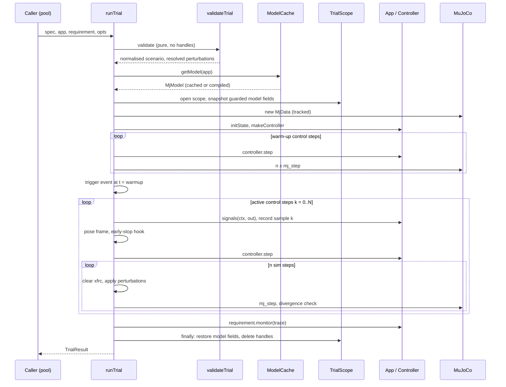

# Design Document

## Overview

golem-sim is the simulation layer of the GOLEM skeleton, in `skeleton/src/sim`. It turns a `RobotApp`, a `CompiledRequirement`, a `Scenario` and a seed into a `TrialResult`. A trial is a pure function of its `TrialSpec`. The module does six jobs:

1. Load `@mujoco/mujoco` (4.x) once per worker, the same way in Node and in the browser.
2. Write a `RobotApp`'s files into the MuJoCo virtual file system with `mj.FS.mkdirTree` and `mj.FS.writeFile`, never `MjVFS.addBuffer`.
3. Compile the model once per worker and keep it in a cache.
4. Run one trial: warm up, fire the trigger, apply perturbations at every simulation step, record a control-rate `Trace` (and optional 30 fps poses), stop at the horizon or early, run the monitor.
5. Guarantee that every MuJoCo handle created is deleted, on every exit path.
6. Ship a tiny inline MJCF app (`Test_App`) so CI needs no robot assets.

All cross-module shapes in `.kiro/steering/interfaces.md` are fixed. This design adds fields and new types only. It renames and removes nothing.

### Design decisions

| # | Decision | Rationale |
|---|---|---|
| D1 | The trace starts at `t = warmup` and has `round(horizon/controlDt)+1` samples. Sample `k` is at `warmup + k*controlDt`, computed by multiplication. | Matches golem-ears' assumption that the monitor window starts at the trigger. Multiplication avoids accumulated rounding error and makes `t` bit-exact. |
| D2 | Divergence (non-finite `qpos`) stops the trial, appends one `diverged` event, and gives `robustness = -Infinity`. | A diverged simulation is a failure with unbounded margin, and the verdict stays deterministic. |
| D3 | Node vs browser is not the Same Runtime. `t` is bit-identical across them, and `signals` agree to 1e-9 relative. The bit-identical guarantee holds only within the Same Runtime. | WASM floating-point is deterministic, but engines may differ in `Math` functions used by app code. `t` uses only IEEE multiplication and addition. |
| D4 | All validation runs before `MjData` exists and before the model is fetched from the cache. Values within 1e-9 relative error of a bound are clamped, and `wrap` dimensions are wrapped into `[min, max)`. | An invalid spec must leave the handle counter and the cache untouched (Req 14.10). |
| D5 | Model-load budget: 2 s for the Test_App (checked in CI) and 5 s for real robot apps with meshes such as the G1 (an `evidence/` benchmark). | CI has no robot assets. |
| D6 | The first Control_Rate_Sample is taken in a prologue, outside the allocation-free Step_Loop. | The signal names are known only from the first `app.signals` call, so the Trace arrays can be sized and allocated only then. See "Open interpretation points". |
| D7 | The runner scopes every handle of a trial in a `TrialScope`, which deletes them in LIFO order in a `finally` block. | One mechanism covers normal end, early stop, divergence and every throw (Req 14.1). |
| D8 | The model is never mutated by the runner. Perturbation templates may change model parameters. The runner snapshots a fixed guard list before the trial and restores it in `finally`. | Satisfies Req 3.10 and 3.11 even when a template misbehaves. |

### Research summary

- `@mujoco/mujoco` 4.x loads with `import load from '@mujoco/mujoco'; const mj = await load();`. It loads in about 0.45 s in Node. This comes from `.kiro/steering/mujoco-wasm.md`, and no further source is needed.
- `mj.FS` is the Emscripten file system. `FS.mkdirTree` and `FS.writeFile` are about 600 times faster than `MjVFS.addBuffer` for MB-sized meshes (20 ms against 13 s, per `mujoco-wasm.md`).
- `data.qpos`, `qvel`, `ctrl`, `xfrc_applied`, `xpos` and `xquat` are live views into WASM memory. If WASM memory grows, `view.buffer` is replaced and old views detach. The runner therefore checks `view.buffer` identity once per control step, outside the physics call (Req 12.8).
- `data.contact` is a copy (a vector handle) and needs `.delete()`. `DoubleBuffer` out-parameters need `.delete()` as well.
- Determinism uses `mulberry32`, a 32-bit PRNG with a single `uint32` state. It needs no BigInt and allocates nothing per draw.

## Architecture

The module is a set of small files under `skeleton/src/sim`. Dependencies point downwards. Nothing in `sim` imports from `ears`, `falsify`, `pool` or `ui`. Those modules import `sim` through `skeleton/src/index.ts` and `skeleton/src/node.ts`.

```mermaid
flowchart TD
    subgraph callers[Callers]
        POOL[pool / cli / mcp]
        APPS[apps via golem-spec and golem-spec/node]
    end

    subgraph sim[skeleton/src/sim]
        RUN[episode.ts: runTrial]
        VAL[validate.ts: validateTrial]
        PRNG[prng.ts: mulberry32]
        CACHE[model-cache.ts: ModelCache]
        FW[file-writer.ts: writeRobotFiles]
        CTX[context.ts: buildContext]
        POSE[pose-recorder.ts: PoseRecorder]
        HELP[helpers.ts: withDoubleBuffer, geomDistance, forEachContact]
        HAND[handles.ts: HandleRegistry, TrialScope]
        LOAD[loader.ts: loadMujoco]
        TAPP[test-app.ts: testApp]
    end

    MJ[(@mujoco/mujoco WASM)]

    POOL --> RUN
    APPS --> RUN
    APPS --> TAPP
    RUN --> VAL
    RUN --> PRNG
    RUN --> CACHE
    RUN --> CTX
    RUN --> POSE
    RUN --> HAND
    CACHE --> FW
    CACHE --> LOAD
    CACHE --> HAND
    CTX --> HAND
    HELP --> HAND
    POSE --> HAND
    FW --> MJ
    LOAD --> MJ
    HAND --> MJ
```

### Trial sequence



### Source layout

```
skeleton/src/sim/
  index.ts          public exports (see "Public exports")
  loader.ts         loadMujoco, __resetLoaderForTests
  file-writer.ts    writeRobotFiles, validateRobotPaths
  model-cache.ts    ModelCache
  context.ts        buildContext
  handles.ts        HandleRegistry, liveHandleCount, TrialScope
  helpers.ts        withDoubleBuffer, geomDistance, forEachContact
  prng.ts           mulberry32
  validate.ts       validateTrial, normaliseScenario
  pose-recorder.ts  PoseRecorder
  episode.ts        runTrial
  errors.ts         SimError, wrapTrialError
  test-app.ts       testApp, makeTestRequirement
  test-fixtures.ts  fixture wrappers for tests (not exported publicly)
```

## Components and Interfaces

### Shared types added by this module

These are new types. None changes a type in `interfaces.md`.

```ts
// The MuJoCo namespace. Typed structurally; `@mujoco/mujoco` ships its own d.ts.
export type Mj = Awaited<ReturnType<typeof import('@mujoco/mujoco').default>>;

// Added optional field on RobotApp (add-only change to the contract):
//   names?: Partial<Record<ObjType, string[]>>;
// Names that the app wants resolved into ctx.ids before the first Sim_Step.
export type ObjType = 'body' | 'geom' | 'site' | 'joint' | 'actuator';

export type EarlyStopHook = (trace: Trace, n: number) => number | undefined;

export interface RunOptions {
  earlyStop?: EarlyStopHook;       // see "Early-stop hook"
  cache: ModelCache;               // per-worker cache, injected by the pool
}
```

### MuJoCo_Loader (`loader.ts`)

```ts
export function loadMujoco(): Promise<Mj>;
/** Test seam: replaces the load function and clears the memo. Not exported from index.ts. */
export function __setLoadFnForTests(fn: (() => Promise<Mj>) | undefined): void;
```

State is one module-level `inflight: Promise<Mj> | undefined`. Each Worker is a separate module instance, so the memo is per worker.

```
loadMujoco():
  if inflight: return inflight
  inflight = (async () => {
      try { return await loadFn() }               // import load from '@mujoco/mujoco'
      catch (cause) {
          inflight = undefined                    // next call starts a new load
          throw new SimError(`Failed to load @mujoco/mujoco: ${cause.message}`, { cause })
      }
  })()
  return inflight
```

- A resolved promise is returned by reference, so the same `Mj` object comes back (Req 1.3) in under 10 ms (1.10).
- Overlapping calls share `inflight`, so the WASM module loads once (1.4), and all waiting calls reject with the same error (1.7).
- The failed attempt clears `inflight` inside the `catch`. This happens before the rejection reaches any waiter, so a retry started from a waiter's `catch` starts a new load (1.6).
- The loader makes no network request except the static WASM fetch done by the package (1.8). The loader does not call `fetch` itself.
- The signature and return type are identical in Node and browser. The Vite note (`optimizeDeps.exclude`) is documented in the module header and is a consumer concern.

### File_Writer (`file-writer.ts`)

```ts
export function validateRobotPaths(app: Pick<RobotApp, 'id' | 'sceneFile'>,
                                   files: Record<string, Uint8Array>): void; // throws SimError
export function writeRobotFiles(mj: Mj, app: Pick<RobotApp, 'id' | 'sceneFile'>,
                                files: Record<string, Uint8Array>,
                                root?: string /* default '/robot' */): void;
```

`writeRobotFiles` is synchronous. The caller awaits `app.files()` first, so the 500 ms budget (Req 2.12) excludes it.

```
writeRobotFiles(mj, app, files, root='/robot'):
  validateRobotPaths(app, files)            // all-or-nothing, before the first write (2.6, 2.7, 2.10)
  for (path of Object.keys(files)):         // record key order (2.11)
      full = root + '/' + path
      try {
          mj.FS.mkdirTree(dirname(full))    // idempotent for existing directories (2.3, 2.5)
          mj.FS.writeFile(full, files[path])// overwrite on a second call (2.8)
      } catch (cause) {
          throw new SimError(`Writing ${path} for app ${app.id} failed: ${cause.message}`, { cause })  // 2.9
      }
```

Path rules checked by `validateRobotPaths` (Req 2.6):

- reject an empty string;
- reject a path that starts with `/` or matches `^[A-Za-z]:`;
- reject a path containing `\`;
- split on `/`, reject if any segment is empty (covers `//` and trailing `/`) or equals `..`.

`app.sceneFile` must be a key of `files`. An empty record fails this check, so criterion 2.10 needs no separate branch. Every error names the offending path or the missing scene file.

A dot segment `.` is accepted and normalised by `mkdirTree`. This is the least surprising choice, and the requirements do not forbid it.

### Model_Cache (`model-cache.ts`)

```ts
export class ModelCache {
  constructor(deps?: { load?: () => Promise<Mj> });
  getModel(app: RobotApp): Promise<{ mj: Mj; model: any }>;
  get size(): number;
  has(appId: string): boolean;
  dispose(): void;
}
```

Internal state: `Map<string, Promise<any>>` keyed by app id, holding the in-flight or resolved compile, and a `generation` counter.

```
getModel(app):
  existing = entries.get(app.id)
  if existing: return existing.then(model => ({ mj, model }))      // no files(), no FS write, no compile (3.2)
  gen = generation
  p = (async () => {
        mj = await loadMujoco()
        files = await app.files()                                  // called once (3.1)
        writeRobotFiles(mj, app, files)
        model = mj.MjModel.from_xml_path('/robot/' + app.sceneFile)
        registry.track(model, 'MjModel')
        return model
      })()
  entries.set(app.id, p)                                           // set synchronously: concurrent requests share p (3.3)
  p.catch(err => { if (entries.get(app.id) === p) entries.delete(app.id) })   // 3.4, 3.5
  return p.catch(err => throw new SimError(`Compiling app ${app.id} failed: ${err.message}`, { cause: err }))
```

- A throw from `from_xml_path` returns no handle. If a partially created handle is ever observed (the wrapper catches an exception that carries one), it is deleted exactly once through the registry. Because the registry deletes idempotently, the counter stays unchanged (Req 3.6, 10.16).
- `dispose()` increments `generation`, deletes every settled model through the registry, and clears the map. A compile that finishes after dispose sees a different generation, deletes its own model and rejects with a `SimError` saying that the cache was disposed. The next request starts again (3.7, 3.8).
- There is one map per `ModelCache` instance and one instance per Worker (3.9).
- The model is not touched after compile. `runTrial` is the only consumer and obeys the guard rules in "Episode_Runner" (3.10, 3.11).
- Budget (Req 3.12): measured from the first `getModel` call and including `loadMujoco`. 2 s for the Test_App in a CI test. 5 s for the G1 in `evidence/` (a benchmark, not a CI test).

### Context_Builder (`context.ts`)

```ts
export interface NameLookups {
  body(name: string): number; geom(name: string): number; site(name: string): number;
  joint(name: string): number; actuator(name: string): number;
}
export function buildContext(mj: Mj, model: any, data: any,
                             names?: RobotApp['names']): SimContext & { lookup: NameLookups };
```

```
lookup(type, name):
  if name === '': throw SimError(`Empty ${type} name`)               // no mj_name2id call (4.10)
  id = mj.mj_name2id(model, mj.mjtObj['mjOBJ_' + TYPE].value, name)  // enum .value (4.2)
  if id < 0: throw SimError(`No ${type} named "${name}" in the model`)  // also wrong-type names (4.5, 4.11)
  return id

buildContext:
  ids = {}                                       // a new object; a failed lookup returns before ctx is returned (4.5)
  for each type in [body, geom, site, joint, actuator]:
      for each name in names?.[type] ?? []:
          ids[`${type}:${name}`] = lookup(type, name)     // 4.6, 4.9 (before the Step_Loop)
  return { mj, model, data, ids, lookup }
```

- The return object holds the same `mj`, `model` and `data` references (4.1). The extra `lookup` field is an addition to `SimContext`, which the contract allows.
- Lookups are for setup time only. The Step_Loop never calls `mj_name2id` (4.8). Apps resolve ids in `makeController` and read `ctx.ids` in the loop.
- `ids` is filled in place and not wrapped in a proxy, so reads are plain property reads.

### Handle registry and Handle_Counter (`handles.ts`)

```ts
interface Deletable { delete(): void }

export class HandleRegistry {
  track<T extends Deletable>(h: T, kind: string): T;   // +1, returns h
  release(h: Deletable): boolean;                      // true if this call deleted it
  get live(): number;                                  // non-negative integer
}
export const registry: HandleRegistry;                 // one per module instance (per worker)
export function liveHandleCount(): number;             // = registry.live (Req 10.13)

export class TrialScope {
  track<T extends Deletable>(h: T, kind: string): T;   // registry.track + push on a stack
  disposeAll(): void;                                  // LIFO; each handle released once
}
```

- `track` adds the handle to a `Set` and increments the counter. `release` returns `false` and does nothing if the handle is not in the set. This gives a second `.delete()` of the same handle no second WASM call and no counter change (Req 10.16). The `Set` holds strong references only for live handles, so it cannot grow past the live count.
- `liveHandleCount()` equals `set.size`. The two cannot drift, because the counter is derived from the set.
- Every Sim_Module path that creates `MjData`, `MjModel`, `DoubleBuffer` or a contact vector goes through `track`. Every deletion goes through `release` (Req 10.12).
- `TrialScope.disposeAll` catches errors thrown by individual `.delete()` calls, continues deleting the rest, and rethrows the first error only if no other error is already propagating.

### Buffer, geom-distance and contact helpers (`helpers.ts`)

```ts
export function withDoubleBuffer<R>(mj: Mj, n: number, fn: (buf: any) => R): R;
export function geomDistance(mj: Mj, model: any, data: any, g1: number, g2: number,
                             distmax: number, opts?: { nearestPoints: false }): number;
export function geomDistance(mj: Mj, model: any, data: any, g1: number, g2: number,
                             distmax: number, opts: { nearestPoints: true }):
                             { distance: number; fromto: Float64Array };
export function forEachContact(mj: Mj, data: any, visit: (contact: any, index: number) => void): void;
```

```
withDoubleBuffer(mj, n, fn):
  if !Number.isInteger(n) || n < 1: throw SimError(`Invalid buffer length ${n}: an integer of 1 or more is required`)  // before any buffer (10.4)
  buf = registry.track(new mj.DoubleBuffer(new Array(n).fill(0)), 'DoubleBuffer')
  try { return fn(buf) }                  // fn must copy buf.getView() data; the view is invalid after delete (10.5)
  finally { registry.release(buf) }       // exactly once, also on throw (10.2, 10.3)

geomDistance(...):
  return withDoubleBuffer(mj, 6, buf => {
      d = mj.mj_geomDistance(model, data, g1, g2, distmax, buf)
      return opts?.nearestPoints ? { distance: d, fromto: Float64Array.from(buf.getView()) } : d   // copy (10.7)
  })

forEachContact(mj, data, visit):
  vec = registry.track(data.contact, 'ContactVector')
  try { for (i = 0; i < data.ncon; i++) visit(vec.get(i), i) }    // ascending; zero visits when ncon = 0 (10.9, 10.10)
  finally { registry.release(vec) }                                // 10.9, 10.11
```

These helpers allocate and are for setup and monitor-side code, not for the Step_Loop. Controllers that need them in the loop keep a long-lived buffer of their own and delete it in a teardown hook.

### PRNG (`prng.ts`)

```ts
export function mulberry32(seed: number): () => number;   // uniform in [0, 1)
```

The state is one `uint32` captured in a closure. `runTrial` creates it once per trial, before the Step_Loop. Nothing else in `sim` calls `Math.random()` (Req 5.3). A lint-style example test greps `skeleton/src/sim/**` for `Math.random`.

The runner draws no value itself. Draws happen only in `app.initState`, `app.makeController` and the controller, in that order, using the same instance (Req 5.5, 5.6).

### Trial validation (`validate.ts`)

```ts
export interface ValidatedTrial {
  scenario: Scenario;                           // normalised copy: clamped and wrapped
  calls: ResolvedCall[];                        // template + values object, built once (Req 6.6)
  warmupSteps: number; controlSteps: number;    // round(warmup/controlDt), round(horizon/controlDt)
  n: number;                                    // sim steps per control step
  warmupSimSteps: number;                       // round(warmup/simDt)
}
export function validateTrial(app: RobotApp, req: CompiledRequirement, spec: TrialSpec): ValidatedTrial;
```

Checks, in this order, with the first failure thrown (every message goes through `wrapTrialError`, which adds the app id, requirement id and seed):

1. `spec.app === app.id`.
2. `simDt` and `controlDt` are finite and greater than 0, and `controlDt/simDt` is an integer within relative tolerance 1e-9 (Req 7.2).
3. `warmup` is finite, at least 0, and an integer multiple of `controlDt` within 1e-9 relative tolerance (5.13).
4. `req.horizon` is finite and greater than 0 (14.9).
5. `seed` is an integer in `[0, 4294967295]` (5.14).
6. Scenario: every dimension in `req.space.dims` is present (14.4, all missing names reported), finite (14.5), then normalised by `normaliseScenario`.
7. Every `PerturbationCall.template` exists in `app.lexicon.perturbations` (6.12), and every string param names a dimension in the scenario (6.11).

`normaliseScenario(dim, value)`:

```
if dim.wrap:      span = max - min; v = value - span * floor((value - min) / span)   // [min, max)
                  if v >= max: v = min                                               // guards float round-up
else:             tol = 1e-9 * (max(|min|, |max|) || 1)                              // absolute 1e-9 when both bounds are 0
                  if value < min - tol or value > max + tol: throw (names dim, value, range in SI)
                  v = clamp(value, min, max)
```

When `min === max` (a fixed dimension), `span` is 0. The wrap branch then returns `min`, which is the only legal value.

The `values` object for each call is built here from the normalised scenario: string params map to `scenario[param]`, numeric params pass through (Req 6.5). The runner reuses the same object for every Sim_Step (6.6).

Nothing here touches MuJoCo. A failure leaves the counter and cache unchanged (14.10).

### Episode_Runner (`episode.ts`)

```ts
export function runTrial(app: RobotApp, req: CompiledRequirement, spec: TrialSpec,
                         opts: RunOptions): Promise<TrialResult>;
```

The function is `async` only because `cache.getModel` is async. Once the model is in hand, the whole trial body is synchronous, so no other trial can interleave inside a worker and share state.

#### Early-stop hook

```ts
/**
 * Called exactly once after each Control_Rate_Sample, with the trace buffers and the
 * number of valid samples `n`. Only indices [0, n) are valid. The arrays have full capacity
 * and are reused across calls. A hook that wants a standalone Trace takes subarray(0, n) itself.
 * Return undefined to continue, or a finite number: the decided robustness value.
 * A number means "the sign of the final verdict is already decided".
 */
export type EarlyStopHook = (trace: Trace, n: number) => number | undefined;
```

The hook contract, which the hook author owes the runner (Req 9.6, 9.7):

- A decided violation `v < 0` means the monitor over any extension of the prefix gives robustness `<= v`. A decided satisfaction `v > 0` means any extension gives robustness `>= v`.
- The monitor is prefix-closed: evaluated on the prefix it returns a value of the same sign and on the correct side of `v`.

The runner does not check the sign claim. It checks that the return is `undefined` or a finite number. `NaN`, `+/-Infinity` and non-number returns reject the trial (Req 9.14).

#### Trial state allocated before the Step_Loop

| Item | Size | Notes |
|---|---|---|
| `scope` | 1 | `TrialScope` |
| `rng` | 1 | `mulberry32(seed)` |
| `data` | 1 | `MjData`, tracked in `scope` |
| views | 6 | `qpos`, `qvel`, `ctrl`, `xfrc_applied`, `xpos`, `xquat` read once from `data` |
| `out` | 1 | the signal output object, reused for every `app.signals` call (12.3) |
| `traceT` | `N+1` doubles | `N = round(horizon/controlDt)` |
| `traceSig[name]` | `N+1` doubles each | allocated at the prologue sample, once names are known (D6) |
| `sigPairs` | `names.length` | array of `[name, Float64Array]`, so the loop does no `Object.keys` |
| `events` | capacity 2 | trigger object created in the prologue |
| `pose` | `nbody*7*(floor(horizon*30)+2)` floats | only when `record === 'poses'` |
| `modelGuard` | snapshot | copies of guarded model arrays |

Guarded model fields: `body_mass`, `body_inertia`, `geom_friction`, `geom_size`, `actuator_gainprm`, `actuator_biasprm`, `dof_damping`, `dof_frictionloss`, and the scalar fields of `opt` (`timestep`, `gravity`, `wind`, `density`, `viscosity`, `impratio`, `tolerance`, `iterations`). The list is a constant in `episode.ts`. Restoring copies each array back byte for byte.

#### Step-loop pseudocode

```
async function runTrial(app, req, spec, opts):
  t0 = performance.now()                         // used only for wallMs; never feeds into signals or verdicts
  try {
    v = validateTrial(app, req, spec)            // throws before any handle exists
    { mj, model } = await opts.cache.getModel(app)
  } catch (e) { throw wrapTrialError(e, app, req, spec) }

  scope = new TrialScope()
  guard = snapshotModel(model)
  try {
    data = scope.track(new mj.MjData(model), 'MjData')
    rng  = mulberry32(spec.seed)
    ctx  = buildContext(mj, model, data, app.names)           // may throw on unknown declared names
    app.initState?.(ctx, rng)                                  // once, before the first Sim_Step (5.4)
    controller = app.makeController(ctx, rng)                  // once, same rng (5.5)
    views = readViews(data)                                    // qpos, qvel, ctrl, xfrc_applied, xpos, xquat

    // ---- warm-up: no samples, no perturbations, xfrc stays zero (5.7, 5.8, 6.4)
    simIndex = 0
    for (c = 0; c < v.warmupControlSteps; c++) {
      controller.step(ctx, simIndex * app.simDt)
      for (j = 0; j < v.n; j++) {
        mj.mj_step(model, data); simIndex++
        if (!allFinite(views.qpos)) throw SimError('Simulation diverged during warm-up at t = ' + ... + ' s')
      }
      refreshViewsIfDetached()                                 // view.buffer identity, outside mj_step (12.8)
    }
    // simIndex === round(warmup/simDt) here (5.9)

    // ---- prologue: trigger and sample 0 (not part of the allocation-free Step_Loop, D6)
    trace.events.push({ name: 'trigger', t: app.warmup })      // before sample 0 and any apply (6.1)
    views.xfrc_applied.fill(0)                                 // 6.8
    pose = spec.record === 'poses' ? new PoseRecorder(...) : undefined
    recorded = 0; diverged = false; decided = undefined; haveSample0 = false

    // ---- Step_Loop: sample k, then (if more) one control step of n sim steps
    for (k = 0; k <= N; k++) {
      app.signals(ctx, out)                                    // once per control step, before its sim steps (7.4)
      if (k === 0) allocateSignalArrays(out)                   // D6, the only allocation after warm-up
      traceT[k] = app.warmup + k * app.controlDt               // multiplication (7.9)
      for ([name, arr] of sigPairs) arr[k] = out[name]         // store non-finite values unchanged (7.10)
      recorded = k + 1
      pose?.maybeRecord(traceT[k], views.xpos, views.xquat)    // first at k = 0, then >= 1/30 s apart (8.1)

      if (opts.earlyStop) {
        r = opts.earlyStop(traceView, recorded)                // once per sample (9.2)
        if (r !== undefined) {
          if (typeof r !== 'number' || Number.isNaN(r)) throw SimError(`Early-stop hook returned ${String(r)}; a finite number or undefined is required`)
          decided = r; break                                   // no further Sim_Step (9.3, 9.15)
        }
      }
      if (k === N) break                                       // horizon reached (9.1)

      controller.step(ctx, traceT[k])                          // once at the start of the control step (7.1)
      for (j = 0; j < v.n; j++) {
        views.xfrc_applied.fill(0)                             // 6.9
        tSim = simIndex * app.simDt
        for (call of v.calls) call.template.apply(ctx, tSim, app.warmup, call.values)   // array order, no mj_step between (6.7)
        mj.mj_step(model, data); simIndex++
        if (!allFinite(views.qpos)) { diverged = true; divT = simIndex * app.simDt; break }   // 7.11
      }
      if (diverged) break
      refreshViewsIfDetached()
    }
    // 12.8: when a refresh happens, views are re-read before the next mj_step

    // ---- end of trial
    if (diverged) events.push({ name: 'diverged', t: divT })    // exactly one (7.12)
    trace = trimmedTrace(recorded)                              // subarray(0, recorded) when shorter
    m = req.monitor(trace)                                      // exactly once (9.5, 9.13)
    result = {
      spec, robustness: diverged ? -Infinity : m.robustness,
      worstAt: diverged ? divT : m.worstAt, unit: m.unit,
      wallMs: performance.now() - t0,
      ...(pose ? { poses: pose.finish() } : {})
    }
    return result
  } catch (e) { throw wrapTrialError(e, app, req, spec) }
  finally {
    restoreModel(model, guard)                                  // 3.11
    scope.disposeAll()                                          // MjData deleted exactly once (9.10)
  }
```

Notes on the loop:

- **Control_Step definition.** A Control_Step is one `controller.step` call followed by `n` Sim_Steps. The last sample (`k = N`) has no Control_Step after it, so the controller is called `N` times in the active phase.
- **Time of a perturbation call.** `t` is `simIndex * simDt`, the simulated time at the start of that Sim_Step. `tTrigger` is `app.warmup`.
- **Divergence time.** `divT` is the time after the diverging Sim_Step. Divergence inside a control step cuts the control step short, and the trace holds the samples recorded before it (Req 7.12).
- **Warm-up divergence.** There is no trace to return and no trigger. The runner throws a `SimError`. See "Open interpretation points".
- **Constant control input within a control step.** The loop never touches `data.ctrl` between the first and last Sim_Step of a control step, so it is bit-identical across them (Req 7.3).
- **Error wrapping.** `wrapTrialError` builds a message like `Trial failed (app test, requirement R1, seed 42): <cause message>` and sets `cause` (Req 14.2, 14.3). It contains no stack and no decoration (14.11). When the thrown value is already a `SimError` from this trial, it is not wrapped twice.
- **Monitor on a truncated trace.** On early stop or divergence the monitor sees the trace trimmed to the recorded samples. It is a prefix, so the monitor must tolerate traces shorter than the horizon. This is an assumption on golem-ears (see "Open interpretation points").
- **Model guard.** `restoreModel` runs in `finally`, so it covers throw, divergence and early stop.
- **Concurrency inside a worker.** The synchronous body means a worker never interleaves two trials. Parallelism comes from several workers, each with its own `Mj` and `ModelCache`.

#### Allocation discipline (Req 12)

- Views are read once per trial and re-read only when `view.buffer` changes identity. The check is `views.qpos.buffer !== lastBuffer`, done once per control step.
- `out` is one object. `sigPairs` is one array. Neither is rebuilt.
- The loop uses index `for` loops, no closures, no template strings, no spread. The error and event paths, which are terminal, may allocate.
- `allFinite` is a plain loop over `qpos` with no allocation.
- The hook receives preallocated full-capacity arrays and the count `n`, so no subarray is created per sample (see D6 and the hook contract).

### Pose_Recorder (`pose-recorder.ts`)

```ts
export class PoseRecorder {
  constructor(nbody: number, horizon: number);                  // allocates once: nbody*7*(floor(horizon*30)+2)
  maybeRecord(t: number, xpos: Float64Array, xquat: Float64Array): void;
  finish(): { fps: 30; nbody: number; frames: Float32Array };   // subarray(0, nbody*7*frameCount)
  get frameCount(): number;
}
```

```
maybeRecord(t, xpos, xquat):
  if frameCount === 0 || t - lastT >= 1/30 - eps:     // eps = 1e-9 s, because controlDt multiples may undershoot 1/30
      base = frameCount * nbody * 7
      for (b = 0; b < nbody; b++):
          frames[base + 7b + 0..2] = xpos[3b + 0..2]
          frames[base + 7b + 3..6] = xquat[4b + 0..3]       // float32 conversion by assignment, nothing else (8.3)
      lastT = t; frameCount++
```

- Frames are recorded in the prologue at `t = warmup` and then at control-step times. The runner calls `maybeRecord` only after the trigger, so nothing is recorded during warm-up (Req 8.9).
- The capacity `floor(horizon * 30) + 2` is enough, because frames are at least 1/30 s apart except the first, and the horizon is `horizon` long. The `eps` tolerance cannot add a frame beyond that capacity: it only lets a frame at `1/30 - 1e-9` s count as due. A guard `if (frameCount >= capacity) return` keeps the recorder safe. It never triggers in valid runs.
- `finish()` returns a subarray over the recorded frames only, so an early stop returns no frame after the stop (8.8).
- Recording only reads the views and writes into its own array. It cannot change the simulation, so a trial with `record: 'poses'` is bit-identical to one with `'none'` in every other field (8.7).
- `record` `'none'` or absent: the recorder is not constructed and `poses` is absent (8.6).
- The frame layout `nbody x (x, y, z, qw, qx, qy, qz)` matches `TrialResult.poses` in `interfaces.md`.

### Test_App (`test-app.ts`)

```ts
export const testApp: RobotApp;                       // id 'test'
export function makeTestRequirement(opts: {
  horizon: number;                                    // seconds after warm-up, a multiple of 0.02 s
  kind?: 'always-bob-angle' | 'eventually-bob-slow';  // fixtures for hook tests
  bound?: number;
  perturbations?: PerturbationCall[];                 // default: one `push` call
}): CompiledRequirement;
export function makeAlwaysHook(req: ...): EarlyStopHook;
export function makeEventuallyHook(req: ...): EarlyStopHook;
```

`makeTestRequirement` builds a `CompiledRequirement` by hand, so `sim` tests do not depend on `ears`.

Inline MJCF (returned as UTF-8 bytes under `scene.xml`):

```xml
<mujoco model="golem-test">
  <option timestep="0.002" gravity="0 0 -9.81"/>
  <worldbody>
    <geom name="floor" type="plane" size="5 5 0.1"/>
    <body name="box" pos="1 0 1">
      <freejoint name="box_free"/>
      <geom type="box" size="0.1 0.1 0.1" mass="1"/>
    </body>
    <body name="bob" pos="-1 0 1">
      <joint name="hinge" type="hinge" axis="0 1 0" damping="0.02"/>
      <geom type="capsule" fromto="0 0 0 0 0 -0.5" size="0.03" mass="0.5"/>
    </body>
  </worldbody>
  <actuator>
    <motor name="drive" joint="hinge" ctrlrange="-5 5"/>
  </actuator>
</mujoco>
```

| Field | Value |
|---|---|
| `id` / `name` | `'test'` / `'Sim test pendulum and box'` |
| `sceneFile` | `'scene.xml'`; `files()` returns exactly `{ 'scene.xml': <bytes> }` |
| `simDt` / `controlDt` / `warmup` | 0.002 s / 0.02 s / 0.2 s |
| `names` | `body: ['box', 'bob']`, `joint: ['hinge']`, `actuator: ['drive']` |
| `lexicon.robotNames` | `['robot']` |
| `lexicon.predicates` | none required; the tests build monitors directly |
| `lexicon.perturbations` | one template, `push` (below) |
| signals | `box.z` (m), `bob.angle` (rad), `bob.speed` (rad/s) |
| `initState` | one PRNG draw: `qpos[hingeAdr] = (rng() * 2 - 1) * 0.1` rad |
| controller | PD: `u = clamp(-kp * angle - kd * speed, -5, 5)`, reading only the hinge angle and speed, with constant `kp`, `kd` (Req 13.6) |

`push` template (`PerturbationTemplate`):

```ts
phrase: 'the bob is pushed with {range:force} for {duration} from {direction}'
dims:   slots => [ { name: 'push.force', kind: 'force', min: 0, max: <slot max>, severity: 'up' },
                   { name: 'push.angle', kind: 'angle', min: 0, max: 2*Math.PI, severity: 'none', wrap: true } ]
apply(ctx, t, tTrigger, values):
   if (values.force === 0) return                                    // writes nothing (13.11)
   if (t < tTrigger || t >= tTrigger + values.duration) return       // zero outside [tTrigger, tTrigger+duration) (13.7)
   xfrc[6*bobId + 0] = values.force * cos(values.angle)
   xfrc[6*bobId + 1] = values.force * sin(values.angle)
```

A `PerturbationCall` for it is `{ template: 'push', params: { force: 'push.force', duration: 0.2, angle: 'push.angle' } }`. `bobId` comes from `ctx.ids['body:bob']`, read once into a local per call through a small closure created in the template factory, not inside `apply`.

The Test_App imports only `@mujoco/mujoco` types and contract types (Req 13.10).

### Fixture wrappers for tests (`test-fixtures.ts`)

Not exported publicly. They wrap an app and change one thing:

| Wrapper | Effect | Used for |
|---|---|---|
| `withThrowingController(app, atStep)` | `controller.step` throws at a given control step | leak and error properties |
| `withThrowingSignals(app, atStep)` | `app.signals` throws | same |
| `withNaNControl(app, atStep)` | controller writes `NaN` into `ctrl`, so `qpos` becomes non-finite | divergence, finite-robustness |
| `withModelAlteringTemplate(app)` | a template that changes `body_mass`, `geom_friction` and `opt.gravity` | model restore property |
| `withSpyTemplate(app, log)` | records `(t, tTrigger, values identity, xfrc snapshot)` per call | perturbation properties |
| `withNoDraws(app)` | `initState` and controller draw no PRNG value | seed independence |
| `withFakeMj()` | an in-memory fake `Mj` with `FS`, `MjModel`, `DoubleBuffer`, delete counters | cache, writer, helper properties |

### Public exports (`index.ts`)

`skeleton/src/index.ts` re-exports the browser-safe parts. `skeleton/src/node.ts` re-exports the Node-only parts, if any exist. Apps import only from `golem-spec` and `golem-spec/node`.

```ts
// skeleton/src/sim/index.ts
export { loadMujoco } from './loader.js';
export { writeRobotFiles, validateRobotPaths } from './file-writer.js';
export { ModelCache } from './model-cache.js';
export { buildContext } from './context.js';
export { liveHandleCount } from './handles.js';
export { withDoubleBuffer, geomDistance, forEachContact } from './helpers.js';
export { mulberry32 } from './prng.js';
export { runTrial } from './episode.js';
export { PoseRecorder } from './pose-recorder.js';
export { testApp, makeTestRequirement } from './test-app.js';
export { SimError } from './errors.js';
export type { Mj, ObjType, EarlyStopHook, RunOptions } from './types.js';
```

`HandleRegistry`, `TrialScope`, test seams and fixtures stay internal. Tests in `skeleton/src/sim/*.test.ts` import them by relative path, which the structure rules allow because tests live inside the module.

## Data Models

### Trace (from `interfaces.md`, unchanged)

```ts
interface Trace {
  t: Float64Array;                          // seconds, t[k] = warmup + k*controlDt
  signals: Record<string, Float64Array>;    // same length as t
  events: { name: string; t: number }[];    // 'trigger' once; 'diverged' at most once
}
```

Invariants of a returned Trace:

- `t.length === signals[name].length` for every signal name.
- Full trial: `t.length === round(horizon/controlDt) + 1`.
- `events` has exactly one `{ name: 'trigger', t: warmup }`. If the trial diverged, it has exactly one `{ name: 'diverged', t }` after it.
- `t[0] === warmup` and `t[k] === warmup + k*controlDt` bit for bit.

### TrialResult (from `interfaces.md`, unchanged)

`spec` is the received `TrialSpec` (same object, deep-equal). `wallMs` is finite and at least 0. Everything except `wallMs` is covered by the determinism guarantee. `poses` is present only when `record === 'poses'`.

### Internal types

```ts
interface ResolvedCall {
  template: PerturbationTemplate;
  values: Record<string, number>;   // built once, reused every Sim_Step
}

interface TrialMemory {             // lifetime = one trial
  scope: TrialScope;
  traceT: Float64Array;
  sigPairs: Array<[string, Float64Array]>;
  events: { name: string; t: number }[];
  pose?: PoseRecorder;
  guard: ModelSnapshot;
}

class SimError extends Error {
  constructor(message: string, opts?: { cause?: unknown });  // message in plain language, SI units, no stack text
}
```

### Phase timeline

```
t = 0            t = warmup (trigger)                       t = warmup + horizon
 | warm-up      | sample 0 | sample 1 | ... | sample N      |
 | controller    | active phase: perturbations at every     |
 | runs, no      | Sim_Step, signals once per control step  |
 | samples       | N = round(horizon / controlDt)           |
```

## Correctness Properties

*A property is a characteristic or behavior that should hold true across all valid executions of a system-essentially, a formal statement about what the system should do. Properties serve as the bridge between human-readable specifications and machine-verifiable correctness guarantees.*

Reflection results from the prework: determinism properties for `t`, `signals`, `events`, `poses` and `robustness` merge into Property 1. Trace length and time-axis exactness stay separate (Properties 2 and 3), because they fail for different reasons. Trigger-event and warm-up isolation stay separate from each other (Properties 4 and 5). Handle-leak coverage for throw, divergence and early stop merges into Property 8. Pose layout and pose invariance stay separate (Properties 12 and 13). Properties that need the real MuJoCo model use the Test_App. Properties on the writer, cache and helpers use `withFakeMj()` and run no physics.

### Property 1: Determinism

*For any* Test_App `TrialSpec` (scenario within the space, seed, `record` mode, horizon) and any sequence of other trials (different seeds, scenarios or requirements) run between two executions in one worker, running the same `TrialSpec` twice in the same runtime returns Bit-identical `t`, Bit-identical `signals` (same names, same lengths, same bytes), `events` with equal length, order, names and Bit-identical `t`, Bit-identical `robustness` and `worstAt`, equal `unit`, and Bit-identical `poses.frames` when recorded. `wallMs` is excluded.

**Validates: Requirements 11.1, 11.2, 11.3, 11.4, 11.5, 11.6, 11.7, 11.8, 15.2**

### Property 2: Trace length

*For any* Test_App `TrialSpec` and any horizon from 0.2 s to 1.5 s in steps of `controlDt`, a full-length trial (no hook, no divergence) returns `t.length === round(horizon / controlDt) + 1`, and every array in `signals` has length `t.length`.

**Validates: Requirements 7.6, 7.7, 7.8, 15.3**

### Property 3: Time axis is exact

*For any* app timing with `controlDt` an integer multiple of `simDt`, any `warmup` an integer multiple of `controlDt`, and any trial of any length, `t[k]` is Bit-identical to `warmup + k * controlDt` evaluated in IEEE-754 double precision, and `t[0] === warmup`.

**Validates: Requirements 7.5, 7.9, 5.8**

### Property 4: Trigger event

*For any* Test_App `TrialSpec`, including trials that stop early or diverge, the returned `events` contain exactly one event named `trigger` and its `t` equals `app.warmup`. It precedes any `diverged` event, and a trial with an empty `perturbations` array still has it.

**Validates: Requirements 6.1, 6.2, 6.14, 15.4**

### Property 5: Warm-up isolation and step counts

*For any* valid app timing and any `TrialSpec`, before the trigger the runner makes zero `template.apply` calls, leaves `data.xfrc_applied` at 0, records no trace sample, and has run exactly `round(warmup / simDt)` `mj_step` calls and `round(warmup / controlDt)` `controller.step` calls.

**Validates: Requirements 5.7, 5.8, 5.9, 6.4**

### Property 6: Early stop is sound

*For any* Test_App `TrialSpec`, and for a hook built by `makeAlwaysHook` or `makeEventuallyHook` that returned a decided value `v` at some sample: the trial ends after that sample's control step boundary (no further Sim_Step), the hook was called once per sample, the sign of the early-stopped `robustness` equals the sign of `robustness` from the same trial run without the hook, and `robustness <= v` for a decided violation or `robustness >= v` for a decided satisfaction.

**Validates: Requirements 9.2, 9.3, 9.4, 9.5, 9.6, 9.7, 9.15, 15.5**

### Property 7: Perturbation calls are ordered, fresh and stable

*For any* Test_App `TrialSpec` with a list of spy templates, in the active phase every Sim_Step makes one call per template in array order with no `mj_step` between them, `t` is the simulated time at the start of the step, `tTrigger === warmup`, the `values` object is the same object at every call, string params equal the normalised scenario values, and `data.xfrc_applied` at the start of each Sim_Step's first call is all zero.

**Validates: Requirements 6.3, 6.5, 6.6, 6.7, 6.8, 6.9, 6.10, 11.10**

### Property 8: No handle leaks

*For any* Test_App `TrialSpec`, including trials made to throw (in `initState`, `makeController`, `controller.step`, `app.signals`, `template.apply`, the early-stop hook, or the monitor), to diverge, to stop early, or to fail validation, `liveHandleCount()` after the trial equals its value before the trial plus the number of `MjModel` handles the cache added during the trial. After `cache.dispose()` it equals its value before the first trial.

**Validates: Requirements 5.10, 5.11, 6.13, 7.13, 9.10, 9.11, 9.12, 10.14, 10.15, 14.1, 14.10, 15.6**

### Property 9: Failed trials report their identity

*For any* `TrialSpec` that makes the runner reject, the error message contains the app id, the requirement id and the decimal seed, the error's `cause` is the underlying error when there is one, and the message contains no stack-trace text.

**Validates: Requirements 14.2, 14.3, 14.11**

### Property 10: Scenario normalisation

*For any* `Dimension` and any finite value: if the value is within `[min, max]` it is passed on unchanged; if it lies outside by 1e-9 relative error or less (relative to `max(|min|, |max|)`, or absolute 1e-9 when both bounds are 0) it is clamped into `[min, max]`; if `wrap` is true the passed-on value is in `[min, max)` and congruent to the input modulo `max - min`; otherwise (outside beyond the tolerance, no wrap) the trial is rejected with an error naming the dimension, the value and the range, before any `MjData` is created. A scenario with a missing dimension or a non-finite value is likewise rejected before any `MjData` is created.

**Validates: Requirements 14.4, 14.5, 14.6, 14.7, 14.8, 6.5, 6.11**

### Property 11: Finite robustness unless diverged

*For any* Test_App scenario, including scenarios that make `qpos` non-finite, `robustness` is a finite number when the trace has no `diverged` event. When it has a `diverged` event, `robustness === -Infinity`, `worstAt` equals the divergence time, the trace holds only the samples recorded before it, and `events` contain exactly one `diverged` event.

**Validates: Requirements 7.11, 7.12, 9.13, 15.9**

### Property 12: Pose frame layout

*For any* Test_App `TrialSpec` with `record: 'poses'`, `poses.fps === 30`, `poses.nbody === model.nbody`, `frames.length === nbody * 7 * frameCount` with `frameCount >= 1`, the first frame is at the trigger time, consecutive frames are at least 1/30 s apart (within 1e-9 s), no frame lies before the trigger or after an early stop, and each frame equals `xpos` and `xquat` converted to float32. With `record` absent or `'none'`, `poses` is absent.

**Validates: Requirements 8.1, 8.2, 8.3, 8.4, 8.5, 8.6, 8.8, 8.9, 8.11**

### Property 13: Pose recording does not change the result

*For any* Test_App `TrialSpec`, the trial with `record: 'poses'` and the trial with `record: 'none'` return Bit-identical `robustness`, `worstAt`, `t`, `signals` and `events`.

**Validates: Requirements 8.7, 15.8**

### Property 14: The cached model is unchanged by trials

*For any* sequence of Test_App trials, including trials that end early, diverge or throw, and trials that use a template which alters `body_mass`, `geom_friction` or `opt.gravity`, the bytes of the guarded model arrays (`opt` scalars, `body_mass`, `geom_friction`, `actuator_gainprm`, and the rest of the guard list) are equal before and after each trial.

**Validates: Requirements 3.10, 3.11**

### Property 15: File round trip

*For any* byte map with valid relative paths (no leading `/`, no `..` segment, no backslash, 1 to 5 segments, 0 to 4096 bytes per file, 1 to 10 files) that contains the scene file, writing it with the File_Writer and reading each file with `mj.FS.readFile` returns bytes equal to the input. Writing a second, different map with the same paths overwrites each file, and reading returns the second bytes.

**Validates: Requirements 2.1, 2.3, 2.4, 2.5, 2.8, 15.7**

### Property 16: Invalid paths change nothing

*For any* valid byte map with one path replaced by an invalid one (empty, absolute, drive letter, `..` segment, empty segment, backslash) at any position, or with the scene file removed, the File_Writer rejects with an error naming the offending path or the missing scene file, and the virtual file system listing is identical before and after.

**Validates: Requirements 2.6, 2.7, 2.10**

### Property 17: Model cache compiles once and recovers

*For any* schedule of concurrent and sequential `getModel` requests over several app ids, with any subset of compiles failing the first time: `app.files()` and `from_xml_path` are called once per successful compile of an app id, concurrent requests for one app id resolve with the same model object, a failed id leaves no entry and other ids unchanged, a request after a failure retries, and after `dispose()` every stored model was deleted exactly once and the next request compiles again.

**Validates: Requirements 3.1, 3.2, 3.3, 3.4, 3.5, 3.6, 3.7, 3.8, 3.9**

### Property 18: Helpers delete exactly once

*For any* integer `n >= 1`, any callback outcome (return or throw), any `ncon >= 0` and any throwing visitor, `withDoubleBuffer`, `geomDistance` and `forEachContact` call `.delete()` on each handle they created exactly once, return the callback result (or rethrow the same error), and visit contacts `0..ncon-1` in ascending order. For any `n` that is not an integer of 1 or more, `withDoubleBuffer` throws an error naming `n` before creating a buffer or calling the callback.

**Validates: Requirements 10.1, 10.2, 10.3, 10.4, 10.6, 10.7, 10.8, 10.9, 10.10, 10.11**

### Property 19: Handle registry counts live handles

*For any* sequence of track and release operations, including repeated releases of the same handle, `liveHandleCount()` equals the number of tracked handles not yet released, is never negative, and a second release of a handle makes no second WASM `.delete()` call.

**Validates: Requirements 10.12, 10.13, 10.16**

### Property 20: PRNG and seed behaviour

*For any* seed in `[0, 4294967295]`, `mulberry32(seed)` yields values in `[0, 1)`, and two generators from the same seed yield equal first 1000 values. *For any* seed outside that range or not an integer, the trial is rejected before any `MjData` is created. *For any* two seeds and an app whose `initState` and controller draw nothing (`withNoDraws`), the two trials return Bit-identical results.

**Validates: Requirements 5.2, 5.14, 11.9**

## Error Handling

### Error classes

All errors are `SimError` (extends `Error`). Messages are plain sentences with SI units and unit symbols, with no emoji, decoration or stack trace (Req 14.11). Trial-level errors add the identity prefix and keep the original in `cause`.

```
Trial failed (app test, requirement R2, seed 42): Scenario value push.force = 250 N is outside [0 N, 200 N]
```

### Where each error is raised

| Stage | Condition | Message names | Handles created? |
|---|---|---|---|
| Loader | WASM load fails | package `@mujoco/mujoco`, cause message | no; retry allowed |
| File_Writer | bad path, missing scene file, empty record | offending path or scene file | no; FS unchanged |
| File_Writer | `FS` call throws | app id, path, cause | no |
| Model_Cache | compile fails | app id, compiler message | none left; no cache entry |
| Context_Builder | unknown, empty or wrong-type name | object type, name | MjData deleted by trial scope |
| Validation | app id mismatch | both ids | no |
| Validation | bad `simDt`, `controlDt` or `warmup` | values in s | no |
| Validation | bad horizon or seed | value | no |
| Validation | scenario missing, non-finite, out of range | dimension, value, range in SI | no |
| Validation | unknown template or unknown dimension in params | template, dimension | no |
| Runner | `initState`, `makeController`, `controller.step`, `signals`, `apply`, hook or monitor throws | app id, requirement id, seed, cause | all trial handles deleted |
| Runner | hook returns `NaN`, a non-number, or a non-finite value | the value | all trial handles deleted |
| Runner | divergence during warm-up | time in s | all trial handles deleted |
| Helpers | invalid buffer length | the length | no buffer created |

### Cleanup guarantees

- Every trial-level handle is registered in the `TrialScope` and deleted in the trial's `finally` block, in LIFO order, whether the trial ended normally, early, by divergence or by a throw.
- `restoreModel` runs before `disposeAll` in the same `finally`, so the model is restored even when deleting a handle throws.
- A `.delete()` that throws does not stop deletion of the remaining handles.
- Validation errors happen before any handle exists and before the cache is touched. The counter and cache are unchanged (Req 14.10).
- `Model_Cache` deletes a compile that finishes after `dispose()`.

### Non-finite values

- A non-finite signal value is stored unchanged and does not stop the trial (Req 7.10). The monitor decides what it means.
- A non-finite `xpos` or `xquat` in a pose frame is stored unchanged (Req 8.11).
- A non-finite `qpos` is divergence. Only `qpos` is checked, as the requirements specify.

### Open interpretation points

These are places where the requirements leave room, and this design picks a reading. They are listed so the requirements can be tightened later without surprise.

1. **Allocation scope (D6).** Req 12.1 says the Trace arrays are allocated before the Step_Loop, but the signal names are known only after the first `app.signals` call. The design treats sample 0 as a prologue that allocates the per-signal arrays once. Everything after sample 0 allocates nothing. If the requirement should count sample 0 as inside the loop, `RobotApp` would need a declared signal-name list. That is an add-only contract change and can be made if wanted.
2. **Hook argument.** The requirement says the hook gets "the partial Trace". Building a trimmed `Trace` each sample would allocate. The design passes full-capacity arrays plus the valid count `n`. Wrappers that call a monitor take `subarray(0, n)` themselves.
3. **Warm-up divergence.** The requirements define divergence only after the trigger. The design rejects the trial with an error, since there is no trace and no trigger event to return.
4. **Prefix-closed monitors.** Early stop reports `monitor(prefix)`. This assumes golem-ears monitors accept a trace shorter than the horizon and evaluate it as a prefix. If a monitor instead treats a short trace as "window incomplete", golem-ears must say so.
5. **`RobotApp.names`.** Req 4.6 and 4.9 talk about names "the app declares", but `RobotApp` has no such field. The design adds the optional field `names`. It is add-only.

## Testing Strategy

### Approach

- **Unit (example) tests** with Vitest cover specific cases and every error condition.
- **Property tests** with fast-check cover Properties 1 to 20. They use a fixed, logged seed and at least 25 generated cases for physics properties (each trial is at most 2 s of simulated time) and at least 100 cases for pure properties (writer, cache, helpers, registry, normalisation, PRNG).
- Each property is one fast-check test, tagged with a comment `Feature: golem-sim, Property N: <title>`.
- A failing property prints the `TrialSpec` (app id, requirement id, scenario, seed) so it reproduces.
- Physics tests use the Test_App with `warmup + horizon <= 2 s`. Long runs live in `evidence/`.
- Test names state the behaviour, for example `it('rejects a force outside its range before creating MjData')`. No assertion or requirement is weakened to make a test pass.

### Layers

| Layer | Needs MuJoCo? | What it covers |
|---|---|---|
| Fake-`Mj` tests | no | File_Writer, Model_Cache, helpers, registry, loader memoisation (Properties 15 to 19, loader examples) |
| Pure tests | no | PRNG, `normaliseScenario`, `validateTrial` checks (Properties 10, 20) |
| Real-model tests | yes, Test_App | Runner properties 1 to 9, 11 to 14, plus examples below |
| Smoke and timing | yes | load 2 s, compile 2 s, FS write 500 ms, Test_App trial under 1 s |
| Integration | browser | Node vs browser: `t` bit-identical, `signals` within 1e-9 relative (Req 1.11) |
| Benchmarks in `evidence/` | G1 assets | 5 s model load and compile for a real robot (Req 1.9, 3.12) |

### Example tests (not properties)

- Loader: one real load, a second call returns the same object in under 10 ms; fake-loader failure then success; overlapping calls share one load; all waiters reject with the same error; the message names `@mujoco/mujoco` and the cause. (1.1 to 1.7, 1.10)
- File_Writer: scene file missing; empty record; `mkdirTree` throws, and the error names app id, path and cause; a 0-byte file; a 50 MiB file; write order follows record keys. (2.2, 2.4, 2.9, 2.11)
- Model_Cache: `dispose` then request compiles again. (3.7, 3.8)
- Context_Builder: ids in range; same name twice gives the same id; empty name throws without calling `mj_name2id`; wrong-type name throws; unknown declared name throws before the first Sim_Step; `mj_name2id` spy shows zero calls in the Step_Loop. (4.1 to 4.11)
- Runner order: `initState` before `makeController`, same `rng`, each once, before the first Sim_Step. (5.4, 5.5)
- Controller constancy: `data.ctrl` is Bit-identical after the first and last Sim_Step of a control step. (7.3)
- Non-finite signals: an app writing `NaN` still returns a Trace. (7.10)
- Hook errors: a hook returning `NaN`, a string or an object rejects and deletes `MjData`. (9.14)
- Hook at the last sample: a decided value at `k = N` ends the trial at that sample. (9.15)
- Allocation probe: wrap `mj_step` and `controller.step`, count `Float64Array` and `Float32Array` constructions and the handle counter across the Step_Loop. Both stay unchanged. (12.5, 12.6)
- Heap growth: with `--expose-gc`, 1.5 s horizon, growth at most 64 KiB. (12.9)
- View refresh: force WASM memory growth in a controller, and check the trace equals the no-growth trace. (12.8)
- Test_App: model contains `box` with a free joint, `bob`, `hinge` and `drive`; `files()` has one entry; timings are 0.002 s, 0.02 s, 0.2 s; signals are finite without a perturbation; PD torque is clamped; `initState` draws exactly once and stays within 0.1 rad; a 0 N push leaves `xfrc_applied` zero and the trace equals a no-perturbation trace; a 2 s trial finishes in under 1 s. (13.1 to 13.11)
- Source scan: no `Math.random` under `skeleton/src/sim`. (5.3)
- One error example per condition in Requirements 1, 2, 3, 4, 5, 6, 7, 9, 10 and 14, each asserting that the message contains the required identifiers. (15.10)

### Generators

- `arbTestSpec`: scenario `push.force` in `[0, 20]` N, `push.angle` any finite angle (wrapped), seed in `[0, 2^32 - 1]`, `record` in `{none, poses}`, horizon from `{0.2, 0.22, ..., 1.5}` s capped so that `warmup + horizon <= 2 s`.
- `arbBoundaryValue(dim)`: values at `min`, `max`, `min - tiny`, `max + tiny`, `max * (1 + 1e-9)`, and far outside.
- `arbByteMap`: 1 to 10 files, 1 to 5 segments, 0 to 4096 bytes, always includes the scene file.
- `arbBadPath`: one of the six invalid forms, inserted at a random position.
- `arbCompileSchedule`: sequences of `{ appId, concurrent: boolean, failsFirst: boolean }`.
- `arbRegistryOps`: sequences of track and release of a small pool of handles.

### Why property-based testing applies here

The trial runner, writer, cache, helpers, registry, normalisation and PRNG are logic with a wide input space and universal invariants (determinism, shape, leak freedom, soundness). The inputs that PBT does not suit are the real-browser cross-check, the load and compile time budgets, and the G1 benchmark. Those are integration, smoke or evidence checks, as the prework shows.
