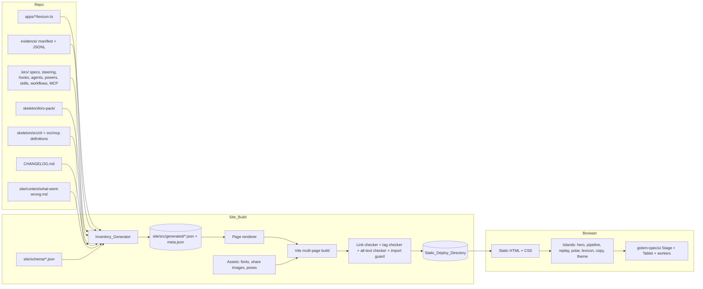
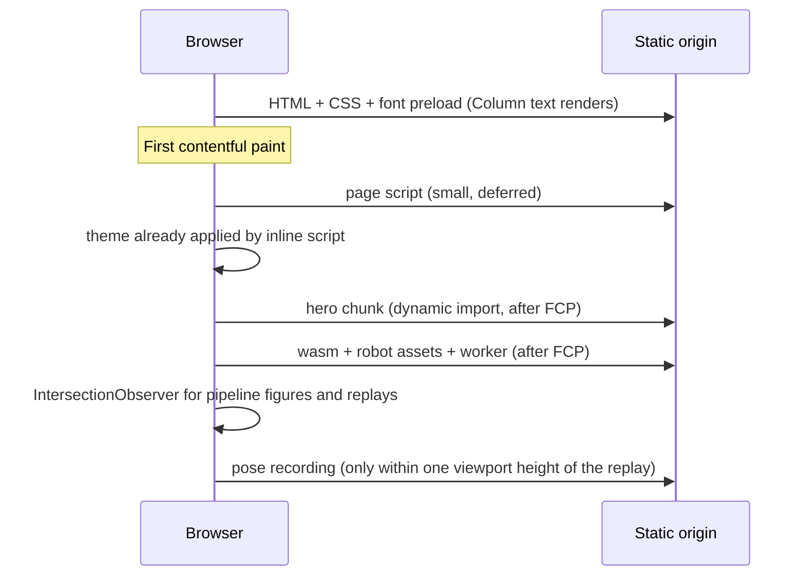

# Design Document

## Overview

`golem-site` is the public website of GOLEM, in `site/`. It is a Vite multi-page static build with four pages (`/`, `/kit`, `/evidence`, `/how-kiro`), a changelog page, and the two bundled app studios (`/stagger/`, `/candy/`). It deploys as static files and makes no network request except to its own origin.

The design splits the site into two halves that meet at a set of JSON data files:

1. **Build-time generation.** The Inventory_Generator reads the repository (lexicons, `evidence/`, `.kiro/`, `skeleton/kiro-pack/`, CLI and MCP definitions, `CHANGELOG.md`, `site/content/what-went-wrong.md`) and writes schema-validated JSON into `site/src/generated/`. It is a pure function of the repository contents. A page-rendering step then writes the Column text, tables, lists and Text_Alternatives into static HTML, so every Page is readable with JavaScript disabled (Requirement 21.7).
2. **Browser-side islands.** Interactive Figures (Hero_Studio, Pipeline figures, Replay_Loops, Polar_Figure, Lexicon filter, Copy_Snippet, Theme_Switch) are small TypeScript modules that hydrate server-rendered placeholders. Each placeholder has reserved dimensions, so loading never shifts layout. Heavy code (MuJoCo WASM, three.js, workers) loads only after first contentful paint and, for below-the-fold islands, only when the island nears the viewport.

The site reuses `golem-spec/ui` (Stage, Tablet, Ghost swarm, reel) from `golem-studio-ui` and does not redefine them. It only reads the contracts in `interfaces.md`.

### Design decisions

| Decision | Rationale |
|---|---|
| Static HTML emitted by a build script (not a client-rendered SPA) | Requirements 21.7 and 1.1 need Column text with JavaScript off and non-empty `main` from a plain static server. It also gives the best Lighthouse result. |
| Pure-function generator with JSON Schema validation | Requirements 25.1 to 25.4 demand determinism and schema checks. Pure functions are also where property tests pay off. |
| Islands with reserved layout boxes | Requirements 5.13, 8.7, 16.10 and 21.3 cap CLS at 0.01. |
| Plain DOM and SVG for figures (no UI framework on the site pages) | Keeps the Home JavaScript small for the Lighthouse 90 bar. React stays in the studios only (`tech.md`). |
| Figures take a `data` object and a `tokens` object and return an SVG string or mutate a root | Separates pure geometry (property-testable) from DOM wiring (Playwright-tested). |
| Theme as a `data-theme` attribute on `<html>`, set by an inline pre-paint script | Requirement 4.4 forbids a frame in the wrong theme. |
| Compile example lines with the real `golem-ears` compiler at build time | Requirements 14.6 and 14.7. The reference cannot drift from the dialect. |
| Fail the build loudly on any missing source | Requirements 1.7, 9.3, 10.5, 12.8, 15.8, 18.4, 20.5 and 25.6. No silent fallbacks to typed-in content. |

### Research notes

- **Vite multi-page builds**: set `build.rollupOptions.input` to a map of HTML entries; each entry gets its own chunk graph, and shared code is split automatically ([Vite build options](https://vite.dev/config/build-options)). Dynamic `import()` creates the separate Hero_Studio chunk required by Requirement 21.6.
- **Font fallback metrics**: `size-adjust`, `ascent-override`, `descent-override` and `line-gap-override` on a local fallback `@font-face` make the fallback occupy the same box as the web font, which is how CLS from a font swap is held at or below 0.01 ([MDN @font-face descriptors](https://developer.mozilla.org/en-US/docs/Web/CSS/@font-face)). The metrics are computed once from the woff2 files by a script in `scripts/`.
- **Layout shift measurement**: the Layout Instability API (`PerformanceObserver` with `layout-shift` entries, excluding entries with `hadRecentInput`) is what the Smoke_Suite sums ([MDN LayoutShift](https://developer.mozilla.org/en-US/docs/Web/API/LayoutShift)).
- **Lighthouse CI**: `@lhci/cli` runs Lighthouse N times against a static directory and asserts category scores; it supports `numberOfRuns` and `minScore` assertions ([Lighthouse CI configuration](https://googlechrome.github.io/lighthouse-ci/docs/configuration.html)).
- **Playwright**: `page.route('**/*')` can record and fail requests to foreign origins, and `page.addInitScript` can install the layout-shift observer before navigation.

Content was rephrased for compliance with licensing restrictions.

## Architecture



### Build order

1. `check-node` verifies Node major ≥ 20 (Requirement 1.9).
2. `check-imports` scans `site/` for deep imports of `skeleton/src/...` or app internals (Requirement 1.6).
3. `generate` runs the Inventory_Generator. It writes into a temporary directory and moves the files into `site/src/generated/` only when every file validated. Previous files are untouched on failure (Requirement 25.6).
4. `render` produces the HTML entries from templates and generated data.
5. `vite build` bundles pages, islands and the two studio entries. A missing studio entry aborts before writing the output directory (Requirement 1.7).
6. `post-build` writes content-hashed names, `.gz` and `.br` variants, runs the link checker, the metadata checker and the alt-text checker, and writes `sitemap.xml`.
7. The output is staged in a temporary directory and renamed to the Static_Deploy_Directory only if all checks pass, so a failed build leaves no output directory (Requirements 1.7, 9.3).

### Runtime loading strategy



Requirement 21.4 is met by starting the hero chunk load from a `requestIdleCallback` or `load` handler scheduled after the first contentful paint, and by never referencing WASM, robot assets or pose recordings in `<link rel="preload">` or in the HTML.

## Components and Interfaces

All site code is TypeScript in strict mode, ES modules. The site imports only `golem-spec`, `golem-spec/ui`, `golem-spec/node` and each app's public entry.

### Directory layout of `site/`

```
site/
  pages/                 index.html, kit.html, evidence.html, how-kiro.html, changelog.html (templates)
  src/
    build/               generator, renderer, post-build checks (Node only)
    generated/           JSON written by the generator (committed or gitignored; see Data Models)
    islands/             hero, pipeline, replay, polar, lexicon-filter, copy-snippet, theme-switch
    figures/             pure geometry and text-alternative builders
    styles/              tokens.css, type.css, layout.css, fonts.css
    shared/              footer, head metadata builder, types
  schema/                JSON Schemas for each generated file
  content/               what-went-wrong.md
  public/                fonts, favicons, share images, manifest, robots
  scripts/               font-metrics, share-image generation
  tests/                 vitest + fast-check; playwright/
```

### Build-time modules (Node, pure where possible)

```ts
// site/src/build/generator.ts
interface GeneratorInput {
  repoRoot: string;
  commit: { hash: string; date: string };   // recorded commit date, never "now"
}
interface GeneratedFile { path: string; text: string }   // text is canonical JSON, trailing newline
function generate(input: GeneratorInput, fs: ReadOnlyFs): Promise<GeneratedFile[]>;  // throws GeneratorError
function canonicalJson(value: unknown): string;           // sorted keys policy, 2-space indent, "\n" end
function parseJsonl(text: string, file: string): unknown[];  // throws on first malformed line with its number

interface GeneratorError { code: string; file: string; line?: number; expected?: string; message: string }
```

`ReadOnlyFs` is a small interface (`readFile`, `readDir`, `exists`) so tests can drive the generator with an in-memory tree. This is what lets property tests generate "repository trees" (Requirement 27.6).

```ts
// site/src/build/inventory.ts
interface SpecEntry { name: string; requirements: number; tasks: number }
interface SteeringEntry { name: string; inclusion: string; path: string }
interface HookEntry { name: string; trigger: string; action: string; path: string }
interface NamedEntry { name: string; purpose: string; path: string }   // agents, MCP servers, powers, skills, workflows
interface KiroInventory {
  commit: string;
  lists: {
    specs: SpecEntry[]; steering: SteeringEntry[]; hooks: HookEntry[]; agents: NamedEntry[];
    mcp: NamedEntry[]; powers: NamedEntry[]; skills: NamedEntry[]; workflows: NamedEntry[];
  };
  totals: Record<keyof KiroInventory['lists'], number>;
  surfaces: { surface: string; exampleLink: string }[];   // eight surfaces, Requirement 19.7
}
function countRequirements(requirementsMd: string): number;  // count of /^### Requirement \d+/m headings
function countTasks(tasksMd: string): number;                // count of /^\s*- \[[ x]\]/ items
function buildInventory(tree: ReadOnlyFs, commit: string): { inventory: KiroInventory; warnings: string[] };
```

`buildInventory` writes "no description in file" and a warning when a purpose line is missing (Requirement 19.8).

```ts
// site/src/build/lexicon-reference.ts
interface TemplateRow {
  app: 'stagger' | 'candy'; kind: 'predicate' | 'perturbation';
  phrase: string;                         // character-identical to the lexicon
  slots: { name: string; slotKind: string; units: string[] }[];
  marginUnit?: string;                    // predicates only
  example: string;                        // compiled by golem-ears at build time
}
interface LexiconReference {
  rows: TemplateRow[];
  units: { unit: string; si: string; factor: number }[];
  patterns: { pattern: 'ubiquitous'|'event'|'state'|'unwanted'|'optional'; shape: string; compilesTo: string }[];
  errorExample: { line: string; diagnostic: string; suggestion: string };
}
function buildLexiconReference(lexicons: Record<string, Lexicon>, compile: CompileFn): LexiconReference;
type CompileFn = (line: string, lexicon: Lexicon) => { ok: true } | { ok: false; diagnostic: string; suggestion?: string };
```

The compiler is injected so a property test can pass a stub. In the real build it is `golem-ears`'s compile function, imported through `golem-spec`.

```ts
// site/src/build/evidence.ts
interface HeadlineNumber {
  id: string; label: string; value: number; unit: string;
  budget: { trialsPerRun?: number; runs?: number; text: string };
  resultId: string; href: string;           // e.g. "/evidence#falsifier"
}
function deriveHeadlineNumbers(manifest: EvidenceManifest, raw: RawData): HeadlineNumber[];  // pure
function verifyBuiltHeadlines(builtHtml: string, derived: HeadlineNumber[]): string[];       // list of mismatches
function validateManifest(manifest: EvidenceManifest): ManifestIssue[];   // missing pre-registration, missing fields
```

```ts
// site/src/build/links.ts
interface LinkRef { page: string; kind: 'href' | 'src' | 'css-url' | 'preload' | 'module'; target: string }
function extractLinks(pageHtmlOrCss: string, page: string): LinkRef[];
function checkLinks(refs: LinkRef[], exists: (path: string) => boolean): LinkRef[];  // exactly the unresolved ones
```

```ts
// site/src/build/metadata.ts
interface PageMeta { path: string; title: string; description: string; canonical: string; og: Record<string,string>; twitter: Record<string,string>; shareImage: string }
function checkMetadata(pages: PageMeta[], fileExists: (p: string) => boolean): string[];  // messages naming page and item
function buildSitemap(pages: string[]): string;
```

```ts
// site/src/build/figures-check.ts
function findFiguresWithoutAlt(html: string, page: string): { page: string; figureId: string }[];
```

### Browser-side modules

```ts
// site/src/shared/theme.ts
type Theme = 'dark' | 'light';
interface ThemeStore { get(): Theme; set(t: Theme): void; subscribe(fn: (t: Theme) => void): () => void }
function resolveInitialTheme(stored: string | null, prefersLight: boolean): Theme;   // pure
function readTokens(el: Element): TokenValues;   // reads CSS custom properties for figures
```

An inline script in `<head>` calls the equivalent of `resolveInitialTheme` before first paint. The store keeps the choice in memory when `localStorage` throws (Requirement 4.7). Figures subscribe and redraw with `readTokens()` within 100 ms.

```ts
// site/src/islands/hero.ts
interface HeroConfig {
  root: HTMLElement; app: RobotApp;                 // Stagger via its public entry
  requirementIds: [string, string, string];         // exactly three
  ghostCount: 64;
}
function mountHero(cfg: HeroConfig): Promise<HeroHandle>;
interface HeroHandle { push(forceN: number, directionDeg: number): void; summon(): void; dispose(): void }
function fallbackReason(env: { webgl: boolean; wasm: boolean }): string | null;   // names what is missing
```

`push()` is the shared entry point for pointer drag and for the keyboard action (Requirement 23.4). Both produce a `Scenario` with the same dimensions, so results are identical. Physics runs in a worker through `TrialPool` from `golem-spec/ui`; the island posts messages and never steps MuJoCo on the main thread (Requirement 5.16). The island uses an `IntersectionObserver` on the Stage to pause rendering and stepping off-screen, and the Stage's on-demand render loop from `golem-studio-ui` supplies the zero idle render calls.

```ts
// site/src/figures/polar.ts   (pure geometry; DOM wiring is in islands/polar.ts)
interface PolarSample { directionDeg: number; maxForceN: number }
interface PolarData { samples: PolarSample[]; boundN: number; phases?: number[] }   // samples sorted by direction
interface PolarGeometry { size: number; rMaxN: number; scale: number }
function toXY(p: PolarSample, g: PolarGeometry): { x: number; y: number };
function fromXY(pt: { x: number; y: number }, g: PolarGeometry): PolarSample;
function nearestSample(data: PolarData, directionDeg: number): number;           // index, wraps at 360
function stepIndex(i: number, n: number, dir: 'cw' | 'ccw'): number;             // wraps
function splitByBound(data: PolarData): { below: number[][]; atOrAbove: number[][] };  // runs of indices
function polarAlt(data: PolarData): string;   // weakest/strongest direction and force
```

Angle convention: direction 0° points along +x of the figure and increases counter-clockwise on screen, matching the studio's push direction. `stepIndex(i, n, 'ccw')` moves to the next larger angle for ccw (Requirement 16.4 says left arrow is counter-clockwise).

```ts
// site/src/figures/alt.ts
function falsifierAlt(r: FalsifierResult): string;
function gateAlt(r: GateResult): string;
function pipelineAlt(step: PipelineStepData): string;
function replayAlt(r: ReplayMeta): string;
function wordCount(text: string): number;   // used to enforce 1 sentence minimum, 80 words maximum
```

```ts
// site/src/islands/copy-snippet.ts
interface ClipboardLike { writeText(text: string): Promise<void> }
function mountCopySnippet(root: HTMLElement, clipboard: ClipboardLike | undefined): void;
```

On success the button label changes to a confirmation for 2 s and then restores. On failure (or no clipboard) the snippet text is selected, a message appears within 100 ms, and the snippet text is unchanged (Requirement 13.7).

```ts
// site/src/islands/lexicon-filter.ts
function filterRows(rows: TemplateRow[], f: { app?: string; kind?: string }): TemplateRow[];  // pure
```

Without JavaScript the full table is present in HTML. Below 640 px the table is restyled as cards by CSS only.

```ts
// site/src/islands/replay.ts
function mountReplay(root: HTMLElement, meta: ReplayMeta, opts: { reducedMotion: boolean }): void;
```

A replay uses `IntersectionObserver` with a `rootMargin` of one viewport height to start the fetch, and with a margin of 0 to play or pause. On fetch failure it shows the still image, the Text_Alternative and the Studio link within 1 s. Under `prefers-reduced-motion` it shows a step control and advances one frame per activation.

### Pipeline figures

The six Pipeline_Steps are one data array (`PipelineStepData[]`) generated at build time from one Stagger requirement (the example requirement is selected by id in `site/src/build/example.ts` and read from `apps/stagger/.kiro/specs/stagger/requirements.md`, so the quoted text is character-identical in every step). Each step has `{ title, explanation, figureKind, source: 'live' | 'recorded', alt }`. Live figures start computation through an `IntersectionObserver` with a root margin of one viewport height and stop when farther away.

| Step | Figure | Source |
|---|---|---|
| 1 EARS line | Sentence with quantities highlighted and unit-labelled | live (pure render) |
| 2 Scenario space and monitor | Dimension ranges with units; sign-convention legend | live (from compiled requirement `space`) |
| 3 Ghosts | Trial counters (random, guided), lowest margin; label plus a dashed outline for guided Ghosts as the non-colour cue | recorded from `evidence/` trial log |
| 4 Shrink | Failing and shrunk scenarios side by side | recorded |
| 5 Pinned seed | `.golem/seeds/<app>/<reqId>.json` entry with all `Counterexample` fields | recorded |
| 6 Stop gate | `golem gate` output, exit code 2, reproduction command | recorded |

### CSS architecture

- `tokens.css` defines the eight Tokens under `:root[data-theme="dark"]` and `:root[data-theme="light"]`. No other stylesheet holds a literal colour for `color` or `background-color` (Requirement 2.8). Borders use `color-mix` on `--clay` at 35% (or a precomputed token alias that is itself defined in `tokens.css`).
- `type.css` defines the seven-size scale as custom properties and the EARS keyword span class (`.kw`) at 0.85em with 0.04em letter spacing. Keywords are written in capitals in the source text of the generated HTML, so no `text-transform: uppercase` is needed anywhere.
- `layout.css` defines `.column { max-width: 72ch }` and `.bleed { width: 100vw; margin-left: calc(50% - 50vw) }`, with `overflow-x: auto` inside tables and code blocks. Document `overflow-x` stays visible, and the bleed technique uses `100%` of the container on a full-width grid track to avoid the scrollbar-width overflow of `100vw`.
- Every Figure and Stage has an explicit `aspect-ratio` or width and height.
- Interactive controls under 1024 px get `min-height: 44px; min-width: 44px`.
- Focus ring: 2 px outline in `--ink` with 2 px offset (contrast ≥ 3:1 against both grounds, which the token test checks).

### Fonts

B612, B612 Mono and Gloock live in `site/public/fonts/` as woff2 with their licence files. `fonts.css` declares each face with `font-display: swap` and a local fallback face with the four override descriptors computed by `scripts/font-metrics.ts` (which reads the woff2 tables and writes `fonts.generated.css`). Every Page preloads the body-text woff2 with `crossorigin`. If a font fails to load the fallback stack renders the same text.

## Data Models

All generated files are canonical JSON (sorted keys, 2-space indent, LF line ends, trailing newline). Each has a schema in `site/schema/<name>.schema.json`. Lists are sorted by a stable key (name or id), never by file system order.

| File | Content | Source |
|---|---|---|
| `meta.json` | `{ commit: string (40 hex), commitDate: string, generatorVersion: string }` | git, recorded |
| `lexicon-reference.json` | `LexiconReference` | app lexicons + `golem-ears` |
| `kit.json` | `{ categories: KitCategory[] }`, eight categories in fixed order | `skeleton/src/cli`, `skeleton/src/mcp`, `skeleton/kiro-pack/` |
| `kiro-inventory.json` | `KiroInventory` | `.kiro/` |
| `evidence.json` | `{ results: EvidenceResult[], defaultBudgetTrials: number, headlines: HeadlineNumber[] }` | `evidence/` |
| `polar.json` | `PolarData` for the Stability_Map, plus reserved size | `evidence/` |
| `changelog.json` | `{ releases: { version: string; date: string; body: string }[] }` newest first | `CHANGELOG.md` |
| `notes.json` | `{ notes: WrongNote[] }` | `site/content/what-went-wrong.md` |
| `pipeline.json` | `PipelineStepData[]` (six) | Stagger spec + evidence logs |
| `alt.json` | map `figureId → text alternative` for build-time fallbacks | derived |

```ts
interface KitEntry { id: string; section: string; name: string; description: string; snippet: string }
interface KitCategory { section: 'cli'|'mcp'|'hooks'|'agents'|'skills'|'power'|'workflow'|'crew'; title: string; entries: KitEntry[] }
// KitEntry.id = `${section}-${name}` lowercased, spaces to hyphens; unique per page

interface EvidenceResult {
  id: string; title: string; kind: 'falsifier' | 'stability' | 'gate';
  method: string; budget: { trialsPerRun?: number; runs?: number; text: string };
  seeds?: number[]; commit: string; date: string;
  preRegistration: string;             // path; required
  rawData: { path: string; bytes: number; format: 'JSONL'; sha256: string }[];
  limits: string[]; reproduce: string; weaknesses: string[];
  coverage?: { reqIds: string[]; apps: string[] };
}
interface FalsifierResult extends EvidenceResult {
  methods: Record<'guided' | 'random', {
    trialsToFirst: { median: number; lo: number; hi: number };
    foundFraction: { value: number; lo: number; hi: number };
  }>;
  intervalMethod: string; confidence: number;
}
interface GateResult extends EvidenceResult {
  arms: Record<'with' | 'without', { runs: number; held: number; broken: number }>;
  difference: { value: number; lo: number; hi: number; method: string };
  task: string; agent: string; model: string;
}
interface WrongNote { title: string; happened: string; cost: string; response: string; link: string | null }  // title ≤ 80 chars
interface PipelineStepData { n: 1|2|3|4|5|6; title: string; explanation: string; quote: string; figureKind: string; source: 'live'|'recorded'; alt: string }
```

Invariants carried by the schema or by build checks:

- `arms.with.held + arms.with.broken === arms.with.runs`, and the same for `without` (Requirement 17.2).
- `PipelineStepData.quote` is equal in all six steps (Requirement 7.3).
- `PolarData.samples` has at least 3 entries, strictly increasing `directionDeg` in [0, 360), finite non-negative `maxForceN`.
- Every Headline_Number has `value`, `unit`, `budget` and `href` (Requirement 9.2).
- Total counts in `KiroInventory.totals` equal the list lengths (Requirement 19.9).

Raw_Data_Files are read through `parseJsonl`, which fails on the first malformed line and reports its number (Requirement 25.7). The site build copies Raw_Data_Files byte for byte into the deploy directory so their SHA-256 equals the repository file (Requirement 18.7). Compressed variants are added alongside and never replace them.

Round trip: for every generated file, `canonicalJson(JSON.parse(text)) === text` (Requirement 25.8).

## Correctness Properties

*A property is a characteristic or behavior that should hold true across all valid executions of a system-essentially, a formal statement about what the system should do. Properties serve as the bridge between human-readable specifications and machine-verifiable correctness guarantees.*

Reflection on the prework: it produced many per-criterion candidates. These were merged where one implies another. The evidence renderer criteria (15.2, 15.4 to 15.6, 16.7, 16.8, 17.3 to 17.5, 18.1 to 18.3) became one "manifest fields are rendered" property. The lexicon completeness criteria (14.1, 14.10, 27.4) became one property. The inventory totals and counts (19.2, 19.3, 19.9, 27.6, 27.7) became two properties. Determinism criteria (25.1 to 25.3, 19.10) became one property. The polar alt text criteria (16.9, 27.5) became one property. Criteria that are browser layout, timing, network or Lighthouse measurements are not properties and are covered by the Playwright and Lighthouse tests in the Testing Strategy.

### Property 1: Link checker is sound and complete

For any set of existing files and any set of link references (`href`, `src`, CSS `url()`, preload, module import), `checkLinks` reports exactly the references whose target is not in the file set, each with its page. It reports no resolvable reference and misses no unresolvable one.

**Validates: Requirements 1.8, 12.4, 13.9, 27.8**

### Property 2: Deploy file whitelist

For any list of file names, the output validator reports exactly the names whose extension is not in the allowed set (`.html`, `.css`, `.js`, `.wasm`, `.woff2`, `.png`, `.svg`, `.ico`, `.webmanifest`, `.txt`, `.xml`, `.jsonl`, `.json`, pose recordings, `.gz`, `.br`, licence files).

**Validates: Requirements 1.3**

### Property 3: No foreign origins in built files

For any HTML, CSS or JavaScript text and any serving origin, the origin scanner reports exactly the absolute URLs (in `src`, `href`, CSS `url()`, `import`, `fetch` literals) whose origin differs from the serving origin.

**Validates: Requirements 1.4, 1.5, 3.1**

### Property 4: Deep import guard

For any import specifier written in a file under `site/`, the import guard flags it if and only if it deep-imports `skeleton/src/...` or an app's internal path, and its message names the file path and the specifier.

**Validates: Requirements 1.6**

### Property 5: Node version gate

For any version string `major.minor.patch`, the version check passes if and only if the major number is 20 or greater, and its failure message contains both the required and the detected version.

**Validates: Requirements 1.9**

### Property 6: Typography and colour rules over CSS

For any set of CSS declarations, the style checker reports exactly the `font-size` values outside {13, 16, 20, 25, 31, 39, 61} px, every `text-transform: uppercase`, every gradient `background-image`, every card `box-shadow` other than `none`, and every `color` or `background-color` declaration that holds a literal colour instead of a Token reference.

**Validates: Requirements 2.4, 2.5, 2.6, 2.8**

### Property 7: Token coverage and contrast

For any Token in {`--ground`, `--ground-2`, `--ink`, `--ink-2`, `--clay`, `--ghost`, `--break`, `--hold`} and each Theme, `tokens.css` defines a value. For any two colours, the contrast function returns a ratio in [1, 21] and is symmetric. For the real Token values in both Themes, `--ink` on `--ground` is at least 7:1, `--break` and `--hold` on `--ground` are at least 4.5:1, and the focus ring colour on `--ground` and `--ground-2` is at least 3:1.

**Validates: Requirements 4.1, 4.5, 23.3**

### Property 8: Initial theme resolution

For any stored value (absent, `dark`, `light` or any other string) and any `prefers-color-scheme` result, `resolveInitialTheme` returns the stored value when it is `dark` or `light`, otherwise `light` if the user agent prefers light, otherwise `dark`.

**Validates: Requirements 4.2, 4.4**

### Property 9: Theme store round trip and propagation

For any sequence of `set` calls on the theme store and any number of subscribers, every subscriber is called once per change with the new Theme, and a new store created over the same storage returns the last set Theme. If storage throws on read or write, `set` and `get` still work in memory for the session and no error propagates.

**Validates: Requirements 4.3, 4.6, 4.7**

### Property 10: Drag maps to a bounded push

For any drag vector in pixels, the drag-to-push mapping returns a force in [0, 200] N and a direction in [0, 360) degrees, and reversing the vector changes the direction by 180° (modulo 360) with the same force.

**Validates: Requirements 5.4**

### Property 11: Keyboard push equals drag push

For any force in [0, 200] N and direction in [0, 360) degrees, the keyboard push action and the drag push whose mapped values are the same produce an identical `Scenario` for the same requirement.

**Validates: Requirements 23.4, 5.4**

### Property 12: Result text states held or broke with margin and unit

For any robustness value and unit string, the result formatter outputs the word "held" if the robustness is greater than 0 and "broke" otherwise, followed by the margin magnitude and the unit, so the state is never carried by colour alone.

**Validates: Requirements 5.5, 23.7**

### Property 13: Ghost cap and tablet result state

For any sequence of summon, trial-result and fade events, the number of visible Ghosts never exceeds 64. For any sequence of quantity changes and results on a requirement, the tablet state shows exactly the latest result for that requirement, or the running marker while its re-run is in progress.

**Validates: Requirements 5.7, 5.8**

### Property 14: Pixel ratio cap

For any device pixel ratio greater than or equal to 0, the Stage pixel ratio equals `min(dpr, 1.5)`.

**Validates: Requirements 5.10**

### Property 15: Fallback reason names what is missing

For any pair of flags (WebGL available, WASM available), `fallbackReason` returns `null` when both are available, and otherwise a message that names exactly the unavailable capability or capabilities.

**Validates: Requirements 5.15**

### Property 16: Pipeline data invariants

For any example requirement text, the pipeline builder outputs exactly six steps in the required order, each with exactly one figure, an explanation of at most 80 words, and a `quote` that is character-identical to the input text in all six steps. For any pair of failing and shrunk scenarios, the shrink validator accepts the pair if and only if the shrunk force is less than or equal to the original force.

**Validates: Requirements 7.1, 7.2, 7.3, 7.7**

### Property 17: Pipeline figure renderers show every required field

For any EARS line with quantities, the line figure highlights each quantity and labels its unit. For any `ScenarioSpace`, the space figure shows each dimension name with its min, max and unit. For any `Counterexample`, the pinned-seed figure contains all six field names (`reqId`, `scenario`, `seed`, `robustness`, `shrunk`, `foundAfter`). For any list of verdicts, the gate figure has exactly one line per broken requirement, shows exit code 2 when at least one is broken, and shows each reproduction command.

**Validates: Requirements 7.4, 7.5, 7.8, 7.9**

### Property 18: Trial counters

For any list of trials tagged random or guided, the Ghost figure's random count plus guided count equals the number of trials, and the displayed lowest margin equals the minimum robustness in the list, with its unit.

**Validates: Requirements 7.6**

### Property 19: Headline numbers derive from evidence

For any valid Evidence_Manifest and raw data, `deriveHeadlineNumbers` is deterministic (two calls give equal results), includes at least one number from each of the falsifier, stability and gate results, gives each number a value, unit, budget and a link to an existing section id, and each value equals an independent recomputation from the raw data. For any built Home text with one headline value altered, `verifyBuiltHeadlines` reports exactly the altered number.

**Validates: Requirements 9.1, 9.2, 9.6, 27.2**

### Property 20: Missing or invalid evidence fails the build with a named cause

For any evidence tree from which one required file (manifest or Raw_Data_File) is removed, the generator fails and names that file and the headline number that needed it. For any manifest, `validateManifest` reports exactly the results that lack a Pre_Registration link, a method note, a budget, a commit hash, Raw_Data_File links, a limits statement, a reproduce command or a known weakness, each issue naming the result and the missing field. It also rejects a gate result whose held plus broken does not equal runs, and any reported number whose interval does not satisfy `lo ≤ value ≤ hi`, or a gate difference with no interval or no method name.

**Validates: Requirements 9.3, 15.3, 15.8, 17.2, 17.7, 18.4, 18.6**

### Property 21: Manifest fields are rendered

For any valid evidence result, the rendered section contains its method note, budget, commit hash, date, seeds, limits, known weaknesses, Pre_Registration link, one link per Raw_Data_File with its size and format, and the reproduce command inside a Copy_Snippet. For any manifest default budget, the Home limits section contains that trials-per-run number.

**Validates: Requirements 11.2, 15.2, 15.4, 15.5, 15.6, 16.7, 16.8, 17.3, 17.4, 17.5, 18.1, 18.2, 18.3**

### Property 22: Raw data files are copied unchanged

For any byte sequence used as a Raw_Data_File, the deploy copy has an identical SHA-256, and compressed variants are written alongside without replacing it.

**Validates: Requirements 18.7**

### Property 23: Copy snippet copies exact text

For any snippet text (including Unicode, tabs, newlines and trailing spaces), activating the copy button writes exactly that text to the clipboard and the button label shows the confirmation then restores. If the clipboard rejects or is absent, the snippet text is selected, a message is shown and the snippet text is unchanged.

**Validates: Requirements 10.1, 13.6, 13.7**

### Property 24: Kit lists match their sources

For any CLI definition set, MCP tool set and `kiro-pack` file tree, the kit builder outputs eight categories in the fixed order, the number of entries in the CLI, MCP, hook, agent, skill, power and workflow categories equals the number of definitions or files of that kind, every entry has a description of at most 30 words and exactly one snippet, entries are sorted by name, and the Home pack list has one entry per file in the pack.

**Validates: Requirements 10.2, 13.1, 13.2, 13.3, 13.4, 13.5**

### Property 25: Anchor ids are well formed and unique

For any section key and set of unique entry names, the generated id equals `<section>-<name>` in lowercase with spaces replaced by hyphens, ids are unique within the page, and every table-of-contents link targets an existing id.

**Validates: Requirements 13.8, 13.9**

### Property 26: Lexicon reference is complete and exact

For any set of lexicons, the Lexicon_Reference lists every `PredicateTemplate` and `PerturbationTemplate` exactly once, with the phrase character-identical to the lexicon, the app, the kind, the slot types and units, and the margin unit for predicates. Each row has exactly one example line. For any compiler that rejects some example, the builder fails with that line and its diagnostic. The row count per app equals that app's template count.

**Validates: Requirements 14.1, 14.2, 14.3, 14.6, 14.7, 14.10, 27.4**

### Property 27: Unit conversion round trip

For any accepted unit in the units table and any finite value, converting to SI and back using the table factor returns the value within a relative error of 1e-12.

**Validates: Requirements 14.4**

### Property 28: Lexicon filter

For any rows and any filter on app and kind, `filterRows` returns exactly the rows that match, in the original order, and an empty filter returns all rows.

**Validates: Requirements 14.8**

### Property 29: Polar fidelity and geometry

For any Stability_Map data and any size, converting a (direction, force) sample to figure coordinates and back returns the pair within a relative error of 1e-9, and the drawn radius divided by the scale equals the sample's maximum survived force within 1e-9 for every direction. The boundary path is closed. The reference circle radius equals the scale times the force bound.

**Validates: Requirements 16.1, 16.2, 16.12, 27.3**

### Property 30: Polar navigation and split

For any data with n samples and any direction in degrees, `nearestSample` returns the sample with the smallest circular angular distance. For any index, one step clockwise after one step counter-clockwise returns the index, and n steps in one direction return to the start. `splitByBound` places every sample in exactly one run list, with force below the bound in `below` and the rest in `atOrAbove`.

**Validates: Requirements 16.3, 16.4, 16.5**

### Property 31: Polar scaling

For any viewport width from 375 px to 1440 px, the Polar_Figure size has a constant aspect ratio and its label size is at least 13 px.

**Validates: Requirements 22.6**

### Property 32: Text alternatives state their data

For any Stability_Map data, the alt text names a weakest direction whose force equals the minimum force in the data and a strongest direction whose force equals the maximum, with units. For any falsifier result, gate result and replay metadata, the alt text contains every required number with its unit (both methods' trials to first counterexample and found fraction with intervals, both arms' runs, held and broken counts, and the replay's app, scenario quantities and outcome with margin). Every alt text is between 1 sentence and 80 words.

**Validates: Requirements 8.6, 15.7, 16.9, 17.6, 23.1**

### Property 33: Figure alt completeness

For any built HTML, the figure checker reports exactly the figures that have no Text_Alternative or whose Text_Alternative is outside 1 to 80 words, each with its page and figure id.

**Validates: Requirements 7.12, 23.1, 23.10**

### Property 34: Page structure rules

For any sequence of headings on a page, the heading checker accepts it if and only if it has exactly one `h1` and no heading level skips more than one level going down. For any link text, the link-text checker flags exactly the generic ones ("click here", "read more"). For any HTML, the image and figure checker flags exactly elements that have neither explicit width and height nor an aspect ratio.

**Validates: Requirements 21.5, 23.6, 23.9**

### Property 35: Content word and phrase rules

For any text, the word counter is consistent with whitespace-separated tokens, the vague-quantifier scanner flags exactly the texts that contain a banned word ("many", "most", "often") in the problem section, and the problem section builder output has 60 to 150 words.

**Validates: Requirements 6.3, 6.5**

### Property 36: Shared footer is identical

For any page path, the rendered footer markup is the same string, and the sitemap `nav` inside it contains links to `/`, `/kit`, `/evidence`, `/how-kiro`, `/stagger/` and `/candy/`.

**Validates: Requirements 12.1, 12.2**

### Property 37: Changelog order

For any set of release entries given in any order, the parsed changelog lists them from newest to oldest.

**Validates: Requirements 12.5**

### Property 38: Kiro inventory counts and totals

For any markdown with a known number of `### Requirement N` headings (and decoy headings of other forms), `countRequirements` returns that number. For any markdown with a known number of `- [ ]` and `- [x]` items, `countTasks` returns that number. For any repository tree, each total equals the number of items in its list, there are eight lists in the fixed order, steering front matter inclusion and hook trigger and action are read back equal to what was written, and every item has a purpose of at most 30 words.

**Validates: Requirements 19.1, 19.2, 19.3, 19.4, 19.5, 19.6, 19.9, 27.6, 27.7**

### Property 39: Missing purpose warns once

For any tree where some items have no purpose line, each such item is written with the text "no description in file" and the generator emits exactly one warning naming each of them.

**Validates: Requirements 19.8**

### Property 40: Notes round trip and rendering

For any list of valid notes, formatting them to markdown and parsing returns equal notes. The validator rejects titles longer than 80 characters and notes missing a field. The rendered note shows its link if one exists and the text "no link" otherwise.

**Validates: Requirements 20.1, 20.2, 20.3**

### Property 41: Metadata checker

For any set of page metadata, the checker reports exactly the pages with a missing or duplicate title, a missing or duplicate or over-160-character description, a missing Open Graph or Twitter tag, a canonical URL that is not exactly one or not equal to `og:url`, or a Share_Image that does not exist, each message naming the page and the item. `buildSitemap` lists exactly the input pages and no other URL.

**Validates: Requirements 24.1, 24.2, 24.5, 24.6, 24.7**

### Property 42: Deterministic generation

For any repository tree, running the generator twice gives byte-identical files, and the output is the same for any permutation of directory listing order. Share images generated twice from the same inputs are byte-identical. `meta.json` contains the supplied 40-character commit hash.

**Validates: Requirements 19.10, 24.8, 25.1, 25.2, 25.3, 25.5**

### Property 43: Generated JSON validates and round trips

For any generated data file, the file validates against its schema, and `canonicalJson(JSON.parse(text))` equals the original text. For any generated file with one field altered to an invalid value, the validator fails and names the file and the first invalid path.

**Validates: Requirements 25.4, 25.8**

### Property 44: JSONL reading is strict

For any valid JSONL text, `parseJsonl` returns the records in order. For any valid JSONL text with one malformed line inserted at a random position, it fails with that line's number and does not skip any line.

**Validates: Requirements 25.7**

### Property 45: Failed generation leaves previous output untouched

For any repository tree with one source file made unreadable or malformed, the generator throws an error that names the file, and every previously written data file is unchanged.

**Validates: Requirements 10.5, 12.8, 20.5, 25.6**

### Property 46: Build output plan

For any list of built assets, the post-build plan adds a `.gz` and a `.br` variant for exactly the HTML, CSS, JavaScript, JSON, JSONL and SVG assets, and every asset other than an HTML entry has a content hash in its file name.

**Validates: Requirements 21.8**

### Property 47: Lighthouse failure report

For any list of Lighthouse audits with scores and point losses, the CI report prints the five audits with the largest point loss in descending order, each with its score and loss, and exits non-zero when a score is below 90.

**Validates: Requirements 21.9**

## Error Handling

All build-time errors use `GeneratorError` or `BuildError` with `{ code, file, line?, expected?, message }`, print one line per error to stderr, and exit non-zero. The build never writes a partial Static_Deploy_Directory: it stages into a temporary directory and renames only after every check passes.

| Condition | Behaviour | Requirement |
|---|---|---|
| Node major < 20 | Exit non-zero, message names required and detected version | 1.9 |
| Deep import of skeleton or app internals | Fail with the first file path and specifier | 1.6 |
| Studio entry missing | Fail, no output directory, message names entry and app | 1.7 |
| Unresolved link or asset reference | Fail with list of unresolved references and their pages | 1.8 |
| Evidence manifest or Raw_Data_File missing or unreadable | Fail naming the file and the number | 9.3 |
| Headline number in built page differs from derived value | Fail with the offending number | 9.6 |
| Result has no pre-registration or other required field | Fail naming result and field | 15.8, 18.4 |
| `kiro-pack` directory unreadable | Fail naming the directory | 10.5 |
| `CHANGELOG.md` missing | Fail naming the file | 12.8 |
| Notes file missing or empty | Fail naming the file | 20.5 |
| Lexicon example does not compile | Fail with the line and the diagnostic | 14.7 |
| Item with no purpose line | Write "no description in file" and print a warning naming the item; build continues | 19.8 |
| Malformed JSONL line | Fail with the file and line number of the first bad line | 25.7 |
| Generated file fails schema | Fail naming file and first invalid path | 25.4 |
| Source file unreadable or malformed | Fail with file, line where known and expected shape; earlier outputs unchanged | 25.6 |
| Figure without Text_Alternative | Fail listing pages and figures | 23.10 |
| Missing metadata tag or Share_Image | Fail naming page and item | 24.7 |

Browser-side failures degrade without an uncaught error:

| Condition | Behaviour | Requirement |
|---|---|---|
| No WebGL or no WASM | Still image in Stage bounds, three requirements as text, message naming what is missing, link to the Replay_Loop | 5.15 |
| Assets still loading | Still image of the G1 in the Stage bounds and a text line stating the loading state | 5.14 |
| Font file fails | Fallback stack renders all text; no horizontal scroll | 3.6 |
| `localStorage` blocked | Theme held in memory for the session; later sessions use `prefers-color-scheme` or dark | 4.7 |
| Replay recording fails | Within 1 s show still image, Text_Alternative and Studio link; rest of page unchanged | 8.8 |
| Stability_Map data fails to load | Show build-time Text_Alternative and link to the Raw_Data_File | 16.11 |
| Clipboard unavailable or rejects | Select snippet text, show message within 100 ms, leave text unchanged | 13.7 |
| JavaScript disabled | Column text, tables, lists and Text_Alternatives remain; lexicon table shows unfiltered | 14.8, 21.7 |

## Testing Strategy

The site uses a dual approach. Property tests cover the pure build-time and figure logic. Example, Playwright and Lighthouse tests cover layout, timing, network and browser behaviour, which are not meaningful as properties.

### Property-based tests (Vitest + fast-check)

- Library: `fast-check` with Vitest (`tech.md`, `testing.md`). Nothing is implemented from scratch.
- Each of Properties 1 to 47 is implemented by exactly one property test, configured with `numRuns` of at least 100.
- Each test carries a comment tag in the form `Feature: golem-site, Property N: <property title>`.
- Test names state the behaviour, for example `it('reports exactly the links whose target does not exist')`.
- Generators: in-memory `ReadOnlyFs` trees (with shuffled directory order), manifests and raw results, lexicons with templates, `PolarData` with 3 to 360 samples, scenario spaces, CSS declaration lists, HTML snippets with and without figures and sizes, version strings, JSONL text with one injected malformed line, and arbitrary Unicode snippet text.
- The compiler is injected into the lexicon builder, so the property tests run with a stub; one example test runs the real `golem-ears` compiler on every real lexicon template.
- The Polar_Figure and unit tests use relative-error tolerances of 1e-9 and 1e-12 as stated in the requirements.
- Per `testing.md`, no assertion or requirement is weakened to make a test pass. If a test is wrong, the commit message says why.

### Unit and example tests (Vitest)

- Static content checks of the built HTML: problem section placement and wording (6.1, 6.2), the six steps, the "live" or "recorded" label (7.10), the two app sections and their links (8.1 to 8.3), the not-a-proof statement in the same words on Home and Evidence (9.4, 18.5), the three commands in order (10.3), the limits statements (11.1, 11.3, 11.4), the call to action and Footer order (11.5, 11.6), the eight Kiro surfaces (19.7), and the font preload on every page (3.3).
- Smoke checks on build output: one HTML entry per page (1.1), studio entries and WASM present (1.2), `font-display: swap` (3.2), font licences linked (3.5), separate hero chunk (21.6), favicons, manifest and Share_Image dimensions read from the PNG header (24.3, 24.4), `lang` attribute (23.8), and no `Math.random()` in `site/src/build` (25.9).
- Build failure examples: remove a studio entry and expect a non-zero exit with no output directory (1.7).

### Playwright smoke suite

- Runs against the Static_Deploy_Directory served by a plain static file server, with short simulation horizons (at most 2 s) and small budgets (`testing.md`).
- Matrix: 6 pages (`/`, `/kit`, `/evidence`, `/how-kiro`, `/stagger/`, `/candy/`) × 3 viewports (1440×900, 390×844, 375×812) × 2 themes (dark, light) = 36 combinations. The test title carries the page, the viewport and the theme (26.9).
- For each combination: document scroll width ≤ viewport width; layout-shift total ≤ 0.01 after load, scroll to Footer and 2 s (via `addInitScript` installing a `PerformanceObserver`, ignoring entries with recent input); exactly one `h1`, one `main`, one `footer`; Open Graph tags; non-empty Text_Alternative on every Figure; Footer contains the sitemap, licences and repository link; every request goes to the serving origin (a route handler fails the test otherwise).
- Home: "Shove it" and the Summon_Button are visible; activating the button produces at least one Ghost within 5 s; keyboard push gives the same result as a drag; no render calls while idle; pose recordings are not requested before the replay nears the viewport; no WASM or recording request before first contentful paint.
- Evidence: moving focus along the Polar_Figure with the right arrow changes both the direction in degrees and the force in N.
- Theme: activating the Theme_Switch changes `data-theme` and the value is the same after reload; no frame is painted in the other Theme when a choice is stored.
- Computed-style checks: Column max width 72ch, body 16 px, font sizes within the scale, hit areas of at least 44 px below 1024 px, focus ring of at least 2 px, Full_Bleed_Figure width equals the viewport within 1 px.
- Failure paths: abort woff2 requests (3.6), abort a recording (8.8), abort the polar data (16.11), emulate reduced motion (2.10), emulate blocked storage (4.7), disable JavaScript (21.7, 14.8).

### Lighthouse CI

- `@lhci/cli` runs 3 consecutive audits of `/` and `/kit` on the static directory with the default mobile profile and asserts a performance score of at least 90 on every run (21.1, 21.2).
- A small wrapper prints the 5 audits with the largest point loss, each with its score and loss, and exits non-zero on failure (21.9). The wrapper's sorting logic is covered by Property 47.

### Not covered by property tests, and why

Browser layout, CLS, timing, network logs and Lighthouse scores are measurements of a real browser on real assets. They have no input space where 100 iterations would find more than a few examples, so they are covered by Playwright and Lighthouse. Physics-dependent behaviour of the embedded studios belongs to `golem-studio-ui`, `golem-sim` and `golem-falsify` and is not retested here. Long campaigns stay in `evidence/`.
