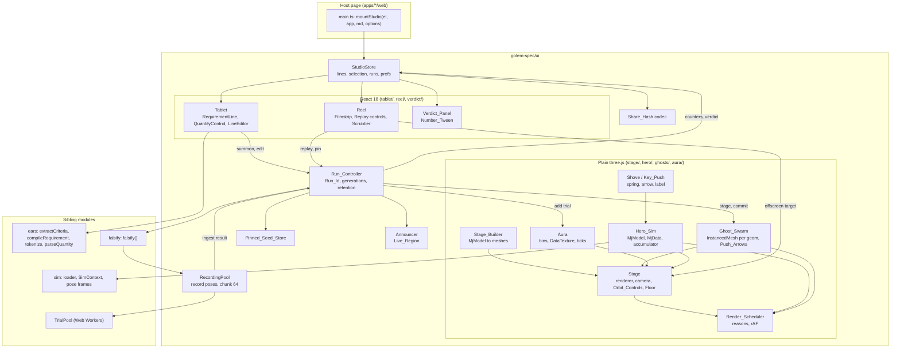

# Design Document

## Overview

`golem-studio-ui` is `skeleton/src/ui`, published as `golem-spec/ui`. One call, `mountStudio(el, app, requirementsMarkdown, options)`, builds the studio both apps mount on their `web/` page: a plain three.js stage with a clay hero robot, a swarm of ghost trials, a floor aura of the measured failure boundary, a React "tablet" of editable EARS sentences, a counterexample reel with replay, and a verdict panel.

The studio is a consumer. It uses the `interfaces.md` shapes unchanged (`RobotApp`, `Lexicon`, `CompiledRequirement`, `Scenario`, `Dimension`, `TrialSpec`, `TrialResult`, `Counterexample`, `Verdict`, `TrialPool`) and adds only the optional `PerturbationTemplate.visual` field plus studio-local types.

The design follows five rules:

- **Logic is pure, rendering is thin.** Everything with a correctness claim (pose conversion, accumulator, spring, ghost state, aura bins, quantity stepping, share codec, status, tween) is a pure function or a small class with injected clock, scheduler and storage. These run in Vitest with no browser, no WebGL and no MuJoCo.
- **No React below the tablet.** `stage/`, `hero/`, `ghosts/`, `aura/` and `run/` import neither React nor `document` at module scope. React is used only by `tablet/`, `reel/` and `verdict/`.
- **Render on demand.** One `RenderScheduler` owns the only `requestAnimationFrame` that draws the stage. No reason, no frame.
- **Deterministic.** Every random choice comes from a `mulberry32` stream derived from the studio seed. Shaders have no time term. The same pose data and ghost state give the same instance matrices.
- **Bounded memory.** Pose arrays live for one Generation plus two retained trials.

### Design decisions

| Decision | Rationale |
|---|---|
| The scene is **z-up**, the same frame as MuJoCo. `camera.up = (0,0,1)`. No axis swap anywhere. | Pose conversion is then only the quaternion reorder `wxyz → xyzw`. Fewer conversions, fewer bugs. |
| The falsifier is wrapped, not modified. A `RecordingPool` implements `TrialPool`, forces `record: 'poses'` on every spec, forwards each `run()` call to the real pool in chunks of at most 64 specs, and calls the studio for every result. **One `run()` chunk is one Generation.** | The studio needs a Generation boundary and poses for every trial, and `golem-falsify` has neither a generation id on `onResult` nor a poses switch. A pool wrapper adds both with no change to the falsifier. |
| `RecordingPool.run` returns results with `poses` removed. | The falsifier may keep every `TrialResult` it sees. Stripping poses keeps its memory flat, and the studio alone owns pose lifetime. |
| Staged ghosts. Results of the current Generation appear as soon as they arrive (rise and hold the trigger frame). On the Generation commit, all of them start playing from one shared clock start. | Requirement 11.10 needs a visible ghost within 100 ms of the first result. Requirement 10.14 needs equal ghost times inside a Generation. Staging satisfies both. |
| A new Generation **overwrites slot `i`** of the previous one when its result `i` arrives. Previous ghosts in slots the new Generation never fills fade out over 300 ms at the commit. | The swarm has exactly 64 slots and one draw call per geom (9.1, 9.2). Overwrite is the clearing; leftover slots fade. |
| The Hero_Sim **sleeps** after `idleSleepMs` (default 10 s) without a shove, key, reset or summon. A pointer or key wakes it. | Requirement 6.10 keeps `simulating` active while the sim runs, while 5.11 and 27.6 need an idle page to draw nothing. A walking policy never settles, so only a sleep reconciles them. This is an added behaviour and is listed in Open points. |
| `ShaderMaterial` for the clay and the ghosts, not `onBeforeCompile`. | The recipes are short and fully ours. No dependence on the internals of a built-in material. |
| Aura as a **36×1 `Uint8` DataTexture** sampled with linear filtering and `RepeatWrapping` on U, plus an instanced tick mesh. | Linear interpolation is a convex combination, so the outline never exceeds the larger adjacent radius. A cubic would overshoot. One texture write per trial batch. |
| Filmstrip from **one** offscreen `WebGLRenderTarget`, one frame per animation frame, read back into eight 2D canvases. | One WebGL context (20.4) and a main thread that stays responsive (27.9). |
| Share hash is `#g=` plus base64url of compact JSON. | Isomorphic (no `Buffer`), URL-safe, no network, easy to bound at 4000 characters. |
| `golem-falsify` is called through one adapter file, `run/falsify-adapter.ts`. | The sibling spec fixes the behaviour (phases, `Verdict`, cancellation, Phase 0 seeds) but not every option name. If a name differs, one file changes. |

### Research summary

- Three.js `InstancedMesh` stores one `instanceMatrix` per instance and adds `attribute mat4 instanceMatrix` to `ShaderMaterial` vertex shaders when the object is instanced. A custom `InstancedBufferAttribute` gives per-instance data (`aState`). Source: [three.js InstancedMesh docs](https://threejs.org/docs/#api/en/objects/InstancedMesh).
- WebGL2 samples `RGBA8` textures with `LINEAR` filtering and `REPEAT` wrapping with no extension. 32-bit float textures need `OES_texture_float_linear` to filter, so the aura uses `Uint8`. Source: [WebGL2 specification, texture filtering](https://registry.khronos.org/webgl/specs/latest/2.0/).
- MuJoCo applies `xfrc_applied` at the body's centre of mass, so a force at another point needs the torque `(p − xipos) × F`. Source: [MuJoCo computation, applied forces](https://mujoco.readthedocs.io/en/stable/computation/index.html).
- WCAG relative luminance and contrast ratio `(L1 + 0.05) / (L2 + 0.05)` are the definitions the contrast property uses. Source: [WCAG 2.2, contrast](https://www.w3.org/TR/WCAG22/#dfn-contrast-ratio).
- Contrast computed from the tokens in `design-language.md` shows two pairs below 4.5:1: dark `--break` on `--ground` (3.43) and on `--ground-2` (3.08), and light `--hold` on `--ground` (3.76). See "Theme and contrast" and Open points.

### Open points for the requirements owner

1. **Token contrast.** Requirements 18.4 and 25.6 ask for `--break` and `--hold` text at 4.5:1 or better. The steering tokens do not give that for dark `--break` or light `--hold`. The design adds two derived **text-only** tokens, `--break-text` and `--hold-text`, and leaves the eight steering tokens unchanged. Fracture lines, ghosts, aura and ticks use the raw tokens.
2. **Additive ghosts in the light theme.** Requirement 9.3 asks for additive blending. Adding dark `#4B44A6` onto light grey `#D6D6D2` brightens the background instead of drawing a ghost. The design uses additive blending in the dark theme and premultiplied-alpha normal blending in the light theme. Everything else in 9.3 holds in both.
3. **Hero sleep.** See the design decisions table.
4. **Wrap property at bin edges.** Requirement 13.10 says `a` and `a + 2π` share a bin. IEEE rounding can move an angle that lies within about 1e-12 rad of a bin edge by one bin. The property states that precision domain explicitly.
5. **Falsifier option names.** `FalsifyFn` (see Data Models) lists the options the studio needs: `signal`, `seeds`, `onProgress`, `generationSize`. Their final names come from `golem-falsify`.

## Architecture



### Frame flow

One scheduler tick does, in order: `hero.advance(dtWall)` (fixed-step accumulator), `replay.advance(dtWall)`, `swarm.update(nowSec)`, `controls.update()`, then `renderer.render`. After the render the scheduler reschedules only if some reason is still active.

### Module and file layout

```
skeleton/src/ui/
  index.ts                  public API: mountStudio, StudioOptions, StudioHandle, PerturbationVisual (types)
  mount.ts                  mountStudio, dispose, WebGL probe, error boundary wiring
  types.ts                  studio-local types (Data Models)
  core/                     no DOM, no three, no React
    prng.ts                 mulberry32, deriveStream(seed, label)
    format.ts               formatSig, formatQuantityValue, decimalsOf, roundTo
    units-ui.ts             step tables, ranges per kind, toDisplay/fromDisplay via ears toSI/fromSI
    pose-math.ts            frameToTRS, writeMatrixTRS, nlerp, quatRotate (wxyz)
    accumulator.ts          FixedStepAccumulator
    spring.ts               springForce, rayPlane, shovePlane, keyPushDirection
    scheduler.ts            RenderScheduler (injected raf/caf)
    tween.ts                easeOutCubic, tweenValue, TweenLoop
    theme-tokens.ts         TOKENS, contrastRatio, relativeLuminance
    announcer.ts            Announcer (rate limit)
    store.ts                StudioStore (subscribe, getState, coalesced notify)
  stage/                    three.js, no React
    stage-builder.ts        buildStage(modelLike, THREE): StageParts
    clay-material.ts        CLAY_VERT, CLAY_FRAG, createClayMaterial
    floor.ts                createFloor
    orbit.ts                createOrbit (damping, keyboard orbit)
    stage.ts                Stage: renderer, camera, resize, theme, WebGL loss, visibility gate
  hero/
    hero-sim.ts             HeroSim: MjData, views, step loop, sleep, snapshot
    load-hero.ts            only file touching golem-sim loader names
    shove.ts                ShoveController: pointer + key push, arrow, label
  ghosts/
    ghost-state.ts          pure evalGhost, constants
    ghost-shader.ts         GHOST_VERT, GHOST_FRAG, createGhostMaterial
    ghost-swarm.ts          GhostSwarm (slots, generations, matrices)
    push-arrow.ts           resolveArrow, arrow instanced mesh
  aura/
    aura-model.ts           AuraModel (bins, ticks), binOf, boundaryRadius
    aura-summary.ts         auraSummary
    aura-view.ts            AURA_FRAG, AURA_VERT, TICK_VERT, texture writer, decal mesh
  run/
    recording-pool.ts       RecordingPool
    run-controller.ts       RunController, generations, retention, Run_Id
    falsify-adapter.ts      FalsifyFn type and default binding
    pins.ts                 PinnedSeedStore, sameCounterexample
    share-hash.ts           encodeShare, decodeShare, buildShareState
    seed-json.ts            seedToJson, seedFromJson
    status.ts               lineStatusOf, marginText, counterexampleSummary
  tablet/                   React
    tablet.tsx  requirement-line.tsx  quantity-control.tsx  line-editor.tsx
    segments.ts             segmentLine (pure)
    quantity-edit.ts        stepQuantity, dragQuantity, rewriteSpan, commitTyped (pure)
    diagnostics-view.ts     underlineRanges (pure)
  reel/                     React plus three.js for the offscreen target
    reel.tsx  filmstrip.ts  replay.ts
  verdict/
    verdict-panel.tsx  verdict-rows.ts  number-tween.tsx
  layout/
    styles.ts               CSS string injected as one <style>
    theme.ts                ThemeController (tokens, storage, matchMedia)
    boundary.tsx            PanelErrorBoundary
  __tests__/                *.test.ts (Vitest + fast-check), fakes.ts, generators.ts
  e2e/                      Playwright specs
```

### Entry point

`skeleton/src/ui/index.ts` is the only file `golem-spec/ui` exports. It exports `mountStudio` and the option and handle types. Everything else is internal and reached by tests through relative imports. Apps never deep-import.

### Module dependency order

Each layer imports only from layers above it in this list. A test scans import statements and fails on a violation.

1. `core/*` (imports only `ears` and `interfaces` types).
2. `stage/stage-builder`, `stage/clay-material`, `stage/floor`, `ghosts/ghost-state`, `aura/aura-model`, `aura/aura-summary`, `run/status`, `run/pins`, `run/share-hash`, `run/seed-json` (pure).
3. `ghosts/ghost-shader`, `ghosts/push-arrow`, `aura/aura-view`, `stage/orbit`.
4. `stage/stage`, `hero/hero-sim`, `ghosts/ghost-swarm`.
5. `hero/shove`, `run/recording-pool`.
6. `run/run-controller`, `run/falsify-adapter`.
7. `tablet/*`, `reel/*`, `verdict/*`, `layout/*`.
8. `mount.ts`, `index.ts`.

## Components and Interfaces

### mountStudio and options

```ts
export function mountStudio(
  el: HTMLElement, app: RobotApp, requirementsMarkdown: string, options?: StudioOptions
): StudioHandle;   // throws TypeError('mountStudio needs an HTMLElement as its first argument') if el is not an HTMLElement

export interface StudioOptions {
  pool?: TrialPool;                  // not closed on dispose
  workerUrl?: string | URL;          // used to build a browser pool when `pool` is absent
  seed?: number;                     // Search_Seed and studio PRNG seed, default 1
  budget?: Budget;                   // default { maxTrials: 240, maxMs: 30000 }
  theme?: 'dark' | 'light';          // initial theme when nothing is saved
  autorun?: boolean;                 // default false
  shoveStiffness?: number;           // k in N/m, default 600
  primaryPushBody?: string;          // default: body of the first perturbation template's visual
  ghostGenerationSize?: number;      // default 64, clamped to [2, 64]
  idleSleepMs?: number;              // default 10000
  stepCap?: number;                  // default 40
  fontBaseUrl?: string;              // default './fonts/'
  summaryPhrases?: Partial<Record<Kind, string>>;   // see counterexampleSummary
  testHooks?: StudioTestHooks;       // injected raf, now, storage, matchMedia, falsify, loadHero, createRenderer
}

export interface StudioHandle {
  readonly ready: Promise<void>;     // resolves when the first frame is drawn, or the 3D view failed
  getState(): Readonly<StudioState>;
  dispose(): void;                   // idempotent
}
```

`mountStudio` returns synchronously. It renders the Tablet and panels first, then starts the async hero load. `mountStudio` calls the `golem-ears` extractor, then `compileRequirement(text, app.lexicon, { id })` for each criterion.

Defaults documented in the option comments are the "documented defaults" of Requirement 1.9. If neither `pool` nor `workerUrl` is given, the Summon buttons are disabled with the message "No trial pool is configured: pass `pool` or `workerUrl` to mountStudio".

### Stage_Builder (`stage/stage-builder.ts`)

The builder reads a `ModelLike`, a plain object of typed arrays, so tests need no MuJoCo. The real `MjModel` satisfies it, and `load-hero.ts` copies the arrays once so no view into WASM memory outlives the build (2.10).

```ts
interface ModelLike {
  nbody: number; ngeom: number;
  geom_type: ArrayLike<number>; geom_group: ArrayLike<number>; geom_bodyid: ArrayLike<number>;
  geom_dataid: ArrayLike<number>; geom_size: ArrayLike<number>;      // 3 per geom
  geom_pos: ArrayLike<number>; geom_quat: ArrayLike<number>;         // 3 and 4 (wxyz) per geom
  mesh_vertadr: ArrayLike<number>; mesh_vertnum: ArrayLike<number>;
  mesh_faceadr: ArrayLike<number>; mesh_facenum: ArrayLike<number>;
  mesh_normaladr: ArrayLike<number>;
  mesh_vert: ArrayLike<number>; mesh_normal: ArrayLike<number>;
  mesh_face: ArrayLike<number>; mesh_facenormal: ArrayLike<number>;
}
interface StageParts {
  bodyGroups: THREE.Group[];                 // index = body id, parented to `root`
  meshes: THREE.Mesh[];                      // one per drawn geom
  geomInfo: { geom: number; body: number; mesh: THREE.Mesh; local: Float32Array }[]; // local = 16 floats, body-relative
  floor?: FloorSpec;                         // from the first plane geom
  skipped: { geom: number; reason: 'group' | 'type' | 'empty-mesh'; type?: number }[];
  warnings: string[];
  meshCount: number;
}
declare function buildStage(m: ModelLike, three: typeof THREE, material: THREE.Material): StageParts;
```

Geom type numbers are MuJoCo's: plane 0, sphere 2, capsule 3, ellipsoid 4, cylinder 5, box 6, mesh 7. Heightfield 1 and SDF 8 are unsupported.

| Geom | Geometry built | Orientation fix |
|---|---|---|
| box | `BoxGeometry(2sx, 2sy, 2sz)` | none |
| sphere | `SphereGeometry(sx, 24, 16)` | none |
| capsule | `CapsuleGeometry(sx, 2·sy, 6, 16)` | `rotateX(π/2)` baked into the geometry (MuJoCo axis is z, three axis is y) |
| cylinder | `CylinderGeometry(sx, sx, 2·sy, 24)` | `rotateX(π/2)` baked |
| ellipsoid | unit `SphereGeometry` | `scale(sx, sy, sz)` baked into the geometry |
| mesh | non-indexed `BufferGeometry`: for each face corner `c`, position `mesh_vert[3·(vertadr + face[c])]`, normal `mesh_normal[3·(normaladr + facenormal[c])]` | none (MuJoCo already folds the mesh frame into `geom_pos` and `geom_quat`) |
| plane | `Floor`, see below | none |

Each mesh is added to `bodyGroups[geom_bodyid]` with `position = geom_pos` and `quaternion = (qx, qy, qz, qw)` taken from `geom_quat` (wxyz). `userData.bodyId` and `userData.geom` are set for picking. Floor: half extent `max(size.x, size.y, 20)` m, `MeshBasicMaterial({ color: ground })`, no texture; `scene.fog = new Fog(ground, 12, 30)` produces the fade to `--ground` at the edge. A mesh with zero faces or a geom with an unsupported type is skipped with one warning each (2.11, 2.12). The same input yields the same arrays, which the build-twice test compares.

### Clay material

See "Shader recipes, 1" below. `createClayMaterial(tokens)` returns a `ShaderMaterial` whose uniforms are updated on theme change.

### Stage (`stage/stage.ts`)

```ts
class Stage {
  constructor(host: HTMLElement, deps: { THREE; scheduler: RenderScheduler; createRenderer?: (canvas) => Renderer; matchMedia; now(): number });
  readonly scene: THREE.Scene; readonly camera: THREE.PerspectiveCamera; readonly renderer: Renderer;
  setModel(parts: StageParts, boundingRadius: number): void;
  setTheme(t: TokenSet): void;               // updates clay, floor, background, ghosts, aura, requests one render
  resize(): void;                            // renderer size, camera aspect, one render
  isVisible(): boolean;                      // Visibility_Gate
  dispose(): void;
}
```

- Pixel ratio: `renderer.setPixelRatio(Math.min(window.devicePixelRatio, 1.5))`.
- Camera: `PerspectiveCamera(40°)`, `up = (0,0,1)`, target near the base at 0.55 of the model height, start distance `2.6 × boundingRadius`.
- Orbit: three's `OrbitControls` with `enableDamping`, `dampingFactor 0.12`, `maxPolarAngle = π/2 − 0.05` (camera stays above the floor), `minDistance = 0.8 R`, `maxDistance = 6 R`, touch `ONE: ROTATE`, `TWO: DOLLY`. Shift + arrow rotates by 5° through `controls.rotateLeft(5° in rad)` and `rotateUp`. When `prefers-reduced-motion` is set, damping is off.
- `transition` reason: acquired on the controls `change` event, released when `|camera.position − previous| < 1e-4 m` for one frame (0.1 mm).
- Visibility_Gate: `IntersectionObserver` (threshold 0) plus `document.visibilitychange`. Either says hidden: `scheduler.setVisible(false)`, `hero.pause()`.
- WebGL context loss: `webglcontextlost` calls `preventDefault`, shows "The 3D view was lost" and `webglcontextrestored` calls `rebuild()`, which rebuilds renderer resources from the retained `StageParts` geometry.
- The canvas has `tabindex="0"`, `role="application"`, `aria-label`, and `aria-describedby` pointing at the text of 8.10.

### Render_Scheduler (`core/scheduler.ts`)

```ts
type Reason = 'simulating' | 'dragging' | 'replaying' | 'ghosts-running' | 'transition';
class RenderScheduler {
  constructor(deps: { raf(cb): number; caf(id): void }, tick: (tsMs: number) => void);
  acquire(r: Reason): void;      release(r: Reason): void;      requestOnce(): void;
  setVisible(v: boolean): void;  active(): ReadonlySet<Reason>;  pendingFrames(): 0 | 1;
}
```

```
mask: bitmask of reasons; dirty: boolean; id: number | 0; visible = true

acquire(r):   mask |= bit(r);  schedule()
release(r):   mask &= ~bit(r); if (mask == 0 && id == 0 && visible) schedule()   // final frame
requestOnce():dirty = true;    schedule()
schedule():   if (visible && id == 0) id = raf(frame)
frame(ts):    id = 0
              tick(ts)                   // update + render, may release reasons
              dirty = false
              if (visible && mask != 0) id = raf(frame)      // never reschedules with mask == 0
setVisible(false): if (id) { caf(id); id = 0 }          // reasons stay in `mask`
setVisible(true):  if (mask != 0 || dirty) schedule()   // resume reasons that were active
```

At most one `raf` is pending and one frame is drawn per callback (5.3). With `mask == 0` and `dirty == false` after the last frame, `pendingFrames() === 0` (5.1). The Number_Tween and the filmstrip use their own loops, not the scheduler (23.12).

### Hero_Sim (`hero/hero-sim.ts`)

```ts
interface HeroDeps { mj: any; model: any; data: any; ctx: SimContext; app: RobotApp; rng: () => number; stepCap: number; idleSleepMs: number }
class HeroSim {
  advance(dtWall: number, nowMs: number): { steps: number; diverged: boolean };
  setForce(slot: 'shove' | 'key', body: number, f: Float64Array | null): void;   // read each step
  reset(): void;   pause(): void;   resume(): void;   wake(): void;   sleeping: boolean;
  snapshot(): void;   restore(): void;                  // for Replay and "Back to live"
  poseOf(body: number, out: Float64Array): void;       // xpos, xquat views
  dispose(): void;                                     // .delete() model and data once
}
```

Views (`qpos`, `qvel`, `xpos`, `xquat`, `xipos`, `xfrc_applied`) are read once into fields. Before each `advance`, `if (data.xfrc_applied.buffer !== this.xfrcBuf) this.refreshViews()` handles WASM memory growth (6.7). `xipos` is added to the listed views because `xfrc_applied` acts at the centre of mass.

The step loop allocates nothing:

```
advance(dtWall):
  n = acc.add(dtWall)                       // see accumulator
  for i in 0 .. n-1:
    if (ctrlCountdown == 0) { controller.step(ctx, simTime); ctrlCountdown = nCtrl }   // nCtrl = round(controlDt / simDt)
    ctrlCountdown -= 1
    xfrc.fill(0)                            // 6.8
    applyShove(); applyKeyPush(simTime)     // write xfrc_applied rows
    mj.mj_step(model, data)
    simTime += simDt
  if (!isFiniteSum(qpos)) { reset(); announce("The simulation diverged and was reset") }
  syncBodyGroups()                          // body group position and quaternion from xpos, xquat
```

The same `app.makeController(ctx, rng)` and `app.initState(ctx, rng)` as the trials run here, with `rng = mulberry32(deriveSeed(seed, 'hero'))`.

Sleep: `lastActivityMs` updates on shove, key, reset, summon and replay. When `now − lastActivityMs > idleSleepMs` the Hero releases `simulating`, sets `sleeping`, and the status line shows "Paused to save power: shove the robot to wake it". Wake resumes with accumulator time zero.

### Fixed_Step_Accumulator (`core/accumulator.ts`)

```
class FixedStepAccumulator { constructor(dt, stepCap) ; acc = 0 }
add(dtWall):                       // dtWall in seconds, >= 0, finite
  acc += dtWall
  n = floor(acc / dt + 1e-9)
  if (n > stepCap) {               // spiral guard
    acc -= stepCap * dt
    acc -= floor(acc / dt + 1e-9) * dt    // discard the excess above the cap, keep a remainder < dt
    return stepCap
  }
  acc -= n * dt
  if (acc < 0) acc = 0             // floating guard: -1e-18 becomes 0
  return n
resumeAfterHidden(): acc = 0       // the first dtWall after a pause is 0, so hidden time never steps (5.8)
```

After every call `0 ≤ acc < dt`. For a fixed total wall time T split into any frame durations, the summed step counts equal `floor(T/dt)` to within one step when no frame hits the cap.

### Shove (`hero/shove.ts`, `core/spring.ts`)

Picking uses `THREE.Raycaster` against `parts.meshes` (bounding spheres first). On pointer-down, a hit gives the body id from `userData.bodyId` and the grab point in body-local coordinates through `bodyGroup.worldToLocal(point.clone())`. Orbit is disabled for that pointer. A second pointer id during a shove is ignored (7.14). Touch: `touch-action: none` on the canvas while the pointer is down on a body, `preventDefault()` on `touchstart`, `touchmove` (non-passive listeners added only for the Stage canvas).

Pure maths:

```ts
// plane through G whose normal is the horizontal part of the camera view direction d_cam
shovePlaneNormal(dirCam: V3): V3 | null        // (dx, dy, 0) / |(dx, dy)|, or null when |(dx,dy)| < 1e-6 (camera straight down)
rayPlane(O, d, G, n): V3 | null                // t = dot(n, G − O) / dot(n, d); null if |dot(n,d)| < 1e-9 or t < 0; else O + t·d
springForce(G, target, k, cap = 400): V3       // F = k (target − G); if |F| > cap then F = F · cap / |F|
```

Applied each physics step, scalar maths only:

```
Gw = xpos[b] + R(xquat[b]) · Glocal              // quatRotateWXYZ, no allocation
F  = springForce(Gw, target, k)                  // capped at 400 N
xfrc[6b+0..2] += F
xfrc[6b+3..5] += (Gw − xipos[b]) × F             // torque about the centre of mass
```

If the pointer ray misses the plane, `target` keeps its last value (7.7). The arrow runs from `Gw` to `target` and the label reads `round(|F|) N`. The peak force is kept for the release announcement ("Pushed with a peak of 168 N", 7.13).

Key push: on an arrow key without Shift, with `fwd = normalize(dirCam.xy)` and `right = (fwd.y, −fwd.x, 0)`, ArrowUp gives `+fwd`, ArrowDown `−fwd`, ArrowRight `+right`, ArrowLeft `−right`. The force is `100 N × dir`, applied at the primary push body's centre of mass (no torque) for `round(0.2 / simDt)` physics steps. A second arrow key restarts the push. Escape cancels. Announcement on end: "Pushed 100 N toward the far side | near side | left | right".

### Ghost_Swarm (`ghosts/ghost-swarm.ts`)

```ts
interface GhostMeta {
  robustness: number; worstAt: number;            // absolute sim time, as in TrialResult
  warmup: number;                                 // app.warmup, so ghost time of the worst moment = worstAt − warmup
  arrow?: ResolvedArrow;
}
interface ResolvedArrow { body: number; dir: V3; length: number; tEnd: number /* ghost time, s */ }

class GhostSwarm {
  constructor(parts: StageParts, three, opts: { capacity: 64; reducedMotion: () => boolean });
  beginGeneration(): void;                                          // nextSlot = 0
  accept(r: TrialResult, meta: GhostMeta): 'ok' | 'ignored-full' | 'rejected';
  commitGeneration(clockStartSec: number): void;                    // shared start, retire leftover slots
  clear(): void;                                                    // cancel: hide all within one frame
  update(nowSec: number): boolean;                                  // writes matrices and aState; true while anything animates
  timeOf(slot: number, nowSec: number): number;                    // ghost time, equal for one generation
  setTheme(t: TokenSet): void;  dispose(): void;
  readonly shown: number;       // ghosts visible, for the count property
}
```

Per geom there is one `InstancedMesh(geometry, ghostMaterial, 64)` that shares the hero mesh's `BufferGeometry`, plus one `InstancedMesh` for the Push_Arrows. All meshes share one `InstancedBufferAttribute aState` (64 × vec4) set on each geometry. `instanceMatrix.usage = DynamicDrawUsage`. `mesh.count = highestActiveSlot + 1`. Matrices are written into the mesh's own `Float32Array` with scalar maths.

Per slot data lives in struct-of-arrays typed arrays: `robust: Float64Array(64)`, `tWorst`, `frames: (Float32Array|null)[]`, `frameCount: Int32Array`, `validFrames` (frames before the first non-finite), `startSlot` (generation start, shared), `stage: Uint8Array` (0 free, 1 staged, 2 playing, 3 retiring). Per frame:

```
update(now):
  for slot in 0 .. highest:
    if stage[slot] == free: aState[slot].opacity = 0; continue
    tau = (stage == staged) ? 0 : max(0, now − genStart)          // ghost time
    ev = evalGhost(slotRecord, tau, reduced)                      // writes into a reused struct, no allocation
    if ev.hidden: free the slot (drop poses reference); continue
    bodyMatrices(frames, ev.frame, ev.alpha, scratch16 × nbody)   // frame index, nlerp
    for each geom g: instanceMatrix[slot] = bodyMatrix[body(g)] × geomLocal[g]
    aState[slot] = (ev.breakMix, ev.opacity, ev.rise, 0)
  arrows: same loop, one matrix per slot, only inside [0, arrow.tEnd] of ghost time
  return anyStagedOrPlayingOrFading
```

Validation in `accept`: `poses.nbody !== model.nbody` rejects with the warning "Ghost rejected: result has nbody 31 but the model has 30"; `frames.length % (nbody·7) ≠ 0` rejects; a first frame that is non-finite rejects; otherwise `validFrames` is the index of the first non-finite frame, and frame index is clamped to `validFrames − 1` (29.6).

### Ghost state function (`ghosts/ghost-state.ts`)

```ts
const SUMMON_S = 0.4, FADE_S = 0.6, RETIRE_S = 0.3;
const OPACITY_RUNNING = 0.55, OPACITY_SURVIVOR = 0.30;
interface GhostEval { frame: number; alpha: number; breakMix: 0 | 1; opacity: number; rise: number; hidden: boolean }

evalGhost(g, tau, reduced, out):
  T       = (frameCount − 1) / fps
  t       = min(tau, T)                                  // hold the last frame (10.7)
  f       = reduced ? floor(t·fps) : floor(t·fps)        // index, clamped to [0, validFrames − 1]
  alpha   = reduced ? 0 : (t·fps − f)                    // nlerp weight toward f + 1
  broke   = g.robustness < 0                             // NaN is not < 0
  tBreak  = clamp(g.worstAt − g.warmup, 0, T)            // −Infinity robustness uses the recorded worstAt
  rise    = reduced ? 0 : 1 − easeOutCubic(clamp(tau / SUMMON_S, 0, 1))      // 1 → 0
  if broke and tau >= tBreak:
     breakMix = 1
     fade = reduced ? (tau >= tBreak ? 1 : 0) : clamp((tau − tBreak) / FADE_S, 0, 1)
     opacity  = OPACITY_RUNNING · (1 − fade);  hidden = fade >= 1
  else:
     breakMix = 0; opacity = broke ? OPACITY_RUNNING : OPACITY_SURVIVOR
  opacity *= reduced ? 1 : (1 − rise)                    // fades in while rising
```

The break state is exactly `robustness < 0`, and `breakMix` is 1 only after `tBreak` (colour property).

### Push_Arrow (`ghosts/push-arrow.ts`)

```ts
interface PerturbationVisual {          // optional field on PerturbationTemplate
  (values: Record<string, number>): { body: string; force: [number, number, number]; duration?: number } | undefined;
}
resolveArrow(call: PerturbationCall, tpl: PerturbationTemplate, scenario: Scenario, bodyId: (name: string) => number): ResolvedArrow | undefined
```

`values` resolves each `call.params` entry: a string is a dimension name looked up in the scenario, a number is used as written. The arrow starts at the body position in frame 0 (the trigger frame, per `golem-sim` 8.1) and its length is `clamp(0.3 · |F| / 100, 0.05, 0.9)` m. A zero force vector or a missing `visual` yields no arrow. The arrow instance matrix is `T(start) · R(+X → dir) · S(length, w, w)`, where `+X → dir` is the shortest-arc quaternion.

### Aura (`aura/*`)

```ts
class AuraModel {
  constructor(forceMax: number);                       // largest force in the Aura_Source space, SI
  add(angle: number, force: number, robustness: number): void;   // NaN robustness counts as ignored
  readonly held: Float64Array;       // 36, −Infinity when none
  readonly broke: Float64Array;      // 36, +Infinity when none
  readonly ticks: { angle: number; force: number }[];   // lowest 512 by (force, angle), order independent
  ignored: number; total: number;
  reset(): void;
}
binOf(angle: number): number;                          // wrap, floor(frac · 36), clamp 35
boundaryForce(m: AuraModel, i: number): number | undefined;     // broke, else held, else undefined
radiusAt(m: AuraModel, angle: number): number;         // CPU reference of the shader: linear between bin centres
auraSummary(m: AuraModel): string;
```

`binOf` computes `turns = angle / 2π`, `frac = turns − floor(turns)`, `bin = min(35, floor(frac · 36))`.

Boundary radius of bin `i` in metres: `R_i = 1.2 · min(1, B_i / forceMax)`, and `0` when `B_i` is unknown or `forceMax ≤ 0`. The texel value is `round(255 · R_i / 1.2)`.

`aura-view.ts` owns the `DataTexture` (`36 × 1`, `RGBAFormat`, `UnsignedByteType`, `LinearFilter`, `wrapS = RepeatWrapping`, `wrapT = ClampToEdgeWrapping`, `generateMipmaps = false`), a preallocated `Uint8Array(36·4)`, the decal quad and the tick mesh. Each trial batch rewrites the array, sets `needsUpdate`, and calls `scheduler.requestOnce()`. The decal is centred at the Hero's initial base XY (re-centred on Reset). The angle is the world azimuth about +z from +x, counter-clockwise, of the force direction, plus an optional `headingOffset` from the app (default 0).

`auraSummary` text:

- No force or direction dimension: "This requirement has no direction and force to map".
- No trials: "No trials yet".
- Some bin broke: "Weakest direction {5 + 10·i} deg: breaks at {formatSig(B, 3)} N" using the lowest bin index with the smallest Broke_Force.
- None broke: "No break found. Strongest push held: {F} N at {5 + 10·j} deg in {total} trials", where `j` is the lowest bin with the largest Held_Force.

### Run_Controller (`run/run-controller.ts`)

```ts
class RunController {
  constructor(deps: { lines: LineModel[]; pool: TrialPool; falsify: FalsifyFn; stage; swarm; aura; hero; store; pins; announcer; now(): number; options });
  start(lineId: string): Promise<void>;
  startAll(): Promise<void>;                     // sequential in file order
  stop(): Promise<void>;
  select(lineId: string): void;
  dispose(): Promise<void>;
}
```

State per run: `{ runId, lineId, ac: AbortController, trialCount, randomTrials?, closest?: Retained, bestCe?: Retained, genIndex, staged: StagedResult[] }`, where `Retained = { spec, robustness, worstAt, poses? }`.

```
start(lineId):
  runId = ++lastRunId
  await cancelActive()                       // abort and await settle: one run at a time on the pool
  if (runId != lastRunId) return             // superseded by a newer click
  line = lines[lineId]; if line has error diagnostics: status = error; return
  active = { runId, lineId, ac: new AbortController(), ... }
  store.setRunning(lineId, runId); swarm.clear(); aura.reset(source of line); aura.setSource(line)
  rec = new RecordingPool(pool, hooks(runId))
  try   verdict = await falsify(line.compiled, rec, budget, seed, { signal, seeds: pins.read(app.id, line.id), onProgress: e => guard(runId, () => onProgress(e)), generationSize })
        guard(runId, () => finish(verdict))
  catch err: if (isAbort(err)) { keep previous verdict, mark stale } else { guard(runId, () => fail(err)) }

guard(runId, fn): if (active?.runId === runId) fn()            // stale callbacks do nothing (10.11, 19.15)

hooks(runId).beginGeneration(): guard → dropPrevGenerationPoses(); swarm.beginGeneration(); genIndex++
hooks(runId).ingest(r):
  guard:
    trialCount += 1; aura.add(angleOf(r.spec.scenario), forceOf(r.spec.scenario), r.robustness)   // all trials
    updateClosest(r); updateBest(r)                            // keep poses only when retained
    meta = ghostMeta(r); if r.poses: swarm.accept(r, meta)    // no poses: counted, no ghost
    store.bump(counters)                                       // coalesced to one notify per frame
hooks(runId).commit(): guard → swarm.commitGeneration(now())

dropPrevGenerationPoses(): for each result of the previous generation: r.poses = undefined unless r is closest or bestCe
```

`angleOf` and `forceOf` read the `Dimension` names of the Aura_Source's `space.dims` (kind `angle`, kind `force`). The first dimension of each kind is used.

`finish(verdict)` stores the Verdict on the line, resolves `bestCe` to the trial whose scenario and seed equal `verdict.counterexample` (if retained, its poses become the Reel cache), drops every other pose array, sets the Aura summary, announces the verdict immediately, saves nothing automatically (pinning is explicit), and releases `ghosts-running` once the swarm reports idle.

Run-all: `startAll` iterates compilable lines in file order and awaits `start` for each, skipping lines with errors. A "Stop the run" activation calls `stop()`, which aborts the active run and clears the run-all queue.

Pinned seeds: `pins.read(appId, reqId)` returns the valid pins, passed as `seeds` to the falsifier's Phase 0.

### RecordingPool (`run/recording-pool.ts`)

```ts
class RecordingPool implements TrialPool {
  constructor(inner: TrialPool, hooks: { beginGeneration(): void; ingest(r: TrialResult): void; commit(): void });
  get size(): number { return inner.size }
  async run(specs, onResult?) {
    const out: TrialResult[] = []
    for (const chunk of chunksOf(specs, 64)) {
      hooks.beginGeneration()
      const res = await inner.run(chunk.map(s => ({ ...s, record: 'poses' })), r => { hooks.ingest(r); onResult?.(strip(r)) })
      hooks.commit()
      for (const r of res) out.push(strip(r))
    }
    return out                      // same order and same length as `specs`
  }
  close() { return Promise.resolve() }     // never closes the shared pool
}
```

`strip(r)` is `{ ...r, poses: undefined }` with the key removed. A chunk that throws propagates the error and calls no `commit`.

### Pinned_Seed_Store and codecs

```ts
class PinnedSeedStore {
  constructor(storage: Storage | undefined, warn: (msg: string) => void);
  read(appId: string, reqId: string): Counterexample[];     // ignores invalid entries, one warning with the count
  pin(appId: string, ce: Counterexample): 'added' | 'duplicate' | 'memory-only';
  remove(appId: string, ce: Counterexample): void;
}
sameCounterexample(a, b): boolean       // same reqId, same seed, same dimension names with equal values
```

Key: `golem:pins:v1:${appId}:${reqId}` holding a JSON array. On `setItem` failure or a missing `localStorage`, pins go to an in-memory `Map` and the store announces once "Pins can't be saved in this browser and will be lost on reload".

`seed-json.ts`:

```ts
seedToJson(ce: Counterexample): string   // 2-space indent; key order reqId, scenario (keys sorted), seed, robustness, shrunk, foundAfter
seedFromJson(text: string): { ok: true; value: Counterexample } | { ok: false; error: string }
```

JSON has no `NaN` or `Infinity`. A non-finite `robustness` is written as the string `"-Infinity"`, `"Infinity"` or `"NaN"`, and `seedFromJson` accepts those strings. Negative zero is normalised to `0` when writing.

`share-hash.ts`:

```ts
interface ShareState { lines: Record<string, string>; pick?: { reqId: string; seed: number; scenario: Scenario } }
encodeShare(s: ShareState): string                   // base64url(UTF-8(JSON {"v":1,"l":{...sorted ids...},"c":{"r","s","d"}})), no padding
decodeShare(hash: string, knownIds: ReadonlySet<string>): { state: ShareState; ignored: string[] }   // never throws
buildShareState(original: Record<string, string>, current: Record<string, string>, pick?): ShareState  // keeps only lines that differ
fitShare(state, original, maxChars = 4000): { hash: string; omittedIds: string[]; tooLong: boolean }
```

The fragment is `#g=` + the encoded string. `fitShare` first drops lines equal to the original (they are redundant), then, if the encoding is still over 4000 characters, drops edited lines from the last in file order backwards and reports `tooLong` so the studio shows "The link is too long: it leaves out edits to lines 3.2 and 3.4". The decoder applies each valid part and lists the ignored parts (unknown ids, bad base64, bad JSON, wrong shape). A malformed hash loads the original text and shows "Ignored the shared link: it could not be read".

### Tablet and Quantity_Control

`segments.ts` splits a line into a segment list using `tokenize(text)` from `golem-ears`:

```ts
type Segment = { kind: 'keyword' | 'quantity' | 'plain'; text: string; start: number; end: number; q?: QuantityInfo }
interface QuantityInfo { kind: Kind; unit: string; gap: string; numberText: string; inheritedUnit: boolean }
segmentLine(text: string): Segment[]     // concatenation of segment.text equals text
```

A quantity span is a `number` token plus an adjacent `unit` token. A number with no adjacent unit that is followed by `to <number> <unit>` inherits that unit (`150 to 250 N`, `inheritedUnit: true`); it rewrites only the number. A number that `parseQuantity` rejects (for example a missing unit on a line that has an error) stays plain text. Keyword tokens get the class `kw` (0.85em, letter-spacing 0.04em).

`quantity-edit.ts` (pure):

```ts
const STEP: Record<string, number> = { N: 1, kN: 0.1, s: 0.1, ms: 10, m: 0.01, cm: 1, mm: 1, 'm/s': 0.05, 'cm/s': 5, deg: 5, '°': 5, rad: 0.05, kg: 0.1, g: 10, '%': 1 };
effectiveStep(unit, mod: 'none' | 'shift' | 'alt') = STEP[unit] · (shift ? 10 : alt ? 0.1 : 1)
decimalsOf(x): number                                  // decimal places of the shortest decimal representation
stepQuantity(v, unit, dir: 1 | -1, mod, range, writtenDecimals): number
   = clamp(roundTo(v + dir · effectiveStep, max(decimalsOf(step), writtenDecimals)), range.min, range.max)
dragQuantity(startValue, dxPx, unit, mod, range, writtenDecimals): number
   = clamp(roundTo(startValue + trunc(dxPx / 4) · effectiveStep, …), range.min, range.max)
rangeOf(kind, unit, templateLimits?): { min: number; max: number }
   // force, duration, length, speed, mass: [0, +Infinity); ratio with %: [0, 100]; angle: [0, 360] deg or [0, 2π] rad; template limits narrow it
rewriteSpan(text, start, end, newSpan): string        // text.slice(0, start) + newSpan + text.slice(end)
formatSpan(info: QuantityInfo, value: number, decimals: number): string   // roundTo(value, decimals) + gap + unit, same unit and spacing as written
commitTyped(typed: string, info: QuantityInfo, range): { ok: true; value: number; clamped: boolean } | { ok: false; message: string }
```

`commitTyped` appends the original unit when the user typed none, parses with `parseQuantity`, rejects a unit of another kind with "Write a {kind}: 200 N, not 200 s", converts the SI result back to the displayed unit with `fromSI(q.si, info.unit)`, then clamps.

The rendered control is a `<span role="spinbutton" tabindex="0">` with `aria-valuenow` (displayed unit), `aria-valuemin`, `aria-valuemax`, `aria-valuetext` ("200 N") and `aria-label` (for example "Force of the push"). It uses `min-height: 24px`, a visible focus ring, and `touch-action: none` while dragging. The label of the quantity comes from the slot or dimension name of the matched template, falling back to the kind name. Debounce: 80 ms after the last change, then recompile and `runController.start(line)`. While dragging, the displayed number updates on every pointer move without waiting.

`diagnostics-view.ts`: `underlineRanges(text, diags): { start: number; end: number }[]` clamps each Diagnostic `[start, end)` into `[0, text.length]`, sorts by start, and trims overlap so ranges are disjoint and in source order. A zero-width Diagnostic widens to one UTF-16 unit when that stays inside the text. The Line_Editor draws the wavy underline in a mirrored overlay layer behind a transparent `<textarea>`, so the offsets match code units exactly.

### Status, summary and margin (`run/status.ts`)

```ts
type LineStatus = 'untested' | 'running' | 'held' | 'broken' | 'error';
statusOfVerdict(v: Verdict): LineStatus                // 'held' | 'broken' | 'error' only, a direct map
lineStatusOf(s: { hasCompileError: boolean; running: boolean; verdict?: Verdict }): LineStatus
   // order: compile error, running, verdict (statusOfVerdict), untested
marginText(robustness: number, unit: string): string   // `${formatSig(r, 3)} ${unit}`, −Infinity gives "diverged"
counterexampleSummary(space: ScenarioSpace, scenario: Scenario, classification?: 'robust' | 'seed-sensitive', phrases?): string
```

`formatSig(x, 3)` uses `Intl.NumberFormat('en-US', { maximumSignificantDigits: 3, useGrouping: false })`, which never prints an exponent. `counterexampleSummary` selects dimensions with `severity !== 'none'` or `wrap`, in `space.dims` order, converts each to its display unit by kind, and joins phrases from a table: force `from {v} N`, angle `at {v} deg`, phase `{v}% into the stride`, duration `for {v} s`, length `at {v} m`, speed `at {v} m/s`, mass `carrying {v} kg`, ratio `{v}%`. Display conversion: force N, duration s, length m, speed m/s, mass kg, angle degrees (`si · 180/π`), phase and ratio percent (`si · 100`). The leading verb is "falls" when the failing predicate's `signals` include a name matching `/^(pelvis|torso|base|com)_?(height|z|tilt|pitch|roll|upright)/` and its unit is `m`, `rad` or `deg`, otherwise "fails". The same test picks the button label "Replay the fall" or "Replay the failure" (default). `seed-sensitive` appends ", depends on the seed".

### Reel, Filmstrip and Replay

`filmstrip.ts` selects frames:

```ts
filmstripFrames(worstTau: number, frameCount: number, fps: number): { frame: number; tau: number; isWorst: boolean }[]   // always 8
   tau_k = clamp(worstTau − 0.35 + k · 0.7 / 7, 0, T)  for k = 0..7, T = (frameCount − 1)/fps
   frame_k = min(frameCount − 1, floor(tau_k · fps)); isWorst = k with the smallest |tau_k − worstTau|, lowest k on ties
```

Rendering: one `WebGLRenderTarget(160, 120, { samples: 0 })` with `texture.colorSpace = SRGBColorSpace`, created from the Stage renderer. A `FilmstripJob` renders one frame per animation frame in its own `requestAnimationFrame` loop: set the hero body groups to the frame pose, hide ghosts, aura and live arrows, render with a private camera framing the robot into the target, `readRenderTargetPixels` into one reused `Uint8Array(160·120·4)`, flip rows into `canvas[k].putImageData`, restore the live pose, `renderer.setRenderTarget(null)`. All steps run in one synchronous task, so the visible canvas never shows a filmstrip pose. Each canvas has `role="img"` and an `aria-label` such as "Frame at 0.35 s after the push: pelvis 0.31 m above the floor", where the body is the primary push body and the height is `z` from the frame.

The replay trial is `pool.run([{ ...ce, record: 'poses' }])` through the `RecordingPool` bypass (a plain `pool.run`, not a Generation). If the best counterexample's poses were retained, they are used instead and no trial runs. A new line selection aborts the pending job (`AbortController` plus a job token).

`replay.ts`: `ReplayController` holds `{ frames, fps, nbody, t, playing, speed: 0.25 }`. `advance(dtWall)` adds `0.25 · dtWall` to `t` while playing, stops at the last frame. `seekFrame(i)` and `stepFrame(±1)` set `t = i / fps` and pause. Under Reduced_Motion, `advance` does nothing and "Next frame" calls `stepFrame(+1)`. While active: `hero.snapshot()` on enter, `scheduler.acquire('replaying')`, hero paused; "Back to live" calls `hero.restore()`, releases `replaying`, resumes. The Scrubber is `<input type="range" role="slider">` with `min = 0`, `max = duration`, `step = 1/fps`, `aria-valuetext` "0.35 s after the push", and a `--break` tick at `worstTau`.

### Verdict_Panel and Number_Tween

`verdict-rows.ts` formats rows from a `Verdict` and the pool size:

| Row | Value |
|---|---|
| Trials | `verdict.trials` (equal to `randomTrials + guidedTrials` plus pinned and shrink trials as the falsifier counts them) |
| Random trials, Guided trials | `randomTrials`, `guidedTrials` |
| Closest call | `marginText(closest.robustness, unit)` |
| Failure-rate bound (95%, random trials) | `formatSig(failureRateUpper95 · 100, 2) + '%'`, or "not available" |
| Wall time | `(ms / 1000).toFixed(1) + ' s'` |
| Pool size | `pool.size` |

Held sentence: "No counterexample in {N} trials; from the {n} uniformly random ones, failure rate below {P} % (95 % confidence)" (without a bound: "No counterexample in {N} trials ({n} random, {m} guided)") with the Budget after it. The bound row is labelled "Failure-rate bound (95%, random trials)". The word "proved" never appears.

`tween.ts`:

```ts
easeOutCubic(p) = 1 − (1 − p)³
tweenValue(from, to, p): number     // p clamped to [0,1]; p == 1 returns `to` exactly; result clamped to [min(from,to), max(from,to)]
class TweenLoop { to(key, target, durationMs = 250): void; ... }   // own rAF; stops when all tweens end
```

Under Reduced_Motion, `to` sets the value at once. The loop reads counters from the store at most once per frame. Every number has `aria-label` and text content with the final value; the tween writes only a visual copy marked `aria-hidden`, and a visually hidden copy carries the final value.

### Layout, theme and contrast

`styles.ts` returns one CSS string with `:root[data-golem-theme='dark']` and `'light'` token blocks, `@font-face` rules for B612, B612 Mono, and a grid:

- `≥1024 px`: `grid-template-columns: 380px 1fr; grid-template-areas: "tablet stage" "tablet reel"`.
- `<1024 px`: one column, order stage (56vh), primary actions, tablet, reel; buttons `min-height: 44px; min-width: 44px`.
- 1 px borders `color-mix(in srgb, var(--clay) 35%, transparent)`, 2 px control radius, 0 for the stage, no gradient, no box-shadow. Gloock is never referenced.

Token values come from `core/theme-tokens.ts` (the table in `design-language.md`). Two derived text tokens keep the contrast requirement:

| Token | Dark | Light | Rule |
|---|---|---|---|
| `--break-text` | `#DA7D6C` (`--break` mixed 35% toward `--ink`) | `#A8311F` (= `--break`) | text colour for broken status |
| `--hold-text` | `#86BFA6` (= `--hold`) | `#2C6352` (`--hold` mixed 20% toward `--ink`) | text colour for held status |

Computed contrast, WCAG 2.2: dark `--break-text` 5.35 on `--ground`, 4.79 on `--ground-2`; light `--hold-text` 4.78 on `--ground`, 5.42 on `--ground-2`; light `--break` 4.61 and 5.22; dark `--hold` 7.52 and 6.73; dark `--ink` 12.72 on `--ground`; light `--ink` 11.73. The raw `--break` (dark) and `--hold` (light) are used for non-text marks only.

`ThemeController`: initial theme = saved `localStorage['golem:theme']` → `matchMedia('(prefers-color-scheme: light)')` → `options.theme` → dark. The toggle has `aria-pressed`. A `change` listener on the media query follows the system only while nothing is saved. Without `localStorage`, the choice lives in memory. A change writes `data-golem-theme`, calls `stage.setTheme(tokens)`, which updates the clay, floor, fog, background, ghost and aura uniforms from the same `TOKENS` object, and calls `requestOnce()`.

### Announcer (`core/announcer.ts`)

Two elements: `aria-live="polite"` and `role="alert"`. `announceProgress(msg, nowMs)` emits only if `nowMs − lastProgressMs ≥ 2000`. `announceFinal(msg)` always emits. Errors go to the alert element. No focus moves.

### Shader recipes

All GLSL is GLSL ES 3.00 through three's `ShaderMaterial` (WebGL2; three injects the `#version` header and the `modelMatrix`, `viewMatrix`, `projectionMatrix`, `cameraPosition` uniforms). No shader has a time uniform.

#### 1. Clay material

Uniforms: `uClay` (vec3, from `--clay`), `uKeyDir` (vec3, world, unit, pointing toward the light), `uFillDir` (vec3), `uKeyI` (0.85), `uFillI` (0.28), `uAmb` (0.12), `uWrap` (0.5), `uGrain` (0.06), `uGrainFreq` (150.0). Constants live in code: the key light has azimuth 35° and elevation 15° above the floor (≤ 20°). The fill sits at azimuth 215° and elevation 40°. The fill-to-key ratio is `0.28 / 0.85 = 0.33` (≤ 0.35). Grain amplitude is `uGrain = 0.06` (≤ 6%).

```glsl
// vertex
varying vec3 vNormalW;
varying vec3 vObj;
void main() {
  vObj = position;                                           // object space: the grain rides with the body
  vNormalW = normalize(mat3(modelMatrix) * normal);          // uniform scale only; ellipsoid scale is baked
  gl_Position = projectionMatrix * viewMatrix * modelMatrix * vec4(position, 1.0);
}
```

```glsl
// fragment
uniform vec3 uClay, uKeyDir, uFillDir;
uniform float uKeyI, uFillI, uAmb, uWrap, uGrain, uGrainFreq;
varying vec3 vNormalW;
varying vec3 vObj;

float hash31(vec3 p) {                        // deterministic, no sin, no time
  p = fract(p * 0.3183099 + vec3(0.1, 0.2, 0.3));
  p *= 17.0;
  return fract(p.x * p.y * p.z * (p.x + p.y + p.z));
}
float vnoise(vec3 x) {                        // value noise in [0,1]
  vec3 i = floor(x), f = fract(x);
  f = f * f * (3.0 - 2.0 * f);
  float n000 = hash31(i),                 n100 = hash31(i + vec3(1,0,0));
  float n010 = hash31(i + vec3(0,1,0)),   n110 = hash31(i + vec3(1,1,0));
  float n001 = hash31(i + vec3(0,0,1)),   n101 = hash31(i + vec3(1,0,1));
  float n011 = hash31(i + vec3(0,1,1)),   n111 = hash31(i + vec3(1,1,1));
  return mix(mix(mix(n000, n100, f.x), mix(n010, n110, f.x), f.y),
             mix(mix(n001, n101, f.x), mix(n011, n111, f.x), f.y), f.z);
}
float wrapped(float ndl) { return clamp((ndl + uWrap) / (1.0 + uWrap), 0.0, 1.0); }   // wrapped / half-Lambert

void main() {
  vec3 n = normalize(vNormalW);
  float key  = wrapped(dot(n, normalize(uKeyDir)))  * uKeyI;
  float fill = wrapped(dot(n, normalize(uFillDir))) * uFillI;
  float g = vnoise(vObj * uGrainFreq) * 0.65 + vnoise(vObj * uGrainFreq * 3.1) * 0.35;   // [0,1]
  float grain = 1.0 + uGrain * (2.0 * g - 1.0);                                          // [1 − 0.06, 1 + 0.06]
  vec3 lit = uClay * (uAmb + key + fill) * grain;
  gl_FragColor = vec4(lit, 1.0);
  #include <colorspace_fragment>
}
```

State: opaque, `side: FrontSide`, `depthWrite: true`, `transparent: false`. `uClay` is `new THREE.Color(token)`, which three converts to the linear working space, and `colorspace_fragment` encodes on output.

#### 2. Ghost fresnel rim

Geometry: the hero mesh's own `BufferGeometry`. Per geom, `new InstancedMesh(geometry, ghostMaterial, 64)`. Instance attributes: `instanceMatrix` (mat4, three) and `aState` (vec4, one shared `InstancedBufferAttribute`, `DynamicDrawUsage`): `x` = colour mix (0 `--ghost`, 1 `--break`), `y` = opacity (0 hides), `z` = summon rise (1 at the floor, 0 at pose height), `w` reserved.

Uniforms: `uGhost` (vec3), `uBreak` (vec3), `uRimPower` (2.5), `uBase` (0.10), `uRiseDepth` (model height in metres).

```glsl
// vertex
attribute vec4 aState;                         // instanceMatrix is declared by three for InstancedMesh
uniform float uRiseDepth;
varying vec3 vN;
varying vec3 vV;
varying vec4 vState;
varying float vZ;
void main() {
  mat4 m = modelMatrix * instanceMatrix;
  vec4 wp = m * vec4(position, 1.0);
  wp.z -= aState.z * uRiseDepth;               // the ghost rises from below the floor over 400 ms
  vZ = wp.z;
  vN = normalize(mat3(m) * normal);
  vV = normalize(cameraPosition - wp.xyz);
  vState = aState;
  gl_Position = projectionMatrix * viewMatrix * wp;
}
```

```glsl
// fragment
uniform vec3 uGhost, uBreak;
uniform float uRimPower, uBase;
varying vec3 vN;
varying vec3 vV;
varying vec4 vState;
varying float vZ;
void main() {
  if (vState.y <= 0.001) discard;                      // empty or faded slot
  if (vState.z > 0.0 && vZ < 0.0) discard;             // the part still under the floor while rising
  float ndv = clamp(abs(dot(normalize(vN), normalize(vV))), 0.0, 1.0);   // abs: back faces count the same
  float rim = pow(1.0 - ndv, uRimPower);                // fresnel
  vec3  col = mix(uGhost, uBreak, vState.x);            // --ghost to --break
  float a   = vState.y * (uBase + (1.0 - uBase) * rim);
  gl_FragColor = vec4(col, a);
  #include <colorspace_fragment>
}
```

Material state:

```ts
new ShaderMaterial({
  vertexShader, fragmentShader, uniforms,
  transparent: true,
  depthWrite: false,
  depthTest: true,
  side: FrontSide,
  blending: theme === 'dark' ? AdditiveBlending : NormalBlending,   // see Open points, light theme
})
// renderOrder = 10 so ghosts draw after the opaque hero
```

With `AdditiveBlending`, the blend is `src.rgb · src.a + dst.rgb`, so the framebuffer gains `col · a` and draw order does not matter. In the light theme `NormalBlending` blends `col` over the background with alpha `a`. The Push_Arrow `InstancedMesh` uses the same material with its own `aState` attribute. A ghost with `opacity 0` costs a discard per fragment, and `mesh.count` excludes slots above the highest active one.

#### 3. Aura floor decal

Texture: `DataTexture(Uint8Array(36 · 1 · 4), 36, 1, RGBAFormat, UnsignedByteType)`. Texel `i` (centre at `u = (i + 0.5)/36`) holds `R = round(255 · R_i / 1.2)` and `G = 255` when bin `i` has a Broke_Force, else `0`. Filters `LinearFilter`, `wrapS = RepeatWrapping`, so bin 35 and bin 0 interpolate across the seam. Because `u = fract(angle / 2π)`, bin `i` covers `u ∈ [i/36, (i+1)/36)` exactly as in `binOf`.

Smoothing rule: the radius at angle `θ` is the linear (convex) combination of the two nearest bin-centre radii. A convex combination cannot exceed the larger of the two, so the outline never overshoots (14.4). The edge ramp ends at the interpolated radius, never beyond it.

Decal quad: `PlaneGeometry(2 · 1.26, 2 · 1.26)` at `z = 0.002` m, centred at the hero base XY. Uniforms: `uAura` (texture), `uHold` (vec3 `--hold`), `uBreak` (vec3 `--break`), `uRmax` (1.2), `uOpacity` (0.34). `transparent: true`, `depthWrite: false`, `blending: NormalBlending`, `polygonOffset` factor −1, units −1, `renderOrder: 1`. No glow and no shadow.

```glsl
// vertex
varying vec2 vLocal;
void main() {
  vLocal = position.xy;                                       // metres, floor-local
  gl_Position = projectionMatrix * viewMatrix * modelMatrix * vec4(position, 1.0);
}
```

```glsl
// fragment
uniform sampler2D uAura;
uniform vec3 uHold, uBreak;
uniform float uRmax, uOpacity;
varying vec2 vLocal;
const float TAU = 6.28318530718;
void main() {
  float r   = length(vLocal);
  float ang = atan(vLocal.y, vLocal.x);                       // [−π, π], 0 along +x, counter-clockwise
  float u   = fract(ang / TAU);                               // [0, 1)
  vec4  t   = texture2D(uAura, vec2(u, 0.5));
  float R   = t.r * uRmax;                                    // interpolated boundary radius, metres
  if (R < 0.004) discard;                                     // unknown bin: zero radius (14.3)
  float px   = max(fwidth(r), 1e-4);                          // one pixel in metres
  float edge = 1.0 - smoothstep(R - 2.0 * px, R, r);          // fill ends exactly at R, never beyond
  float ring = smoothstep(R - 3.0 * px, R - 2.0 * px, r) * (1.0 - smoothstep(R - px, R, r));
  float solid = step(0.5, t.g);                               // 1: a trial broke in this bin; 0: held only
  float dash  = step(0.5, fract(ang * 90.0 / TAU));           // dashed edge when the boundary is only a lower bound
  ring *= mix(dash, 1.0, solid);
  float a = uOpacity * edge + 0.8 * ring;
  if (a <= 0.002) discard;
  gl_FragColor = vec4(uHold, a);
  #include <colorspace_fragment>
}
```

Ticks: one `InstancedBufferGeometry` of a unit quad (`aQuad` positions `±0.5`) with instance attribute `aTick` (vec2: angle in radians, radius in metres, `DynamicDrawUsage`), capacity 512, `instanceCount` set from the model. Material: `ShaderMaterial`, `--break`, opaque, `depthWrite: false`, `renderOrder: 2`, at `z = 0.004`.

```glsl
// tick vertex
attribute vec2 aQuad;        // x in [−0.5, 0.5] along the radius, y in [−0.5, 0.5] across
attribute vec2 aTick;        // angle, radius
uniform float uLen, uWid;    // 0.07 m, 0.012 m
void main() {
  vec2 radial = vec2(cos(aTick.x), sin(aTick.x));
  vec2 across = vec2(-radial.y, radial.x);
  vec2 p = radial * (aTick.y + aQuad.x * uLen) + across * (aQuad.y * uWid);
  gl_Position = projectionMatrix * viewMatrix * modelMatrix * vec4(p, 0.0, 1.0);
}
// tick fragment
uniform vec3 uBreak;
void main() { gl_FragColor = vec4(uBreak, 1.0); #include <colorspace_fragment> }
```

Held and broken differ by shape (a filled region with a ring, against separate short radial ticks) and by edge style (dashed for held-only), not only by colour (14.11). An unused tick instance has `aTick.y = −10` and sits off the decal.

### Pose frame to transform conversion

A Pose_Frame stores per body `x, y, z, qw, qx, qy, qz` (float32). Body `b` of frame `f` starts at offset `o = (f · nbody + b) · 7`.

```
position   = (frames[o+0], frames[o+1], frames[o+2])
quaternion = (x = frames[o+4], y = frames[o+5], z = frames[o+6], w = frames[o+3])     // three.js order
```

`writeMatrixTRS(out, off, px,py,pz, qx,qy,qz,qw)` fills a column-major 4×4 with scale 1:

```
xx=qx²  yy=qy²  zz=qz²  xy=qx·qy  xz=qx·qz  yz=qy·qz  wx=qw·qx  wy=qw·qy  wz=qw·qz
m0 = 1−2(yy+zz)  m1 = 2(xy+wz)    m2 = 2(xz−wy)    m3 = 0
m4 = 2(xy−wz)    m5 = 1−2(xx+zz)  m6 = 2(yz+wx)    m7 = 0
m8 = 2(xz+wy)    m9 = 2(yz−wx)    m10 = 1−2(xx+yy) m11 = 0
m12 = px  m13 = py  m14 = pz  m15 = 1
```

Interpolation between frames `f` and `f+1` with weight `α`: position `p = (1−α)p₀ + αp₁`, orientation by normalised linear interpolation: `q = normalize((1−α)q₀ + α·s·q₁)` with `s = sign(q₀·q₁)` (use `+1` when the dot is zero). With Reduced_Motion `α = 0`. The Hero replay and the Ghost_Swarm use this one function (21.13).

### Pose memory budget

One frame is `28 · nbody` bytes (7 float32 per body). One trial holds `frameCount = floor(horizon · 30) + 2` frames at most (`golem-sim` 8.5). A Generation of at most 64 trials, plus the closest call and the best counterexample, bounds the poses memory:

`bytes ≤ 28 · nbody · (floor(horizon · 30) + 2) · (64 + 2)`

For the G1 (`nbody` about 31) with a 5 s horizon this is 28 · 31 · 152 · 66 ≈ 8.7 MB. The Reel replay adds one more trial. A unit test asserts the bound with synthetic results across many generations, and the studio logs one console warning if a computed bound exceeds 64 MB.

### Error boundary and failure modes

`PanelErrorBoundary` wraps Tablet, Reel and Verdict_Panel separately. On a render error it shows "This panel failed to draw: {message}" and a "Reload this panel" button that clears the error and remounts only that panel (29.8). The Stage and the other panels keep running.

## Data Models

```ts
// ---- studio-local types (interfaces.md shapes are unchanged) ----
type Reason = 'simulating' | 'dragging' | 'replaying' | 'ghosts-running' | 'transition';
type LineStatus = 'untested' | 'running' | 'held' | 'broken' | 'error';
type V3 = readonly [number, number, number];

interface Budget { maxTrials?: number; maxMs?: number }

interface LineModel {
  id: string;                          // "2.1" or "R2"
  group?: string;                      // Kiro requirement heading text, when present
  original: string;                    // text from requirementsMarkdown
  text: string;                        // current text (after edits)
  diagnostics: Diagnostic[];           // golem-ears Diagnostic
  compiled?: CompiledRequirement;      // absent on an error
  status: LineStatus;
  progress?: { trials: number };
  verdict?: Verdict;
  stale: boolean;                      // a newer run was cancelled or the line changed
  counterexample?: ClassifiedCounterexample;
  summary?: string;                    // Counterexample_Summary or margin line
}

interface ClassifiedCounterexample extends Counterexample { classification?: 'robust' | 'seed-sensitive' }

interface StudioState {
  lines: LineModel[];
  selectedId?: string;
  run?: { runId: number; lineId: string; trials: number; phase?: number; generation: number };
  aura: { total: number; ignored: number; summary: string };
  verdictRows?: VerdictRows;
  replay?: { playing: boolean; t: number; duration: number; worstTau: number };
  theme: 'dark' | 'light';
  reducedMotion: boolean;
  hero: 'loading' | 'running' | 'sleeping' | 'replaying' | 'failed' | 'no-webgl';
  messages: { id: string; kind: 'info' | 'warning' | 'error'; text: string }[];
}

interface Retained { spec: TrialSpec; robustness: number; worstAt: number; poses?: TrialResult['poses'] }

// ---- additive field on the Lexicon contract ----
interface PerturbationTemplateVisual { visual?: PerturbationVisual }    // merged into PerturbationTemplate

// ---- falsifier adapter (the only file that names falsify options) ----
type FalsifyFn = (
  req: CompiledRequirement, pool: TrialPool, budget: Budget, searchSeed: number,
  options: { signal?: AbortSignal; seeds?: Counterexample[]; generationSize?: number;
             onProgress?: (e: { phase: 0 | 1 | 2 | 3; generation: number; trials: number }) => void }
) => Promise<Verdict & { counterexample?: ClassifiedCounterexample }>;

// ---- aura ----
interface AuraState { held: Float64Array /*36*/; broke: Float64Array /*36*/; ticks: { angle: number; force: number }[]; ignored: number; total: number }

// ---- ghosts ----
interface GhostSlotSoA {
  robust: Float64Array; tWorst: Float64Array; frameCount: Int32Array; validFrames: Int32Array;
  stage: Uint8Array;           // 0 free, 1 staged, 2 playing, 3 retiring
  frames: (Float32Array | null)[];
}

// ---- share and seeds ----
interface ShareState { lines: Record<string, string>; pick?: { reqId: string; seed: number; scenario: Scenario } }

// ---- tokens ----
interface TokenSet { ground: string; ground2: string; ink: string; ink2: string; clay: string; ghost: string; break: string; hold: string; breakText: string; holdText: string }
```

Notes on the data:

- `Scenario` values are SI. All text conversion (N, s, m, m/s, kg, deg, %) happens at the display edge in `core/units-ui.ts`, through `toSI` and `fromSI` from `golem-ears`.
- `Retained.poses` is set only for the closest-call trial and the best counterexample. The current Generation's staged results hold their `poses` inside the swarm slot, not in the `RunController`.
- Negative zero is normalised to `0` in `seedToJson` and in the share codec. Both codecs round-trip every other finite number exactly.
- Share payload JSON: `{"v":1,"l":{"2.1":"WHEN ..."},"c":{"r":"2.1","s":12345,"d":{"push.force":168}}}`. `c` is absent when no counterexample is selected.
- Local storage keys: `golem:theme` (`'dark' | 'light'`) and `golem:pins:v1:<appId>:<reqId>` (a JSON array of `Counterexample`).


## Correctness Properties

*A property is a characteristic or behavior that should hold true across all valid executions of a system-essentially, a formal statement about what the system should do. Properties serve as the bridge between human-readable specifications and machine-verifiable correctness guarantees.*

Reflection on the prework: the prework found about 60 testable criteria. Several were merged. The ghost colour, fade and summon rules share one pure function, so Properties 15 and 16 cover them together with the break state. The counts, the capacity and the retention rules stay separate because each fails for a different reason. Quantity stepping, clamping and rewriting stay separate because a bug in one does not imply a bug in another. Criteria about DOM wiring, ARIA attributes, CSS and live browser timing are example or Playwright tests, not properties.

### Property 1: Stage mesh count and group filter

For any `ModelLike` with any mix of geom groups and geom types, `buildStage` creates exactly one mesh for each geom whose group is 2, whose type is supported and, for a mesh geom, whose mesh has at least one face. It skips every other geom, lists each skipped geom id in `skipped`, reports one warning per unsupported or empty geom, and `meshCount` equals `meshes.length`. Each mesh is parented to the group of its geom's body id.

**Validates: Requirements 2.1, 2.2, 2.7, 2.11, 2.12, 2.13**

### Property 2: Primitive extents match MuJoCo

For any positive `geom_size`, the bounding box of the geometry built for a box has extents `2·size`; for a sphere `2·size[0]` on each axis; for a capsule `2·size[0]` on x and y and `2·(size[0] + size[1])` on z; for a cylinder `2·size[0]` on x and y and `2·size[1]` on z; for an ellipsoid `2·size` per axis (all within 1e-6 relative error, allowing for sphere tessellation poles). For any mesh geom, the built geometry has `3 × facenum` vertices, each equal to the model vertex addressed by that face corner. For any plane, the floor half extent equals `max(size[0], size[1], 20)`.

**Validates: Requirements 2.3, 2.4, 2.5, 2.6**

### Property 3: Stage build is deterministic

For any `ModelLike`, building the stage twice gives the same mesh count, the same skipped list and byte-equal position and normal arrays for every mesh.

**Validates: Requirements 2.14**

### Property 4: Pose conversion matches the quaternion definition

For any pose frame entry `(x, y, z, qw, qx, qy, qz)` with a unit quaternion, `frameToTRS` returns position `(x, y, z)` and three.js quaternion components `(qx, qy, qz, qw)`, and the matrix from `writeMatrixTRS` maps any vector `v` to the same result as the reference rotation `q ⊗ (0, v) ⊗ q*` computed in MuJoCo's `wxyz` order, plus the position (within 1e-5, float32 precision). The same function serves the Ghost_Swarm, the Replay and the body groups of the Hero_Robot.

**Validates: Requirements 2.8, 2.9, 21.13**

### Property 5: Ghost matrices compose and are deterministic

For any pose frames, any geom-local transforms and any ghost state, instance matrix `i` of a geom equals the body matrix of that geom's body multiplied by the geom-local matrix, and running `update` twice with the same state and the same frames writes bit-identical matrices.

**Validates: Requirements 9.10, 28.10**

### Property 6: Fixed-step decoupling

For any sequence of frame durations with a positive total `T`, any timestep `dt` and a `stepCap` that no frame reaches, the accumulator leaves a remainder in `[0, dt)` after each call, and the total number of steps equals `floor(T / dt)` to within one step. Two different splits of the same total differ by at most one step. For any frame duration that would need more than `stepCap` steps, exactly `stepCap` steps run and the remainder is still in `[0, dt)`. After `resumeAfterHidden`, a first frame of duration 0 runs zero steps.

**Validates: Requirements 5.8, 6.1, 6.2, 6.3, 6.5**

### Property 7: Control decimation

For any `simDt`, `controlDt` that is an integer multiple of it, and any number of physics steps `S`, the controller is called `ceil(S / n)` times, where `n = round(controlDt / simDt)`, at steps `0, n, 2n, …`, and never twice in one control interval.

**Validates: Requirements 6.4**

### Property 8: Spring force

For any grab point `G`, target `P`, stiffness `k > 0` and the cap of 400 N, the force vector points from `G` toward `P` (parallel, same sense) and has magnitude `min(k·|P − G|, 400)`, and is the zero vector when `P = G`.

**Validates: Requirements 7.4, 7.11, 7.12**

### Property 9: Ray and Shove_Plane intersection

For any ray origin `O`, direction `d`, grab point `G` and camera direction with a non-zero horizontal part, a returned target `P` satisfies `dot(n, P − G) = 0` (within 1e-9 relative) with `n` the horizontal unit normal, and `P = O + t·d` with `t ≥ 0`. When `|dot(n, d)| < 1e-9` or `t < 0`, the function returns no target and the controller keeps the previous one.

**Validates: Requirements 7.2, 7.7**

### Property 10: Key push direction and magnitude

For any camera azimuth and any arrow key without Shift, the Key_Push force has zero vertical component, magnitude 100 N, and is applied for `round(0.2 / simDt)` steps. Rotating the camera azimuth by `θ` rotates the force direction by `θ` about the vertical axis. ArrowUp and ArrowDown give opposite forces, and ArrowLeft and ArrowRight give opposite forces perpendicular to them.

**Validates: Requirements 8.2, 8.5**

### Property 11: Render scheduler draws no idle frames

For any sequence of `acquire`, `release`, `requestOnce`, `setVisible` and "run the pending callback" operations on a scheduler with a fake `requestAnimationFrame`: at most one callback is pending at any time; each callback draws at most one frame; no callback is pending when no reason is active and no one-shot request is outstanding after the pending callbacks have run; a frame is drawn after the last reason is released; and no frame is drawn while the scheduler is hidden. After `setVisible(true)`, a callback is pending if and only if some reason is active or a request is outstanding.

**Validates: Requirements 5.1, 5.2, 5.3, 5.4, 5.6, 5.7, 5.8, 5.11**

### Property 12: Pixel ratio cap

For any `devicePixelRatio` greater than zero, the renderer pixel ratio equals `min(devicePixelRatio, 1.5)`.

**Validates: Requirements 5.5**

### Property 13: Ghost frame selection and interpolation

For any ghost time `τ ≥ 0`, any `fps > 0` and any frame count `N ≥ 1`, the selected frame index is `min(N − 1, floor(τ·fps))`, never negative. For any `τ` beyond the last frame the ghost holds the last frame. With interpolation on, the blended position lies on the segment between the two adjacent frames (each coordinate between the two values) and the blended quaternion has unit length within 1e-6. With Reduced_Motion the weight is 0 and the output equals the selected frame exactly.

**Validates: Requirements 10.4, 10.5, 10.6, 10.7**

### Property 14: Ghosts of one Generation are in sync

For any generation of ghosts committed with one clock start and any later time `now`, `timeOf(slot, now)` is equal for every slot of that generation, equals `max(0, now − start)`, and is 0 for every staged ghost.

**Validates: Requirements 10.14**

### Property 15: Break state if and only if robustness is below zero

For any robustness value (including `0`, `-0`, `-Infinity`, `NaN` and very small magnitudes), any `worstAt`, and any ghost time `τ`, the ghost's `breakMix` is 1 only if `robustness < 0` and `τ ≥ tBreak`, and it is never 1 when `robustness ≥ 0` or `NaN`. For any ghost with `robustness < 0`, `breakMix` is 1 for every `τ ≥ tBreak`, with `tBreak = clamp(worstAt − warmup, 0, T)`, including `-Infinity` robustness, which uses the recorded `worstAt`. A ghost with `robustness ≥ 0` stays at `OPACITY_SURVIVOR`, which is below `OPACITY_RUNNING`.

**Validates: Requirements 11.1, 11.3, 11.8, 11.9**

### Property 16: Break fade and summon bounds

For any ghost with `robustness < 0`, opacity is non-increasing in `τ` after `tBreak`, equals 0 for `τ ≥ tBreak + 0.6`, and the slot is freed on the first update at or after that time. For any ghost, `rise` is 1 at `τ = 0`, 0 for `τ ≥ 0.4`, and non-increasing in between; with Reduced_Motion `rise` is 0 for all `τ` and the break fade is a step (opacity 0 from `tBreak`).

**Validates: Requirements 11.2, 11.4, 11.5, 11.6, 11.7**

### Property 17: Generation capacity

For any Generation of `n` results with poses, the swarm shows `min(n, 64)` ghosts, those are the first `min(n, 64)` in arrival order, and `InstancedMesh.count` equals the highest used slot plus one. For any sequence of generations, the number of visible ghosts never exceeds 64.

**Validates: Requirements 9.1, 9.5, 9.6, 9.8**

### Property 18: Counts cover all trials

For any run made of any number of Generations of any sizes (including results without poses and results beyond the 64 shown), the trial counter, the Aura `total` and the Verdict_Panel live count each equal the number of results received for the current Run_Id, and each is at least the number of ghosts shown. The Reel's closest-call trial has the lowest robustness of all received results.

**Validates: Requirements 10.12, 10.15, 10.16, 10.18**

### Property 19: Pose retention is bounded

For any sequence of Generations, after each Generation starts, the number of results the Run_Controller still holds poses for is at most `(size of the current Generation) + 2`, and the extra two are exactly the closest-call trial and the best counterexample when they come from earlier Generations. For any synthetic run, the total pose bytes held never exceeds `28 · nbody · (floor(horizon · 30) + 2) · 66`.

**Validates: Requirements 10.17**

### Property 20: RecordingPool preserves results and records poses

For any list of trial specs and any inner fake pool, `RecordingPool.run` calls the inner pool with chunks of at most 64 specs in order, sets `record: 'poses'` on every spec it forwards, returns results in the order and number of the input specs with no `poses` field, calls `ingest` once per result, and never calls `close` on the inner pool.

**Validates: Requirements 10.1, 1.10**

### Property 21: Stale runs change nothing

For any interleaving of callbacks (begin, ingest, commit, progress, finish) from a current run and from earlier runs, the studio state (trial counts, Aura bins, swarm contents, line status, verdict) equals the state produced by the current run's callbacks alone. At most one falsifier call is in flight at any time.

**Validates: Requirements 10.11, 19.3, 19.11, 19.15**

### Property 22: Pose frame validation

For any `poses` with any `frames` length and any `nbody` pair: when `poses.nbody` differs from the model's, or the length is not a multiple of `nbody · 7`, or the first frame is not finite, the result is rejected, one warning is recorded and no ghost is created. When a later frame is not finite, the ghost is created and its frame index never exceeds the index before the first non-finite frame. A result with no `poses` creates no ghost and is still counted.

**Validates: Requirements 10.12, 10.13, 29.5, 29.6**

### Property 23: Push arrow direction and length

For any non-zero force vector returned by `visual`, the arrow direction equals the force normalised and the length equals `clamp(0.3 · |F| / 100, 0.05, 0.9)` m, so it is in `[0.05, 0.9]`. A zero vector or a template without `visual` gives no arrow. The arrow starts at the position of the named body in frame 0.

**Validates: Requirements 12.1, 12.2, 12.3, 12.7, 12.8**

### Property 24: Aura bins match a reference model

For any sequence of trial results (angle, force, robustness), the Aura bins equal those of a naive reference: bin `binOf(angle)`; a result with robustness `≥ 0` (including exactly 0) sets Held_Force to the maximum held force of that bin; a result with robustness `< 0` sets Broke_Force to the minimum broken force of that bin and adds a tick; a `NaN` robustness changes no bin and increments `ignored`. Every Held_Force is at most the maximum held force among that bin's results, and every Broke_Force is at least the minimum broken force among them. There are always exactly 36 bins.

**Validates: Requirements 13.1, 13.3, 13.4, 13.5, 13.6, 13.9**

### Property 25: Aura is order independent

For any multiset of trial results and any two orderings of it, the resulting Held_Force and Broke_Force arrays, the tick list, `total` and `ignored` are equal.

**Validates: Requirements 13.8**

### Property 26: Aura angle wrap

For any angle `a` and integer `k`, `binOf(a)` is in `[0, 35]` and `binOf(a + 2πk)` equals `binOf(a)`. Precision domain: for angles within 1e-9 rad of a bin edge, the two bins may differ by one step modulo 36 because of floating point rounding, and the test asserts that bound there.

**Validates: Requirements 13.2, 13.10**

### Property 27: Aura radius and smoothing

For any Aura state and `forceMax > 0`, the radius of bin `i` is `1.2 · min(1, B_i / forceMax)` metres, and 0 for a bin with no Boundary_Force. For any angle, `radiusAt` lies between the smaller and the larger radius of the two nearest bins, so it never exceeds the larger adjacent radius. The encoded texel `round(255 · R_i / 1.2)` decodes to within 1.2 / 510 m of `R_i`.

**Validates: Requirements 14.1, 14.3, 14.4**

### Property 28: Aura summary names the weakest direction

For any Aura state with at least one broken bin, the summary text contains the direction `5 + 10·i` deg and the force `formatSig(B_i, 3)` N, where `i` is the lowest index among bins with the smallest Broke_Force. For a state with held results and no break, it names the lowest bin with the largest Held_Force and the trial count. A state with no results gives "No trials yet".

**Validates: Requirements 14.7, 14.8, 14.9, 14.12**

### Property 29: Tablet text display

For any line text produced by the line generator (random mixes of keywords, words, quantities with and without units, and commas), `segmentLine` returns segments whose concatenated text equals the line text, segments do not overlap and cover every character, every `keyword` segment is one of WHEN, WHILE, IF, THEN, WHERE, THE, SHALL, and the number of `quantity` segments equals the number of quantities that `parseQuantity` accepts.

**Validates: Requirements 15.2, 15.11, 16.1**

### Property 30: Quantity step round trip

For any value `v`, unit, modifier and range such that `v` and `v + step` are in the range, stepping up then down returns `v` within `10^-d` where `d` is the number of decimal places of the step. For any number of repeated steps, the displayed value has at most `max(decimals(step), decimals(v))` decimal places, so no binary noise such as 0.30000000000000004 appears. ArrowUp and ArrowRight add one step, ArrowDown and ArrowLeft subtract one, Shift multiplies the step by 10 and Alt by 0.1.

**Validates: Requirements 16.3, 16.4, 16.5, 16.11, 16.15**

### Property 31: Quantity clamp

For any kind, unit, start value, list of drag distances and list of steps, every resulting value lies inside the allowed range of its kind (at least 0 for force, duration, length, speed and mass; between 0 and 100 for percent ratios; within the template limits when declared), and a drag of `dx` pixels changes the value by `trunc(dx / 4)` steps before clamping.

**Validates: Requirements 16.2, 16.9, 16.16**

### Property 32: Quantity rewrite touches only its span

For any line text, any quantity span `[start, end)` inside it, and any new value, `rewriteSpan` leaves `text.slice(0, start)` and `text.slice(end)` unchanged, the new span keeps the original gap and unit spelling, and re-segmenting the new line gives the same segments before and after the span.

**Validates: Requirements 16.10, 16.12, 16.17, 16.18**

### Property 33: Typed values with the wrong unit are rejected

For any quantity of kind `K` and any typed value with a unit of a different kind or an unknown unit, `commitTyped` returns an error whose message names the expected kind, and the control keeps its previous value. A typed value with no unit uses the original unit. A typed value in another unit of the same kind is converted to the displayed unit.

**Validates: Requirements 16.6, 16.7**

### Property 34: Display unit conversion round trip

For any value and any accepted unit, converting the displayed value to SI with `toSI` and back with `fromSI` returns the value within 1e-12 relative error.

**Validates: Requirements 16.10, 18.7**

### Property 35: Diagnostic underline ranges

For any line text and any list of Diagnostics (with offsets that may lie outside the text), `underlineRanges` returns ranges that lie inside `[0, text.length]`, are in source order, do not overlap, have `start < end`, and cover the clamped extent of every Diagnostic whose `start` is inside the text.

**Validates: Requirements 17.11, 17.12, 17.13**

### Property 36: Status is broken if and only if the verdict is broken

For any `Verdict`, `statusOfVerdict(v) === 'broken'` if and only if `v.status === 'broken'`, `'held'` if and only if `'held'`, and `'error'` if and only if `'error'`. For any combination of compile error, running flag and verdict, `lineStatusOf` returns `error` when there is a compile error, else `running` when running, else the verdict status, else `untested`.

**Validates: Requirements 18.1, 18.2, 18.14, 17.7**

### Property 37: Margin text

For any finite robustness and any unit string, `marginText` contains the unit, and the numeric part parsed from it equals the robustness rounded to three significant figures. It never contains an exponent.

**Validates: Requirements 18.3, 18.15**

### Property 38: Counterexample summary units

For any scenario space and scenario, the summary has one phrase for each dimension with severity `up` or `down` or `wrap`, in space order, and none for other dimensions. Each value is converted by kind (force N, duration s, length m, speed m/s, mass kg, angle degrees, phase and ratio percent) and rounded to three significant figures. A `seed-sensitive` classification adds "depends on the seed".

**Validates: Requirements 18.4, 18.6, 18.7, 18.8**

### Property 39: Share hash round trip and limit

For any `ShareState` with generated line ids, text (including non-ASCII and punctuation) and an optional counterexample pick, `decodeShare(encodeShare(s))` returns an equal state with nothing ignored. `fitShare` never returns more than 4000 characters, drops lines equal to the original first, and sets `tooLong` and lists the omitted ids when it drops an edited line. For any corrupted string, `decodeShare` never throws, returns the original state with the ignored parts listed, and an unknown id is ignored while valid ids still apply.

**Validates: Requirements 22.8, 22.10, 22.11, 22.12, 22.13**

### Property 40: Seed JSON round trip

For any `Counterexample` (any scenario keys and finite values, any seed, any robustness including `-Infinity`, any `shrunk` and `foundAfter`), `seedFromJson(seedToJson(x))` returns an equal value, and the text uses 2-space indentation with the key order `reqId`, `scenario`, `seed`, `robustness`, `shrunk`, `foundAfter`. Negative zero is normalised to zero in both directions.

**Validates: Requirements 22.1, 22.14**

### Property 41: Pinned seeds are stored once and invalid entries are skipped

For any sequence of pin operations, the stored list for an app and requirement contains no two counterexamples that have the same `reqId`, the same `seed` and equal values for every dimension name, and contains every distinct one. For a stored value mixed with invalid entries, `read` returns exactly the valid entries and one warning that states the number ignored.

**Validates: Requirements 22.3, 22.4, 22.7, 22.16**

### Property 42: Verdict display

For any `Verdict` and pool size, the displayed trial count equals `verdict.trials`, the random and guided counts equal their fields, the wall time equals `(ms / 1000).toFixed(1)` with unit s, the failure-rate bound equals `failureRateUpper95 · 100` rounded to two significant figures with a percent sign (or "not available" when undefined), the closest call equals its margin text, and the pool size equals `pool.size`. The held sentence contains "No counterexample in N trials" and never contains "proved" or "verified".

**Validates: Requirements 23.1, 23.2, 23.3, 23.4, 23.5, 23.11, 23.13, 18.12**

### Property 43: Number tween bounds

For any `from`, `to` and progress `p`, `tweenValue(from, to, p)` lies in `[min(from, to), max(from, to)]`, equals `from` at `p ≤ 0` and `to` at `p ≥ 1` exactly, and is monotone in `p` toward `to`. With Reduced_Motion, the value is `to` at once.

**Validates: Requirements 23.7, 23.8, 23.14**

### Property 44: Theme tokens and contrast

For any theme, the studio defines all eight steering tokens with the `design-language.md` values, and for every pair of foreground and background tokens the studio uses for text, the contrast ratio computed from the token values meets its minimum: `--ink` on `--ground` at least 7, `--break-text` and `--hold-text` on `--ground` and on `--ground-2` at least 4.5. The ratio is symmetric and at least 1 for any two colours.

**Validates: Requirements 25.1, 25.6, 25.9**

### Property 45: Filmstrip frame selection

For any worst time `τw`, frame count `N ≥ 1` and `fps > 0`, `filmstripFrames` returns eight entries with non-decreasing `tau`, every `tau` in `[0, (N − 1)/fps]`, every frame index in `[0, N − 1]`, frame indices non-decreasing, and exactly one entry marked as worst, the one nearest to `τw` (lowest index on ties). When the window `[τw − 0.35, τw + 0.35]` lies inside the recording, the first and last `tau` equal its ends.

**Validates: Requirements 20.1, 20.2**

### Property 46: Replay position stays in range

For any replay length, any sequence of `advance`, `seek`, `stepFrame(±1)` operations, the replay time stays in `[0, duration]`, `stepFrame` moves by exactly one frame (`1/fps`) unless at an end, a seek pauses the replay, and the replay stops at the last frame. With Reduced_Motion `advance` never changes the time.

**Validates: Requirements 21.2, 21.4, 21.5, 21.8, 21.9**

### Property 47: Announcement rate limit

For any sequence of progress announcement times, the emitted progress announcements are at least 2000 ms apart, and a final verdict announcement is always emitted immediately, whatever the time since the last progress announcement.

**Validates: Requirements 26.5, 26.3**

### Property 48: Seeded determinism

For any studio seed, `deriveStream(seed, label)` yields the same sequence on every call, different labels yield different sequences, and no source file under `skeleton/src/ui` contains a call to `Math.random`.

**Validates: Requirements 6.9, 28.1**

## Error Handling

All messages say what broke and how to fix it, in plain language with units. No spooky wording appears in a message.

| Condition | Behaviour | Requirement |
|---|---|---|
| `el` is not an `HTMLElement` | `mountStudio` throws `TypeError('mountStudio needs an HTMLElement as its first argument')` | 1.6 |
| `requirementsMarkdown` has no criterion | Empty Tablet with the message from 1.7 | 1.7 |
| WebGL unavailable | Tablet, Reel and Verdict_Panel mount. The Stage area shows "WebGL is required for the 3D view: use a browser with WebGL 2 enabled". `hero = 'no-webgl'`. Ghost summoning is disabled, line editing and the diagnostics still work | 1.8 |
| MuJoCo fails to load | Tablet stays usable. Summon and Shove are disabled. Message names the failure and says "Reload the page to try again" | 29.1 |
| `app.files()` rejects | "Could not load the files of {app.name}: {error}. Check that the robot files are served from the same origin." | 29.2 |
| WebGL context lost | "The 3D view was lost" in the Stage area. On `webglcontextrestored` the Stage rebuilds from the retained geometry | 29.3 |
| Pool worker crash or any non-abort rejection | Line status `error` with the message and the `TrialSpec` named (`app`, `reqId`, scenario, seed). Other lines unchanged. Announced in the alert region | 19.9, 29.4 |
| `AbortError` | No message. The previous verdict stays and is marked "stale" | 19.6, 19.10 |
| Pose array length not a multiple of `nbody · 7`, or `nbody` mismatch | Result rejected with a warning that names both numbers. It still counts as a trial | 10.13, 29.5 |
| Non-finite pose value | The ghost holds the last finite frame. If the first frame is non-finite the result is rejected | 29.6 |
| Simulation state non-finite | Hero resets and announces "The simulation diverged and was reset" | 6.11 |
| Hero slower than real time | Stage area shows "Running slower than real time" while the Step_Cap is being hit | 27.10 |
| Typed quantity with wrong unit | Value kept, inline message "Write a force: 200 N, not 200 s" | 16.7 |
| Line has an error Diagnostic | Underline, message list with suggestion, "Use suggestion" button, `aria-invalid`, status `error`, no run | 17.3 to 17.7 |
| Clipboard unavailable | JSON shown in a selectable field and announcement "Copy failed: the seed is shown below, select it to copy" | 22.2 |
| `localStorage` missing or full | Pins and theme stay in memory. Announcement "Pins can't be saved in this browser and will be lost on reload" | 22.6, 25.8 |
| Pinned entries invalid | Valid entries kept. One warning with the count ignored | 22.7 |
| Share hash malformed or unknown id | Valid parts applied. Message "Ignored the shared link: {what}". With a fully malformed hash, the original text loads | 22.11, 29.7 |
| Share hash over 4000 characters | Lines equal to the original dropped first, then edited lines. Message "The link is too long: it leaves out edits to lines {ids}" | 22.12 |
| Exception inside a React panel | Panel shows "This panel failed to draw: {message}" and a "Reload this panel" button. Stage and other panels keep running | 29.8 |
| Replay trial fails | Reel shows the error. "Copy seed" and "Pin this seed" stay active | 20.9 |
| Poses memory bound above 64 MB | One console warning with the computed bound | 10.17 |
| Divergent robustness `-Infinity` | Margin text "diverged", ghost break at the recorded `worstAt` | 11.8 |

Disposal order in `dispose()`: stop the scheduler and tween loops, abort active runs without blocking on their settle, remove listeners and observers, dispose swarm, aura, floor, stage geometries and materials, the offscreen target and the renderer, `.delete()` the Hero `MjData` then `MjModel` once each, unmount React roots, remove the DOM. A flag makes the second call return at once. A pool passed in `options.pool` is not closed. A pool the studio built from `workerUrl` is closed.

## Testing Strategy

The studio uses two layers. Pure logic is tested with Vitest and fast-check in Node, with no browser, no WebGL and no MuJoCo. Browser behaviour is tested with Playwright. This follows `testing.md`: every spec task that adds logic adds its tests in the same task, test names state behaviour, assertions are never weakened to make a test pass, and CI physics uses horizons of at most 2 s of simulated time and small budgets. Long campaigns stay in `evidence/`.

### Property tests (fast-check)

Each of Properties 1 to 48 is one `fc.assert(fc.property(...))` with `numRuns` of at least 100. Each test carries the tag comment `Feature: golem-studio-ui, Property N: <title>`.

| Group | Properties | Notes |
|---|---|---|
| Stage and pose | 1 to 5 | `ModelLike` generator with random groups and types. Uses real three.js `BufferGeometry` and `Matrix4` in Node (no WebGL context). The reference rotation in the test uses plain quaternion algebra. |
| Loop and input | 6 to 12 | Fake `raf`. Scheduler operation sequences are generated as arrays of tagged operations. |
| Ghosts and runs | 13 to 23 | A synthetic trial function and a fake `TrialPool`, in the manner of `golem-falsify`. `GhostSwarm` runs against three.js without a renderer. |
| Aura | 24 to 28 | A naive reference implementation lives in the test file. |
| Tablet and quantities | 29 to 35 | The line generator builds EARS-like lines from keyword, word and quantity pieces. Quantity edits use `tokenize`, `parseQuantity`, `toSI` and `fromSI` from `golem-ears`. |
| Status, verdict, codecs | 36 to 43 | The `Verdict` generator respects `interfaces.md`. Codec tests include non-ASCII text, `-Infinity` and large seeds. |
| Theme, reel, announcements, seed | 44 to 48 | Contrast is computed from `core/theme-tokens.ts`. |

Shared generators live in `__tests__/generators.ts`: `arbModelLike`, `arbPoseFrames`, `arbScenario`, `arbDimension`, `arbVerdict`, `arbCounterexample`, `arbLine`, `arbShareState`, `arbTrialResult`.

### Example tests (Vitest)

- Render on demand: with no reason active and a fake renderer, no `requestAnimationFrame` callback is pending (5.1).
- Shader recipe checks: the clay source has no time uniform and no sampler, the key elevation constant is at most 20°, the fill to key ratio is at most 0.35, the grain amplitude is at most 0.06 (3.2, 3.3, 3.4, 3.8). The ghost material has `depthWrite: false`, `transparent: true` and additive blending in the dark theme (9.3).
- Aura texture: `wrapS` is `RepeatWrapping`, the filter is `LinearFilter`, the size is 36×1.
- Dispose: `.delete()` counts on the fake `MjModel` and `MjData`, geometry dispose counts, and a silent second `dispose()` (1.4, 1.5, 6.12, 28.6).
- Hero: `xfrc_applied` is zeroed before each step, views refresh when the `buffer` identity changes, divergence resets and announces (6.7, 6.8, 6.11).
- Diagnostics display: one test per `Diagnostic` kind (`PATTERN_MISMATCH`, `MISSING_UNIT`, `UNKNOWN_PHRASE`, `BAD_RANGE`, `UNKNOWN_ROBOT`, `NON_EARS_LINE`), asserting that `kind`, `line` and `column` show in the message list and the underline (30.10).
- Run flow with a fake `falsify`: Summon labels, "Stop the run", the stale verdict, pinned seeds passed as Phase 0 seeds, error against `AbortError` (19.x).
- Source scans: no `Math.random`, no `react` import in `core/`, `stage/`, `hero/`, `ghosts/`, `aura/`, `run/`, the module dependency order, no `fetch` or `XMLHttpRequest` except for static assets, and only `golem-spec/ui` exports (28.1 to 28.9).
- Theme: a saved choice beats the system, a system change is followed only when nothing is saved, and the storage-less fallback (25.2 to 25.8).
- React panels with Testing Library: ARIA attributes of the spinbutton and the scrubber, `aria-current`, `aria-describedby`, the error boundary (15.x, 16.8, 26.x, 29.8).

Names follow the form `it('rejects a force typed with a time unit')`.

### Browser tests (Playwright)

They run against a Vite build of a test app that uses the `golem-sim` Test_App MJCF, so no robot assets are needed.

| Test | Method | Pass rule |
|---|---|---|
| 64 ghosts at 60 fps (27.1) | A test hook `summonSynthetic(64)` feeds a fake pool with 64 pose results (2 s horizon). A Frame_Probe records `requestAnimationFrame` intervals over 5 s. | Median at most 17 ms, 95th percentile at most 25 ms. Tagged `@perf` and run on the reference integrated-GPU laptop, not in default CI. |
| First meaningful frame (27.2) | The studio sets `performance.mark('golem:first-frame')` and `data-first-frame` on the host when the hero is drawn on the floor and the Tablet text is visible. | Mark time below 4000 ms from navigation. |
| Idle (27.6, 5.11) | After a verdict, wait for the hero sleep and the ghost fade. A frame counter exposed through `studio.getState()` counts stage frames. | Zero stage frames for 1 s. |
| Draw calls (27.3) | `renderer.info.render.calls` with 64 ghosts. | At most one call per geom for ghosts plus one for arrows, plus the hero, floor, aura and tick calls. |
| One WebGL context (20.4) | Count contexts created through a wrapped `getContext`. | Exactly 1. |
| 375 px layout (24.5) | Viewport 375 px wide. | `document.documentElement.scrollWidth` at most 375, and no element's `getBoundingClientRect().right` exceeds 375. |
| Accessibility (26.12) | `@axe-core/playwright` (a dev dependency) in both themes. | No serious or critical violation. |
| Keyboard path (8, 16, 26) | Tab order, arrow Key_Push, spinbutton stepping, Escape. | Matches the criteria. |
| Pointer shove (7) | Drag on the hero. | The label rises while dragging and release clears it within one frame. |

### Test doubles

- `FakeRaf`: a manual queue with `runNext()` and a pending count.
- `FakeClock`: `now()` advanced by the test.
- `FakeMj`: records `mj_step` calls, exposes `xfrc_applied` and `xpos` as `Float64Array`, counts `.delete()`.
- `FakePool` and `fakeFalsify`: a synthetic robustness function of the scenario, results delivered in generations, optional pose frames from a small generator.
- `FakeStorage`, `FakeMatchMedia`, `FakeClipboard`.

### What is not property tested

CSS, layout, shader pixel output, ARIA wiring, loading messages and real MuJoCo behaviour use example, snapshot or Playwright tests. The shader recipes are checked by source-string tests and by the CPU reference functions (`radiusAt`, `evalGhost`) that mirror them. Visual regression of the stage is out of scope for CI.
