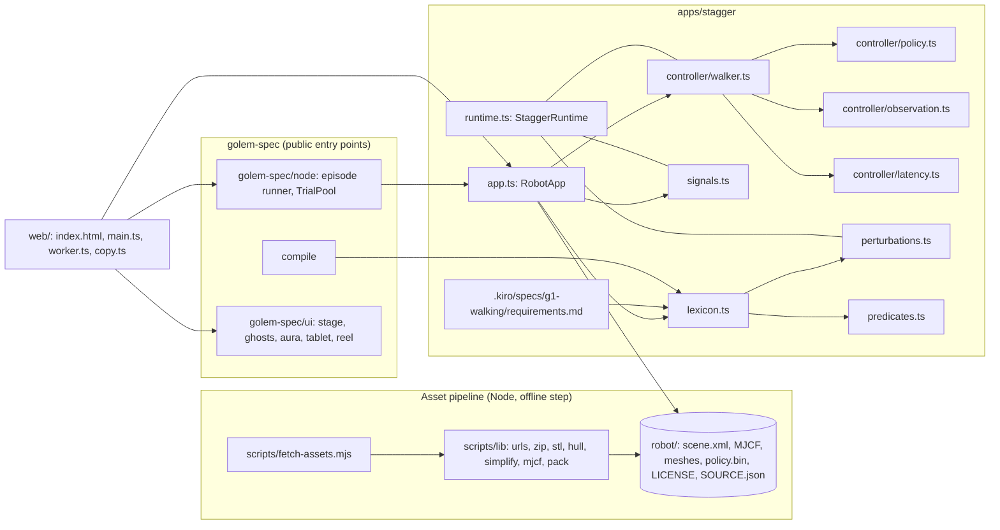
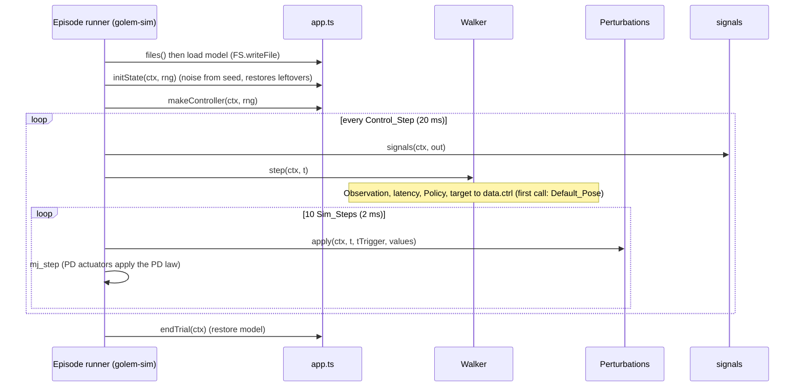

# Design Document

## Overview

stagger-app is `apps/stagger`: a Unitree G1 (12-DOF legs, `g1_12dof`) walking under Unitree's published policy, packaged as a GOLEM `RobotApp`. It supplies everything the skeleton needs to test the robot from EARS lines: processed assets, a TypeScript controller, a lexicon, signals, the app definition, the robot's own requirements, and a studio page.

The design follows four rules from the steering files:

- **Fixed contracts.** Every cross-module shape (`RobotApp`, `Controller`, `SimContext`, `Lexicon`, `PredicateTemplate`, `PerturbationTemplate`, `Dimension`, `Quantity`, `Trace`, `TrialSpec`, `TrialResult`) is used exactly as `interfaces.md` defines it. This design only adds fields (listed under Data Models).
- **Public entry points only.** The app imports from `golem-spec`, `golem-spec/ui` and `golem-spec/node`. Nothing imports `skeleton/src`.
- **Pure, allocation-free hot path.** A trial is a pure function of (scenario, requirement, seed). The Walker, the signals and every perturbation `apply` reuse preallocated typed arrays. No `Math.random()` in app code.
- **Core logic is pure functions.** Observation building, the PD law, the LSTM step, margins, push geometry and delay buffering are plain functions over typed arrays, so they can be tested with fast-check without MuJoCo. MuJoCo-backed tests are few and short (at most 2 s simulated).

### Design decisions

| Decision | Rationale |
|---|---|
| Per-trial mutable state lives in one `StaggerRuntime` object attached to the `SimContext` through a `WeakMap`. | `Controller.step`, `signals` and `PerturbationTemplate.apply` are separate calls that must share the command, the latency delay, the trigger pose and saved model values. The interface has no slot for them, and a `WeakMap` leaves `SimContext` unchanged. |
| Add one optional field `RobotApp.endTrial?(ctx)` that restores the model. | Requirements 14.3, 14.6 and 14.8 need a restore at trial end, and `interfaces.md` has no end hook. Adding an optional field is allowed. `initState` also restores any leftover saved values, so a skipped `endTrial` cannot leak into the next trial. `golem-sim` must call `endTrial` in a `finally` block. |
| Add an internal signal `episode_time` to the five named signals. | The `track the commanded speed within` margin must return a positive value while the episode time is under 2 s (12.6), and `margin(s, slots)` receives only signals. The sixth signal is additive, and requirement authors never name it. |
| Gather weights into one `Policy` class with a private scratch area, and expose the math as free functions (`lstmStep`, `linear`, `elu`). | The class meets the no-allocation rule. The free functions let a test compare against a naive reference implementation. |
| Asset processing is a set of pure functions in `scripts/lib/*.mjs`, driven by a thin `fetch-assets.mjs` that owns I/O. | The properties (hull enclosure, STL round trip, MJCF idempotence, pack round trip) run without network or disk. |
| The Latency_Buffer stores 26 rows: the current Observation plus 25 earlier ones. The maximum delay is 25 Control_Steps (0.5 s). | Requirement 15.4 asks for a capacity of at least 0.5 s / 0.02 s = 25 steps. |

### Research summary

- Unitree's `unitree_rl_gym` deploy script for the G1 defines the 47-dimensional observation, the action scale 0.25, the gains and the 0.8 s gait period. The requirements restate those values, and this design uses them as given. The policy file `deploy/pre_train/g1/motion.pt` is a TorchScript zip whose weights are raw float32 storages under `policy_lstm_1/data/N`. (Source: [unitreerobotics/unitree_rl_gym](https://github.com/unitreerobotics/unitree_rl_gym). Content was rephrased for compliance with licensing restrictions.)
- PyTorch's LSTM stacks gate weights in the order input, forget, cell, output (`i, f, g, o`), and uses two bias vectors. The port follows that layout.
- `mujoco-wasm.md` supplies the platform rules used here: write model files with `mj.FS.writeFile`, read live views of `qpos`, `qvel`, `ctrl` and `xfrc_applied`, delete every handle, and exclude `@mujoco/mujoco` from Vite's dependency optimizer.

## Architecture



### Trial data flow



### Layout

```
apps/stagger/
  package.json                 own package, TS strict, ESM, Node >= 20
  app.ts  lexicon.ts  signals.ts  perturbations.ts  predicates.ts  runtime.ts
  controller/  policy.ts  observation.ts  walker.ts  latency.ts  pd.ts
  robot/       scene.xml, g1_12dof MJCF, hull + visual STL, policy.bin, LICENSE, SOURCE.json
  scripts/     fetch-assets.mjs, lib/{urls,zip,stl,hull,simplify,mjcf,pack}.mjs
  web/         index.html, main.ts, worker.ts, copy.ts, vite.config.ts
  test/        *.test.ts (Vitest + fast-check), fixtures/parity.json
  .kiro/specs/g1-walking/requirements.md
  README.md  proposals.md
```

## Components and Interfaces

All signatures are TypeScript. Bodies are described, not written.

### Asset pipeline (`scripts/`)

`fetch-assets.mjs` owns the network, disk and exit codes. It calls pure helpers.

```ts
// urls.mjs
export const PINNED_COMMIT: string;                       // 40 lowercase hex, single constant
export function upstreamUrl(commit: string, path: string): string;   // raw.githubusercontent.com/...
export function isAllowedHost(url: string): boolean;      // raw.githubusercontent.com | github.com

// zip.mjs  (stored or deflate entries; node:zlib only)
export function readZipEntries(zip: Uint8Array): Map<string, Uint8Array>;

// stl.mjs
export interface Tri { v: Float32Array }                  // 9 floats; normals recomputed on write
export function parseBinaryStl(buf: Uint8Array): Float32Array;       // 9 floats per triangle
export function writeBinaryStl(tris: Float32Array): Uint8Array;      // length 84 + 50 * n

// hull.mjs      quickhull3d wrapper
export function buildHull(tris: Float32Array, name: string): Float32Array;   // throws "<name>: fewer than 4 non-coplanar vertices"

// simplify.mjs  meshoptimizer wrapper
export function buildVisual(tris: Float32Array, maxTris?: number): Float32Array; // default 3000; identity if tris <= max

// naming
export function hullName(source: string): string;        // e.g. "pelvis.hull.stl"
export function visualName(source: string): string;      // e.g. "pelvis.vis.stl"

// mjcf.mjs
export function rewriteMjcf(xml: string, meshes: MeshMap): string;   // collision -> hull/group 3; visual -> light/group 2, contype 0, conaffinity 0
export function writeScene(robotMjcfName: string): string;           // includes Robot_MJCF, floor geom "floor", timestep 0.002

// pack.mjs
export interface TensorSpec { name: string; shape: number[] }
export const WEIGHT_SPECS: readonly TensorSpec[];        // W1,b1,W2,b2,Wih,Whh,bih,bhh with Requirement 4.2 shapes
export const ZIP_ENTRY_FOR: Record<string, string>;      // tensor name -> "policy_lstm_1/data/N"
export function extractWeights(zipEntries: Map<string, Uint8Array>): Record<string, Float32Array>; // checks presence and byte length
export function packPolicy(w: Record<string, Float32Array>, commit: string): Uint8Array;
export function unpackPolicy(bytes: Uint8Array): { header: PolicyHeader; tensors: Record<string, Float32Array> };
```

**policy.bin layout.** 4-byte little-endian header length `H`, then `H` bytes of UTF-8 JSON, then padding so the first tensor starts on a multiple of 4 bytes, then the float32 tensors in header order. The JSON header holds `{ commit, gateOrder: "ifgo", tensors: [{ name, shape, offset, bytes }] }`, with offsets measured from the start of the file.

**Flow of `fetch-assets.mjs`.** (1) download MJCF; (2) parse the MJCF to list referenced meshes; (3) download meshes, `LICENSE` and `motion.pt` through `upstreamUrl`, failing with URL and status on a non-200 answer and with the mesh name when a mesh is missing; (4) build hulls and visuals, rewrite the MJCF, write the scene; (5) extract and pack weights; (6) write `SOURCE.json`; (7) print the Robot_Folder size in bytes; (8) remove the temporary directory in a `finally` block. Every write goes through one `writeInsideRobot(path)` helper that rejects paths outside `robot/` and the temporary directory.

### Controller (`controller/`)

```ts
// policy.ts
export const OBS_DIM = 47, ACT_DIM = 12, HIDDEN = 64;
export class Policy {
  constructor(weights: Record<string, Float32Array>);   // converts to Float64Array once; h, c zero
  reset(): void;                                        // h, c := 0
  step(obs: Float64Array, out: Float64Array): void;    // throws on length mismatch; no allocation
  static fromBytes(policyBin: Uint8Array): Policy;      // validates shapes against Requirement 4.2
}
// pure building blocks, shared with the reference test
export function lstmStep(w: LstmWeights, x: Float64Array, h: Float64Array, c: Float64Array, gates: Float64Array): void;
export function linear(W: Float64Array, b: Float64Array, rows: number, cols: number, x: Float64Array, y: Float64Array): void;
export function elu(x: Float64Array, n: number): void;

// observation.ts  (pure, no MuJoCo)
export const DEFAULT_POSE: Float64Array;                // [-0.1,0,0,0.3,-0.2,0] x2
export const GAIT_PERIOD = 0.8;
export function gaitPhase(t: number): number;           // (t mod 0.8) / 0.8, in [0,1)
export function buildObservation(
  qpos: ArrayLike<number>, qvel: ArrayLike<number>, command: Float64Array,
  previousAction: Float64Array, time: number, out: Float64Array): void;
export function projectedGravity(quat: ArrayLike<number>, out: Float64Array, offset: number): void; // R(q)^-1 * (0,0,-1)

// pd.ts
export const KP: Float64Array, KD: Float64Array;       // 12 each
export const ACTION_SCALE = 0.25;
export function actionToTarget(action: Float64Array, target: Float64Array): void;       // action*0.25 + DEFAULT_POSE
export function pdTorque(target: Float64Array, q: ArrayLike<number>, qd: ArrayLike<number>, ctrl: Float64Array): void;

// latency.ts
export class LatencyBuffer {
  static readonly MAX_DELAY = 25;                       // rows = MAX_DELAY + 1
  constructor();                                        // all rows allocated here
  reset(): void;
  push(obs: Float64Array): void;                        // copies into the next row
  delayed(d: number, out: Float64Array): void;          // observation d steps earlier, or oldest stored if fewer exist
}
export function delaySteps(duration: number): number;   // clamp(round(duration / 0.02), 0, 25)

// walker.ts
export class Walker implements Controller {
  constructor(ctx: SimContext, policy: Policy, rt: StaggerRuntime);
  step(ctx: SimContext, t: number): void;
}
```

**Walker.step(ctx, t) pseudocode.**

```
if calls > 0:
    command := rt.command                    // default (0.5, 0, 0); command perturbation overrides
    buildObservation(qpos, qvel, command, prevAction, t, obs)
    latency.push(obs)
    latency.delayed(rt.delaySteps, delayedObs)   // delay 0 returns obs unchanged
    policy.step(delayedObs, action)
    actionToTarget(action, target)
    prevAction := action                     // copy
calls += 1
ctrl := target                               // PD actuators turn the target into torque every Sim_Step
```

**Revision (implementation).** golem-sim calls `controller.step` once per Control_Step, before its 10 Sim_Steps, and never touches `data.ctrl` between them (golem-sim design, "Control_Step definition"). A TypeScript PD law could therefore only hold one torque for 20 ms. The Robot_MJCF instead declares each leg actuator as a MuJoCo PD actuator (`<general gaintype="fixed" biastype="affine" gainprm="kp" biasprm="0 -kp -kd">`), so MuJoCo computes `(ctrl - q)·kp - qd·kd` with `ctrl = target` at every Sim_Step, which is the PD_Law of the deploy script. `pdTorque` stays as the pure reference law, and a physics test checks `data.actuator_force` against it. Unitree's script evaluates the policy after every 10th Sim_Step from the state and time after that step, and holds Default_Pose for the first 10 Sim_Steps; call k of `step` sees exactly that state at `t = 0.02·k s`, so the first call after construction holds Default_Pose and every later call evaluates the policy. With this schedule the parity run matches the Python reference to 1e-5 m.

`qpos[7:19]` and `qvel[6:18]` are read from the live views of `ctx.data`. The Walker's constructor resets the policy state, previous action, latency buffer and call counter, and sets the target to Default_Pose.

`buildObservation` slices: `[0:3] = 0.25 * qvel[3:6]`; `[3:6] = projectedGravity(qpos[3:7])`; `[6:9] = command .* (2, 2, 0.25)`; `[9:21] = qpos[7:19] - DEFAULT_POSE`; `[21:33] = 0.05 * qvel[6:18]`; `[33:45] = previousAction`; `[45] = sin(2π·phase)`, `[46] = cos(2π·phase)`, with `phase = gaitPhase(time)`. The previous action is all zeros at the first Control_Step because the Walker's constructor zeroes it.

### Runtime state (`runtime.ts`)

```ts
export interface StaggerRuntime {
  command: Float64Array;              // [vx, vy, wz], default [0.5, 0, 0]
  delaySteps: number;                 // 0 unless the latency perturbation applies
  trigger: { latched: boolean; t: number; pos: Float64Array; heading: Float64Array };
  push: { startTime: number; dirX: number; dirY: number; latched: boolean };
  saved: { gravity: Float64Array; torsoMass: number; torsoInertia: Float64Array; floorFriction: Float64Array; has: boolean };
  speedRing: { buf: Float64Array; n: number; head: number; sum: number };   // 50 samples
}
export function runtimeFor(ctx: SimContext): StaggerRuntime;   // WeakMap lookup, creates once per ctx, allocates the arrays then
export function resetRuntime(rt: StaggerRuntime): void;
```

The runtime is created and fully allocated in `makeController` / `initState`, before the step loop. Nothing in the loop creates new objects.

### Signals (`signals.ts`)

```ts
export const SIGNAL_NAMES = ['pelvis_z','tilt_deg','forward_speed','commanded_speed','lateral_drift','episode_time'] as const;
export function writeSignals(ctx: SimContext, rt: StaggerRuntime, out: Record<string, number>): void;
export function heading(quat: ArrayLike<number>, out: Float64Array): void;     // unit horizontal vector from the pelvis x axis
export function tiltDeg(quat: ArrayLike<number>): number;                        // acos(clamp(R[2][2])) in degrees, [0,180]
export class MovingAverage {                                                      // 50-sample ring, allocated up front
  constructor(n: number);
  push(x: number): void;
  mean(): number;                                                                 // average of the samples available
  reset(): void;
}
```

Definitions:
- `pelvis_z` is `xpos[pelvis].z` (the floor is at z = 0).
- `tilt_deg` is the angle between the pelvis z axis and world up.
- `forward_speed` is `MovingAverage.mean()` of the dot product of the horizontal pelvis velocity with the Heading, pushed once per Control_Step.
- `commanded_speed` is `rt.command[0]`.
- `lateral_drift` is `|(p - p0) x h|` in the horizontal plane, where `p0` and `h` are the pelvis position and Heading latched at the trigger time. When no perturbation has latched a trigger, the runtime latches at the end of warm-up (first call with `data.time >= app.warmup`).
- `episode_time` is `data.time`.

### Lexicon (`lexicon.ts`, `predicates.ts`, `perturbations.ts`)

`lexicon.ts` exports `lexicon: Lexicon` with `robotNames: ['golem', 'G1', 'robot']`.

| Predicate phrase | Signals | Margin | Unit |
|---|---|---|---|
| `stay upright` | `pelvis_z`, `tilt_deg` | `tilt_deg > 60 ? -0.01 : pelvis_z - 0.5` | m |
| `keep its pelvis above {length}` | `pelvis_z` | `pelvis_z - length` | m |
| `track the commanded speed within {speed}` | `forward_speed`, `commanded_speed`, `episode_time` | `episode_time < 2 ? speed : speed - abs(forward_speed - commanded_speed)` | m/s |
| `not drift sideways more than {length}` | `lateral_drift` | `length - lateral_drift` | m |

The comment above `stay upright` records: the margin is `pelvis_z - 0.5 m`; a Tilt above 60 deg forces `-0.01 m`; and the reason is that a robot lying on its side can have a pelvis height above 0.5 m while it has fallen, and a small fixed negative margin marks it as broken without hiding the real height elsewhere.

| Perturbation phrase | Dimensions | Apply behaviour |
|---|---|---|
| `the pelvis is pushed with {range:force} for {duration} from {direction} at {phase}` | `push.force` (force, up), `push.angle` (angle, wrap, none), `push.phase` (phase, wrap, none); duration fixed | Latches Heading and start time at the trigger; writes a horizontal force to `xfrc_applied` of `pelvis` inside the window, zero outside |
| `walking on a slope of {range:angle}` | `slope.angle` (angle, up) | Rotates `opt.gravity` about world y |
| `carrying a payload of {range:mass}` | `payload.mass` (mass, up) | Adds the mass to the torso body, then `mj_setConst` when needed |
| `the floor friction drops to {ratio}` | none (ratio fixed) | Scales sliding friction of geom `floor` |
| `the sensor latency rises to {range:duration}` | `latency.duration` (duration, up) | Sets `rt.delaySteps = delaySteps(duration)` |
| `commanded to walk at {range:speed}` | `command.speed` (speed, none) | Sets `rt.command = (speed, 0, 0)` |

Pure helpers behind `apply`, so tests need no MuJoCo:

```ts
export function pushStartOffset(pushPhase: number, triggerPhase: number): number;                 // ((p - p0) mod 1) * 0.8, in [0, 0.8)
export function pushForce(t: number, start: number, duration: number, force: number,
                          heading: Float64Array, angle: number, out: Float64Array): void;        // out[0..2] = fx, fy, 0 in window else 0
export function slopeGravity(g0: Float64Array, angle: number, out: Float64Array): void;
export function validateRatio(ratio: number): void;                                               // throws diagnostic naming ratio and [0, 1]
```

Slope rotation about y by angle `a`: `g = (g0z·sin a, g0y, g0z·cos a)` for `g0 = (0, 0, -9.81)` generalised as a rotation of the vector `g0`. The norm is preserved.

The `xfrc_applied` row of `pelvis` is written with torque entries held at 0. The perturbation applies to the same row on every call, so it overwrites rather than accumulates.

Ratio validation runs at compile time: the `{ratio}` slot handler rejects a ratio outside [0, 1] with a diagnostic of the form `ratio 130% is outside 0% to 100%`.

### App definition (`app.ts`)

```ts
export const stagger: RobotApp & { endTrial?(ctx: SimContext): void };
```

| Field | Value |
|---|---|
| `id`, `name` | `stagger`, `Stagger: Unitree G1` |
| `sceneFile`, `simDt`, `controlDt`, `warmup` | `scene.xml`, 0.002, 0.02, 2 |
| `files()` | Node: reads every file under `robot/` (found through the committed file list in `SOURCE.json`); browser: `fetch` from the page origin. Rejects with the file name if one is missing. Returns the same bytes on every call. |
| `lexicon` | the `lexicon` export |
| `makeController(ctx, rng)` | loads `policy.bin` from the cached bytes, builds `Walker`; draws nothing from `rng` |
| `initState(ctx, rng)` | restores leftovers, resets the runtime, sets the free joint to the standing pose, adds `0.01 * normal(rng)` to the 12 leg joints in joint order |
| `signals(ctx, out)` | `writeSignals` |
| `endTrial(ctx)` | restores gravity, torso mass and inertia, floor friction; calls `mj_setConst` if mass was changed |

`normal(rng)` is a Box-Muller draw that uses exactly two `rng()` calls per pair in a fixed order, so twelve joints use twelve values from six pairs. The standing pose is the upstream config pose (`z = 0.8 m`, upright quaternion, zero velocities); the parity fixture records the exact pose used by the Python reference.

### Requirements file and tests

`.kiro/specs/g1-walking/requirements.md` is a standard Kiro requirements file. The tests in `test/` read it, extract every EARS line, and compile each against `lexicon` with the public compile function of `golem-spec`.

### Studio page (`web/`)

```ts
// copy.ts
export const STUDIO_COPY: Record<string, string>;                                   // all page text, sentence case, <= 72 chars per line
export function formatCounterexample(s: Scenario): string;                          // "falls from 168 N at 135 deg, 62% into the stride"
// main.ts: builds the page from golem-spec/ui components; wires Shove, Summon 64 ghosts, Replay the fall, Pin this seed
// worker.ts: one MuJoCo instance per worker; speaks the TrialPool message protocol
```

The page entry is a Vite multi-page entry with `optimizeDeps.exclude: ['@mujoco/mujoco']`. `main.ts` fetches `robot/*` and the requirements text from its own origin, builds a tablet line per EARS line, and re-runs the test on every control edit. Rendering is on demand and capped at pixel ratio 1.5. The page makes no request other than its own static assets.

## Data Models

Additions to the fixed contracts (all additive):

| Name | Shape | Purpose |
|---|---|---|
| `RobotApp.endTrial?` | `(ctx: SimContext) => void` | Restores model changes made by perturbations (14.3, 14.6, 14.8) |
| Signal `episode_time` | number, seconds | Lets the speed-tracking predicate apply its 2 s settling rule |
| `StaggerRuntime` | see Components | Per-context trial state, not part of `interfaces.md` |
| `PolicyHeader` | `{ commit: string; gateOrder: 'ifgo'; tensors: { name: string; shape: number[]; offset: number; bytes: number }[] }` | JSON header of `policy.bin` |
| `SourceJson` | `{ commit: string; files: { upstream: string; local: string }[] }` | `robot/SOURCE.json`; also the file list that Node `files()` uses |

Scenario dimensions produced by the lexicon (SI values in a `Scenario`):

| Dimension | Kind | Range source | Severity | Wrap |
|---|---|---|---|---|
| `push.force` | force | trigger range | up | no |
| `push.angle` | angle | `from any direction` = [0, 2π) | none | yes |
| `push.phase` | phase | `at any point in its stride` = [0, 1) | none | yes |
| `slope.angle` | angle | trigger range | up | no |
| `payload.mass` | mass | trigger range | up | no |
| `latency.duration` | duration | trigger range | up | no |
| `command.speed` | speed | trigger range | none | no |

Constants: control period 0.02 s, simulation step 0.002 s, gait period 0.8 s, settling time 2 s, tilt limit 60 deg, height limit 0.5 m, forced margin -0.01 m, moving-average window 50 samples, maximum delay 25 steps.

Policy weight shapes: W1 32×64, b1 32, W2 12×32, b2 12, Wih 256×47, Whh 256×64, bih 256, bhh 256, stored row-major, matching zip entries `policy_lstm_1/data/2` through `data/9`.

Parity fixture `test/fixtures/parity.json`: the 12 initial noise values, command `(0.5, 0, 0)`, duration 2 s, and the reference pelvis position `(0.79987, -0.02247, 0.76789) m` with tolerance 1e-3 m. The fixture is never edited to make a test pass.

## Correctness Properties

*A property is a characteristic or behavior that should hold true across all valid executions of a system-essentially, a formal statement about what the system should do. Properties serve as the bridge between human-readable specifications and machine-verifiable correctness guarantees.*

Reflection notes: the PD-law, zero-torque and target-mapping criteria merge into Property 16. Moving-average constant, bounded and partial-window criteria merge into Property 18. The `stay upright` formula and forced margin merge into Property 21. The push magnitude, window and no-torque criteria merge into Property 24. Perturbation restoration and the no-side-effect criterion merge into Property 30. Determinism criteria in 9.8, 16.13, 21.1 and 21.2 merge into Property 34. Criteria that are layout, visual, evidence-only or performance checks have no property and are covered by example tests (see Testing Strategy).

### Property 1: Download URLs are built from the pinned commit

For any 40-character lowercase hexadecimal commit and any upstream path, `upstreamUrl(commit, path)` contains the commit and the path, and its host is `raw.githubusercontent.com` or `github.com`. `isAllowedHost` accepts every such URL and rejects URLs with any other host.

**Validates: Requirements 1.1, 1.8**

### Property 2: Hull meshes enclose their source meshes

For any triangle soup with at least 4 non-coplanar vertices, every vertex of the source lies inside or on the surface of `buildHull(source)` within 1e-6 m.

**Validates: Requirements 2.1, 2.2**

### Property 3: Visual meshes respect the triangle cap

For any triangle soup and any cap of at least 1 triangle (default 3,000), `buildVisual` returns at most the cap triangles, and returns the input unchanged when the input has no more triangles than the cap.

**Validates: Requirements 2.3, 2.4, 2.5**

### Property 4: STL write and parse round trip

For any valid triangle list, `writeBinaryStl` produces a buffer of exactly `84 + 50 * n` bytes, and parsing then writing then parsing gives a triangle list equal to the first parse.

**Validates: Requirements 2.6, 2.9**

### Property 5: Hull and visual file names never collide

For any set of distinct source mesh names, the set of `hullName` and `visualName` outputs has no duplicates.

**Validates: Requirements 2.7**

### Property 6: MJCF rewrite sets mesh groups and preserves structure

For any generated MJCF with collision and visual geoms, `rewriteMjcf` points every collision geom at a hull mesh with `group` 3, points every visual geom at a light mesh with `group` 2, `contype` 0 and `conaffinity` 0, and leaves every body name, joint name, joint range, actuator name, inertial element and body nesting unchanged.

**Validates: Requirements 3.1, 3.2, 3.3**

### Property 7: MJCF rewrite is idempotent

For any generated MJCF, `rewriteMjcf(rewriteMjcf(x)) = rewriteMjcf(x)`.

**Validates: Requirements 3.9**

### Property 8: policy.bin pack and unpack round trip

For any set of tensors with the Weights shapes (including NaN payloads, infinities, negative zero and subnormals), `unpackPolicy(packPolicy(w))` returns float32 values equal bit for bit to the input, and every header offset is a multiple of 4 with `offset + bytes` inside the file. The header carries the commit and gate order `ifgo`.

**Validates: Requirements 4.5, 4.6, 4.7, 4.9**

### Property 9: Zip extraction maps entries to the right tensors

For any synthetic zip whose entries `policy_lstm_1/data/2` to `data/9` hold float32 storages of the expected byte lengths, `extractWeights` returns tensors named W1, b1, W2, b2, Wih, Whh, bih, bhh with the values of entries 2 to 9 in that order. For any entry whose length is wrong or that is absent, it throws an error that names the entry.

**Validates: Requirements 4.1, 4.2, 4.3, 4.4**

### Property 10: The asset pipeline is reproducible

For any generated upstream input set, running the pure pipeline twice produces byte-equal output files.

**Validates: Requirements 5.4**

### Property 11: The Policy matches a reference network

For any weights and any input sequence with entries in [-10, 10], every output of `Policy.step` equals the output of a naive reference implementation of LSTM(47→64) with gate order `i, f, g, o`, Linear 64→32, ELU, Linear 32→12, computed in Float64, within 1e-12 relative error.

**Validates: Requirements 6.1, 6.2, 6.3**

### Property 12: Policy output is finite

For any input vector with finite entries in [-10, 10] and zero Policy_State, `Policy.step` returns 12 finite values.

**Validates: Requirements 6.11**

### Property 13: Policy is deterministic and reset restores the initial state

For any input sequence, two fresh Policy instances give bit-identical outputs, and one instance run on the sequence, then `reset`, then run on the sequence again gives bit-identical outputs for both runs. A new Policy and a reset Policy both have `h` and `c` equal to zero.

**Validates: Requirements 6.6, 6.7, 6.12, 6.13**

### Property 14: Observation layout

For any `qpos`, `qvel`, command, previous action and time, `buildObservation` writes `obs[0:3] = 0.25·qvel[3:6]`, `obs[6:9] = command ⊙ (2, 2, 0.25)`, `obs[9:21] = qpos[7:19] - Default_Pose`, `obs[21:33] = 0.05·qvel[6:18]`, `obs[33:45] = previousAction`, `obs[45] = sin(2π·gaitPhase(time))` and `obs[46] = cos(2π·gaitPhase(time))`, with `gaitPhase(time) = (time mod 0.8)/0.8` and `gaitPhase(0) = 0`.

**Validates: Requirements 7.1, 7.3, 7.4, 7.5, 7.6, 7.7, 7.13**

### Property 15: Projected gravity is a unit vector and is yaw invariant

For any unit quaternion, the projected gravity has norm 1 within 1e-12, equals `(0, 0, -1)` for the identity quaternion, and is unchanged within 1e-12 when a rotation about the world vertical axis is applied to the quaternion.

**Validates: Requirements 7.2, 7.8, 7.9**

### Property 16: PD law and action mapping

For any finite action, `q` and `qd`, `actionToTarget` gives `action·0.25 + Default_Pose`, and `pdTorque` gives `(target - q)·kp - qd·kd` within 1e-12 relative error, with `kp = [100,100,100,150,40,40]` and `kd = [2,2,2,4,2,2]` repeated for both legs. When `q` equals the target and `qd` is zero, every `ctrl` entry is 0.

**Validates: Requirements 8.1, 8.2, 8.3, 8.4, 8.8, 8.9**

### Property 17: The Walker evaluates the Policy once per Control_Step and holds its target in data.ctrl

For any number of calls N to `Walker.step` (one per Control_Step), the Policy is called exactly `N - 1` times (the first call holds Default_Pose), `ctrl` equals the latest target after every call, and the action stored on each Control_Step is the previous action seen by the next Observation. The PD law itself runs in the model's PD actuators at every Sim_Step (see the Walker revision note).

**Validates: Requirements 8.5, 8.6, 8.7**

### Property 18: Moving average semantics

For any sample sequence of any length, `MovingAverage.mean()` equals the arithmetic mean of the last `min(n, 50)` samples within 1e-12, lies between their minimum and maximum, and equals the constant value exactly within 1e-12 for a constant sequence of at least 50 samples.

**Validates: Requirements 11.7, 11.8, 11.10, 11.11**

### Property 19: forward_speed is invariant under a common yaw rotation

For any pelvis velocity, Heading and yaw angle, rotating both the velocity and the Heading by that angle leaves the projected forward speed unchanged within 1e-12.

**Validates: Requirements 11.4, 11.12**

### Property 20: Tilt range and lateral drift geometry

For any unit quaternion, `tiltDeg` lies in [0, 180] and equals 0 for any pure yaw rotation. For any trigger position, Heading and pelvis position, `lateral_drift` equals the perpendicular horizontal distance to the Heading line and is non-negative.

**Validates: Requirements 11.2, 11.3, 11.5, 11.6**

### Property 21: stay upright margin

For any `pelvis_z` and `tilt_deg`, the margin equals `pelvis_z - 0.5` within 1e-12 when `tilt_deg ≤ 60`, and equals exactly -0.01 when `tilt_deg > 60`.

**Validates: Requirements 12.1, 12.2, 12.10, 12.11**

### Property 22: Height, speed and drift margins are exact and monotone

For any signal values and slots, `keep its pelvis above` gives `pelvis_z - length`, `track the commanded speed within` gives `speed - |forward_speed - commanded_speed|` when `episode_time ≥ 2`, and `not drift sideways more than` gives `length - lateral_drift`. Raising the length slot of the height predicate never raises its margin, and the speed margin is non-decreasing in the speed slot.

**Validates: Requirements 12.4, 12.5, 12.7, 12.12, 12.13**

### Property 23: Settling time is forgiven

For any signal values and any `episode_time < 2`, the margin of `track the commanded speed within {speed}` equals the speed slot, which is positive for any positive speed.

**Validates: Requirements 12.6**

### Property 24: Push force magnitude and window

For any force, angle, phase, start time, duration, Heading and time, the horizontal force written by `pushForce` has norm equal to `push.force` within 1e-9 relative error when `start ≤ t < start + duration`, and is exactly zero otherwise. The vertical force component and all torque components written to `xfrc_applied` are zero.

**Validates: Requirements 13.3, 13.6, 13.7, 13.9, 13.10**

### Property 25: Push direction follows the latched Heading

For any Heading and angle, the direction of the applied force equals the Heading rotated by the angle within 1e-9 rad (0 deg gives the Heading, 180 deg gives its opposite). For any later pelvis rotation after the trigger, the direction is unchanged.

**Validates: Requirements 13.4, 13.8, 13.11**

### Property 26: Push start offset hits the requested gait phase

For any push phase and any trigger time, `pushStartOffset` lies in [0, 0.8) and `gaitPhase(tTrigger + offset)` equals the push phase within 1e-9 (taken modulo 1).

**Validates: Requirements 13.5, 13.12**

### Property 27: Slope keeps the gravity norm

For any slope angle in [0, 20 deg], `slopeGravity` returns a vector whose norm equals the original within 1e-12 relative error, and the vector tilts about the world y axis only (the y component is unchanged).

**Validates: Requirements 14.2, 14.10**

### Property 28: Payload adds mass exactly

For any payload mass and torso mass, the torso mass after the perturbation equals the original plus the payload within 1e-12 relative error.

**Validates: Requirements 14.5, 14.11**

### Property 29: Friction ratio scales sliding friction and out-of-range ratios are rejected

For any ratio in [0, 1] and original friction, the sliding friction equals ratio × original. For any ratio below 0 or above 1, `validateRatio` throws a diagnostic that names the ratio and the range [0%, 100%].

**Validates: Requirements 14.7, 14.13**

### Property 30: Trials leave the cached model unchanged

For any scenario of the push, slope, payload, friction, latency and command perturbations, after the perturbations run and `endTrial` is called, `opt.gravity`, `body_mass`, `body_inertia` and `geom_friction` are byte-equal to their values before the trial. The same holds when a previous trial was aborted before `endTrial` and the next `initState` runs.

**Validates: Requirements 14.3, 14.6, 14.8, 14.9, 21.8**

### Property 31: Latency delay is a whole number of Control_Steps

For any duration, `delaySteps(duration)` is an integer equal to `round(duration / 0.02)` clamped to [0, 25].

**Validates: Requirements 15.2, 15.5, 15.13**

### Property 32: Latency buffer returns the observation from d steps earlier

For any observation sequence and any delay `d` in [0, 25], after `d` or more observations have been pushed, `delayed(d)` returns the observation pushed `d` steps earlier. With `d = 0` it returns the current observation unchanged. With fewer than `d` observations stored it returns the oldest stored observation.

**Validates: Requirements 15.3, 15.4, 15.6, 15.7, 15.11, 15.12**

### Property 33: initState noise is deterministic and in fixed order

For any seed, `initState` draws exactly the same number of values from the seeded generator on every call, assigns them to the 12 leg joints in joint order, and gives equal poses for equal seeds. The free joint is at the standing pose and every other state is unchanged.

**Validates: Requirements 16.7, 16.8, 16.9**

### Property 34: A trial is a deterministic function of scenario and seed

For any scenario and seed (horizon at most 2 s), running the same trial twice in one runtime gives bit-identical Traces and bit-identical final pelvis positions. Changing only the seed changes only the initial joint noise.

**Validates: Requirements 9.8, 16.13, 21.1, 21.2**

### Property 35: Requirement lines compile and re-compile to the same space

For any EARS line of the Requirements_File, compiling it, formatting the compiled line, and compiling the result gives an equal `space` and equal `perturbations`.

**Validates: Requirements 18.12**

### Property 36: Counterexample sentence is complete and fits the measure

For any shrunk scenario with force, angle and phase values, `formatCounterexample` returns a string of the form `falls from <force> N at <angle> deg, <phase>% into the stride` in which the numbers parse back to the scenario values rounded to the displayed precision, and no line of the wrapped copy exceeds 72 characters.

**Validates: Requirements 20.8, 20.9**

### Property 37: The import scan flags exactly the forbidden imports

For any generated source text, the public-entry-point scan reports an import if and only if the module specifier contains `skeleton/src`, and accepts `golem-spec`, `golem-spec/ui` and `golem-spec/node`.

**Validates: Requirements 10.2, 10.3, 10.8**

## Error Handling

| Condition | Behaviour | Requirements |
|---|---|---|
| HTTP status other than 200 | `fetch-assets.mjs` prints the URL and the status, exits 1 | 1.5 |
| Referenced mesh missing | Prints the mesh name, exits 1 | 1.6 |
| Source mesh with fewer than 4 non-coplanar vertices | `buildHull` throws `<name>: fewer than 4 non-coplanar vertices`; script exits 1 | 2.8 |
| Zip entry missing or wrong length | `extractWeights` throws naming the entry, expected bytes and actual bytes; script exits 1 | 4.3, 4.4 |
| Write outside `robot/` or the temporary directory | `writeInsideRobot` throws before writing | 1.7 |
| `policy.bin` tensor shape differs | `Policy.fromBytes` throws naming the tensor, expected shape and actual shape | 6.9 |
| Wrong input or output length | `Policy.step` throws naming both lengths (for example `expected input 47 and output 12, got 46 and 12`) | 6.10 |
| File of `robot/` missing | `files()` rejects with an error that names the file | 16.12 |
| Ratio outside [0, 1] | Compile diagnostic that names the ratio and the range, through the lexicon slot handler | 14.13 |
| Latency above 0.5 s | The delay is clamped to 25 Control_Steps; no error | 15.5 |
| Perturbation throws mid-trial | The episode runner's `finally` calls `endTrial`; the next `initState` restores any leftover saved values | 14.9, 21.8 |
| Model or policy fails to load in the browser | The page shows `Could not load <file>. Reload the page.`; no partial stage | 19.16 |
| Parity test mismatch | Prints observed, reference and difference for x, y and z in metres; the tolerance is not changed | 9.6 |
| Requirement line fails to compile | The test prints the line, the diagnostic and the suggestion, and fails | 18.2 |
| MuJoCo handle leak | The Smoke_Trial asserts the handle counter equals its prior value plus the cached model | 18.7, 21.4 |

Error messages are plain and physical. Spooky wording is limited to names and visuals.

## Testing Strategy

The tests follow `testing.md`: Vitest for examples, fast-check for properties, short horizons, and no weakened assertions. Test names state behaviour, for example `it('rejects a ratio above 100%')`.

### Approach

- **Property tests.** Each correctness property above is implemented by exactly one fast-check test with at least 100 runs (`numRuns: 100` or more). Each test carries the tag comment `Feature: stagger-app, Property N: <property text>`.
- **Physics-backed properties** (30, 34) use the real model and horizons of at most 2 s simulated, with `numRuns` limited to a small number such as 5 to 10 to keep CI short. Their pure parts (restoration of saved values, argument handling) also run against a stub `SimContext` made of typed arrays at 100 runs.
- **Example tests** cover the rest:
  - Asset pipeline with a stubbed `fetch`: file set, `LICENSE` copied unchanged, `SOURCE.json` content, failure exits (1.2 to 1.7, 2.8, 4.3, 4.4).
  - Committed Robot_Folder: joint order, `pelvis` root, `floor` geom, timestep 0.002, motor actuators, model compiles to 12 actuators and `nq = 19` within 5 s (3.4 to 3.8, 3.10, 3.11, 5.1 to 5.3, 5.6, 5.7).
  - Parity test: runs 2 s in Node, compares the pelvis to the fixture within 1e-3 m, prints the diff on failure, finishes in under 10 s (9.1 to 9.7).
  - Observation layout example with a hand-written case (7.10 to 7.12).
  - Lexicon structure: `robotNames`, declared signals and units, the comment above `stay upright`, phrase text and dimension declarations (12.3, 12.8, 12.9, 13.1, 13.2, 14.1, 14.4, 15.1, 15.8).
  - App definition fields and `files()` in Node, with a missing-file error case (16.1 to 16.6, 16.10 to 16.12).
  - Requirements file structure: Introduction, Glossary, numbered requirements, units on every number, required lines present, expected-break line of 250 N from behind, ID first on every line, marks outside EARS lines, every line compiles, `perturbations` non-empty, finite positive `horizon`, `min ≤ max` (17.1 to 17.10, 18.1 to 18.3).
  - Smoke_Trial: 2 s after warm-up with a 0 N push, finite robustness, expected trace length, handle counter, under 15 s (18.4 to 18.7).
  - Nominal scenario: the robustness of every Expected_Hold and Expected_Break line on a 0 N or nominal scenario is positive (18.13).
  - Package: `package.json` fields, no `Math.random()` in `controller/`, `lexicon.ts`, `app.ts`, dependency lists, no Python files (10.1, 10.4 to 10.7, 21.5).
  - Source scans for no-allocation inside `Policy.step`, `Walker.step`, `writeSignals` and each `apply` (no `new`, array or object literals, closures); a runtime check that heap use stays flat over a long loop supplements the scan (6.5, 7.11, 8.11, 11.9, 13.13, 21.3).
  - Studio page, tested with jsdom or Playwright-free DOM checks: button labels, `optimizeDeps.exclude`, load-failure message, copy statements and links, no analytics script, no `skeleton/src` import (19.1, 19.6, 19.7, 19.10, 19.13 to 19.16, 20.1 to 20.5, 20.10).
- **Not covered by automated tests.** Layout and visual rules (19.2, 19.3, 19.8, 19.9, 19.11, 19.12, 20.6, 20.7), the 100 ms interaction response (19.5), the Expected_Hold and Expected_Break search results (17.11, 17.12) and CPU time per trial (21.7) are checked by review, manual runs, or the evidence scripts in `evidence/`, which are outside CI.

### Why property-based testing applies

The app is mostly pure numeric and data transformations (parsers, serializers, mesh functions, network maths, geometry, buffers, margin functions), which have clear input and output behaviour and large input spaces. Property tests are therefore the main tool. The studio page layout, the live MuJoCo behaviour and the evidence runs are not suited to properties and use example or manual checks.

### Generators

- Triangle soups: random vertices with at least 4 non-coplanar points (filter or construct a tetrahedron first).
- Weights: float32 arrays of the specified shapes with small magnitudes (for example in [-0.5, 0.5]) for the network properties, and arbitrary bit patterns for the pack round trip.
- Quaternions: normalised 4-vectors from a non-degenerate sample.
- Scenarios: values drawn from the dimension ranges of each requirement line, using the lexicon's own `space`.
- MJCF documents: small generated trees of `body`, `joint`, `geom`, `inertial` and `actuator` elements with named references to mesh names.
- Seeds: integers passed to `mulberry32`.

### Test files

| File | Properties and examples |
|---|---|
| `test/assets.test.ts` | 1 to 10 and pipeline examples |
| `test/policy.test.ts` | 11 to 13 |
| `test/observation.test.ts` | 14, 15 |
| `test/walker.test.ts` | 16, 17, 32, 31 |
| `test/signals.test.ts` | 18 to 20 |
| `test/lexicon.test.ts` | 21 to 23, 29, 35 and lexicon examples |
| `test/perturbations.test.ts` | 24 to 28, 30 |
| `test/app.test.ts` | 33, 34, smoke trial, parity test |
| `test/requirements.test.ts` | compile, structure, nominal scenario |
| `test/copy.test.ts` | 36 and page examples |
| `test/layout.test.ts` | 37 and package scans |

Long campaigns and timing numbers live in `evidence/`, not in CI.
