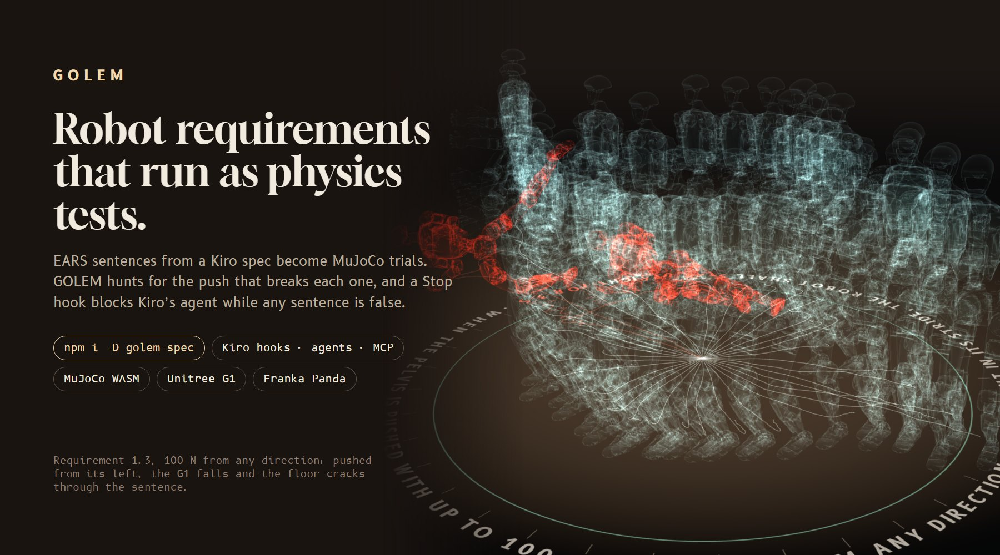
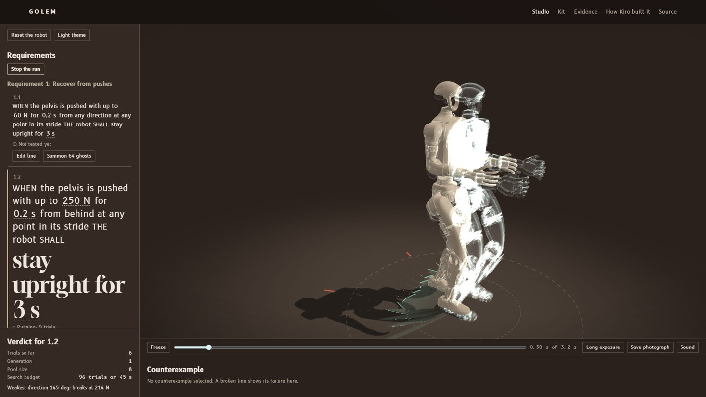
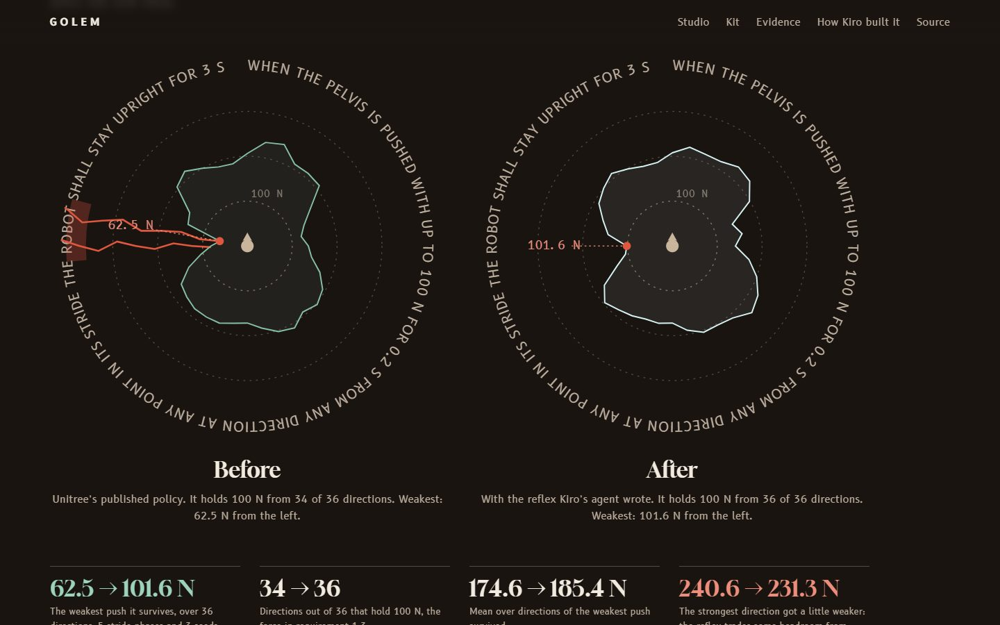
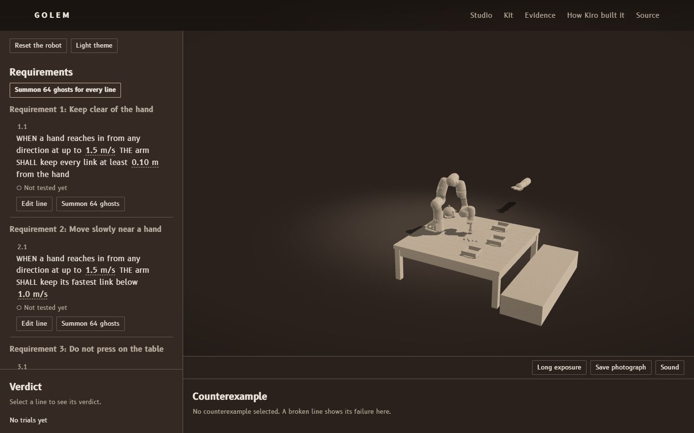

<p align="center"></p>

<p align="center">
<a href="https://www.npmjs.com/package/golem-spec"></a>
<a href="LICENSE"></a>


</p>

<p align="center"><b><a href="https://d23v187fnxad7l.cloudfront.net">Live site</a></b> · <b><a href="https://d23v187fnxad7l.cloudfront.net/stagger/">Shove the G1 in your browser</a></b> · <b><a href="https://www.npmjs.com/package/golem-spec">npm package</a></b> · <b><a href="https://d23v187fnxad7l.cloudfront.net/evidence/">Evidence</a></b> · <b><a href="https://d23v187fnxad7l.cloudfront.net/how-kiro/">How Kiro built it</a></b></p>

# GOLEM

**Kiro writes your robot's requirements as plain sentences. GOLEM turns every sentence into a physics test, tries hard to break the robot, and blocks Kiro's agent from finishing while any sentence is false.**

> In the legend, a golem is clay brought to life by a written word. Here the words are a Kiro spec's EARS acceptance criteria. The clay is a robot in MuJoCo, running in Node or in your browser.

**Try it, no install:** open the [live site](https://d23v187fnxad7l.cloudfront.net) and scroll. The circle replays 24 real recorded trials of a Unitree G1 shoved at 150 N from every side; where it falls, the sentence on the floor cracks. Then [open the studio](https://d23v187fnxad7l.cloudfront.net/stagger/):

1. **Shove the robot.** Drag the Unitree G1 with your mouse or finger.
2. **Summon the ghosts.** 64 translucent copies are pushed at once, in your browser's worker threads. The ones that fall turn red.
3. **Read the verdict.** Each requirement either holds, with its margin in metres, or breaks with the mildest failing push it found, which you can replay.

---

## What it does

```
WHEN the pelvis is pushed with up to 100 N for 0.2 s from any direction
at any point in its stride, THE robot SHALL stay upright for 3 s
```

1. **Compile.** GOLEM reads EARS lines straight from `.kiro/specs/*/requirements.md`, the file Kiro writes. Each line becomes:
   - a *scenario space*: force 0–100 N, angle 0–360°, gait phase 0–1;
   - a *monitor* with quantitative semantics: a signed margin in physical units. It prints the compiled formula too: `G[t₀, t₀+3 s] margin("stay upright") > 0 m`.
2. **Falsify.** It re-runs pinned seeds first, then random Latin-hypercube trials, then a cross-entropy search toward the lowest margin. It **shrinks** each failure to the mildest push that still breaks the line, then re-checks it on fresh seeds and at half the timestep, so a solver artefact isn't reported as a robot failure.
3. **Gate.** Kiro hooks run `golem check` when a requirements file is saved, and `golem test` when a controller is saved. A **Stop hook runs `golem gate`**, so the agent can't finish while a requirement is red, and a guard stops the tuning agent editing the requirement instead of the robot.

The engine is MuJoCo 4 compiled to WebAssembly, the same build in Node and the browser. Every trial is reproducible from its scenario and seed.

## Kiro made the robot stronger, and GOLEM measured it

Requirement 1.3 says the G1 survives a 100 N push from any direction. On Unitree's published policy alone it does not. GOLEM handed the counterexample to `golem-tuner`, a Kiro agent limited to the controller's reflex file, which wrote a lateral step-into-the-push reflex under the Stop gate. The full stability map (36 directions × 5 stride phases × 3 seeds, 4,860 trials) was then run again with the reflex on:

| | Unitree's policy | With Kiro's reflex |
|---|---:|---:|
| Weakest push survived | 62.5 N (pushed from the left, 80°) | **101.6 N** (90°) |
| Directions that hold 100 N | 34 of 36 | **36 of 36** |
| Mean of the weakest push per direction | 174.6 N | 185.4 N |
| Largest loss in any one direction | | −23.4 N at 340° (front right): the reflex trades a little headroom there for the sides |

The agent's session log is in [`evidence/results/tuner/`](evidence/results/tuner); the two maps are in [`evidence/results/`](evidence/results). The reflex ships as a switch (`GOLEM_REFLEX=kiro`); the default stays Unitree's policy exactly.

## The kit: one command into any Kiro project

```bash
npm i -D golem-spec
npx golem-spec init        # installs hooks, agents, MCP, skills, steering and a workflow into .kiro/
npx golem-spec test        # falsify every requirement
npx golem-spec gate        # exit 0 only if everything holds
```

Use `npx golem-spec`, not `npx golem`: a bare `npx golem` resolves to an unrelated npm package.

| What lands in `.kiro/` | What it does |
|---|---|
| `hooks/golem.json` | check on save, falsify on controller save, the Stop gate, test after each spec task, and a manual "Summon the ghosts" |
| `agents/golem-tuner.json` | may edit only controller files; can't touch requirements (its own preToolUse guard); stops only through the gate |
| `agents/golem-skeptic.json` | read-only; proposes harsher believable requirements in `proposals.md` |
| `agents/golem-scribe.json` | turns plain words into EARS lines that compile |
| `settings/mcp.json` | the GOLEM MCP server: list, check, run, falsify, replay, explain_margin, propose |
| `skills/`, `steering/`, `workflows/` | how to write robot EARS; a falsify-and-fix loop that repeats until the gate is green |

The same pack ships as a **Kiro Power** (`skeleton/power`) and a **Kiro Crew app** (`skeleton/crew-app`).

## Two robots, one skeleton (Skeleton Crew)

| App | Robot | What GOLEM found |
|---|---|---|
| [`apps/stagger`](apps/stagger) | Unitree G1 humanoid running Unitree's published walking policy (it matches Unitree's own reference run to 2.5 µm) | It falls from **62.5 N** pushed from its left at 20% of its stride, yet holds **240 N** from the front right: 4,860 trials, all in `evidence/`. With Kiro's reflex the weakest direction rises to **101.6 N**. |
| [`apps/candy`](apps/candy) | Franka Panda with a suction cup, sorting Halloween candy while trick-or-treaters reach in | 57 of 228 trials break "keep every link at least 0.10 m from the hand". Its speed-and-separation controller slows and stops the arm by the cup's distance to the hand, and stops too late for the **wrist**: link 7 is the closest link in 48 of the breaks, while the cup is still about 0.14 m away in most of them. |

## Screens

| | |
|---|---|
|  |  |
| **Unitree's policy.** Requirement 1.3 on the floor, 36 recorded shoves at 100 N. Pushed from its left (80° and 90°) the G1 falls and the floor cracks. | **+ Kiro's reflex.** The same shoves and seeds with the reflex Kiro's `golem-tuner` wrote. All 36 hold; the ring is whole. |
|  |  |
| **The studio.** Real MuJoCo in the browser: drag to shove, or summon 64 ghosts on a line and read the verdict. | **Before and after,** from the full 4,860-trial stability map: weakest push 62.5 → 101.6 N. |
|  | |
| **Candy.** A Franka Panda sorting Halloween candy while a hand reaches in; GOLEM found the wrist too close to it. | |

## Evidence

Every number here comes from committed raw data in [`evidence/`](evidence), using pre-registered methods ([`PREREG.md`](evidence/PREREG.md)). See [`REPORT.md`](evidence/REPORT.md) for what held, what didn't, and what went wrong.

## How Kiro built GOLEM

Kiro CLI did the building: 14 specs that were built (including 3 bugfix specs written from independent audits in [`docs/reviews/`](docs/reviews)) plus one written and not started, 213 requirements, 2,141 EARS acceptance criteria, 273 correctness properties, 699 of 707 tasks done and 490 property-test assertions in 387 test files (counted by `scripts/kiro-stats.mjs`; pack copies installed into the apps are counted once). The root [`.kiro/`](.kiro) holds the steering, specs, hooks, agents and MCP config used to build it. The full account is on the site's [How Kiro built it](https://d23v187fnxad7l.cloudfront.net/how-kiro/) page, and the raw log of every Kiro session is in [`evidence/kiro-sessions/`](evidence/kiro-sessions).

## Run it locally

```bash
npm ci
npm run dev -w apps/stagger    # the G1 studio
npm run dev -w apps/candy      # the candy studio
npm test                       # every workspace
```

## Licences and credits

GOLEM is Apache-2.0. The Unitree G1 model and walking policy are © Unitree Robotics, under BSD-3-Clause (`apps/stagger/robot/LICENSE`). The Franka Emika Panda model comes from MuJoCo Menagerie, Apache-2.0 (`apps/candy/robot/LICENSE`). MuJoCo is Apache-2.0. The B612 typefaces are SIL OFL 1.1.
