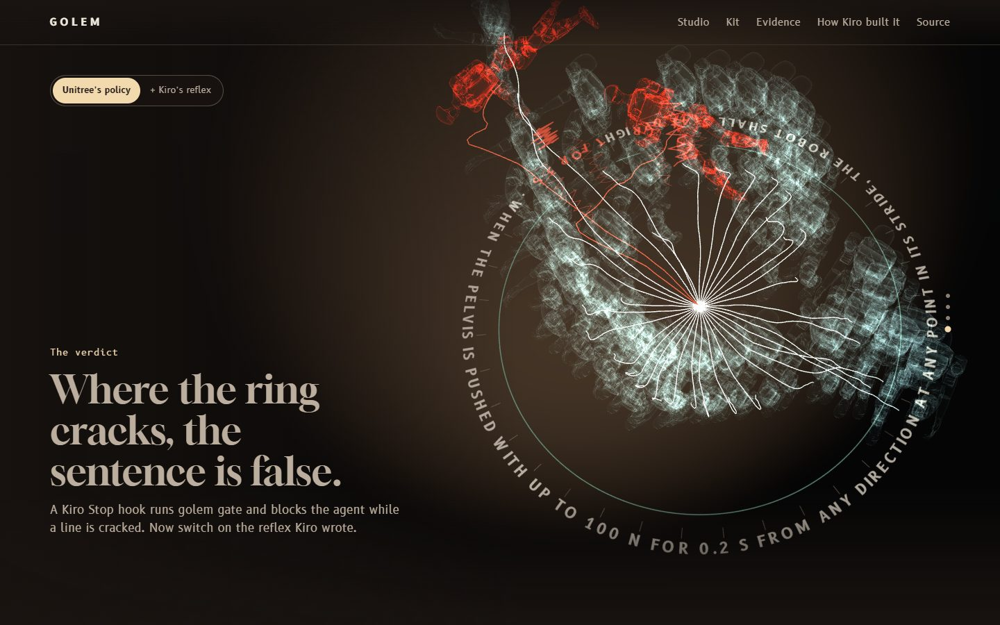
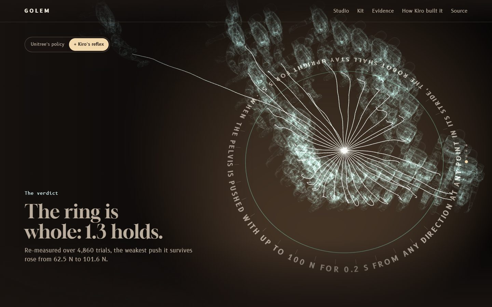
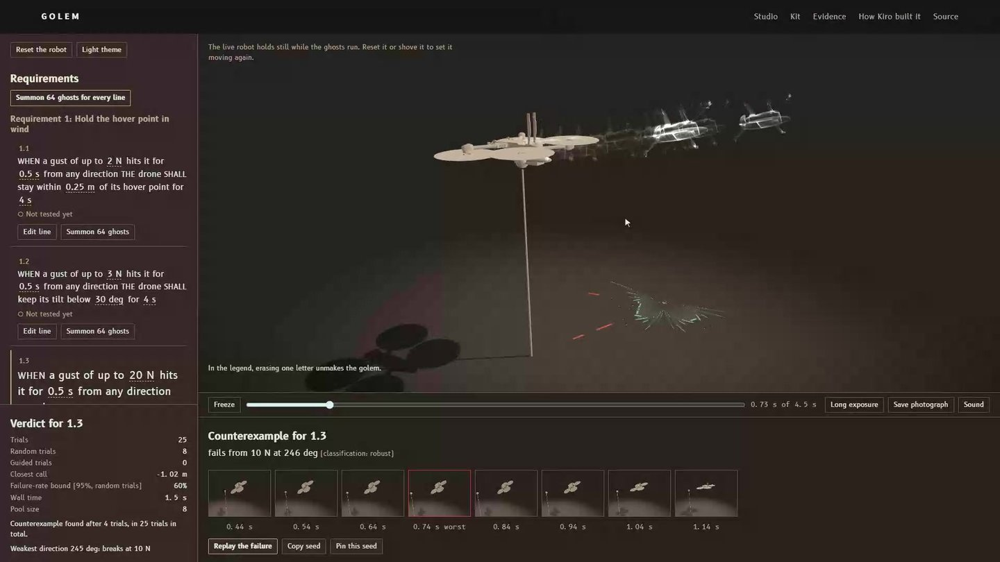
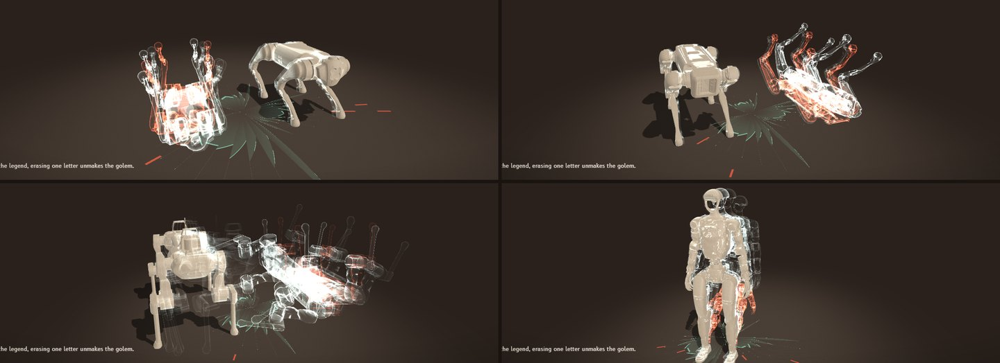
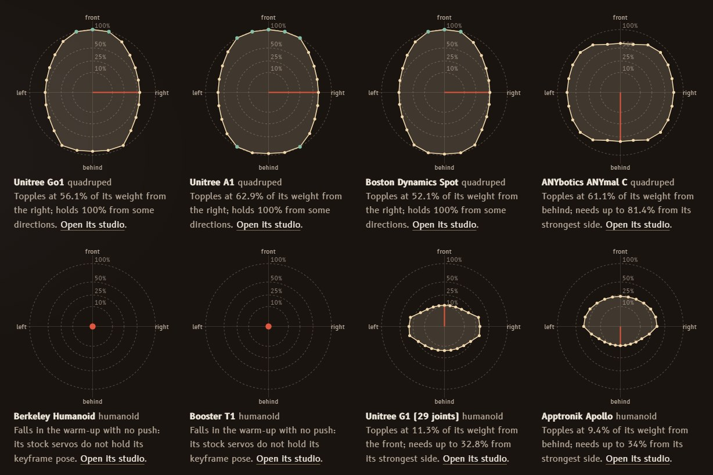

<p align="center"></p>

<p align="center">
<a href="https://www.npmjs.com/package/golem-spec"></a>
<a href="LICENSE"></a>
<a href="https://github.com/RohanGlitched/golem/actions/workflows/golem.yml"></a>


</p>

<p align="center"><b><a href="https://d23v187fnxad7l.cloudfront.net">Live site</a></b> · <b><a href="https://youtu.be/Flj1OCWEaYs">Demo video (2:28)</a></b> · <b><a href="https://d23v187fnxad7l.cloudfront.net/stagger/">Shove the G1 in your browser</a></b> · <b><a href="https://www.npmjs.com/package/golem-spec">npm package</a></b> · <b><a href="https://d23v187fnxad7l.cloudfront.net/evidence/">Evidence</a></b> · <b><a href="https://d23v187fnxad7l.cloudfront.net/how-kiro/">How Kiro built it</a></b></p>

# GOLEM

**Kiro writes your robot's requirements as plain sentences. GOLEM turns every sentence into a physics test, tries hard to break the robot, and blocks Kiro's agent from finishing while any sentence is false.**

> In the legend, a golem is clay brought to life by a written word. Here the words are a Kiro spec's EARS acceptance criteria. The clay is a robot in MuJoCo, running in Node or in your browser.

**Try it, no install:** open the [live site](https://d23v187fnxad7l.cloudfront.net) and scroll. The circle inscribes requirement 1.3 and replays 36 real recorded trials of a Unitree G1 shoved at 100 N, one from every 10°, each at that direction's hardest case in the stability map; where it falls, the floor cracks through the sentence. A switch replays the same shoves with the reflex Kiro wrote. Then [open the studio](https://d23v187fnxad7l.cloudfront.net/stagger/):

1. **Shove the robot.** Drag the Unitree G1 with your mouse or finger.
2. **Summon the ghosts.** 64 translucent copies are pushed at once, in your browser's worker threads. The ones that fall turn red.
3. **Read the verdict.** Each requirement either holds, with its margin in metres, or breaks with the mildest failing push it found, which you can replay.

---

## What it does

```
WHEN the pelvis is pushed with up to 100 N for 0.2 s from any direction
at any point in its stride, THE robot SHALL stay upright for 3 s
```

1. **Compile.** GOLEM reads EARS lines straight from `.kiro/specs/*/requirements.md`, the file Kiro writes. Each line becomes:
   - a *scenario space*: force 0–100 N, angle 0–360°, gait phase 0–1;
   - a *monitor* with quantitative semantics: a signed margin in physical units. It prints the compiled formula too: `G[t₀, t₀+3 s] margin("stay upright") > 0 m`.
2. **Falsify.** It re-runs pinned seeds first, then random Latin-hypercube trials, then a cross-entropy search toward the lowest margin. It **shrinks** each failure to the mildest push that still breaks the line, then re-checks it on fresh seeds and at half the timestep, so a solver artefact isn't reported as a robot failure.
3. **Gate.** Kiro hooks run `golem check` when a requirements file is saved, and `golem test` when a controller is saved. A **Stop hook runs `golem gate`**, so the agent can't finish while a requirement is red. A green is confirmed: the gate searches every `Expected_Hold` line a second time with a second search seed derived from the first, so a green needs two different searches to agree. Re-gated this way, 3 of the 4 controllers that falsely claimed success in experiment 3b come out red; one still passes, so a second seed lowers the odds of a lucky green without removing them ([re-check](evidence/results/agent-gate-hard/confirm-check.md)). A guard stops the tuning agent editing the requirement instead of the robot.

The engine is MuJoCo 4 compiled to WebAssembly, the same build in Node and the browser. Every trial is reproducible from its scenario and seed.

## Kiro made the robot stronger, and GOLEM measured it

Requirement 1.3 says the G1 survives a 100 N push from any direction. On Unitree's published policy alone it does not. GOLEM handed the counterexample to `golem-tuner`, a Kiro agent told to change only the controller's reflex file (its write permission covers `controller/`; a guard blocks edits to requirements), which wrote a lateral step-into-the-push reflex under the Stop gate. The full stability map (36 directions × 5 stride phases × 3 seeds, 4,860 trials) was then run again with the reflex on:

| | Unitree's policy | With Kiro's reflex |
|---|---:|---:|
| Weakest push survived | 62.5 N (pushed from the left, 80°) | **101.6 N** (90°) |
| Directions that hold 100 N | 34 of 36 | **36 of 36** |
| Mean of the weakest push per direction | 174.6 N | 185.4 N |
| Largest loss in any one direction | | −23.4 N at 340° (the front, slightly right): the reflex trades a little headroom there for the sides |

The agent's session log is in [`evidence/results/tuner/`](evidence/results/tuner); the two maps are in [`evidence/results/`](evidence/results). The reflex ships as a switch (`GOLEM_REFLEX=kiro`); the default stays Unitree's policy exactly.

## The kit: one command into any Kiro project

```bash
npm i -D golem-spec
npx golem-spec init        # installs hooks, agents, MCP, skills, steering and a workflow into .kiro/
npx golem-spec test        # falsify every requirement
npx golem-spec gate        # exit 0 only if everything holds, under two search seeds
```

Use `npx golem-spec`, not `npx golem`: a bare `npx golem` resolves to an unrelated npm package.

| What lands in `.kiro/` | What it does |
|---|---|
| `hooks/golem.json` | check on save, falsify on controller save, the Stop gate, test after each spec task, and a manual "Summon the ghosts" |
| `agents/golem-tuner.json` | may edit only controller files; can't touch requirements (its own preToolUse guard); stops only through the gate |
| `agents/golem-skeptic.json` | read-only; proposes harsher believable requirements in `proposals.md` |
| `agents/golem-scribe.json` | turns plain words into EARS lines that compile |
| `settings/mcp.json` | the GOLEM MCP server, 8 tools: list_requirements, check_requirement, run_requirement, falsify, get_counterexample, replay, explain_margin, propose_requirement |
| `skills/`, `steering/`, `workflows/` | how to write robot EARS; a falsify-and-fix loop that repeats until the gate is green |

The same pack ships as a **Kiro Power** (`skeleton/power`) and a **Kiro Crew app**, GOLEM Night Watch, in its own repository: [RohanGlitched/golem-night-watch](https://github.com/RohanGlitched/golem-night-watch) (source of truth: `skeleton/crew-app`).

## Three robots, one skeleton (Skeleton Crew)

Three different jobs for three different users: push recovery for a humanoid, keeping a cobot arm clear of a child's hand, and wind tolerance for a drone. Each app is a MuJoCo model, a TypeScript controller and a small lexicon of what its requirement lines can say; the skeleton does the rest.

| App | Robot | What GOLEM found |
|---|---|---|
| [`apps/stagger`](apps/stagger) | Unitree G1 humanoid running Unitree's published walking policy (after 2 s its pelvis is within 2.5 µm of Unitree's own Python reference run, which is stored to 10 µm: [`parity.test.ts`](apps/stagger/test/parity.test.ts)) | It survives **62.5 N** and falls at 64.1 N pushed from its left at 20% of its stride, yet holds **240.6 N** from the front right: 4,860 trials, all in `evidence/`. With Kiro's reflex the weakest direction rises to **101.6 N**. |
| [`apps/candy`](apps/candy) | Franka Panda with a suction cup, sorting Halloween candy while trick-or-treaters reach in | At a hand speed of 0.8 m/s, 57 of 228 trials break "keep every link at least 0.10 m from the hand". Its speed-and-separation controller slows and stops the arm by the cup's distance to the hand, and stops too late for the **wrist**: link 7 is the closest link in 48 of the breaks, while the cup is still about 0.14 m away in most of them. |
| [`apps/hover`](apps/hover) | Skydio X2 quadrotor holding a hover point 1.0 m above the floor under wind gusts, a sagging battery and a lagging position estimate (a cascaded PD controller; the third app, built on the same skeleton with a lexicon, a controller and the model file) | Line 1.3 asks it to stay within 1.0 m in a gust of up to 20 N, and it breaks from **9.98 N** (the smallest gust that broke it over three search seeds of 64 trials, from any direction). Line 1.1, a gust of up to 2 N within 0.25 m, holds with at least 0.0966 m to spare. A position estimate that lags by 0.275 s breaks line 3.2 (0.30 s asked) while 0.10 s holds (line 3.1). The numbers are read from the real CLI output in [`apps/hover/docs/cli-transcript.md`](apps/hover/docs/cli-transcript.md). |

## The yard: one spec, eight more robots

The three apps above each have their own controller. [`apps/yard`](apps/yard) asks a different question: how far does one requirements file go without writing robot code? It stands eight MuJoCo Menagerie robots in their keyframe poses on their own position servos at stock gains (no balance controller, so it measures the stance that comes in the box, not the robot), and runs the same five EARS lines on each. The pushes are written as a share of the robot's weight, so one sentence asks the same of a 12 kg dog and an 80 kg humanoid:

```
WHEN the base is pushed with up to 25% of its weight for 0.2 s from any direction THE robot SHALL stay upright for 3 s
```

| Robot | 10% | 25% | 50% | 100% | Weakest push that topples it |
|---|---|---|---|---|---|
| Unitree Go1 | held | held | held | broken | 56.1% of its weight, from the right |
| Unitree A1 | held | held | held | broken | 62.9%, from the right |
| Boston Dynamics Spot | held | held | held | broken | 52.1%, from the right |
| ANYbotics ANYmal C | held | held | held | broken | 61.1%, from behind |
| Unitree G1 (29 joints) | held | broken | broken | broken | 11.3%, from the front |
| Apptronik Apollo | broken | broken | broken | broken | 9.4%, from behind |
| Berkeley Humanoid, Booster T1 | broken | broken | broken | broken | fall over before any push |

Verdicts from `golem test --budget 128 --search-seed 1` per robot; the weakest push from a 24-direction bisection with GOLEM's trial runner (a "stance rose" per robot on the [yard page](https://d23v187fnxad7l.cloudfront.net/yard/)). An independent script with MuJoCo 3.3.7's Python bindings, sharing only the scene files, finds the same breaking pushes within 2.2% of the weight at the front, left, back and right of every robot ([`crosscheck.txt`](apps/yard/crosscheck.txt)). It also shows that a falsifier is not a boundary map: for ANYmal C the search broke the 100% line at 72.5% from the side, while 61.1% from behind already topples it.

The eighth robot was added by a Kiro CLI session told only the page's "Add a robot" steps, and asked to report honestly whether they were enough. They were not: the Apollo meets the floor only through contact pairs in its upstream scene, which the yard's scene left out, so it first fell through the floor. The agent found it, fixed the scene generator, made the tests catch it, and wrote everything down in [`apps/yard/ADDING-A-ROBOT.md`](apps/yard/ADDING-A-ROBOT.md) (38 minutes, 24 credits). Each yard robot also has a live studio at `/yard/<id>/`.

## Prior art, and what GOLEM adds

Falsifying cyber-physical systems against temporal logic is an established field, and property-based testing gave us shrinking. GOLEM adds no new search algorithm. What is new is the loop: the requirement is the sentence an AI agent wrote in its own Kiro spec, the test runs in the browser or in CI with no MATLAB, and the result gates the agent.

| Work | What it does | How GOLEM differs |
|---|---|---|
| EARS-CTRL (Lúcio et al., 2017) | EARS requirements checked for realisability, a controller synthesised and simulated in Simulink | The closest on the requirements side. GOLEM does not synthesise; it searches for the scenario that breaks an existing controller, and gates the agent on the result. |
| FRET with CoCoSim, Simulink Requirements Table | Monitors and test cases generated from structured requirements, in MATLAB toolchains | GOLEM does requirements-based testing for MuJoCo in Node, the browser and CI, and searches for the worst case instead of running fixed cases. |
| NASA FRET | No physics search of its own; exports to analysis tools | GOLEM reads the EARS lines an AI agent already writes in a Kiro spec, and searches a physics simulation for the scenario that breaks them. |
| S-TaLiRo, Breach | Robustness-guided falsification of Simulink models in MATLAB | Same idea of robustness-guided falsification; GOLEM runs it on MuJoCo in Node and the browser, with no MATLAB, and adds shrinking and pinned regression seeds. |
| RTAMT | Online and offline monitoring (Python, C++) | A monitor library only; GOLEM compiles its monitors from sentences and drives the search and the gate. |
| VerifAI with Scenic | Falsification with samplers, including cross-entropy, for autonomous vehicles | The nearest ancestor. GOLEM starts from requirement sentences instead of a scenario program, and gates an AI coding agent on the result. |
| nl2spec, NL2TL | Translation only | GOLEM parses a fixed EARS dialect deterministically: no language model decides what a line means or whether it held. |
| Eureka and other LLM plus simulation loops | A language model writes reward or controller code and keeps what scores best in simulation | There the model judges itself by a score it optimises. In GOLEM a fixed monitor decides, and the agent cannot finish while a line misses its expectation. |
| Property-based testing (Hypothesis, fast-check) | Random generation and shrinking | GOLEM borrows shrinking and seed pinning, and applies them to physics trials stated in a spec. |
| Runtime action gates for robots | Blocks unsafe robot actions while running | Those gate the robot. GOLEM gates the coding agent's claim that the work is done, before anything ships. |

## Screens

| | |
|---|---|
|  |  |
| **Unitree's policy.** Requirement 1.3 on the floor, 36 recorded shoves at 100 N. Pushed from its left (80° and 90°) the G1 falls and the floor cracks. | **+ Kiro's reflex.** The same shoves and seeds with the reflex Kiro's `golem-tuner` wrote. All 36 hold; the ring is whole. |
|  |  |
| **The studio.** Real MuJoCo in the browser: drag to shove, or summon 64 ghosts on a line and read the verdict. | **Before and after,** from the full 4,860-trial stability map: weakest push 62.5 → 101.6 N. |
|  | 
| **Candy.** A Franka Panda sorting Halloween candy while a hand reaches in; GOLEM found the wrist too close to it. | **Hover.** A Skydio X2 holding its point in the wind. Line 1.3 asks for 20 N; GOLEM shrinks the gust that blows it out to about 10 N. |
|  |  |
| **The yard.** One requirements file on eight Menagerie robots, each in its own studio: summon ghosts on the 100% line and watch them fall. | **Stance roses.** Where a rose dips inside a ring, that line breaks from that side. |

## Evidence

Every number here comes from committed raw data in [`evidence/`](evidence), using pre-registered methods ([`PREREG.md`](evidence/PREREG.md)). See [`REPORT.md`](evidence/REPORT.md) for what held, what didn't, and what went wrong.

## How Kiro built GOLEM

Kiro CLI did the building: 16 specs, among them 4 bugfix specs written from audits in [`docs/reviews/`](docs/reviews) and the three robots' own requirement files, which GOLEM tests (a 17th, golem-cloud, is written and not started). Together they hold 217 requirements, 2,157 EARS acceptance criteria and 273 correctness properties; 728 of 736 tasks are done, and the tests make 543 property-test assertions in 415 files (counted by `scripts/kiro-stats.mjs`, with pack copies installed into the apps counted once). The root [`.kiro/`](.kiro) holds the steering, specs, hooks, agents and MCP config used to build it. The full account is on the site's [How Kiro built it](https://d23v187fnxad7l.cloudfront.net/how-kiro/) page, and the raw logs of the 52 headless Kiro runs we kept (45 sessions) are in [`evidence/kiro-sessions/`](evidence/kiro-sessions).

## Run it locally

```bash
npm ci
npm run dev -w apps/stagger    # the G1 studio
npm run dev -w apps/candy      # the candy studio
npm run dev -w apps/hover      # the hover studio
npm test                       # every workspace
```

## Words used here

| Word | Meaning |
|---|---|
| EARS | Easy Approach to Requirements Syntax: "WHEN <trigger> THE <system> SHALL <response>". Kiro writes acceptance criteria this way. |
| Margin | How far a trial stayed from breaking a line, in the line's own unit (m, deg). Positive held, negative broke. |
| Counterexample | A scenario (force, direction, stride phase, seed) that breaks a line, shrunk to the mildest one that still does. |
| Expected_Hold, Expected_Break | The row of a spec's Expectation table that says whether a line should hold or is written to break. The gate checks both. |
| Pinned seed | A counterexample saved in `.golem/seeds`, re-run first every time so a fixed bug stays fixed. |
| Lexicon | The phrases an app's requirement lines can use, each mapped to a perturbation or a measurement. |

## Licences and credits

GOLEM is Apache-2.0. The Unitree G1 model and walking policy are © Unitree Robotics, under BSD-3-Clause (`apps/stagger/robot/LICENSE`). The Franka Emika Panda model comes from MuJoCo Menagerie, Apache-2.0 (`apps/candy/robot/LICENSE`). The Skydio X2 model comes from MuJoCo Menagerie too, Apache-2.0 (`apps/hover/robot/LICENSE`; the commit and file hashes are in `apps/hover/robot/SOURCE.json`). MuJoCo is Apache-2.0. The B612 and Gloock typefaces are SIL OFL 1.1.
